# 中国平安 A（601318.SH）· 唐朝估值法（保险股适配版）

> 数据日期：2026-10-30 收盘（A 股）／2026 三季报
> 现价 **52.80 元**｜市值 9,561 亿｜股本 181.08 亿股
> 脚本：`分析脚本/平安唐朝法20261101.py`（唯一权威，完全独立，不引用任何历史版本）
> 配对报告：`中国平安A-20261101-四步法.md`

---

## 〇、三道前置闸（原样输出，不可省略）

```
【precheck · inputs】决策输入清单：缺失必须显式 UNKNOWN，禁止默认值静默生效
  ✓ 可投资总资金基数               = 1000.0
  ✓ 本标的持仓市值                = 0.0
  ✓ 持仓成本价                  = 0.0
  ✓ 现价                     = 52.8
  ✓ 可动用现金                  = 600.0
  ✓ 报表币->交易币汇率             = 1.0

  仓位 = 0.0 / 1000.0 = 0.00%

  结果：PASS
```

```
【precheck · fx】跨币种扰动自检（终值必须与股息同币种）
     FXR      A 法价     B 法价      IRR
   1.000      53.00      53.00  12.0500%
  IRR 极差 0.000000%
  ✓ IRR 对 FXR 恒定（汇率只换展示，不改回报）

  结果：PASS —— 反向自查：把 FXR 改 0.5 重跑，两个价格同向变、IRR 一格不动
```
> 平安为纯 A 股标的，无跨币种敞口，FXR 恒为 1。此闸保留是为了留痕，不是形式主义——同一套脚本将来跑港股 02318 时必须换 0.90 左右再验一次。

```
【precheck · class】分类必须数出来，不得判出来
  核心六维：维度2 过 | 维度3 过 | 维度5 存疑 | 维度6 过 | 维度7 存疑 | 维度8 过
  → 核心存疑 2 个，核心不通过 0 个，否决项 无
  → 护城河 过，财务 存疑

  **机械分类 = B 类**（存疑 2<=2，但有条件不满足 A（护城河或财务非明确通过））
  ✓ 报告所述分类 B 类与机械分类一致

  结果：PASS —— 可以把这段输出原样贴进报告
```

---

## 〇·补 先写我的先验倾向，再做反向扰动

**我的先验：偏空。** 理由三条，且都是真的：① 保险公司的利润可以被三种口径（净利润／营运利润／综合收益）分别讲述，读者永远能挑到好看的那个；② 负债久期十几二十年，估值几乎全靠假设；③ 我此前从没给平安做过独立估值，对它的印象来自「0.6 倍 PEV 很便宜」这种二手结论。

**反向扰动（我自己最可能错在哪）**：如果我因为「不喜欢这个生意的记账方式」而低估了它，我会看到什么？—— PB 0.915、股息率 5.11%、净资产还在涨、资管分部由亏转盈、产险 COR 95.6% 优于同业。**这四条合起来，是一个「被市场当成不会再增长」的价格。** 如果 2027 年 NBV 转正，PEV 从 0.61 修到 1.0，现价 IRR 就是 14.09% 而不是 12.05%。

**所以本报告不用「暴雷／错杀」这类词做结论。** 结论是：现价约等于「12% 回报 + 十年后 0.8 倍 PEV 退出」这一个假设组合，贵贱取决于这个组合成不成立，不取决于三季报那 −27%。

---

## 一、方法与口径声明（必须先说，否则后面全是误读）

**本报告不用 FCF 永续。** 唐朝法原式对消费/制造股是「三年后合理 PE × 利润」，对保险股直接套会犯两个错：

1. **保险的「经营现金流」不是股东可支配现金。** 保费收入是负债的流入，2026 前三季经营现金流为正而净利润 −27.3%，两者都不是「自由」的。
2. **FCF 永续会把 CSM 的释放节奏抹平。** 平安寿险有 7,251 亿合同服务边际已锁定，未来按 8.6%/年释放为利润。这是一条**已签合同的时间表**，不是永续年金假设。用永续去折它，等于把这个真实存在的护城河抹掉。

所以走 **EV-PEV 口径**，即唐朝法「三年后合理市值」的保险版——把「合理 PE」换成「合理 PEV」：

```
P(r) = Σ 股息现值 + (EV_2026 × (1+g_EV)^10 × 退出PEV) / (1+r)^10 / 股本
```

参数：

| 项 | 值 | 性质 |
|---|---|---|
| 集团内含价值 EV（2026-06-30） | 15,678.00 亿 | 事实（公司披露 1,567,800 百万） |
| 每股 EV | 86.58 元 | 事实（与披露一致） |
| 归母净资产（2026-09-30） | 10,443.66 亿 | 事实 |
| 每股净资产 BPS | 57.67 元 | 事实（与披露一致） |
| 合同服务边际 CSM（2025-12-31） | 7,251.19 亿 | 事实 |
| CSM 年释放率 | 8.6% | 事实（2025 实际） |
| DPS（2025） | 2.70 元 | 事实 |
| EV 增速 g_EV | 4.5% | 假设（2025 +4.2%、2026H1 +4.2%） |
| 股息增速 g_DIV | 4.0% | 假设（DPS 2023 2.43 → 2025 2.70，CAGR 5.4%） |
| 持有年限 | 10 年 | 假设 |

---

## 二、先看三个位置：现价到底在哪

```
每股内含价值 EV      86.58 元 = 每股净资产 57.67 + 每股有效业务价值 28.91
PEV = 52.80 / 86.58 = 0.610×
PB  = 52.80 / 57.67 = 0.915×
股息率 = 2.70 / 52.80 = 5.11%
```

**第一件事：现价低于每股净资产。** 市场不仅没给「有效业务价值 28.91 元」一分钱，还在净资产上打了 8.5% 的折。

这句话要读两遍，因为它同时是**最强的看多理由**和**最强的看空理由**：
- 看多：净资产是实的，2026 前三季还 +4.4%，PB 0.915 有硬底
- 看空：净资产是「调整后」的，如果 EV 假设被下调，净资产本身也会被下调（公司披露：投资收益率 −50bp → 集团 EV −9.6%）

---

## 三、EV 的成色：唯一命门是投资收益率假设

平安的 EV 按**长期投资收益率假设 4.0%** 计量（2023 年由 5.0% → 4.5%，后降至 4.0%）。

实际是多少：

| 口径 | 2026 前三季 | 2026 上半年 | 近 10 年均值 |
|---|---:|---:|---:|
| 净投资收益率（非年化） | 2.5%（年化约 3.3%） | 1.4%（年化约 2.8%） | 4.8% |
| 综合投资收益率（非年化） | 2.3% | — | 4.9% |

**近 10 年均值 4.8% > 假设 4.0%，所以假设在过去是保守的。** 但 2026 年的实际只有 3.3%，缺口 70bp。

用公司自己披露的敏感性（每 −50bp）：

| 假设投资收益率 | 集团 EV（亿） | 每股 EV | 现价对应的 PEV |
|---|---:|---:|---:|
| 4.0%（基准） | 15,678 | 86.58 | **0.610×** |
| 3.5% | 14,173 | 78.27 | 0.675× |
| 3.0% | 12,668 | 69.96 | 0.755× |
| 2.5% | 11,163 | 61.65 | 0.857× |

**★ 按实际 3.3% 线性外推（−70bp），每股 EV≈74.94 元，对应的 PEV 不是 0.610× 而是 0.705×。**

这一条把「0.6 倍 PEV = 深度低估」这个叙事拆掉了。市场给的折价，有一半是**对利率下行的合理定价**，不是错杀。中国 10 年国债已在 2% 附近，新增资产 2.x%，存量 3.5% 的老资产在陆续到期——这是**再投资风险**，不是情绪。

---

## 四、Q3 的 −54% 到底是基数还是能力

三季报最刺眼的不是净利润 −27.3%，是 NBV。

| 期间 | NBV | 同比 |
|---|---:|---:|
| 2026 上半年 | 248.47 亿 | **+11.2%** |
| 2026 前三季 | 309.87 亿 | **−13.3%** |
| → 倒推 Q3 单季 | **61.40 亿** | **−54.2%** |
| 2025Q3 单季（对照） | 134.05 亿 | — |

首年保费：Q3 单季 **−51.9%**（270.39 亿 vs 561.91 亿），前三季累计 **−9.1%**。

**性质判定**：
- 半年报 +11.2%，三季报 −13.3%，**24.5 个百分点的落差全部集中在 Q3 一个季度**。这不是趋势，是断点。
- 2025Q3 首年保费 561.91 亿，是预定利率下调前的抢购潮——去年一个季度的首年保费，等于今年两个季度。**高基数解释成立度较高。**
- **但前三季累计首年保费仍 −9.1%，量确实在缩。** 基数只能解释 Q3，解释不了九个月。

**这是本报告最需要监控、也最不能自欺的一格。** 唯一能分辨的窗口是 2027 年开门红：转正 = 基数问题（一次性）；继续负 = 渠道能力问题（趋势性）。在答案出来之前，我给中性情景 45% 权重，不给更乐观的。

---

## 五、四档 PEV 价格

退出 PEV 是唯一需要判断的变量。四档都算出来，让读者自己看：

| 退出 PEV | 含义 | 13% 线 | 15% 线 | 17.46% 线 | **现价 IRR** |
|---:|---|---:|---:|---:|---:|
| 0.6 | 市场当前给的 | 41.36 | 36.13 | 30.82 | **9.58%** |
| **0.8** | **低利率新常态** | **49.28** | **42.78** | **36.20** | **12.05%** |
| 1.0 | 公司假设能兑现 | 57.20 | 49.42 | 41.58 | 14.09% |
| 1.2 | ⚠️ 超出历史区间，仅作上界 | 65.13 | 56.07 | 46.96 | 15.82% |

> **历史区间校准（技能 4.7）**：平安 2016 年以来 P/EV 区间 **0.45–0.95**。所以 1.2 倍**从未出现过**，它只是数学上界，不构成一个可信情景；反过来 0.45 是真实到过的位置，对应股价 38.96（−26.2%）。**现价 0.610 在历史区间中下部，不是极端值。** 这一条比四档本身更重要——它说明"便宜"的空间真实存在但不是白给的。

**同一终值验伪**（技能禁则 38）：`price×(1+r)^n − 股息复利终值 ≡ 同一终值`，四档 × 四档折现率共 16 组，全部残差 < 0.01 元，PASS（见脚本【五】节逐行输出）。

**现价隐含的退出 PEV = 0.795×。** 换句话说：

> **现价 52.80 = 「12% 年化回报 + 十年后按 0.80 倍内含价值卖出」这两条同时成立。**

问句因此变了。不是「平安便宜不便宜」，是 **「2036 年的平安还值不值 0.8 倍内含价值」**。这个问题的答案不在这份财报里。

三情景（权重是我给的，不是市场共识）：

| 情景 | g_EV | 退出 PEV | 现价 10 年 IRR | 权重 |
|---|---:|---:|---:|---:|
| 低利率固化 | 3.5% | 0.60 | 8.79% | 35% |
| 中性 | 4.5% | 0.80 | 12.05% | 45% |
| 利率企稳 + NBV 修复 | 5.5% | 1.10 | 15.90% | 20% |

**概率加权 = 11.68%。跨度 8.79%–15.90%。**



图读法：横轴是你要求的年化回报，纵轴是今天该付的价格（固定退出 PEV 0.8×）。**现价 52.80 那条虚线正好压在曲线 12.05% 的位置上**——这就是「现价 = 12% 回报」的图形版。13% 线在 49.28，比现价低 6.7%。

> ⚠️ 图只画了「退出 PEV 0.8×」这一条曲线。换 0.6 或 1.0，整条曲线上下平移，但**斜率不变**——斜率由久期决定，不由倍数决定。这也是为什么「现价在 12% 线上」这个事实比「便宜 27%」这个说法可靠。

---

## 六、压力测试：永久损失在哪

| 情景 | 集团 EV（亿） | 每股 EV | PEV@现价 | 12% 线 |
|---|---:|---:|---:|---:|
| 基准 | 15,678 | 86.58 | 0.610 | 52.80 |
| 投资收益率 −50bp | 14,173 | 78.27 | 0.675 | 49.49 |
| 投资收益率 −100bp | 12,668 | 69.96 | 0.755 | 46.19 |
| 投资收益率 −150bp | 11,163 | 61.65 | 0.857 | 42.88 |
| 权益公允价值 −10% | 14,941 | 82.51 | 0.640 | 51.18 |
| 组合：−100bp 且权益 −20% | 11,194 | 61.82 | 0.854 | 42.95 |

**下行保护**：现价已低于每股净资产 57.67（PB 0.915）。净资产要再跌 8.5% 才碰到现价，而 2026 前三季净资产仍 +4.4%。

**这是本标的最实在的一条**：在最坏的利率情景下，12% 线降到 42.95，现价高 22.9%——**会浮亏，但不是永久损失**，因为保费还在收、CSM 还在释放、分红还在发。保险股的永久损失风险不来自「股价跌」，来自「负债成本长期高于资产收益」，那是十年尺度的慢性病，不是一年尺度的急症。

---

## 七、四道闸门（保险版，替换通用四闸）

通用四闸里「低资本投入」对保险公司不成立——保险是资本消耗型，不能用 capex/净利 判。替换为保险的等价约束：

| 闸门 | 判定 | 依据 |
|---|---|---|
| 1 利润真实性 | ✅ 过 | OPAT 1,259.05 亿（+8.3%）来自 CSM 释放（7,251 × 8.6% ≈ 624 亿），不依赖投资收益假设 |
| 2 资本充足 | ✅ 过 | 集团综合偿付能力 198.1%（2026H1），寿险 165.6% |
| 3 资本投入 | ⚠️ 替换 | 不适用 capex 判据；等价约束 = EV 对投资收益率敏感性 −9.6%/50bp |
| 4 增长可持续 | ⚠️ 存疑 | NBV 前三季 −13.3%、Q3 单季 −54.2%；代理人 32.3 万（较年初 −8%） |

---

## 八、结论

**中国平安属于 B 类。它是一家有条件的好公司。**

- **最强证据**：CSM 7,251 亿锁定的存量利润（每年释放约 624 亿进 OPAT）+ 产险 COR 95.6% 优于同业 + 13 个月保单继续率 97.4% + 净资产仍在增长。
- **最大缺陷**：寿险 NBV 在头部垫底（国寿 +13.1%、新华正增、太保 −6.5%、平安 −13.3%），且 EV 按 4.0% 投资收益率计量而实际只有 3.3%。
- **三项验证指标**：① 2027 开门红 NBV 能否转正；② 净投资收益率能否守住 2.5%（年化 3.3%）；③ 代理人 32.3 万能否止跌。

**价格结论（主句）：现价 52.80 的 10 年预期回报 11.68%（概率加权），过了 10% 的机会成本线、没过 13% 的买入线。**

这不是「暴雷后的错杀」，是「低利率把 EV 的成色打折之后，市场算对了」。

**建仓三档**（统一按 PEV 0.8× 退出，因为 0.8 是现价已经在用的假设）：

| 要求回报 | 价格 | 动作 |
|---:|---:|---|
| 13% | **49.28 元** | 建 1/3（现价需再跌 6.7%） |
| 15% | 42.78 元 | 加 1/3 |
| 17.46% | 36.20 元 | 加满 |

**仓位（1,000 万基数，独立分析）**：B 类目标 3%–5% = **30–50 万**；当前持仓 0 → 目标配置挂在那里，触发价不满足，**实际建仓 0**。

**⚠️ 硬上限必须从 8% 压到 5%（50 万）**：招行已占 38%，而平安 6.83 万亿投资组合的主体是债券与银行资产，两者挂在同一个「中国利率 + 资产质量」因子上。**加平安不是分散，是同一风险因子加倍。**

---

## 九、什么能推翻这个结论

我把最容易错的地方写在前面，而不是藏在末尾：

1. **如果长期投资收益率假设必须从 4.0% 降到 3.0%**：EV 降 19%，每股 EV 69.96，现价 PEV 变 0.755×，现价就不便宜了。这是**最可能发生**的推翻方式，概率我估 40%。
2. **如果 2027 开门红 NBV 转正且双位数增长**：PEV 可能修复到 1.0，现价 IRR 14.09%，且 12% 线升到 61.66——现价就变成买入价。概率我估 25%。
3. **如果代理人跌破 30 万且人均产能不再提升**：NBV 的下降就不是基数问题，B 类要降 C 类。这是**我被证伪最快**的方式，观察窗口在 2027 年 4 月前。

**注意第 2 条与第 1 条方向相反，且都来自「EV 假设」这一个开关。** 这意味着：**平安这笔投资的全部胜负，押在一个宏观变量（中国长期利率）上，而不是押在经营上。** 这是我给它 B 类而不是 A 类的真正原因——不是它不优秀，是它的优秀有一半不由自己决定。

---

## 十、与四步法的接口

完整对账见 `中国平安A-20261101-四步法.md` 第六节。这里只说三个结论：

**1. 两法共用 EV-PEV 框架，不构成独立验证。**

| 尺子 | 数值 | 它回答的问题 |
|---|---:|---|
| 唐朝法 12% 线（PEV 0.8） | 53.00 | 要求 12% 回报、十年后 0.8 倍退出，今天最多付多少 |
| 四步法 SOTP | 72.56 | 如果今天就按 0.8/0.9 倍重估，值多少 |
| 四步法 清算价值 | 74.18 | 不增长也不倒闭，值多少 |

唐朝法与 SOTP 的差 19.56 元，拆解为：非寿险倍数差 +3.30、十年时间价值 +34.63、十年股息补偿 −18.37，**残值 +0.01 元**。**差的主体是「现在兑现还是十年后兑现」，没有一个字来自「公司值多少」的判断差异。**

**2. 真正独立的第三把尺子是清算价值 74.18 元**（净资产 57.67 + 存量 CSM 税后现值 16.50，11% 折现，不给任何新业务）。它与 SOTP 的 72.56 只差 2.2%，互证「今天的内在价值约 73 元」。

**3. 现价 52.80 vs 内在价值 73 元，折价 27.6%——但这个折价要靠「十年后 PEV 回到 0.8」才能兑现，年化只有 12%。** 如果 PEV 永远停在 0.6，内在价值就是 0.6/0.8 × 73 = 54.8，现价只便宜 4%。

**「折价 27%」是一个假设的产物，不是事实。** 这句话是本次配对最有价值的产出。
