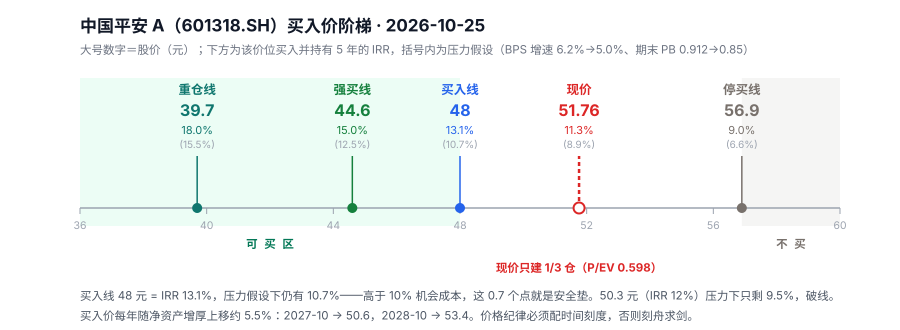

# 中国平安 A vs 中国移动 H：五年预期收益率对比

> 数据截止：2026-10-25。平安 51.76 元（601318.SH），移动 77.10 HKD（00941.HK）。
> 口径：买入并持有 5 年，年度股息不再投资，期末按估值倍数卖出。

---

## 〇、先回答：买入价 48 元

**中国平安 A 的可投资买入价：48 元。**（对应 P/EV 0.554、PB 0.846、5 年 IRR 13.1%；假设打八折后仍有 10.7%。）

**现价 51.76 元能买吗：能，但只买计划仓位的 1/3。** 现价 IRR 约 11.1%，过了 10% 的机会成本线，没过 13% 的买入线。它是"持有价"，不是"买入价"。

三档阶梯：**48 元建 1/3 → 44.6 元加 1/3 → 39.7 元加满**，上限 12%（受招行 38% 仓位约束）。**56.9 元以上停止买入**（IRR 跌破 9%）。

推导见第九节。这里先放结论，是因为你问的就是这个数。

---

## 一、结论

**如果只比预期收益率，中国平安 A 明显更高：中性对中性，11.12% vs 5.15%，差 5.97 个百分点；概率加权后 11.07% vs 5.42%，差 5.65 个百分点。**

差距不是边际的，是三档交错：

| | 悲观 | 中性 | 乐观 | **加权** |
|---|---|---|---|---|
| **平安 A** | 7.21% | **11.12%** | 15.59% | **11.07%** |
| **移动 H** | 2.36% | 5.15% | 9.58% | **5.42%** |

（加权按悲观 30% / 中性 45% / 乐观 25%，权重是我给的，不是市场共识，用来避免只挑一个情景说话。）

读这张表的三个方式：

1. **平安的中性（11.12%）高于移动的乐观（9.58%）**——移动最好的情形，还不如平安的基准情形。
2. **平安的悲观（7.21%）高于移动的中性（5.15%）**——平安最差的情形，仍好于移动的基准。
3. **位置交换需要极端价格**：平安涨到 65.9 元（+27%）才降到移动的水平；移动跌到 60.4 HKD（−22%）才追平平安。

但这个结论有一个前提必须先说清楚：**平安的 11% 里有 6.2 个点来自"假设"，移动的 5.4% 全部来自"已宣告的现金"。** 这是两个不同性质的数字，不能只看大小。

---

## 二、5.64 个点的差距从哪来

### 平安 A 的回报拆解（中性）

```
股息率          5.22%   ← A 股持股满 1 年免征红利税
BPS 增长        6.20%   ← 核心差异所在
PB 变动         0.00%   ← 中性假设：0.912 保持不变
──────────────────────
合计           11.42%   （IRR 11.12%，差异来自现金流时点）
```

### 移动 H 的回报拆解（中性）

```
税后股息率      5.47%   ← 名义 6.84%，港股通扣 20%
利润增长        0.00%
估值变动       -0.48%   ← 净现金打五折的残余折价逐年摊薄
──────────────────────
合计            5.15%
```

**关键发现：两者的股息率几乎一样（5.22% vs 5.47%，移动还略高）。全部差距来自第二行——一个有 6.2% 的本金增长，一个是零。**

### 为什么这 6.2% 是真金白银，不是账面游戏

| | 中国平安 | 中国移动 |
|---|---|---|
| ROE | 14.0%（2025） | 约 10%（含 2–3% 利息收入） |
| 派息率 | 35.2% | 75%+ |
| 留存比例 | 64.8% | 25% 以下 |
| 留存的钱能赚多少 | 14%（复投到寿险/银行/资管） | 2–3%（躺在账上吃利息） |
| **BPS 年增** | **近 6 年 7.0%，近 3 年 5.6%** | 净资产基本不增 |
| 股息 vs 自由现金流 | 股息 490 亿 < 净利 1,348 亿 | **股息 1,011 亿 > FCF 820 亿** |

最后一行是本质区别：

- **平安在增厚本金**：赚 100 元，分 35 元，留 65 元继续生息。
- **移动在消耗本金**：赚的钱全派出去还不够，还要动存量现金补 191 亿。

这就是"复利机器"和"高息债券"的区别。前者的收益率会随时间上升，后者的收益率是固定的。

---

## 三、但平安为什么便宜？市场不是在犯傻

P/EV 0.598、PB 0.912——这是 2016 年以来第 12% 分位。如果只是"便宜"，早该被买走了。折价有四个真实原因：

### 1. 4.0% 这条假设，是"可以随时撤回"的精算参数

口径先厘清：4.0% 对应**总投资收益率**（含买卖价差），不是净投资收益率，两者不能直接相减。

| 指标 | 2025 年 | 与 4.0% 比 |
|---|---|---|
| 净投资收益率（只算利息+股息） | **3.7%**（同比 −0.1pp） | 低 0.3pp |
| 总投资收益率（含价差） | 约 4.6% | 高 0.6pp |
| 综合投资收益率（含全部浮盈） | 6.3% | 高 2.3pp |
| 近 10 年平均净投资 | 4.8% | 高 0.8pp |

所以"3.7% 低于 4.0%"不等于"平安投资做砸了"。真正的问题是**结构变了**：4.0% 从"资产自然产出"退化成"资产自然产出 + 每年靠市场送的价差"。0.3pp 的缺口按 6.49 万亿投资资产算约 **195 亿/年**，一年能补（2025 综合 6.3%），一年补不上（2022 总投资仅 2.4%）。

这条线本身改过三次：

| 时间 | 变动 | 后果 |
|---|---|---|
| 2016 前 → 2016 | 5.5% → 5.0% | — |
| 2023 | 5.0% → 4.5% | EV 一次性 **−992 亿**，NBV −81.8 亿 |
| 2024 | 4.5% → 4.0% | 全行业五家同步 |

2025 年五家上市险企投资回报假设全是 4.00%（人保健康 3.5%），风险贴现率 8.0–8.5%。**同步移动的叫共识，不叫底线。** 机制是精算师协会的联动测试指引，公司在指引下自行裁量——2023 年平安的说法是"相对协会指引更为审慎"，反过来说明它可以贴着指引走。

**最关键的一点：这条线同时是分红计算的分子。** 2025 年中报原文——"剔除短期投资波动后，前述寿险及健康险业务的投资回报率锁定为 **4.0%**"。也就是说，营运利润（分红基础）和内含价值（估值分母）用的是同一条 4.0%。

所以市场给 0.6 倍 PEV，不只是在说"我不信你的 EV"，还在说"我不信你的分红增速能保持"。这两件事被 2026 年中报的一个数字印证了：净利 +36.1%、营运利润 +8.3%、**中期股息只 +3.2%**。

### 2. 2026 年上半年的 +36.1% 是假的

| | 数值 | 性质 |
|---|---|---|
| 归母净利 | 925.9 亿，+36.1% | 含大量投资浮盈 |
| **归母营运利润** | **842.0 亿，+8.3%** | 剔除短期投资波动 |
| **中期股息** | **0.98 元，+3.2%** | **管理层自己的判断** |

用 5.88 倍 PE 说"平安很便宜"，用的是 +36.1% 那个数。但管理层分红只肯加 3.2%——**他们没把投资浮盈当成可持续利润。**

按营运利润增速 8.3% 推，2026 年 EPS 约 8.32 元，真实 PE 是 6.22 倍，不是 5.88。

### 3. BPS 增长比理论值慢得多

理论上：ROE 14% × 留存 64.8% = 9.1%。
实际：近 3 年 5.6%，近 5 年 5.8%，近 6 年 7.0%。

差在哪？FVOCI 股票的浮盈浮亏直接进净资产，不进利润表。2024 年 BPS 只增 3.3%，2025 年增 8.4%——**波动极大，6.2% 的中性假设本身已经偏乐观。**

### 4. B 端压力没解除

- NBV 增速从 2025 全年 +29.3% 掉到 2026H1 +11.2%，Q2 单季 −1.8%
- 银保渠道占比升到 40%，新业务价值率下降 1.7pp
- 不动产敞口 3.1%（已大幅压降，收租型占 86.8%）——这条基本出清了

---

## 四、中国移动的真实位置：不是"差"，是"债券"

移动的 5.42% 不该被理解成"低回报"，该被理解成"债性回报 + 一个免费期权"。

### 债性部分：4 成市值是现金

| | 数值 | 占股价 |
|---|---|---|
| 每股净现金 | 30.8 HKD | **39.9%** |
| 经营 PE（扣现金后） | 12.87× | — |
| 名义 PE | 11.25× | — |

它的下行有底：即使利润年降 2%、现金只按五折算，5 年 IRR 仍有 2.36%，本金不会亏。这是"高息债券"的性质——**收益不高，但极难亏损。**

### 期权部分：5,681 亿净现金

这部分不在上面任何一个情景里。如果出现以下任一情形，移动的收益率会瞬间跳到 8–10%：

- 政策要求提高分红率（现在 75%，国资委鼓励央企提高）
- 特别派息（净现金足以支撑一次性派 2–3 元/股）
- 算力/云业务真的跑出第二增长曲线

**这是一个免费的看涨期权。** 不行权不亏钱，行权就是白赚。这也是为什么"跌到 60.4 HKD 就追平平安"这个数不是遥不可及。

---

## 五、组合层面：这才是真正的约束

你的第一大仓是招商银行，占 38%。

**买平安 = 在已经 38% 的金融敞口上再加金融。**

| 重复暴露 | 具体 |
|---|---|
| 共同驱动 | 长端利率、资产质量、政策让利 |
| 双重银行 | 平安持有平安银行约 49.6%，买平安 = 又买了一份银行 |
| 共同风险 | 利率下行 → 招行息差压缩 + 平安利差损，**同一个变量打两个仓位** |
| 相关性 | 高度同向（金融板块共同的利率与资产质量驱动），不是统计意义上的弱相关资产 |

**利率上行或要求让利时，两者会同时被打。那不是分散，是同一笔风险下两次注。**

如果真买平安，金融合计敞口建议不超过 45–50%——意味着平安的仓位上限约 7–12%，而不是"看好就重仓"。

反过来说，**移动在组合里的价值恰恰是它和金融不同源**：它更像一只永续债，在利率下行时受益（贴现率降）、在股市下跌时抗跌。它的作用不是提高收益，是降低组合波动。

---

## 六、判断

**二选一，选平安。** 但三个限定：

1. **只用 A 股，不用 H 股。** 平安 H 折价 19.5% 看起来更便宜，但港股通 20% 股息税刚好把它吃掉——H 股加权 11.03%，A 股 11.07%，**几乎完全相等**。既然一样，就没必要多承担一层汇率和税制复杂度（除非你的资金本来就在境外）。

2. **仓位受招行限制。** 7–12% 上限，不是"看好就重仓"。

3. **用营运利润跟踪，不用净利润。** 每季度看三个数：营运利润增速（现在 8.3%）、NBV 增速（现在 11.2%）、中期股息增速（现在 3.2%）。**如果股息增速连续两年低于 5%，说明管理层自己也不信这个增长，那时要重新算。**

4. **价格纪律：48 元是买入线，现价 51.76 只建计划仓位的 1/3。** 现价 IRR 11.3%，是"持有价"不是"买入价"。三档：48 → 44.6 → 39.7，仓位上限 12%，56.9 元以上停买。推导见第九节。

**如果目的是"收息替代债券"而不是"提高收益"，选移动。** 5.47% 税后股息 + 4 成市值现金托底，比大多数信用债安全。但要接受它五年不涨。

---

## 七、我会错在哪（五个证伪条件）

| 情形 | 影响 | 触发信号 |
|---|---|---|
| 长端利率跌到 1.2% 以下 | 平安 EV 假设被迫下调，PB 0.91 变"合理"，IRR 掉到 7% | 10 年国债收益率、平安下调 EV 投资收益率假设 |
| 平安 ROE 掉到 10% 以下 | BPS 增速降到 4%，中性 IRR 降到 9% | 季度营运 ROE、NBV 连续 4 季负增长 |
| 房地产/非标二次爆雷 | 净资产直接减记，PB 分母缩水 | 不动产不良率、资管业务减值 |
| **移动重启增长** | 算力/云跑出来，5.15% 跳到 9%+ | 移动云收入增速、资本开支转向算力 |
| **移动特别分红** | 5,681 亿现金一旦分出来，收益率跳升 | 国资委分红要求、公司公告 |

最后两条是移动的"隐形上限"——**它的 5.42% 里不包含任何好消息**，全是坏消息的定价。平安的 11.07% 里已经包含了一部分"PB 不继续下跌"的假设。

---

## 八、假设下调的传导，与当前价格的安全边际

### 8.1 下调 50bp 会影响什么

| 传导路径 | 影响幅度 | 是否影响现金 | 说明 |
|---|---|---|---|
| 集团 EV | **−9.6%**（投资回报单降） | 否 | 1.568 万亿 → 1.418 万亿，每股 86.58 → 78.27 |
| 寿险 EV | −15.5% | 否 | 集团被银行/财险/资管稀释 |
| NBV | −16.8% | 否 | 已从 2023 年的 −19.8% 改善，分红险新单占比超九成 |
| **营运利润（分红基础）** | 投资服务业绩按新假设重算 | **是（间接）** | 锁定的 4.0% 就是分红分子，压低即压低分红能力 |
| 偿付能力／自由现金 | 0 | 否 | 精算参数不改变当期资本 |

两点必须分开：**EV 下调是账面的一次性重估，营运利润下调是每年都发生的现金流折损。** 后者的破坏力大得多，而市场担心的正是后者。

一个反直觉的结论：**假设下调对股价未必是坏事。** 2024 年那次降 50bp，EV 当年仍正增长（NBV +3.9%、投资回报偏差 +2.6%、市场价值调整 +1.9% 对冲掉了假设调整）。逻辑是——一次性扣掉 1,500 亿，换来"剩下的数可信"，折价反而有收敛空间。要盯的是 **10 年期国债会不会破 1.5%**（破了 4.0% 一定守不住）和**分红险占比上升速度**（负债成本降得比资产快，利差反而扩）。

### 8.2 安全边际：七把尺子，39.7–86.6 元

现价 51.76 元（PB 0.912，P/EV 0.598，每股 EV 86.58 元）。

| 尺子 | 每股价值 | 现价位置 | 这把尺子假设了什么 |
|---|---|---|---|
| DDM，要求 10%（g=3%） | 39.7 | 高 30.3% | 只值分红，DPS 2.70 元、年增 3% |
| DDM，要求 9% | 46.4 | 高 11.7% | 同上，要求回报降到 9% |
| 5 年 IRR 反向，要求 12% | 49.9 | 高 3.6% | BPS 年增 6.2%、PB 0.912 不变 |
| **5 年 IRR 反向，要求 10%** | **54.2** | **低 4.5%** | 同上 |
| P/EV 修到 0.75 | 64.9 | 低 25.5% | EV 不变，折价修复到近 3 年中位 |
| EV 假设降到 2.5% | 76.2 | 低 32.1% | 三次下调后仍按 1 倍 EV 卖 |
| EV 当前假设 4.0% | 86.6 | 低 40.2% | 假设不变，折价完全修复 |

**三种答案，对应三个不同的问题：**

1. **"我能承受多少错误"** → **4.5%。** 中性 11.13%，对 10% 要求只多 4.5 个点；涨 4.7% 到 54.2 元边际归零。**一个假设错就掉到 10% 边缘**：BPS 增速 6.2%→5.0% 得 10.04%，PB 0.912→0.85 得 9.78%。**两个同时错**（g=4.0% + PB 0.85）→ 7.81%。
2. **"跌下去会不会亏"** → **不会。** 悲观情景（g=5.0%、PB 0.78）5 年仍有 7.21%；极端到 PB 0.70 还有 5.16%，PB 0.63（历史极值区）仍 3.32%。**下行保护来自 5.22% 股息 + 净资产增厚，不来自"便宜"。**
3. **"账面便宜多少"** → **40.2%。** 但它假设折价修复到 1 倍 EV，而平安近十年从未回到过 1 倍（2021 年高点约 0.95）。

**取哪个数做决策：4.5%，不是 40%。**

理由：40% 的折价市场已经给了很多年，而它的成因（4.0% 假设可不可信）恰好就是你在质疑的那件事。**把"折价"同时算成"便宜"和"我已经为风险付过价"，是重复计算。** 折价里有多少是错杀、多少是风险定价，买之前无法区分——要等三五年才知道。

用"折价不修复"的持有收益率做决策更稳：**11.13%，勉强过 10% 的线**，对 15% 的要求完全不达标。这是"可以买一点、不值得重仓"的数字，和第六节"仓位 7–12% 上限"的结论一致。

H 股对照：49.02 HKD，PB 0.734，税后股息率 5.18%，中性 IRR 11.09%——与 A 股打平（折价 19.5% 刚好抵掉 20% 股息税）。H 股买入线约 **44.5 HKD**（与 A 股 48 元等价）。

**"可以买一点"到底是多少钱——见第九节：A 股 48 元。**

---

## 九、中国平安的可投资买入价格：48 元

第八节给了七把尺子（39.7–86.6），但从没说哪一把是"买入价"。这一节补上这个判断。

### 9.1 先说结论

| | 价格 | P/EV | PB | 5 年 IRR | 假设打八折后 |
|---|---|---|---|---|---|
| **重仓线** | **39.7** | 0.459 | 0.700 | 18.0% | 15.5% |
| **强买线** | **44.6** | 0.515 | 0.786 | 15.0% | 12.5% |
| **买入线** | **48.0** | 0.554 | 0.846 | **13.1%** | **10.7%** |
| 及格线 | 50.3 | 0.581 | 0.886 | 12.0% | 9.5% |
| 现价 | 51.76 | 0.598 | 0.912 | 11.3% | 8.9% |
| 停买线 | 56.9 | 0.657 | 1.003 | 9.0% | 6.6% |

（"假设打八折"= BPS 增速 6.2%→5.0%、期末 PB 0.912→0.85，两个同时发生。现价 IRR 11.3% 与第一节 11.12% 的差，来自本节假设股息年增 3% 而非零增长；用零增长口径现价是 11.05%，买入价结论不变。）

**48 元的选法不是拍脑袋**：它是"主假设 13.1%、压力假设 10.7%"那个点。压力假设下仍高于 10% 机会成本——这 0.7 个点就是安全垫。

- 50.3 元（12%）也能买，但压力假设下只有 9.5%，**破线了**，没有余量。
- 44.6 元（15%）当然更好，但可能等不到。

**48 元这个数字的真正含义：不是"比现价便宜 7.3%"，而是"在为两个假设同时出错留出余量之后，仍然达标"。**



### 9.2 为什么平安给不出"打五折"的买入价

你熟悉的口径是唐朝法——`买入线 = 三年后合理估值 ÷ 2`。把这套硬套到平安，会算出一个荒谬的数：

```
营运利润 2026E      8.32 元/股
三年后（g=8.3%）    10.57 元/股
合理 PE × 25        264.3 元
买入线（÷2）        132.1 元
```

**132 元意味着现价折价 61%。** 264 元对应 P/EV 3.05 倍——平安历史最高只有 0.95 倍（2021 年初）。这个价位从未出现过，也不该出现。

错在哪？错在 **25 倍**。

| 标的类型 | 合理 PE | 依据 |
|---|---|---|
| 消费/制造（茅台、安踏） | 25–30× | 高 ROIC、轻资产、现金流可预测，历史验证过 |
| 保险（平安） | **6–10×** | 利润是精算结果不是现金流，25× 对应 P/EV 3 倍，无历史支撑 |

平安的"合理 PE"实测：P/EV 1.0 倍 = 86.6 元 = 营运 PE 10.4 倍；P/EV 0.75 倍 = 64.9 元 = 7.8 倍。**所以它的估值锚是 P/EV，不是 PE。**

反过来说，唐朝法"三年后合理估值一半"隐含的年化回报约 26%（2 的立方根减 1）。这个要求对茅台成立，因为 25 倍 PE 反复出现过；对平安不成立，因为 10 倍营运 PE 以上只在 2021 年短暂停留。

**所以保险股只能用"要求回报率反推价格"，不能用"合理 PE 的一半"。** 这不是我降低了标准，是这个资产的结构决定的：一个每年把 5.2% 分红、6.2% 增厚净资产的东西，不可能给你 26% 的隐含年化——除非市场疯了。

### 9.3 三档怎么落地

计划仓位上限 12%（第四节算过：招行已占 38%，金融敞口不能过 45–50%）。

| 触发价 | 累计仓位 | 动作 | P/EV |
|---|---|---|---|
| 51.76（现价，可选） | 4% | 只建 1/3，不建满 | 0.598 |
| **48.0（买入线）** | **4%** | 若现价没买，在此建首仓 | 0.554 |
| 44.6 | 8% | +4% | 0.515 |
| 39.7 | 12% | +4%，到此为止 | 0.459 |

两种走法：

- **保守（推荐）**：现价不动，挂 48 元的单。等不到就不买——组合不缺仓位。
- **怕踏空**：现价先建 4%，剩下 8% 留给 44.6 和 39.7。这样即使一路不回头，你也只错过头 1/3。

**不要现价买满 12%。** 现价在压力假设下 IRR 只有 8.9%，低于 10% 的门槛——那不是一个可以下重注的位置。

### 9.4 买入线不是固定的，它每年往上爬约 2.6 元

这是最容易被忽略的一点：**净资产每年增厚 6.2%，买入线就跟着上移约 5.5%**（不是 6.2%，因为股息只增 3%，比净资产慢，混出来的涨幅介于两者之间）。

| 时点 | 每股净资产 | 买入线（IRR≈13.1%） | 若 51.76 元一直不动，那年的 IRR |
|---|---|---|---|
| 2026-10（现在） | 56.75 | **48.0** | 11.3% |
| 2027-10 | 60.27 | 50.6 | 12.6% |
| 2028-10 | 64.01 | 53.4 | **13.9%** |

意思是：**如果平安两年不涨、一直是 51.76 元，到 2028 年 10 月它就已经站在买入线上（13.9%）了。**

一年不够——2027 年 10 月是 12.6%，刚过 12% 及格线，还没到 13.1%。**需要两年。**

所以"等 48"不是无限期等待，代价是时间不是机会成本——而这期间它每年给你 5.2% 的股息，且股息本身也在增（虽然只增 3%）。

这也解释了一件反直觉的事：**买入价不是"越等越低"，而是"越等越高"。** 拿着 2026 年的 48 元去 2028 年等，会等不到——那时该买的价格已经是 53 元。**价格纪律必须配时间刻度，否则就变成刻舟求剑。**

### 9.5 和移动放在一起，会看到一个陷阱

| | 可信口径下的买入线 | 现价 | 位置 | 5 年 IRR（中性） |
|---|---|---|---|---|
| 平安 A | 48.0（P/EV 反推） | 51.76 | **高 7.8%** | **11.1%** |
| 移动 H | 69.8（净现金五折） | 77.10 | **高 10.5%** | **5.2%** |

**两个都没到买入线，平安更近。**

这里有个陷阱：移动的唐朝法买入线是 85.2 元，现价 77.10 看起来"低 9.5%、已在买入区"。**这个结论是假的**，因为 85.2 假设了 5,681 亿净现金 100% 兑现。

- 现金只按五折算，买入线就是 69.8，现价反而高 10.5%。
- 而市场给五折不是没道理：**年股息 1,011 亿 > 自由现金流 820 亿**，现金在被消耗而不是在被创造。
- 5,681 亿现金里有相当部分是监管备付和运营必需，不是随时能分的钱。

**用最乐观的口径算出"已在买入区"，是自欺。** 移动自己的报告里，五口径对照是 56.6–85.2，差了 50%——这个区间的宽度本身就说明"买入线"不精确到个位数。

两条买入线的算法也不同：移动是 DCF（净利 + 现金），平安是 P/EV 反推。**买入线是各家自己的门槛，不能当跨标的排序工具。** 跨标的只能用一个统一口径——现金流折现出来的 IRR。那个口径下：平安 11.1% > 移动 5.2%，差一倍多。

这也是为什么第六节"二选一选平安"的结论不依赖买入线，只依赖 IRR。买入线管的是"什么时候买、买多少"，不管"买哪个"。

### 9.6 48 元在什么情况下作废

不是"跌了就作废"，是这三件事发生时**买入线本身要往下调**：

| 触发 | 买入线变成 | 原因 |
|---|---|---|
| 营运利润增速连续两年 < 5%（现 8.3%） | **48 → 46** | BPS 增速 6.2% 掉到 5.0%，分母假设打折 |
| 10 年国债破 1.5% | **48 → 43** | 4.0% 假设必下调，EV 打 9 折 → 每股 77.9 元，P/EV 0.55 对应 42.9 |
| **股息增速连续两年 < 5%（现 3.2%）** | **48 失效，改用 DDM** | 复利机器降级为债券：股息增 3% 值 46.4（要求 9%），只增 1% 值 34.1 |

第三条最要紧：**平安值 48 元的前提是"它还是复利机器"。** 一旦管理层自己都不给股息加码（2026 中期只 +3.2%），这个前提就在松动，而 DDM 给的 34–46 元远低于 48。**这是买入前唯一需要持续盯的数。**

---

## 十、数据来源

- 行情：腾讯财经 `qt.gtimg.cn`（601318.SH、00941.HK、02318.HK）
- 平安财务：东方财富 F10 `RPT_F10_FINANCE_MAINFINADATA`（年报/中报）、`RPT_SHAREBONUS_DET`（分红）
- 平安 EV/NBV/投资收益率：2026 年中期业绩发布、2025 年年报、券商点评（华西非银、中金）
- 移动数据：见 `cases/cmcc/中国移动H-20261025-唐朝估值法.md` 与 `-四步法.md`
- PB 历史：腾讯月线 + 各年 BPS 手工匹配，2016-01 至 2026-10，130 个月

**可复现**：本文所有 IRR 为现金流折现求解，假设见各节。核心假设（平安 BPS 6.2%、移动零增长、现金五折）都已单独做敏感性，网格结果见正文。
