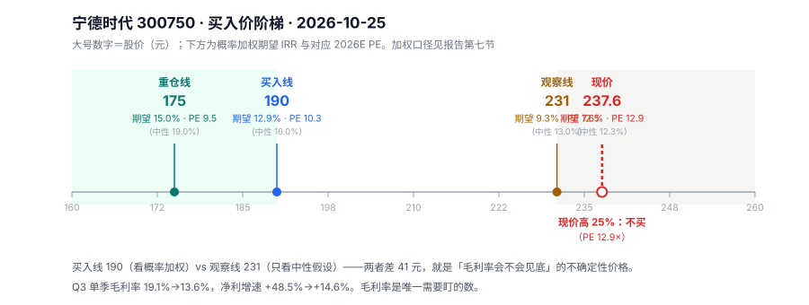

# 宁德时代 300750 · 唐朝估值法

> 数据截止 2026-10-25（收盘 2026-10-23）。现价 **237.60 元**，总股本 46.27 亿股，总市值 10,994 亿。
> 方法：唐朝法主分支 + 增速衰减检测 + 情景加权（因 DCF 终值占比过高，见第六节）。

---

## 〇、结论

**买入线 190 元。现价 237.60 元高 25%，不买。**

| | 价格 | 隐含 2026E PE | 概率加权期望 IRR |
|---|---|---|---|
| 重仓线 | **175** | 9.5× | 15.0% |
| **买入线** | **190** | **10.3×** | **12.9%** |
| 观察线 | 231 | 12.5× | 9.3% |
| **现价** | **237.60** | **12.9×** | **7.6%** |

**两个数字差 41 元，就是"不确定性"的价格**：

- 如果你坚信净利还能年增 10%，**231 元就够**（13% 回报）
- 如果你承认"毛利率会不会见底"说不清，**得等 190 元**

我取后者。理由见第三节——**Q3 单季毛利率从 19.1% 崩到 13.6%，这不是波动，是定价权在转移。**



---

## 一、披露日历

| 项 | 内容 |
|---|---|
| 数据截止 | 2026-10-25（最后交易日 10-23 收盘，当日 **+7.80%**） |
| 最新已披露 | **2026 年三季报**（营收 4,421.4 亿、净利 645.3 亿） |
| 下一个预约披露 | 2026 年报（2027-03 中旬） |
| 报表类型 | A 股创业板，季报完整 |

---

## 二、一个被 12.5 倍 PE 掩盖的事实

现价 237.60，TTM 净利 877 亿，PE **12.54 倍**。看着像"成长股的破产价"。

但拆开三季报，看到的是另一件事：

| 单季 | 营收（亿） | 营收同比 | 净利（亿） | 净利同比 |
|---|---|---|---|---|
| 2026Q1 | 1,291.3 | +52.5% | 207.4 | **+48.5%** |
| 2026Q2 | 1,477.9 | +56.9% | 225.4 | **+36.4%** |
| 2026Q3 | 1,652.2 | **+58.6%** | 212.5 | **+14.6%** |

**收入在加速（+52.5% → +58.6%），利润在失速（+48.5% → +14.6%）。**

差距在毛利率上——把累计毛利率拆成单季：

| 单季毛利率 | 2025Q3 | 2026Q3 | 变动 |
|---|---|---|---|
| 毛利率 | **19.1%** | **13.6%** | **−5.5pct** |

（由累计毛利率反推：2026 前三季 15.72%、中报 16.98% → Q3 单季 13.6%。2025 同法得 19.1%，交叉验证过。）

### 这意味着什么

**收入 +58.6%，净利只 +14.6%——多卖的电池，几乎没多赚钱。**

粗算敏感度：**毛利率每降 1 个百分点，全年净利降约 5.5%**。Q3 掉了 5.5 个点，等于把本该 +45% 的利润压成了 +14.6%。

这不是"成本上升"能解释的（成本上升会传导），只有一个原因：**为了抢份额主动降价，或者在储能这种低毛利业务上放量。**

验证：收入增速（+58.6%）远超行业需求增速（全球动力电池装机约 +20-25%），说明宁德在**以价换量、抢份额**。储能业务（毛利低于动力）占比在快速提升。

**这就是 12.5 倍 PE 的全部理由：市场不认为 13.6% 的毛利率是底部，而按 13.6% 算出来的 853 亿净利，才配 12.5 倍。**

---

## 三、十年序列与增速衰减

| 年份 | 净利（亿） | 同比 | ROE |
|---|---|---|---|
| 2016 | 28.5 | +206% | 69.55% |
| 2017 | 38.8 | +36.0% | 18.99% |
| 2018 | 33.9 | −12.7% | 11.75% |
| 2019 | 45.6 | +34.6% | 12.78% |
| 2020 | 55.8 | +22.4% | 11.27% |
| 2021 | 159.3 | **+185%** | 21.52% |
| 2022 | 307.3 | **+92.9%** | 24.67% |
| 2023 | 441.2 | **+43.6%** | 24.04% |
| 2024 | 507.4 | **+15.0%** | 24.13% |
| 2025 | 722.0 | **+42.3%** | 24.91% |
| 2026E | **853** | +18% | 约 23% |

**十年 CAGR 54%，但增速的形状是"三个台阶 + 一次反弹"：**

```
185% → 93% → 44% → 15% （2021-2024，连降三年）
        ↓
      42.3% （2025，储能爆发，反弹）
        ↓
      单季 +14.6% （2026Q3，再次掉头）
```

### 增速衰减检测：判定"衰减中，且不可外推"

- 近三年 CAGR（2022→2025）32.9%
- 但单季增速已经掉到 +14.6%，且毛利率同步崩塌
- **按规则：不得用历史 CAGR 外推。34% 这个数会带来灾难性的高估。**

**这也是为什么我不给"三年后推演"用 30% 的原因**——那等于假设"毛利率崩塌不影响利润增长"，与 Q3 的事实直接矛盾。

---

## 四、四道闸门

| 闸门 | 标准 | 宁德数据 | 判定 |
|---|---|---|---|
| 闸门 0 · 能力圈 | 靠什么赚钱 | 动力电池 + 储能，规模成本 + 客户绑定 | **过**（但技术路线风险高，见第八节） |
| 闸门 1 · 利润为真 | 净现比 ≥0.8 | 2026 前三季经营现金流 616 亿 ÷ 净利 645 亿 = **0.95** | **过** |
| 闸门 2 · 利润可持续 | 十年序列 + 衰减检测 | 单季 +14.6%、毛利率 −5.5pct | **过，但降级为每年复核** |
| 闸门 3 · 低资本投入 | 资本开支 ÷ 净利 ≤ 30% | **远超 30%**（重资产扩张，产能持续投放） | **不过 → 必须做 FCF 校验** |

### 4.1 闸门 3 不过，意味着什么

宁德是重资产：总资产 11,832 亿，2026 前三季营收 4,421 亿——**资产周转率 0.37 次/年**。

每赚 1 元利润，要压在大量固定资产和存货上。技能规定：这条不过，**估值必须用 FCF 复核**。

但这里有个必须讲清的差别：

```
FCF = 经营现金流 − 全部资本开支（含扩张性）
     = 616 − 约 350（年化） ≈ 266 亿/年
```

而净利 853 亿。**FCF 只有净利的 31%。**

**如果直接用 FCF 估值，宁德只值现在的三分之一。** 这显然不对——因为那些资本开支是**成长性**的，不是维持性的。

正确判断：**宁德 ROE 24.9%，远高于要求回报率 12%。这种公司留存再投资是增值的，用净利口径合理；FCF 口径是它的下限。**

**结论：主口径用净利，FCF 作为"如果停止扩张"的参照。这不是给自己找理由，是因为 ROE > r 这个前提确实成立。**

---

## 五、三锚：锚B 被禁用

| 锚 | 数值 | 说明 |
|---|---|---|
| 锚A · 当年 TTM | **877 亿**（2026E 853 亿） | 前三季 645.3 + Q4 约 208 |
| 锚B · 5 年中位数 | 441.2 亿 | **落后度 = 441.2 ÷ 877 = 0.50 < 0.8 → 禁用** |
| 锚C · 三年后推演 | 不采用（见下） | — |

**锚B 为什么禁用**：宁德五年利润涨了 5.4 倍，用历史中位数估值等于说"它应该回到 2023 年"。这是把成长股当周期股。

**锚C 为什么不用固定增长率推演**：三年后推演需要 g，而 g 现在是断崖状态（+48.5%→+14.6%），任何单点 g 都是猜。**改用情景加权（第七节）代替单点推演。**

**这是本文与标准唐朝法最大的偏离，必须写明理由**：标准流程要求三锚并列，但当"利润增速正在断崖"时，三锚给出的是三个不同时代的价格，没有可比性。**情景加权是更诚实的替代。**

---

## 六、DCF 四层：算出来了，但不能用

按标准公式（NP0 = 853 亿，g1 = 10%，g2 = 3%）：

| 层 | r | 每股 | 终值占比 |
|---|---|---|---|
| 买入线 | 12% | **280 元** | 69% |
| 中枢 | 10% | **364 元** | 75% |
| 卖出线 | 6% | **865 元** | **88%** |

**865 元的卖出线对应 47 倍 PE——这个数字本身就在说"这条公式失效了"。**

### 为什么失效：终值占了 69-88%

DCF 的价值主要来自"五年之后的永续经营"，而永续部分对两个参数极度敏感：

| 参数变动 | DCF(12%) 每股 | 变动 |
|---|---|---|
| g2 = 3%（基准） | 280 | — |
| g2 = 2% | 259 | **−8%** |
| g2 = 1% | 242 | −14% |
| **g2 = 0%** | **228** | **−19%** |

**永续增长率每降 1 个百分点，价值掉 8%。** 而 g2 是整条公式里最不可验证的参数——没人知道 2032 年电池行业还增不增长。

同样，g1 从 10% 变 15%，价值从 280 变 341（+22%）。

**所以我不把 280 元当买入线。** 一个由"最不可知的参数"决定 69% 权重的数字，不能用来决策。

---

## 七、情景加权：这是本文的真正定价

### 7.1 六个情景

用 2026E 净利 853 亿（按 Q3 毛利率 13.6% 外推 Q4）、派息率 49%、5 年期：

| 情景 | 净利年增 | 5年后卖出 PE | 现价 237.60 的 5 年 IRR | 权重 |
|---|---|---|---|---|
| 极度悲观 | −5% | 9× | **−7.2%** | 10% |
| 悲观 | 0% | 10× | **−0.8%** | 20% |
| 偏悲观 | +5% | 11× | **+5.7%** | 25% |
| 中性 | +10% | 12× | **+12.3%** | 30% |
| 偏乐观 | +15% | 14× | **+20.6%** | 12% |
| 乐观 | +20% | 16× | **+28.8%** | 3% |
| | | | **加权 = +7.6%** | 100% |

**加权 7.6%，低于 10% 的机会成本线。**

### 7.2 这张表的读法

**一半的概率（悲观 + 极度悲观 + 偏悲观 = 55%）落在 5.7% 以下。**

这不是"宁德不好"，是"现价已经把乐观情形提前兑现了一部分"。分界线很清楚：

- **净利年增 ≥10%** → 现价能给你 12.3%，及格
- **净利年增 <5%** → 现价只给你 5.7% 以下，不如买国债加一点点风险

而 Q3 的事实（毛利率 13.6%、净利 +14.6%）更接近"<5%"那一侧。

### 7.3 买入价

| 要求 | 价格 | 对应 PE |
|---|---|---|
| 期望 15% | **175** | 9.5× |
| **期望 13%** | **190** | **10.3×** |
| 期望 12% | 197 | 10.7× |

（若只按中性假设算，13% 对应 231 元——这就是"观察线"的来源。）

### 7.4 与 2026-09-08 旧报告的对照：价格跌了 29%，但价值跌得更多

这是本次分析最值得记住的一件事。

| | 旧报告（9/8） | 本文（10/25） | 变化 |
|---|---|---|---|
| 股价 | **335 元** | **237.60 元** | **−29%** |
| 起点净利 | 877 亿（TTM） | **853 亿**（Q3 毛利率外推） | −2.7% |
| 合理价值 | 250–280（中枢 260） | — | — |
| **买入价** | **222 元** | **190 元** | **−14%** |
| 结论 | 不买 | 不买 | 一致 |

**股价跌了 29%，买入价却跟着跌了 14%。**

为什么？因为旧报告是 9 月 8 日写的，当时手上只有**中报**（毛利率 16.98%）。三季报出来后，Q3 单季毛利率掉到 **13.6%**——旧报告没看到这个数。

**结果就是：股价从 335 跌到 237.6，看起来"便宜了 29%"，但"该买的价格"从 222 降到了 190。距离从 51% 缩小到 25%，但还没到。**

这正是"低 PE 陷阱"的完整演示：

```
第 1 步：股价跌 29%，PE 从 19 倍变成 12.5 倍 → 看起来便宜了
第 2 步：查毛利率，发现从 18.5% 掉到 13.6% → 分母要下修
第 3 步：买入线从 222 降到 190 → 便宜的部分被基本面吃掉一半
```

**如果只盯着"跌了 29%"就动手，会在 237.6 买入，然后等发现毛利率的问题时已经晚了。**

旧报告有一句话仍然成立，值得抄在这里：*"当前不买……若严格服务于五年翻倍目标，重点配置价格应在 220–230 元附近，并且经营指标没有触发否决条件。"* —— 现在 237.6 已经接近那个区间，但"经营指标没有触发否决条件"这一条**已经不成立了**（毛利率崩了）。所以那个 220–230 也不能再用。

---

## 八、我会错在哪（六个证伪条件）

| 情形 | 对结论的影响 | 触发信号 |
|---|---|---|
| **毛利率见底回升到 16%+** | 净利直接多 15%，190 元买入线作废，231 元就够 | 季报单季毛利率、碳酸锂价格 |
| 毛利率跌到 11% | 净利再降 15%，买入线降到 160 元 | 储能招标价、动力电池报价 |
| **固态电池 2028 前量产** | 液态锂电产线面临减值，现有估值体系失效 | 车企装车时间表、宁德自己的固态进展 |
| 海外产能受阻 | 增长故事断一条腿，但国内份额仍稳 | 美国/欧洲工厂进度、关税政策 |
| 车企自制电池成功 | 客户变对手，市占率下滑 | 特斯拉 4680、比亚迪外供进展 |
| **储能继续爆发且毛利不降** | 收入结构改善，估值可上修 | 储能出货量、储能毛利率单列 |

### 8.1 最需要盯的一个数

不是营收，不是市占率，是**单季毛利率**。

```
13.6% 是这次的分水岭：
  守住并回升 → 现价不贵
  继续下探   → 现价太贵
```

因为毛利率是唯一能同时反映"价格战强度"和"成本控制力"的指标。

### 8.2 一个必须承认的边界

**"毛利率能不能见底"这个问题，我给不出答案。**

它取决于碳酸锂价格、行业产能出清速度、储能招标规则——这三件事都不在财报里，也不在我的分析能力内。

**所以宁德的买入线定在 190 而不是 231，本质上不是"我觉得它要跌"，而是"我不确定，所以要更多折扣"。** 这是对不确定性的定价，不是对基本面的判断。

---

## 九、数据来源

- 行情：腾讯财经 `qt.gtimg.cn`（300750，2026-10-23 收盘 237.60，当日 +7.80%）
- 财务：东方财富 F10 `RPT_F10_FINANCE_MAINFINADATA`（2015–2026 三季报）
- 分红：`RPT_SHAREBONUS_DET`（2018–2026 中期，2025 年度合计 7.964 元/股，派息率 49.3%）
- 单季毛利率：由累计毛利率反推（2026 前三季 15.72%、中报 16.98% → Q3 单季 13.6%；2025 同法 19.1%）
- 2026E 净利 853 亿：Q1-Q3 实际 645.3 + Q4 按营收 1,700 亿 × 毛利率 13.6% 推算

**可复现**：DCF 与情景表脚本见文末参数；所有 IRR 为 5 年现金流折现求解，含年度股息（派息率 49%、股息年增 0.6×g）。

---

## 十、一句话

**宁德现在的问题不是"12.5 倍 PE 贵不贵"，是"13.6% 的毛利率是不是新常态"。** 如果它是，12.5 倍不便宜（期望回报 7.6%）；如果毛利率能回 16%，现价就是白菜价。**我判断不了毛利率，所以我要 190 元才买——这不是看空，是给"看不懂"这件事标价。**
