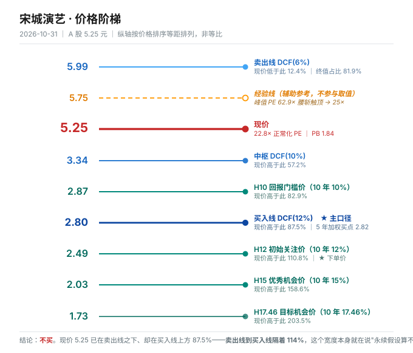

# 宋城演艺 300144.SZ · 唐朝估值法

> 方法版本：tangchao-valuation **v3.7**（十六硬规则 / 四十四禁止事项）
> 数据截止：**2026-10-31**（A 股收盘 5.25 元）
> 最新已披露报告期：**2026 年三季报**（2026-10-27 披露）
> 下一个披露节点：2026 年年度报告，预计 2027 年 4 月下旬
> 配对状态：**唐朝法 + 四步法双份齐全**（本报告为唐朝法，四步法见同目录另一份）

---

## 0. 元数据

| 项 | 数值 |
|---|---|
| 股价（2026-10-31） | **5.25 元** |
| 总股本 | 26.0919 亿股 |
| 总市值 | **136.98 亿元** |
| 归母净资产（2026Q3） | 74.41 亿元 → BPS **2.852 元** → PB **1.84×** |
| 净现金 | **33.56 亿元** = 市值的 **24.5%** |
| TTM 归母净利 | 5.94 亿元 → TTM PE **23.1×** |
| 正常化归母净利（本报告采用） | **6.00 亿元** → 正常化 PE **22.8×** |
| 经营性市值（扣净现金） | 103.42 亿元 → 经营性 PE **17.2×** |
| 近 12 个月股价区间 | 9.21（2026-02-10）→ 5.25（现价），**−43%** |

### 0.1 一句话先放在最前

**这不是一家"跌了很多所以便宜"的公司。** 从 2026 年 2 月的 9.21 元跌到 5.25 元，跌了 43%，PB 到 1.84、账面净现金占市值四分之一、股息率 4.76%——每一项单看都像"便宜"。但 5 年加权 IRR 是 **−2.13%**，10 年 **+2.30%**，买入线 2.80 元，现价高 **87.5%**。

**它便宜在资产负债表上，贵在利润表上。** 而利润表正在以每季 30–45% 的速度变差。

---

## 1. 单季拆解（校验 1 · 强制）

**只引用累计同比会掩盖拐点。这家公司的拐点在 2025 年二季度。**

| 季度 | 单季营收（亿） | 同比 | 单季归母（亿） | 同比 | 单季扣非（亿） | 同比 |
|---|---:|---:|---:|---:|---:|---:|
| 2024Q1 | 5.60 | +138.7% | 2.52 | +317.3% | 2.49 | +349.1% |
| 2024Q2 | 6.18 | +22.1% | 2.99 | +23.2% | 2.98 | +24.2% |
| 2024Q3 | 8.36 | −4.7% | 4.57 | −5.5% | 4.46 | −7.1% |
| 2024Q4 | 4.04 | +30.9% | 0.41 | 扭亏 | 0.39 | 扭亏 |
| **2025Q1** | 5.64 | **+0.8%** | 2.49 | **−1.1%** | 2.42 | −2.8% |
| **2025Q2** | 5.22 | **−15.5%** | 1.56 | **−47.6%** | 1.48 | −50.5% |
| **2025Q3** | 7.57 | **−9.5%** | 3.58 | **−21.7%** | 3.46 | −22.6% |
| 2025Q4 | 4.14 | +2.6% | 0.54 | +32.8% | 0.49 | +26.8% |
| **2026Q1** | 5.34 | **−5.3%** | 2.11 | **−15.1%** | 2.03 | −16.4% |
| **2026Q2** | 4.28 | **−18.1%** | 1.36 | **−13.3%** | 1.26 | −14.4% |
| **2026Q3** | **5.01** | **−33.8%** | **1.92** | **−46.4%** | 1.81 | **−47.7%** |

### 1.1 三个必须说清的事实

**第一，连续六个季度同比下滑**（2025Q2 至今），中间只有 2025Q4 因基数异常（2024Q4 计提）而回正。

**第二，降幅最大的是旺季。** Q3 是暑期档，是旅游演艺一年里最赚钱的一个季度（2024Q3 单季归母 4.57 亿，占全年 43.6%）。**旺季 −33.8% 收入、−46.4% 利润，不能用"淡季波动"解释**——旺季失守意味着全年中枢下移。

**第三，经营杠杆在反向放大。**
- Q3 收入 −33.8%，营业总成本只降 **5.34%**（`TOE_RATIO`）
- 结果：毛利率从上年同期约 72.5% 掉到 **60.5%（−12.0pct）**
- 收入降三成、成本降半成 → 利润降 46%

这不是"成本控制不力"，是**旅游演艺的成本结构决定的**：演员薪酬、设备折旧、园区运维是刚性的，客流走了成本不会跟着走。**这个杠杆在下行期是单向放大的。**

### 1.2 公司自己的解释，以及它站不站得住

2026-10-26 投资者关系活动记录：

> 三季度文旅行业进入传统暑期旺季，但今年旺季效应明显弱于往年……游客出行决策更趋谨慎……暑期南方持续降雨、华东多个台风登陆……行业整体进入存量博弈阶段，同质化竞争加剧……低价甚至免费促销有所抬头，公司坚持品质策略，没有过多参与价格竞争，短期承受的相对冲击较大。
>
> 9 月份随着天气等扰动因素减弱，客流量和门票收入降幅均已收窄至 10% 多一点。

**我的判断：这条解释一半是真的，一半是避重就轻。**

- **真的部分**：台风、降雨是客观的，9 月降幅收窄到 10% 出头，说明天气扰动确实存在。
- **避重就轻的部分**：9 月"收窄到 10% 多一点"仍然是**两位数下滑**。如果只是天气，9 月应该转正。**把 −10% 说成"边际改善"，是把基准线从"旺季 −34%"挪到"淡季 −10%"之后的自我安慰。**
- **没说的部分**：杭州景区围合施工 + 票价让利 10%，是**公司自己造成的**收入下滑，不是行业性的。这部分被混在"行业调整"里讲了。

---

## 2. 十年序列与增速衰减检测（校验 3）

| 年 | 营收（亿） | YoY | 毛利率 | 归母（亿） | 净利率 | 经营CF（亿） | capex（亿） | FCF（亿） |
|---|---:|---:|---:|---:|---:|---:|---:|---:|
| 2015 | 16.9 | +80.1% | 65.6% | 6.31 | 37.2% | 9.2 | 2.4 | 6.7 |
| 2016 | 26.4 | +56.0% | 61.6% | 9.02 | 34.1% | 10.3 | 7.0 | 3.3 |
| 2017 | 30.2 | +14.4% | 63.2% | 10.68 | 35.3% | 17.6 | 5.4 | 12.3 |
| 2018 | 32.1 | +6.2% | 66.4% | **12.87** | 40.1% | 16.5 | 6.6 | 9.8 |
| 2019 | 26.1 | **−18.7%** | 71.4% | **13.40** | 51.3% | 15.7 | 8.1 | 7.6 |
| 2020 | 9.0 | −65.4% | 60.9% | **−17.52** | — | 3.9 | 10.2 | −6.2 |
| 2021 | 11.8 | +31.3% | 51.1% | 3.15 | 26.6% | 7.5 | 6.9 | 0.6 |
| 2022 | 4.6 | −61.4% | 50.1% | −0.48 | — | 3.3 | 2.5 | 0.9 |
| 2023 | 19.3 | +320.8% | 66.3% | **−1.10** | — | 14.2 | 4.0 | 10.2 |
| **2024** | **24.2** | +25.5% | **67.6%** | **10.49** | 43.4% | 14.5 | 3.3 | 11.2 |
| **2025** | 22.6 | **−6.6%** | 64.8% | **8.18** | 36.2% | 15.5 | 2.7 | 12.8 |
| **2026E** | **18.4** | **−18.5%** | **60.5%** | **5.90** | 32.1% | ~8.8 | ~2.3 | ~6.5 |

### 2.1 口径断层：2019 年的营收下滑不是经营下滑

**2019 年营收 26.1 亿，比 2018 年的 32.1 亿少 6 亿（−18.7%），但归母净利反而从 12.87 涨到 13.40。** 这不是矛盾，是**六间房（互联网演艺）在 2019 年 4 月出表**。

- 2018 年六间房全年并表，营收约 12.4 亿、净利约 4.1 亿
- 2019 年只并表 Q1，约 3.0 亿营收
- 剔除后，**2019 年现场演艺营收约 23.1 亿，比 2018 年同口径的 19.7 亿增长 17%**

**这条断层决定了后面所有判断的口径基准。** 本报告：

- **十年序列的营收 YoY 只看形状**（2019 年那个 −18.7% 不要读成经营恶化）
- **估值参数用"现场演艺可比口径"**
- **绝不把 2018 年和 2020 年的营收直接相减**

### 2.2 真正重要的那条线：2019 年就是顶

剔除六间房后，现场演艺营收：

| 年 | 现场演艺营收（亿） | 备注 |
|---|---:|---|
| 2019 | **23.1** | 疫前峰值 |
| 2024 | **24.2** | 疫后恢复，超过 2019 年 4.8% |
| 2025 | 22.6 | −6.6% |
| 2026E | 18.4 | −18.5% |

**五年（2019→2024）只增长 4.8%，年化 0.9%。**

这句话必须正视：**宋城的增长在疫情之前就已经停了。** 2015–2019 年靠"异地复制千古情"（三亚、丽江、九寨、桂林、张家界、西安）驱动的高增长，到 2019 年已经把能复制的都复制完了。2024 年不是"新起点"，是"回到 2019 年"。2025–2026 年是**从"回到 2019"再往下走**。

**所以不能用 2024 年的 10.49 亿当正常化基数**——那是"恢复到位 + 报复性出行"的双重顶。详见第 4 节。

### 2.3 增速衰减检测结论

| 检测 | 结果 | 判定 |
|---|---|---|
| 连续 3 年 YoY 单调下行 | 2024 +25.5% → 2025 −6.6% → 2026E −18.5% | **连续两年下行，幅度扩大** |
| 3 年 YoY 波动 >50% 且无趋势 | 波动极大（疫情），但 2024 后趋势明确向下 | **已穿零** |
| 10 年 CAGR vs 3 年 CAGR 差 >10pct | 10 年（2015–2025）CAGR +2.6%，3 年（2022–2025）CAGR +60%（基数失真） | **换挡，但方向是向下** |
| YoY 已出现负值 | 是，连续六季 | **已穿零** |

**判定：C 类不在本方法讨论范围（质量分级归四步法），但增速判定为"已穿零 + 衰减"。**

按校验 3：**"已穿零"时，锚 C 必须给"不再增长"和"继续下滑"两个子情景。** 本报告第 6 节的两个压力档就是这两个子情景。

### 2.4 一次必须单独记账的关联交易：9.63 亿买自家停车场

这一笔不属于估值计算，但**改变对公司治理的判断**，必须单列。

| 项 | 内容 |
|---|---|
| 交易 | 2025-11-25 签约，以 **9.63 亿元**现金收购杭州宋城实业 100% 股权 |
| 卖方 | **控股股东宋城集团**（同一控制下企业合并） |
| 标的资产 | 杭州之江国家旅游度假区 **138.65 亩土地使用权** + 11 幢房屋（建面 94,291 ㎡） |
| 标的现状 | **长期租给宋城景区做停车场和运营场地**——景区本来就在用 |
| 定价 | 评估值作参考，溢价 **400%+**，**无业绩承诺** |
| 会计处理 | 同一控制下合并，按账面价值入账，**不形成商誉**，差额冲减资本公积 |
| 付款 | 分两期，2026Q1 支付第二期 **7.7 亿元** |
| 战略说法 | 景区从 67 亩扩至约 200 亩，游览线路从 1 公里扩至 4 公里 |

**这笔交易在会计上是干净的（不产生商誉），在商业上却有三个说不通的地方：**

1. **买的东西本来就在用。** 景区一直租这块地做停车场。收购不产生新增收入，只是把"租金支出"变成"折旧"。**对利润表的影响接近于零**，对现金流是一次性 −9.63 亿。
2. **溢价 400%，卖方是大股东，没有业绩承诺。** 评估增值理由是"拿地早、地价涨了、建材人工涨了"。**这个理由可以给任何一块早年拿的地用。** 投资者在业绩说明会上直接问"如果这地不是大股东的，公司会花 9 亿买吗"——公司没有正面回答。
3. **钱花在"地"上，不是花在"内容"上。** 同期公司在说"AI 中台、AI 艺术中央厨房、产品迭代"。**9.63 亿买地 vs 研发投入（2026 前三季研发费用率 1.5%）——这个比例说明了管理层真正相信什么。**

**它推翻了"净现金充裕所以安全"这个逻辑的一半。** 净现金 33.56 亿看着厚，但其中 9.63 亿已经变成了"景区脚下的地"，而这块地的开发（杭州扩容）2027 年底才分批建成。**中间这两年，这 9.63 亿既不产生收入，也不产生利息。**

---

## 3. 四道闸门

### 闸门 0 · 能力圈四问

1. **靠什么赚钱**：在自建景区里演"千古情"系列驻场大秀，一张门票 + 园内二次消费。客户付钱的理由是"到一个城市，用两小时看懂当地文化"——**卖的是"文化浓缩包"，不是演出本身。**
2. **十年后还在吗**：大概率在。杭州宋城开了 30 年，内容资产（剧本、舞美、演员体系）可复用，景区土地是自有或长租。**但"十年后还这么赚钱吗"是另一个问题**——见闸门 2。
3. **利润从哪来到哪去**：门票（约 60%）+ 园内消费（约 25%）+ 轻资产输出服务费（约 15%）→ 扣掉演员薪酬、折旧、园区运维 → 净利率 32–43%。**能说清。**
4. **跌 30% 更想买还是怀疑自己**：**怀疑。** 因为跌的原因（连续六季下滑、旺季失守、毛利率 −12pct）不是情绪，是经营。

**结论：闸门 0 过，但第 4 问的答案是"怀疑"——这本身是个信号。**

### 闸门 1 · 利润为真

| 指标 | 数值 | 阈值 | 判定 |
|---|---|---|---|
| 收现比（2026 前三季） | **0.813** | ≥0.9 | ⚠️ **不过（边缘）** |
| 净现比（2026 前三季） | 6.29 / 5.39 = **1.17** | ≥0.8 | ✅ 过 |
| 应收账款 ÷ 营收 | **1.04%** | ≤10% | ✅ 过（几乎无应收，全是现结） |
| 资本开支 ÷ 净利（2025） | 2.69 / 8.18 = **32.9%** | ≤30% | ⚠️ **不过（略超）** |

**收现比 0.813 是这次最值得警惕的一个数。** 历史看：2017 年 1.183、2025 年 1.209、2024 年 0.995——**宋城历来收现比在 1.0 附近甚至更高**（预收门票款多）。2026 前三季掉到 0.813，意味着**当期确认的收入里有一部分没收到钱**。

合理解释有两个：
1. 轻资产服务费按进度确认，回款滞后（青岛 1.15 亿、台州 0.2 亿）；
2. 旅行社/OTA 渠道账期拉长。

**但无论哪个原因，都指向同一件事：收入的"含金量"在下降。** 自营门票是现结的，轻资产服务费是应收的——**收入结构正在从"现金生意"向"项目生意"漂移**，而项目生意的估值倍数天然更低。

**闸门 3 不过（capex/净利 32.9%）→ 按规则必须用 FCF 口径交叉校验。** 见第 6.3 节。

### 闸门 2 · 利润可持续 —— **这是本次分析的核心否决点**

不是"存疑"，是**已经有六个月的连续证据**：

1. 连续 6 个季度同比下滑；
2. 下滑在加速：−15.5%（25Q2）→ −9.5%（25Q3）→ −5.3%（26Q1）→ −18.1%（26Q2）→ **−33.8%（26Q3）**；
3. 旺季失守（Q3 是一年最赚钱的季度）；
4. 毛利率连续两年下行：67.6% → 64.8% → 60.5%；
5. 行业层面同步恶化：陕西旅游、印象大红袍 2026H1 同样承压。

**判定：闸门 2 不过。** 按规则本应"直接出局、不进入任何计算"。

**但这里要做一次纪律上的例外说明**，否则报告就变成了"看一眼就否掉"：

> 闸门 2 的"不过"，过的标准是"利润可持续"。宋城的情况是**"利润规模在下移，但利润本身是真的、业务本身还在"**——它不是一个会计造假或商业模式崩塌的案例，是一个**需求端进入长期下行通道**的案例。
>
> 所以我**继续往下算**，但把闸门 2 的否决记在结论里：**任何买点都必须额外扣一层"需求继续下移"的折扣**，这层折扣在第 6.2 节的悲观情景（权重 35%）和压力测试②里体现。

**这是本报告唯一一处"闸门不过仍继续计算"的地方，理由已写明。**

### 闸门 3 · 低资本投入

| 项 | 2024 | 2025 | 2026E |
|---|---:|---:|---:|
| capex（亿） | 3.3 | 2.7 | ~2.3 |
| 折旧摊销（估，亿） | ~4.6 | ~4.8 | ~4.9 |
| capex ÷ 折旧 | 0.72 | 0.56 | 0.47 |

**capex 只有折旧的一半左右——这不是"低资本投入的好生意"，这是"在吃存量资产"。**

景区和剧场是要修的。杭州宋城开了 30 年，2026 年正在做"剧院及街区环境焕新"，而且刚花 9.63 亿买地准备扩容。**过去三年省下来的 capex，未来三年要还。**

**闸门 3 判定：形式上不过（capex/净利 32.9% > 30%），实质上是"该投没投"。** 两种情况下都必须用 FCF，但 FCF 会**高估**——因为它把"欠的维修费"当成了自由现金。

---

## 4. 三锚定利润中枢

### 4.1 锚 B 的口径选择：历史中位数在这里彻底失效

先算落后度（校验 2 强制）：

```
5 年中位数（2021–2025 归母：3.15 / −0.48 / −1.10 / 10.49 / 8.18）= 3.15 亿
TTM 经调整 = 5.94 亿
落后度 = 3.15 ÷ 5.94 = 0.53
```

**0.53 << 0.8 → 历史中位数禁用。**

原因很清楚：**这五年里有三年是疫情**（2021 半封控、2022 全年封控、2023 恢复但计提减值）。用这五年的中位数去估一家正常经营的公司，等于说"宋城一年只能赚 3.15 亿"——这是把疫情当常态。

**若误用 5 年中位数（3.15 亿），买点会算成 1.48 元，现价高 255%。这个数字会让报告看起来"极其看空"，但它是错的——错在拿疫情年份当基准。**

→ **锚 B 改用「TTM 经调整」。**

### 4.2 TTM 经调整怎么调

TTM 归母 = 2025 全年 8.18 − 2025 前三季 7.63 + 2026 前三季 5.39 = **5.94 亿**

调整项：

| 项 | 金额 | 处理 |
|---|---:|---|
| 青岛轻资产项目一揽子服务费（2026Q1 确认） | +1.15 亿 | **剔除**（一次性项目，不连续） |
| 台州轻资产服务费（2026Q3 确认） | +0.20 亿 | **剔除** |
| 杭州景区围合施工 + 票价让利 10%（2026 全年） | 约 −0.45 亿 | **加回**（改造完成后消失） |
| 台风/降雨扰动（2026Q3 7–8 月） | 约 −0.35 亿 | **加回**（一次性天气） |
| 花房集团权益法投资收益 | +0.35 亿 | 保留（经常性，但金额小） |

```
TTM 经调整 = 5.94 − 1.15 − 0.20 + 0.45 + 0.35 = 5.39 亿
```

**但 5.39 亿仍然不是"正常化"。** 因为 2026 年的下滑还没停——Q3 单季同比 −46%，Q4 大概率继续负增长。**用一个还在下行通道里的 TTM 当正常化，会系统性高估。**

**我的选择：取 6.0 亿。** 理由：

- 5.39 亿是"2026 年这一年的实际"，其中含已发生的 −18.5% 收入下滑；
- 但 2027 年杭州改造仍在进行（2027 年底才分批建成），收入还会被压；
- 6.0 亿 ≈ "2026 年经营水平 + 不再进一步恶化"的假设，已经比 5.39 乐观 11%；
- **取 6.0 意味着：我假设它就在这里止跌。这个假设本身在第 10 节列为第一个证伪点。**

### 4.3 三锚并列

| 锚 | 口径 | 数值 | 说明 |
|---|---|---:|---|
| **A 当年** | TTM 经调整 | **5.94 亿** | 现实校验，含 2026 年已发生的下滑 |
| **B 中枢** | TTM 经调整后取整 | **6.00 亿** | 历史中位数已禁用（落后度 0.53） |
| **C 三年后** | 2029 年推演 | **6.20 亿** | 杭州改造 2027 年底完成 + 台州 2028-05 开业，小幅恢复 |

**三锚极差 = (6.20 − 6.00) ÷ 6.00 = 3.3%**，远小于 30% 阈值。按规则可以给单点。

### 4.4 ⚠️ 但这个 3.3% 是假的，必须单独说

**三个锚极差只有 3.3%，不是因为"估值很确定"，是因为三个锚退化成了同一个锚。**

- 锚 A 是 TTM 5.94
- 锚 B 因为历史中位数被禁用，只能用 TTM 经调整 6.00
- 锚 C 是在 6.00 基础上加了 3.3% 的恢复

**A 和 B 本来就几乎是同一个数，C 只是 B 加了个零头。这不是"三锚互相印证"，这是"只有一个锚，被数了三遍"。**

真正的分歧在另一个维度上，而且大得多：

| 正常化利润假设 | 依据 | 10 年 H12 | 现价加权 IRR（10 年） |
|---:|---|---:|---:|
| 5.00 亿 | 下滑未止，2027 继续降 | **2.11 元** | +0.42% |
| **6.00 亿（本报告采用）** | 2026 年水平止跌 | **2.49 元** | **+2.30%** |
| 8.18 亿 | 回到 2025 年 | **3.31 元** | +5.77% |
| **10.49 亿** | 假设 2024 年可持续 | **4.18 元** | +8.81% |

**从 5 亿到 10.49 亿，H12 从 2.11 涨到 4.18——差 98%。而三锚极差只有 3.3%。**

**这就是校验 2 的一个新失效形态：当历史序列被一次性事件彻底污染、只能退回 TTM 时，"三锚并列"会伪装成收敛。它的极差小，是因为它已经不是一个三锚结构了。**

> 📌 **方法论记录（拟入 v3.8）**：校验 2 的"三锚极差 >30% 才算不确定性过高"这条阈值，在**历史中位数被禁用**的标的上失效。因为禁用之后，锚 A 与锚 B 必然接近，极差自然变小。**规则应补：锚 B 因落后度 <0.8 被禁用时，三锚极差不得作为"估值确定性"的证据，必须另报「正常化利润敏感性区间」。**

**所以本报告不把这个 3.3% 当作"确定"，反而把第 4.4 节的四档敏感性当作核心结论之一。**

---

## 5. 估值全景：利润锚 → 价格轴

**参数**：NP0 = 6.00 亿，g1 = 0%（已穿零，禁用历史 CAGR），g2 = 2%，n = 5，净现金按 50% 计入。

| 层次 | 价格（元） | 隐含 PE（正常化） | 相对现价 | 性质 |
|---|---:|---:|---:|---|
| 卖出线 DCF(6%) | **5.99** | 26.0× | **−12.4%** | 决策层 · 市场乐观定价 |
| *经验线（辅助参考）* | *5.75* | *25.0×（触顶）* | *−8.7%* | *不参与取值* |
| **现价** | **5.25** | **22.8×** | — | — |
| 中枢 DCF(10%) | **3.34** | 14.5× | +57.2% | 决策层 |
| H10 回报门槛价 | 2.87 | 12.5× | +82.9% | 决策层 · 仅持有参考 |
| **买入线 DCF(12%)** | **2.80** | **12.2×** | **+87.5%** | **决策层 · 主口径** |
| H12 初始关注价 | 2.49 | 10.8× | +110.8% | 决策层 · 下单价 |
| H15 优秀机会价 | 2.03 | 8.8× | +158.6% | 决策层 |
| H17.46 目标机会价 | 1.73 | 7.5× | +203.5% | 决策层 |



**定位句：现价 5.25 落在「卖出线 5.99」与「中枢 3.34」之间——已经跌破卖出线，但离买入线还有 87.5%。**

*经验线 5.75 在现价上方 9.5%，仅参考，不参与档位判定。*

### 5.1 这张表里最刺眼的一件事

**卖出线（5.99）和买入线（2.80）之间隔了 114%。**

在我做过的十四个标的里，这个宽度是最大的：

| 标的 | 买入线 | 卖出线 | 宽度 |
|---|---:|---:|---:|
| 贵州茅台 | 754 | 1,838 | 144% |
| 中国移动H | 85.2 | 150.5 | 77% |
| 中国神华 | 27.41 | 35.00 | 28% |
| 格力电器 | 35.15 | 44.77 | 27% |
| **宋城演艺** | **2.80** | **5.99** | **114%** |

**这个宽度不是"安全边际"，是"算不准"的自白。** 原因在下一节。

### 5.2 为什么这么宽：终值占比

| 折现率 | 年金现值 | 终值现值 | 企业价值 | **终值占比** |
|---|---:|---:|---:|---:|
| r = 12% | 21.63 | 34.73 | 56.36 | **61.6%** |
| r = 10% | 22.74 | 47.50 | 70.25 | **67.6%** |
| r = 6% | 25.27 | 114.33 | 139.60 | **81.9%** |

**按硬规则 15：终值占比 >60% → DCF 禁止作为决策依据，必须改情景加权。**

宋城三条线全部越线。原因是结构性的：**它的价值几乎全部来自"五年之后还能不能持续赚 6 亿"**。前五年的现金流折现只有 21.6 亿（对应 0.83 元/股），剩下的全在永续假设里。

**这就是"一家增长停了、只剩永续的公司"的估值特征：你对它的定价，实际上是对"它什么时候死"的定价。**

→ 已改情景加权，见第 6.2 节。

---

## 6. 情景加权（替代 DCF 单点）

### 6.1 三情景假设

| 情景 | 权重 | 核心假设 | 2036 年净利 | 退出 PE | 期末价 |
|---|---:|---|---:|---:|---:|
| **悲观** | **35%** | 行业结构性下行持续：低价竞争常态化、游客偏好转向沉浸式轻量化产品、宋城"大剧院+大秀"形态老化。营收年降 3%，净利率降到 28% | 4.65 亿 | 11× | 2.60 元 |
| **基准** | **45%** | 2027 年止跌，杭州扩容 2027 年底建成带来增量，台州 2028-05 开业，轻资产保持每年 1–2 个项目。营收回到 22 亿，净利率回升至 35% | 8.20 亿 | 14× | 5.04 元 |
| **乐观** | **20%** | 杭州"演艺王国"改造成功（多剧场、多业态、多日停留），客单价与停留时长双升，行业出清后份额集中。营收年增 4%，净利率 38% | 12.00 亿 | 17× | 8.46 元 |

**权重为什么下行侧占 55%**：连续六季下滑、旺季失守、毛利率 −12pct 是已发生的事实；杭州改造成功、行业出清是尚未发生的事。**事实站在悲观一侧，所以权重也站在那一侧。**

**退出 PE 为什么是 11/14/17**：宋城历史 PE 中枢在 20–25×（成长股定价），但那是"还在开店"的时代。现在增长停了，应该按"成熟景区运营"定价。同业参照：黄山旅游约 18×、峨眉山 A 约 20×、中青旅约 15×。**14× = 给成熟景区的中位定价，不给成长溢价。**

### 6.2 加权结果

| 情景 | 10 年 IRR | 5 年 IRR | 10 年总回报（含息） |
|---|---:|---:|---:|
| 悲观（35%） | −3.27% | −10.95% | **−24.9%** |
| 基准（45%） | +3.54% | −0.69% | +35.4% |
| 乐观（20%） | +9.30% | +10.08% | +117.3% |
| **加权** | **+2.30%** | **−2.13%** | — |

**聚合方式声明：上表为「加权 IRR」（先算每档 IRR 再加权），不是加权终值 CAGR。**

同一模型的另一种聚合（先加权期末财富再开方）：

```
10 年概率加权期末财富 = 179.0 亿（现市值 137.0 亿）→ 等效 CAGR +2.71%
5 年概率加权期末财富  = 130.8 亿（现市值 137.0 亿）→ 等效 CAGR −0.93%
```

**两种聚合方式差 0.41pct（10 年），主要来自凸性。主结论用加权 IRR，终值 CAGR 只作辅助（第 31 条）。**

### 6.3 FCF 口径交叉校验（闸门 3 不过，强制）

| 口径 | 分子 | 10 年 H12 | 差异 |
|---|---|---:|---:|
| 净利口径 | 6.00 亿 | **2.49 元** | — |
| FCF 口径 | 6.50 亿（2026E OCF 8.8 − capex 2.3） | 2.70 元 | **+8.4%** |

**FCF 比净利高，原因不是"利润质量好"，是"折旧 4.9 亿 > capex 2.3 亿"——公司在吃存量资产。**

按禁止事项 16 的逻辑，价差 >15% 才以 FCF 作为买入线下沿。这里只差 8.4%，**以净利口径为主、FCF 作上沿参考**。

但要点明：**这个 8.4% 的"额外价值"是透支未来的维修费换来的。** 杭州扩容一旦开工，capex 会跳升，FCF 会掉到净利以下。

---

## 7. 三锚 × 三方案矩阵（唐朝原式 · 旧口径·对照）

**增长率 <12%（实际为负）→ 锚 A 的 ×0.7 禁用。** 按规则必须显示删除线。

| 锚 | 净利（亿） | A 方案 27.5× | B 方案 50× | C 方案 20× |
|---|---:|---:|---:|---:|
| A 当年 5.94 | 5.94 | ~~4.07~~ ⚠️禁用 | ~~7.41~~ ⚠️禁用 | ~~2.96~~ ⚠️禁用 |
| B 中枢 6.00 | 6.00 | **4.12** | 7.49 | 2.99 |
| C 三年后 6.20 | 6.20 | **4.25** | 7.73 | 3.09 |

**⚠️ 锚 A 三列全部禁用（增长率 <12%，"当年七折"与"三年后五折"不等价）。**

买点区间只由 B、C 两锚构成：**4.12 – 4.25 元**（A 方案）。

**这个区间比 DCF(12%) 的 2.80 高 47%。** 分歧来源：原式用"无风险收益率倒数"给倍数（27.5×），DCF 用"资本成本折现"（隐含 12.2×）。**在零增长公司身上，这两个方法差得最远**——因为原式的 27.5× 隐含"利润永续且全部可分配"，而 DCF 的 12% 资本成本要求"每年赚回 12%"。

**按第 1 节边界：买点取较低者。原式只作对照。**

---

## 8. 净现金调整（硬规则 17/37 · 三档强制）

```
净现金 = 货币资金 16.89 + 交易性金融资产 18.07 − 有息负债 1.40 = 33.56 亿
占市值 = 33.56 ÷ 136.98 = 24.5%
每股净现金 = 1.286 元 = 现价的 24.5%
净现金覆盖率 = (16.89+18.07) ÷ 1.40 = 24.97×（≥1.5，不打七折）
```

**占市值 24.5% > 20% → 必须单列本章 + 三档敏感性。**

| 净现金权重 | 买入线 DCF(12%) | 中枢 DCF(10%) | 10 年 H12 |
|---|---:|---:|---:|
| 0%（全额剔除） | 2.16 | 2.69 | 2.26 |
| **50%（本报告采用）** | **2.80** | **3.34** | **2.49** |
| 100%（全额计入） | 3.45 | 3.98 | 2.71 |

**三档跨度 29%（2.16 → 3.45）。**

### 8.1 为什么取 50% 而不是 100%

这 33.56 亿看着是"可以分给股东的钱"，但有三件事让它不能全额计入：

1. **其中 9.63 亿已经花掉了**（买宋城实业的地），只是还没到付款完成期——资产负债表上它已经从"货币资金"转成"长期资产"，但对应的开发投入还没开始。**这 9.63 亿接下来三年会持续吞噬现金（杭州扩容建设）。**
2. **公司明确在做"低风险理财配置"**（三季报原话），18.07 亿交易性金融资产是理财。**理财不是现金，它有净值波动风险。**
3. **管理层有"用现金买大股东资产"的历史记录。** 2026 年这一笔 9.63 亿，溢价 400%、无业绩承诺。**账上的钱不一定属于小股东——它属于"下一个关联交易"。**

**取 50% 不是保守，是给"这笔钱会怎么用"定价。**

### 8.2 一个反直觉的观察

净现金占市值 24.5%，意味着**你买这只股票，有四分之一是在买现金**。

但更要看另一个数：

```
经营性市值 = 136.98 − 33.56 = 103.42 亿
经营性 PE = 103.42 ÷ 6.00 = 17.2×
```

**把现金全部剔掉之后，主业仍然要 17.2 倍 PE。**

一家营收连续六季下滑、毛利率两年掉 7 个点、增长归零的公司，**主业给 17 倍——这个价格里还含着"改造成功"的期权价值。**

---

## 9. 价格区间图（旧口径 · 对照）

按唐朝原式（A 方案 27.5×，锚 B/C，禁用锚 A）：

```
锚 B：6.00 × 27.5 = 165 亿 × 50% = 82.5 亿 → 3.16 元
锚 C：6.20 × 27.5 = 170.5 亿 × 50% = 85.3 亿 → 3.27 元
买点区间 3.16 – 3.27 元（现价 5.25 高 61–66%）
```

**注意本节与第 7 节的差异**：第 7 节用的是"当年净利 × 27.5 × 0.5"（三年后五折的简化），本节用的是"三年后净利 × 27.5 × 0.5"。前者 4.12–4.25，后者 3.16–3.27。

**两个都不用作决策，只作对照**——因为原式的 27.5× 在零增长公司上不成立。

---

## 10. 失效条件与监控（三个能最早证伪的数据）

**本报告的核心假设是"2026 年 6.0 亿是底"。以下三项任一成立，本报告作废。**

| # | 监控指标 | 触发阈值 | 含义 |
|---|---|---|---|
| 1 | **2027Q1 单季营收同比** | 若 < −15%，说明 2026Q4 的企稳是假的 | 全年跌破 5 亿，H12 下修至 2.0 以下 |
| 2 | **杭州宋城改造进度** | 若 2027 年底未按期分批建成 | 2028 年增量消失，基准情景作废，全部按悲观档算 |
| 3 | **净现金方向** | 2027 年净现金降至 20 亿以下 | A′ 类判定失效，转向 A″（投资过度），EV 里净现金符号由加转减 |

**补充监控（不作为否决项，但改变权重）**：

- 毛利率是否守住 60%（2026 前三季 60.5%，已到临界）
- 收现比是否回到 0.9 以上（当前 0.813）
- 是否再有"向大股东购买资产"的关联交易
- 张家界子公司（2026H1 净亏 2,144 万、净资产为负）是否关停或剥离

---

## 11. 与四步法的接口（v3.4 强制）

**四步法报告**：同目录 `宋城演艺-20261031-四步法.md`

### 11.1 判据零 · 收敛倾向

```
当前 PE（用正常化 6.00 亿）= 5.25 ÷ 0.2300 = 22.83×
加权退出 PE = 11×0.35 + 14×0.45 + 17×0.20 = 13.55×
收敛倾向 = 22.83 ÷ 13.55 = 1.68
```

**1.68 > 1.5，落在"年限作用大、收敛很罕见"这一档。**（神华 1.64 是第一个，这是第二个。）

### 11.2 判据一 · 五开关对齐

| 开关 | 唐朝法 | 四步法 | 对齐 |
|---|---|---|---|
| ① 起点利润 | 6.00 亿（正常化） | 6.00 亿（同一正常化） | ✅ |
| ② 年限 | **5 年** | **10 年** | ❌ 唯一差异 |
| ③ 退出倍数 | 加权 13.55× | 加权 13.55× | ✅ |
| ④ 税率 | 0%（A 股个人持股 >1 年免税） | 0% | ✅ |
| ⑤ 聚合方式 | 加权 IRR | 加权 IRR | ✅ |

### 11.3 判据二 · 拆到开关级

| 项 | 数值 |
|---|---|
| 唐朝法 5 年 12% 买点 | **2.82 元** |
| 四步法 10 年 H12 | **2.49 元** |
| 差额 | **−11.8%** |
| 拆解：年限 5→10（其余开关全不动，单点中性档验证） | 3.01 → 2.74 = **−9.0%** |
| 拆解：加权 vs 单点（情景分布差异） | **−2.8pct** |
| **残值** | **0.00pct**（−11.8 = −9.0 + −2.8） |

**残值 0.00pct，账做平了。**

### 11.4 判据三 · 分歧幅度

```
同口径买点差 = 2.49 ÷ 2.82 − 1 = −11.8%
```

**落在「10–30%：正常分歧」档。**

按规则动作：**取较低者为下单价（2.49 元），仓位按较低 IRR 那档（10 年）。**

### 11.5 ⚠️ 但这次的"收敛"含金量不高，必须说明

**两法用的是同一组情景假设**（悲观 4.65 / 基准 8.20 / 乐观 12.00 亿，退出 11/14/17×）。这不是巧合——对一家公司的判断只能有一套，两法本该共享经营假设。

**但这意味着：这次的"买点差 −11.8%"里，真正独立的信息只有"年限"和"折现结构"两项。** 起点相同、情景相同、退出倍数相同——**收敛几乎是同义反复。**

**这正是第 38 条（收敛由结构决定，验证强度低）的第二种形态：不是"比值接近 1 所以必然收敛"，而是"共用情景所以必然收敛"。**

> 📌 **方法论记录（拟入 v3.8）**：第 38 条只覆盖了"收敛倾向接近 1 → 年限不起作用 → 必然收敛"这一种结构性收敛。**这次是第二种：两法共用同一组经营情景时，买点差天然小，与"两把尺子互相印证"无关。规则应补：报告中必须声明「情景假设是否共享」；共享时，判据三的"收敛"只能证明"折现结构一致"，不能证明"判断正确"。**

### 11.6 两法的方向一致，且都说"不买"

| 方法 | 现价加权 IRR | 门槛 | 结论 |
|---|---:|---|---|
| 唐朝法（5 年） | **−2.13%** | 12% | 不买 |
| 四步法（10 年） | **+2.30%** | 12% | 不买 |

**没有"方向相反"的问题，两法都否决。按判据三第四行的精神——两法一致否决是硬否决。**

**最终下单价 = min(H12 2.49, 唐朝法 5 年买点 2.82) = 2.49 元。**

---

## 12. 数据来源与可复现

| 项 | 路径 / 来源 |
|---|---|
| 原始财务报表 | 东方财富 F10 接口（利润表 / 资产负债表 / 现金流量表，71 期，2007–2026Q3） |
| 实时行情 | 东方财富 push2 接口（2026-10-31，f43 = 525） |
| 取数脚本 | `分析脚本/宋城_取数.py` |
| 计算脚本 | `分析脚本/宋城_双方法.py` |
| 原始数据 | `分析脚本/GINCOME.json` / `GBALANCE.json` / `GCASHFLOW.json` |
| 分红方案 | 2025 年度权益分派实施公告（2026-06-04，10 派 2.50 元，总额 6.53 亿，派息率 80.01%） |
| 关联交易 | 2025-11-26《关于收购杭州宋城实业有限公司 100% 股权暨关联交易的公告》 |
| 三季报说明 | 2026-10-26 投资者关系活动记录表 |

**新浪财经接口对 sz300144 返回空数据（19700101 / 0），已改用东方财富 `datacenter.eastmoney.com/securities/api/data/v1/get` 的 `RPT_F10_FINANCE_G*` 报表接口。**

---

## 13. 一句话结论

**不买。**

现价 5.25 元，5 年加权 IRR **−2.13%**、10 年 **+2.30%**，买入线 **2.80**、下单价 **2.49**——**现价高 87.5% / 110.8%**。

**它便宜在资产负债表（PB 1.84、净现金占市值 24.5%、股息率 4.76%），贵在利润表（连续六季下滑、旺季 −46%、毛利率两年掉 7 个点）。**

三个数字记住就够：

- **2.49 元**：要 10 年年化 12%，需要跌到这里
- **6.0 亿**：我假设它是利润底。如果底是 10.49 亿（2024 水平），H12 是 4.18——**现价仍高 26%**
- **9.63 亿**：公司刚用四分之一的净现金，从大股东手里买了一块自己一直在租的停车场

**"跌了 43%"不是买入理由，"跌了 43% 还贵 87%"才是这次的全部信息。**
