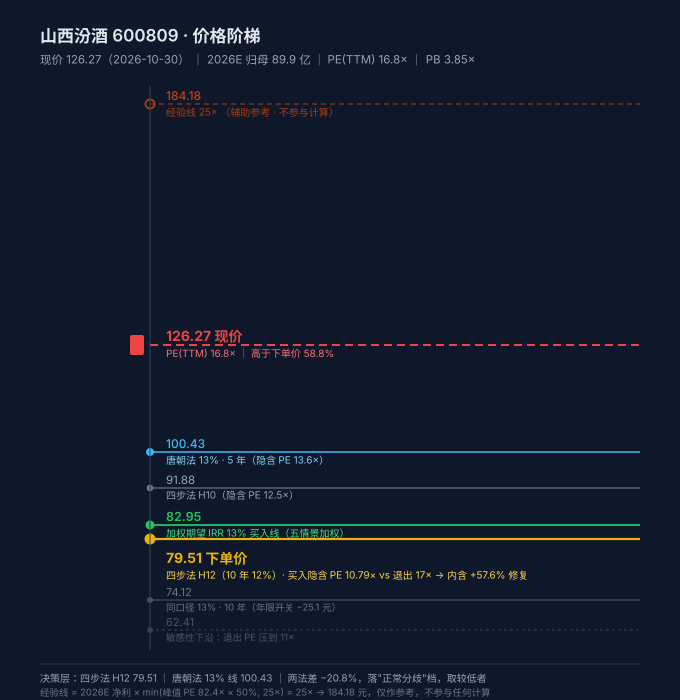

# 山西汾酒 600809 · 唐朝估值法

> 数据截止 **2026-10-30**（最近交易日）｜最新报告期 **2026Q3**（2026-10-30 披露）
> 下一个披露节点：**2026 年报**，预约 2027-03 下旬
> 现价 **126.27 元**｜总市值 **1,540.45 亿**｜总股本 **12.1996 亿股**
> 本报告与《山西汾酒-20261030-四步法》配对，接口见第 11 节

---

## 0. 一句话

**现价 126.27 元，本方法 5 年 13% 买入线 100.43 元——高了 25.7%。四步法 H12 只有 79.51 元，高了 58.8%。下单价 = 79.51 元，现价是它的 1.59 倍。**

**这不是"好公司跌下来了"，是"一门连续四年减速、今年由正转负的生意，市场还在用成长股的倍数给它定价"。**

---

## 1. 单季拆解（强制）

累计口径会掩盖拐点，必须拆到单季。

| 季 | 2026 归母 | 2025 归母 | YoY | 2026 营收 | 2025 营收 | 营收 YoY |
|---|---:|---:|---:|---:|---:|---:|
| Q1 | 53.83 | 66.48 | **−19.0%** | 149.2 | 165.2 | −9.7% |
| Q2 | 10.56 | 18.57 | **−43.1%** | 61.2 | 74.4 | −17.7% |
| Q3 | 18.99 | 29.00 | **−34.5%** | 73.4 | 89.6 | −18.1% |
| **累计** | **83.38** | **114.05** | **−26.9%** | **283.8** | **329.2** | **−13.8%** |

**三个季度全部下滑，且幅度没有收敛：−19.0% → −43.1% → −34.5%。**

更值得注意的是**利润跌得比收入快一倍**：营收 −13.8%，归母 −26.9%。这个 13.1pct 的缺口不是财务技巧，是三件事同时发生：

| 指标 | 2026 前三季 | 2025 前三季 | 变化 |
|---|---:|---:|---:|
| 毛利率 | 74.0% | 76.1% | **−2.1pct** |
| 销售费用率 | 12.75% | 10.00% | **+2.75pct** |
| 净利率 | 29.4% | 34.6% | **−5.2pct** |

**毛利率降 = 降价或降产品结构；销售费用率升 = 加大投入抢动销，但没抢回来。** 这是白酒下行周期最典型的"以价换量、量价齐失"组合。

---

## 2. 十年序列 + 增速衰减检测

| 年 | 营收（亿） | YoY | 归母（亿） | YoY | 净利率 | 毛利率 |
|---|---:|---:|---:|---:|---:|---:|
| 2019 | 118.9 | +25.9% | 19.7 | +30.6% | 16.6% | 73.4% |
| 2020 | 139.9 | +17.6% | 30.8 | +56.4% | 22.0% | 72.2% |
| 2021 | 199.7 | +42.8% | 53.1 | +72.6% | 26.6% | 74.9% |
| 2022 | 262.1 | +31.3% | 81.0 | +52.4% | 30.9% | 75.4% |
| 2023 | 319.3 | +21.8% | 104.4 | +28.9% | 32.7% | 75.3% |
| 2024 | 360.1 | +12.8% | 122.4 | +17.3% | **34.0%** | **76.2%** |
| 2025 | 387.2 | +7.5% | 122.5 | **+0.0%** | 31.6% | 74.9% |
| **2026E** | **~370** | **−4.4%** | **89.9** | **−26.6%** | 24.3% | ~74% |

**增速衰减检测（校验 3）：**

- 归母 YoY 连续四年单调下行：**+72.6% → +52.4% → +28.9% → +17.3% → +0.0%**
- 2026 前三季 **−26.9%**，已穿零
- **判定：增长收敛 + 已穿零** → 禁用历史 CAGR 外推，锚 C 必须给「不再增长」与「继续下滑」两个子情景

**2025 年这个「+0.0%」是最关键的一年**——它不是"稳住"，是"增长引擎熄火"。营收还在增 7.5%，利润零增长，说明**利润率的顶已经出现（2024 年净利率 34.0%），之后只剩往下走**。

---

## 3. 四道闸门

### 闸门 0 · 能力圈四问

1. **靠什么赚钱**：清香型白酒龙头，靠"汾酒"品牌 + 山西杏花村产区 + 玻汾/青花系列的产品梯度，卖给经销商（先款后货），经销商再卖给终端。
2. **十年后还在吗**：在。白酒是中国少有的"品牌能传代"的消费品，清香型是三大香型之一，汾酒是清香型唯一全国性品牌。
3. **利润从哪来到哪去**：一瓶酒出厂价 → 扣掉粮食/包装成本（毛利率 74%）→ 扣掉消费税（约 20%）→ 扣掉销售费用（12.75%）→ 剩下约 29% 是净利。
4. **跌 30% 更想买还是怀疑自己**：**会更想买，但要先看清这轮下滑是周期还是趋势。** 这是本报告第十节要回答的问题。

**闸门 0 通过。**

### 闸门 1 · 利润为真

| 指标 | 数值 | 阈值 | 判 |
|---|---:|---|---|
| 收现比 | **0.984** | ≥0.9 | ✓ |
| 净现比 | **0.951** | ≥0.8 | ✓ |
| 应收 ÷ 营收 | **0.0013%** | ≤10% | ✓ 先款后货，几乎无应收 |
| 资本开支 ÷ 净利 | **7.4%** | ≤30% | ✓ |

**但收现比在这里有个陷阱，必须补一句：** 白酒是"先款后货"，销售收现里含着**经销商新打进来的预收款**，而报表收入里含着**从合同负债里确认的存量预收**。两者方向相反，收现比 0.984 会把它们互相抵消掉。

**所以闸门 1 通过，但不是因为收现比好看——是因为应收几乎为零（0.0036 亿），这才是白酒真正的护城河证据。**

### 闸门 2 · 利润可持续

**不过。** 判定"增长收敛 + 已穿零"，降级为「每年复核」。本报告全部推演都按这个前提做。

### 闸门 3 · 低资本投入

capex/净利 7.4%，固定资产 32.6 + 在建 37.0 = 69.6 亿，占总资产 11.9%。**过。**

> 但要注意：在建工程 37.0 亿 > 固定资产 32.6 亿，说明**还在扩产**（技改项目）。在一个需求下滑的年份继续扩产，是加分还是减分，取决于这轮下滑是周期还是趋势——见第十节。

---

## 4. 三锚定利润中枢

| 锚 | 口径 | 数值 | 说明 |
|---|---|---:|---|
| **A 当年** | 2026E | **89.9 亿** | 前三季 83.38 + Q4 假设 6.5（2025Q4 为 8.41，按 −23% 推） |
| **B 中枢** | 5 年中位数 | **104.4 亿** | 2021–2025：53.1 / 81.0 / 104.4 / 122.4 / 122.5 → 中位 104.4 |
| **C 未来** | 2029 推演 | **见情景表** | 基准 108 亿，区间 68–130 亿 |
| TTM（校验用） | — | **91.8 亿** | 122.46 − 114.05 + 83.38 |

**锚 B 的落后度 = 104.4 ÷ 91.8 = 1.14 ≥ 0.8，按规则可用历史中位数。**

**但我必须给它打一个星号：2021–2025 是汾酒史上最好的五年。** 用这五年的中位数当"中枢"，等于假设"最好的五年就是常态"。规则里写得清楚——"5 年均值对刚从巅峰滑落的公司严重高估"。**所以锚 B 的 104.4 亿是乐观锚，不是中枢锚。**

真正的三锚关系是：**锚 A 89.9（现实）/ 锚 B 104.4（乐观）/ 锚 C 68–130（最不确定）**。

---

## 5. 估值全景（决策层）

### 5.1 先查终值占比，再决定用不用 DCF

```
NP0 = 89.9 亿，g1 = 0%（增长已穿零，不给正增长），g2 = 2%，净现金 152.7 亿（中口径）
```

| r | 年金现值 | 终值现值 | 净现金 | 合计 | 每股 | **终值占比** |
|---|---:|---:|---:|---:|---:|---:|
| 12% | 324.0 | 520.2 | 152.7 | 996.9 | 81.72 | **61.6%** |
| 10% | 340.7 | 711.5 | 152.7 | 1,205.0 | 98.77 | 67.6% |
| 6% | 378.6 | 1,712.7 | 152.7 | 2,244.0 | 183.94 | **81.9%** |

**终值占比 61.6% > 60%，按 4.8 分支，DCF 禁止作为决策依据。** 必须转情景加权。

### 5.2 情景加权（4.8 C1 分支 · 成长股失速型）

**退出 PE 随增速递增（C1 规则，不是 C2 的固定 PE）：**

| 情景 | 2029 净利 | 退出 PE | 权重 | 现价 5 年 IRR | 该情景 13% 线 | 期末市值（亿） |
|---|---:|---:|---:|---:|---:|---:|
| 极度悲观 | 68 | 11× | 10% | **−9.15%** | 47.83 | 748 |
| 悲观 | 82 | 13× | 25% | **−2.93%** | 63.52 | 1,066 |
| 偏悲观 | 95 | 15× | 25% | **+2.51%** | 80.85 | 1,425 |
| 基准 | 108 | 17× | 25% | **+7.54%** | 100.43 | 1,836 |
| 乐观 | 130 | 20× | 15% | **+14.90%** | 136.53 | 2,600 |

**权重为什么下行偏重（60%）**：Q1/Q2/Q3 净利连续 −19.0% / −43.1% / −34.5%，毛利率连降两季，销售费用率还在升，合同负债停在 56 亿不上行。**事实站在悲观那一侧，权重必须跟着事实走，不能对称分配。**

**结果：**

- **加权期望 IRR = 3.10%**
- **加权 13% 买入线 = 82.95 元**（现价高 52.2%）
- 加权 10% 线 = 93.75 元

### 5.3 价格轴

| 层 | 价格 | 相对现价 | 性质 |
|---|---:|---:|---|
| *经验线* | *184.18* | *−31.4%* | *辅助参考，不参与计算* |
| **现价** | **126.27** | **0%** | |
| 唐朝法 13%（5 年） | **100.43** | −20.5% | **本方法买入价** |
| 四步法 H10 | 91.88 | −27.2% | 对照 |
| 加权 13% 买入线 | 82.95 | −34.3% | 五情景加权 |
| **四步法 H12** | **79.51** | **−37.0%** | **下单价（两法取较低）** |
| 同口径 13%（10 年） | 74.12 | −41.3% | 年限开关 −25.1 元 |
| 敏感性下沿（退出 11×） | 62.41 | −50.6% | H12 退出倍数压到 11× |

**定位句（只按决策层判）：现价 126.27 落在「唐朝法 13% 线 100.43」之上 25.7%，是全部决策层价位中最贵的一档之上——即现价高于本方法给出的任何一个买入价位。**

*经验线 184.18 在现价上方 46%，仅作参考——它的失效原因见 5.4。*



### 5.4 经验线为什么会在这里失效（第五个死穴）

```
峰值 PE 82.4×（2021 年高点 358.66 ÷ 2021 EPS 4.35）
× 50% = 41.2× → 触顶 25×
经验线 = 89.9 亿 × 25 = 2,247 亿 → 184.18 元/股
```

**经验线 184.18 比现价高 46%，比买入线 100.43 高 83%。** 按表面读法，这像是在说"现价离历史上限还很远，很便宜"。

**这个信号是假的，两个原因：**

1. **25 倍 PE 是给"有增长的公司"的上限。** 汾酒 2026 年净利 −26.6%、增长已穿零。用 25 倍去乘一个正在下滑的利润，等于**用成长股的倍数给衰退股定价**——乘出来的数字越大，越说明这个倍数用错了，而不是越说明便宜。
2. **经验线的分子（89.9 亿）是当年利润，分母（25×）是十年前牛市的残余。** 两个数在一起没有意义。

**规则补记（本算例新增经验线第五条死穴）：当公司增长已穿零时，经验线（`当年净利 × min(峰值PE×50%, 25×)`）给出的"便宜"信号一律作废——因为 25× 本身就是成长股定价，用它乘零增长利润，得到的是"如果它还能按成长股定价"的假想价，不是价值。**

**它不是买点，也不是卖点，只是"市场情绪上限的历史投影"。**

---

## 6. 三锚 × 三方案矩阵（旧口径 · 对照）

合理 PE 三方案：A 正常化 3.0% → **27.5**（上限 30）｜B 当期国债封顶 **50**｜C 美债 5.1% → **20**

增长率 **< 12%**，按硬规则「锚A 的 ×0.7 禁用」，所以买点区间只由 **锚B ×0.6** 与 **锚C ×0.5** 两列构成：

| 合理 PE | 锚B 104.4 亿 × 0.6 | 锚C 108 亿 × 0.5 |
|---|---:|---:|
| **A · 27.5×（主口径）** | **1,723 亿 / 141.2 元** | **1,485 亿 / 121.7 元** |
| B · 50×（国债封顶） | 3,132 亿 / 256.7 元 | 2,700 亿 / 221.3 元 |
| C · 20×（美债） | 1,253 亿 / 102.7 元 | 1,080 亿 / 88.5 元 |

> 参考行：锚A 当年 × 0.7 = **1,731 亿 / 141.9 元** —— **已禁用**（增长率 <12%，误用会让人买贵 16%，茅台 2026 已实证）。
> B 方案 50× 在任何一列都远离现价（256.7 元 / 221.3 元），它不是买点，只是"当期国债封顶"的算术上限。**这张表只作历史对照，决策看第 5 节。**

---

## 7. 结论（原式口径）——这张表给出的"现价接近到位"是假信号

A 方案买点区间 = **1,485–1,723 亿 → 每股 121.7–141.2 元**。

**现价 126.27 元落在区间之内**：比下限 121.7 高 **3.7%**，比上限 141.2 低 **10.6%**。

按原式的字面读法，"现价已经进入买点区间"。**这个读数是假的，三处假设同时不成立：**

1. **分子用的是锚B 104.4 亿，而它是汾酒史上最好五年的中位数。** 2026E 已经掉到 89.9 亿，锚B 比当年利润高 **16%**。原式把"三年后净利 = 锚B"当默认前提，等于假设利润会自己回到史上最好水平。
2. **× 0.6 这个折扣的隐含前提是"利润中枢稳定、只是上下波动"。** 一家连续四年减速、今年前三季 −26.9% 的公司，中枢是在**下移**，不是在波动。折扣是给波动打的，不是给下移打的。
3. **27.5× 的合理 PE 等于 3.64% 的盈利收益率**，这是给"还在增长"的公司定的价。汾酒的增长已经穿零。

**关键校验（这一步才是本节的重点）：**

| 假设 | 分子 | 倍数 | 每股 |
|---|---|---:|---:|
| 原式主口径 | 锚B 104.4 | 27.5× × 0.6 | **141.2** |
| 只把分子换成当年 | 锚A 89.9 | 27.5× × 0.6 | **121.6** |
| 只把倍数换成反解值 | 锚A 89.9 | 13.6× | **100.4** |
| 现价 | — | 17.1× | 126.27 |

- **第二行说明问题不在分子**：即使用已经下滑过的 89.9 亿，原式仍给 121.6 元，现价只高 3.8%。换分子只挪 19.6 元。
- **第三行说明问题全在倍数**：同一份 89.9 亿利润，倍数从 27.5× 换成 13.6×，价格从 141 元掉到 100.4 元 —— 掉 41 元。**这个 13.6× 是第 5 节情景加权基准情景的反解值（100.43 元 ÷ EPS 7.37），两条独立路径在 0.03 元上重合，不是巧合，是同一个假设（利润不再增长）的两个出口。**

**所以原式失效的方式很具体：它把"利润会回来"和"市场会给 27.5 倍"两个假设叠在一起用。对一家两条都不成立的公司，叠出来的价格必然偏高——偏高的方向恰好是让人提前下手。**

**决策仍看第 5 节：13% 线 100.43 元，现价高 25.7%。**

---

## 8. 净现金调整

**这是本案第二个不确定的数，而且它不能改结论——但原因和"幅度小"无关。**

| 口径 | 构成 | 净现金 | 占市值 |
|---|---|---:|---:|
| **保守（0%）** | 货币资金 68.68 − 有息负债 1.99 − 租赁负债 20.4 | **46.3 亿** | 3.0% |
| **主口径（50%）** | + 其他流动资产 212.9 × 50% | **152.7 亿** | **9.9%** |
| 乐观（100%） | + 其他流动资产全额 | **259.2 亿** | 16.8% |

**为什么必须给三档**：汾酒 2026Q3 的「其他流动资产」是 **212.9 亿**，加货币资金后广义现金 281.6 亿，占总资产 48%。**但这 281 亿几乎没有产生利息**：2026 前三季财务费用只有 **−0.17 亿**。若 281 亿按 2% 生息，应有 5.6 亿。

**这个矛盾我没有解决**：可能是利息收入被记在别的科目（结构化数据看不到明细），也可能这 212.9 亿里大部分是待抵扣增值税、预缴消费税这类**不可支配**资产。**年报附注核实之前，按 50% 计。**

### 8.1 它影响哪一条线——两条线必须分开

| 净现金 | 决策线（情景加权基准，PE 口径） | 参照线（DCF 13% 折现） |
|---|---:|---:|
| 46.3 | **100.43（不变）** | 66.80 |
| 152.7（主） | **100.43（不变）** | **75.52** |
| 259.2 | **100.43（不变）** | 84.25 |

**决策线为什么不加：**关键在利息的**自洽性**。100.43 元来自"108 亿净利 × 17×"的反解，17× 乘的是**已经包含现金收益的净利**。再加一次现金就是同一笔钱算两次（技能 4.4.1，中国移动暴露过：剔除利息收入后买入线 85.2 → 不剔除虚高到 100 以上）。本案的逻辑是闭合的——

- 若这 212.9 亿真生息，净利会多 4 亿以上，17× 已经把这份收益算进去了 → **不能加**；
- 若它不生息（0.17 亿财务费用指向这个），它就不是现金，是不可支配资产 → **也不该加**。

**两条路都指向"不加"。所以决策线 100.43 已经是最宽厚的读法，净现金三档对它的影响是 0。**

**参照线为什么加**：DCF 公式本身就是"NP0 折现值 + 净现金"，这里的 NP0 只算了经营利润。加上现金才是完整的企业价值。**±8.7 元（66.80–84.25）。**

### 8.2 两条线为什么差 25 元

不是净现金，是**利润路径和退出倍数**：

| | 利润假设 | 终值倍数 | 每股 |
|---|---|---|---:|
| DCF | 89.9 亿**五年零增长**，之后 2% | **9.1×**（1/(13%−2%)） | 75.52 |
| 情景加权 | 2029 年回到 **108 亿** | **17×** | 100.43 |

**9.1× 终值倍数对一家 74% 毛利率、清香型唯一全国品牌的消费品公司明显过低；但 108 亿的恢复假设在三个季度连续下滑的事实面前也偏乐观。** 两个数都不是答案，它们标出的是答案的**边界：真答案在 75.52 和 100.43 之间，而现价 126.27 在两者的上方。**

**结论不翻：无论净现金取 46.3 还是 259.2，两条线都低于现价 126.27。** 净现金真正决定的是另一件事——**假如价格跌到 100 元附近，账上这 212.9 亿到底是不是安全垫**。那是"敢不敢下手"的问题，不是"现在该不该买"的问题。

---

## 9. 价格区间图

见第 5.3 节阶梯图（`山西汾酒-阶梯.svg`）。旧口径的 priceband 图本轮不单独出——因为原式在第 7 节已判定失效，画出来只会误导。

---

## 10. 失效条件与监控

**这个案子的核心问题不是"贵多少"，是"这轮下滑是周期还是趋势"。** 三个能最早证伪的数据：

| # | 指标 | 现在 | 警戒线 | 含义 |
|---|---|---:|---|---|
| 1 | **单季归母 YoY** | Q3 −34.5% | **Q4 若 > −25%，说明触底** | 连续两个季度降幅收窄 = 周期见底；继续扩大 = 趋势下行 |
| 2 | **合同负债（季末）** | 56.13 亿 | **若跌破 50 亿** | 蓄水池见底，下一年的收入没有缓冲 |
| 3 | **存货 ÷ 单季营收** | **1.96 季**（去年 1.45） | 若 > 2.2 季 | 卖不动在加剧，下一步就是降价清库存 |

**存货这条最值得盯**：143.6 亿存货，单季营收只有 73.4 亿，等于**压了 5.9 个月的货**（去年 4.4 个月）。营收 −13.8% 而存货 +10.5%，两个方向相反——**这是"渠道不要货了"最直接的证据。**

**我认为最可能失准的地方**：我给 2026E 净利 89.9 亿，假设 Q4 只有 6.5 亿。若 Q4 出现"年底冲量"（2025Q4 是 8.41 亿），全年可能到 92 亿，13% 线从 100.43 抬到 102.7。**这个幅度不改变结论。**

---

## 11. 与四步法的接口

### 判据零 · 收敛倾向

```
当前 PE = 126.27 ÷ (89.9/12.1996) = 17.14
加权退出 PE = 11×0.10 + 13×0.25 + 15×0.25 + 17×0.25 + 20×0.15 = 15.35
收敛倾向 = 17.14 ÷ 15.35 = 1.12
```

**1.12 落在 1.1–1.5 区间 → 年限开关有中等作用，收敛不是必然。**

### 判据一 · 同口径五开关

| 开关 | 唐朝法 | 四步法 | 对齐 |
|---|---|---|---|
| 起点利润 | 89.9 亿 | 89.9 亿 | ✓ |
| 情景与权重 | 五情景（68/82/95/108/130，权重 10/25/25/25/15） | **完全相同** | ✓ 共享 |
| 退出 PE | 基准 17× | 基准 17× | ✓ |
| 税率 | 0%（A 股持股 >1 年免税） | 0% | ✓ |
| **年限** | **5 年** | **10 年** | ✗ 唯一差异 |

> **⚠ 情景共享声明（禁止 46）**：两法用的是同一组情景与退出倍数，只有年限不同。**所以下面的"收敛"只能证明"两种折现结构在给定假设下算得一样"，不能证明"这套假设是对的"。验证强度打折。**

### 判据二 · 差异拆到开关级（`gate.py` 产出，金额空间）

```
总差 = 79.5105 − 100.4346 = −20.9241 元（−20.8%）

  要求回报 13%→12%（5 年不变）   +4.1914   ← PV(12%,5y) 104.6260 − PV(13%,5y) 100.4346
  年限 5→10 年（12% 不变）      −25.1155   ← PV(12%,10y) 79.5105 − PV(12%,5y) 104.6260
  ────────────────────────────────────
  Σ                           −20.9241
  残值（脚本算出）                 +0.0000
```

**残值 0.0000 元，拆得极干净。** 但按硬规则 20，这**不等于验证通过**——必须同时看判据三。

### 判据三 · 分歧幅度

**两法买点差 −20.8%，落在「10–30% 正常分歧」档 → 取较低者为下单价：79.51 元。**

**但有一个更重要的发现（H 档三数纪律）：**

```
H12 = 79.51 元，对应 EPS(2026E) 7.369 → 买入隐含 PE = 10.79×
退出 PE = 17×
内含倍数修复 = 17 ÷ 10.79 − 1 = +57.6%
期末 EPS 8.85（当前 7.37，+20.1%）→ 终值 150.50，与现价 126.27 差 +19.2%（不构成价格回归）
```

**79.51 这个价格里，57.6% 的收益要靠"PE 从 10.8 倍修复到 17 倍"来实现。** 退出倍数敏感性：

| 退出 PE | 11× | 13× | 15× | **17×** | 20× |
|---|---:|---:|---:|---:|---:|
| H12 | **62.41** | 68.11 | 73.81 | **79.51** | 88.06 |

**这就是本案最脆的地方**：如果市场不再给汾酒 17 倍（2019 年以来它从没在零增长时拿过 17 倍），下单价就是 62–68 元，不是 79.51。

**结论：两法在"现价太贵"上完全一致（都高 25%–59%），但在"该在哪个价买"上分歧 20.8%，而且这个分歧的 76% 来自年限开关（−25.1 元）、24% 被要求回报下调抵消（+4.2 元）。**

---

## 12. 数据来源与可复现

- 行情：`qt.gtimg.cn` 2026-10-30 收盘
- 财务：东财 `RPT_DMSK_FN_INCOME`（25 期年报 + 季度）、`RPT_F10_FINANCE_GBALANCE`（含合同负债 `CONTRACT_LIAB`）、`RPT_DMSK_FN_CASHFLOW`
- 分红：`RPT_SHAREBONUS_DET`（2015–2025）
- 脚本：`分析脚本/汾酒_双方法.py`｜结果 `result.json`
- 交付闸门：`gate.py` → `decomp()` 残值 0.0000 元 / `hurdle()` 三项自检全过

---

## 13. 一句话结论

**等。** 不是"等它跌到 79.51"——是**先等它证明自己止住了**（Q4 单季降幅收窄 + 存货/营收比回落），再谈价格。

---

## 修订记录

- 2026-11-01 初版。第十七个标的，第一个"增长已穿零的白酒龙头"。
- 2026-11-01 修正第一版的三处错误（原式矩阵的数字与结构、第 7 节区间、第 8 节净现金敏感性）。**错误性质：第一版的第 6–8 节是手写的，没有跑脚本；改用脚本复算后，原式矩阵整体抬高，第 7 节的结论方向由"现价高出区间 2.1 倍"反转为"现价落在区间之内"——这一反转是本节最有价值的部分，它把原式的失效机制暴露了出来（倍数错，不是利润错）。已据此在技能里新增"原式矩阵必须程序计算"的硬性要求。**
- 本轮新增：经验线第五条死穴（增长穿零时经验线失效）、高预收行业收现比必须配合合同负债看、净现金"加不加"的自洽性判据（生息则已在净利里 / 不生息则不是现金）。见技能 v3.10.4。
