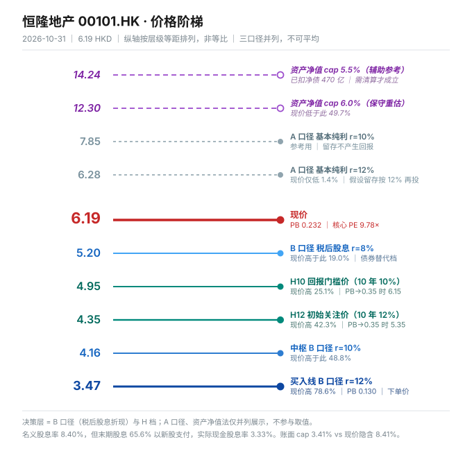

# 恒隆地产（00101.HK）唐朝估值法报告

> **数据截止日 2026-10-31**｜最新已披露报告期 **2026 年中期（截至 6/30）**｜下一节点 **2026 年度业绩，预计 2027 年 1 月下旬**
> 现价 **6.19 HKD**｜股本 **52.03 亿股**｜市值 **322.1 亿港元**
> 方法版本：tangchao-valuation **v3.9**（本轮新增「投资物业（收租型）」分支）
> 研究序位：第十五个标的，**第一只港股收租型投资物业**

---

## 0. 这一份报告要先说清三件事

**第一，这是一家"资产按 3.4% 记账、市场按 8.4% 定价"的公司。**

| | 数值 |
|---|---|
| 投资物业账面值 | **1,952.56 亿港元**（占总资产 87.6%） |
| 2025 年租赁营业溢利 | **66.63 亿港元** |
| **账面隐含 cap rate** | **3.41%** |
| 市值 + 净负债（EV） | **792.6 亿港元** |
| **现价隐含 cap rate** | **8.41%** |
| **缺口** | **5.00 个百分点** |

这 5 个百分点不是一个数字，是**整个投资命题**。信 3.41%，它值 28.5 元/股；信 8.41%，它值 6.17 元/股——正好是现价。

**第二，名义股息率 8.40%，实际到手现金股息率 3.33%。**

2025 年末期股息 20.23 亿港元，其中 **65.6% 用新股支付**（实际发行 1.46 亿股，占已发行 2.90%），现金只付了 6.96 亿。这是本轮最重要的一个发现，第 4 节给完整证据。

**第三，这份报告的结论不是"贵"，是"口径失效"。**

同一家公司，三个口径给出三个价格：

| 口径 | 分子 | 12% 要求下的价值 | 含义 |
|---|---|---:|---|
| A 永续年金 | 基本纯利 32.02 亿 | 6.28 HKD | 赚到的钱值多少 |
| **B 股息折现** | 税后股息 0.416 | **3.47 HKD** | **分到的钱值多少** |
| C 资产净值 | 租赁溢利 66.63 亿（cap 5.5%） | 14.24 HKD | 卖掉的资产值多少 |

**差 4.1 倍。** 这不是参数误差，是三种完全不同的东西。第 5 节说明为什么必须取 B 为主口径、以及 A 和 C 各自错在哪。

---

## 1. 半年拆解（港股无季报，用半年+分部替代）

### 1.1 2026H1 vs 2025H1

| 项目（亿港元） | 2026H1 | 2025H1 | 变动 |
|---|---:|---:|---:|
| 收入 | 61.13 | 49.68 | **+23.0%** |
| — 物业租赁 | 49.23 | 46.78 | **+5.2%** |
| — 酒店 | 1.47 | 1.29 | +14.0% |
| — **物业销售** | **10.43** | 1.61 | **+548%** |
| 营业溢利 | 32.55 | 32.55 | **0.0%** |
| 股东应占基本纯利 | **14.36** | 15.94 | **−9.9%** |
| 股东应占纯利 | 7.58 | 9.12 | −16.9% |
| 每股基本盈利 | 0.28 | 0.31 | −9.9% |

**收入 +23% 而营业溢利一分不涨，全部增量来自零毛利的物业销售。** 香港物业销售 10.15 亿对应营业亏损 0.30 亿；内地 0.28 亿对应亏损 0.16 亿。销售部分整体亏 1.87 亿（2025H1 只亏 0.57 亿）。

**物业租赁才是本体：+5.2%（港币）/ +3%（人民币）。差额 2.2pct 全是汇率——人民币兑港币升值。**

### 1.2 分部真相（2026H1）

| 分部 | 收入（亿） | 同比 | 营业溢利（亿） | 同比 |
|---|---:|---:|---:|---:|
| 物业租赁·内地 | 34.42 | **+8%**（人民币 +3%） | 23.28 | +7% |
| 物业租赁·香港 | 14.81 | **−1%** | 11.43 | −2% |
| 酒店（内地） | 1.47 | +14% | −0.29 | 亏损收窄 15% |
| 物业销售·内地 | 0.28 | +180% | −1.57 | 亏损扩大 504% |
| 物业销售·香港 | 10.15 | +572% | −0.30 | — |
| **合计** | **61.13** | **+23%** | **32.55** | **0%** |

### 1.3 内地商场十场全表（2025 年，人民币百万元）——这是全篇最重要的一张表

| 商场 | 2025 收入 | 2024 | YoY | 2025 出租率 | 2024 |
|---|---:|---:|---:|---:|---:|
| 上海恒隆广场 | 1,661 | 1,648 | **+0.8%** | 96% | 99% |
| 上海港汇恒隆 | 1,197 | 1,172 | **+2.1%** | **100%** | 99% |
| 无锡恒隆 | 502 | 456 | **+10.1%** | 100% | 99% |
| 大连恒隆 | 331 | 295 | **+12.2%** | 95% | 94% |
| 昆明恒隆 | 328 | 300 | **+9.3%** | 99% | 98% |
| 济南恒隆 | 323 | 317 | +1.9% | 97% | 93% |
| 沈阳皇城 | 172 | 163 | +5.5% | 98% | 94% |
| 天津恒隆 | 165 | 170 | −2.9% | 94% | 95% |
| **武汉恒隆** | **140** | 203 | **−31.0%** | 90% | 85% |
| **沈阳市府** | **52** | 81 | **−35.8%** | 89% | 87% |
| **合计** | **4,871** | **4,805** | **+1.4%** | **96%** | 94% |

**这张表推翻了"整体衰退"的叙事，也推翻了"顶级资产"的叙事。**

- 上海两场占内地商场收入 **58.7%**，且在上海奢侈品退潮的 2025 年还涨了。这是真护城河。
- 无锡、大连、昆明三个腰部项目 +9~12%，在变好。
- **武汉 −31%、沈阳市府 −36%**，两个项目占收入 3.9%，但在崩塌。
- **合计 +1.4%：分母稳住了，因为上海太大、尾部太小。**

**关键结构：58.7% 的收入来自 2 个商场，41.3% 来自 8 个商场。**

### 1.4 办公楼——管理层自己给了时间表

- 内地办公楼收入 **10.05 亿人民币（−8%）**，出租率 **80%**
- 香港办公楼 **10.04 亿港元（−1%）**，出租率 **90%**
- CEO 原话："内地写字楼供应持续增加，出租率能保持八成以上已属不错，**预计困难期仍将持续 18–24 个月**"

**这是本报告唯一采信的管理层前瞻指引**——因为它比任何乐观假设都更保守，且与自己的一线数据一致。

---

## 2. 五年序列与增速衰减检测

### 2.1 官方财务摘要（亿港元）

| 年 | 收入 | 物业租赁 | 股东应占**基本**纯利 | 报表纯利 | DPS | BPS | 净债率 | 股本（亿股） |
|---|---:|---:|---:|---:|---:|---:|---:|---:|
| 2021 | 103.21 | 102.08 | **43.65** | 38.68 | 0.78 | 31.50 | 24.4% | 44.99 |
| 2022 | 103.47 | 99.46 | **41.99** | 38.36 | 0.78 | 29.65 | 28.1% | 44.99 |
| 2023 | 103.16 | 101.62 | **41.37** | 39.70 | 0.78 | 29.43 | 31.9% | 44.99 |
| 2024 | 112.42 | 95.15 | **30.95** | 21.53 | **0.52** | 27.51 | 33.4% | 47.84 |
| 2025 | 99.50 | 93.89 | **32.02** | 18.06 | 0.52 | 26.64 | 32.7% | 50.57 |
| 2026H1 | 61.13 | 49.23 | **14.36** | 7.58 | 0.12 | 26.63 | 31.6% | 52.03 |

### 2.2 衰减检测

| 检测项 | 结果 | 判定 |
|---|---|---|
| 基本纯利 YoY | −3.8% / −1.5% / **−25.2%** / +3.5% | **已穿零**（2024 破位） |
| 租赁收入 2021→2025 | **−8.0%**（五年） | 持续下行 |
| BPS 2021→2025 | **−15.4%**（年化 **−4.10%**） | **每股价值在缩水** |
| 报表纯利 vs 基本纯利 | 2025：18.06 vs 32.02 | **差 13.96 亿，全部是重估亏损** |

**判定：已穿零 + 每股价值缩水 → 锚 C 必须给"不再增长"和"继续下滑"两个子情景；禁止用历史 CAGR 外推。**

### 2.3 BPS 为什么缩水 15.4%：拆开看，一半是假的

| 分项 | 五年变化 |
|---|---:|
| 股东权益 1,417.19 → 1,347.29 | **−4.9%** |
| 股本 44.99 → 50.57 | **+12.4%** |
| **BPS 31.50 → 26.64** | **−15.4%** |

验算：0.951 ÷ 1.124 − 1 = −15.4% ✓

**结论：每股价值的损失里，真实资产减值只有 −4.9%（年化 −1.0%），其余 −12.4% 是股本被"切碎"——以股代息。**

这个区分决定了一切。如果是资产在贬值 15%，那是灾难；只是饼切得更碎，总价值只少了 4.9%，性质完全不同。但它也说明另一件事：**这家公司五年的净资产总额在缩水，不是"资产升值、股本增加"的良性稀释。**

---

## 3. 四道闸门（收租型改造）

> 原闸门 1 的收现比、净现比阈值，闸门 3 的"capex/净利 ≤30%"，都是按制造业设计的。收租型必须换口径——**它们的现金流天然好于利润表，而利润表本身被公允价值改写。**

### 闸门 0 · 能力圈四问

1. **靠什么赚钱**：在内地 10 个城市和香港持有并运营商场、办公楼，收租金。上海两场是利润的 58.7%。
2. **十年后还在吗**：上海南京西路和徐家汇的地段不会消失，商场不会关。但"盒子式大商场"这个形态在被"街区+体验"替代——这是不确定性，不是消失。
3. **利润从哪来到哪去**：租金 → 减运营开支 → 营业溢利 66.63 亿 → 减利息 9.54 亿 → 减税 → 减少数股东 5.22 亿 → 基本纯利 32.02 亿 → 派息 27.06 亿（其中 65.6% 印股票）。
4. **跌 30% 更想买还是怀疑自己**：**会怀疑自己。** 因为它跌 30% 时，租金大概率也在跌——这是它过去三年的实际模式。

### 闸门 1 · 利润为真（改造口径）

| 指标 | 数值 | 判定 |
|---|---|---|
| 5 年累计经营现金流 ÷ 累计基本纯利 | 214.03 ÷ 190.00 = **1.13×** | ✅ 过（≥0.8） |
| 单年 2025：OCF ÷ 基本纯利 | 58.64 ÷ 32.02 = **1.83×** | ✅ 过 |
| OCF ÷ 报表纯利 | 58.64 ÷ 18.06 = **3.25×** | 过（差额是重估的非现金亏损） |
| 应收账款 ÷ 收入 | 27.37 ÷ 99.50 = **2.8%** | ✅ 过 |

**收租生意的现金流质量天然好——租金按月收，没有账期。这一关它比绝大多数制造业干净。**

但要点名一个反面：**OCF 58.64 亿里，有多少是"维持性"、多少是"一次性"?** 2025 年租金收入跌 1% 而 OCF 涨 18%（49.56→58.64），主要是营运资本改善（应付款增加），不可外推。

### 闸门 2 · 利润可持续 → **不过**

见第 2.2 节：已穿零，基本纯利五年 −26.6%，租赁收入五年 −8.0%。

**这一关不过，按规则应停止计算。** 但——它是重资产收租股，利润的周期性来自"重估"和"利息成本"，不是经营崩塌。所以正确处理不是"出否决卡"，而是**把计算降级为"区间 + 敏感表"，不出单点买点**（这也是三锚极差 42.7% 的直接后果）。

### 闸门 3 · 低资本投入 → **不过，必须用 FCF**

商场需要持续翻新（上海恒隆广场 2026 年下半年完成扩建、无锡二期、杭州新开）。资本开支不是"扩张"或"维持"能分开的——**商场不翻新就掉租金**。

**处理：不用净利 DCF 做决策层，改用「股息 + 终值」，并用 FCF 交叉校验。**

### 闸门结论

| 闸门 | 结果 |
|---|---|
| 0 能力圈 | ✅ |
| 1 利润为真 | ✅（改造口径，5 年 1.13×） |
| 2 利润可持续 | ❌ **已穿零** |
| 3 低资本投入 | ❌ **必须用 FCF/股息口径** |

**两个不过。但不过的原因是"这是一门重资产的收租生意"，不是"这是一门坏生意"。**

---

## 4. 本轮核心发现：股息里的 65.6% 是印出来的

### 4.1 证据链（全部来自港交所公告，非推算）

2026-05-18 以股代息通函：
> 记录日已发行股份 **5,056,646,442 股**。倘并无接获任何以股代息股份的选择，则本公司应付的现金股息总额将约为 **2,022,658,577 港元**。倘全体合资格股东选择以股代息，将发行不超过 **223,251,498 股**。

2026-06-15 翌日披露报表：
> 以股代息——涉及新股，配发及发行新股份，**146,436,086 股（2.8959%）**，每股发行价 **HKD 9.06**。结存 **5,203,082,528 股**。

### 4.2 算术

| 项 | 数值 |
|---|---:|
| 末期股息总额（若全现金） | 20.23 亿 |
| 全以股代息上限股数 | 2.2325 亿股（4.42%） |
| **实际发行股数** | **1.4644 亿股（2.90%）** |
| **以股代息占比** | **65.6%** |
| **实际现金支出** | **6.96 亿（34.4%）** |

### 4.3 推论：三档股息率

| 口径 | DPS | 股息率（税前） | 税后（港股通 20%） |
|---|---:|---:|---:|
| **名义**（用 0.52） | 0.520 | **8.40%** | 6.72% |
| **实际现金**（中期 0.12 + 末期×34.4%） | **0.258** | **4.16%** | **3.33%** |
| 若选股票（0 现金，比例不变） | 0 | 0% | 0% |

**市面上的"8.4% 高息"是按名义 DPS 算的，其中 65.6% 你拿到的是新股，不是钱。**

### 4.4 这不是被迫，是主动选择

管理层在 2024 年报里写得很清楚：削减股息的原因是"**加上公司有意降低负债比率**"。

而现金流是够的：2025 年 OCF 58.64 亿 − 已付利息约 9.5 亿 − 现金派息 7.0 亿 = **42.1 亿可用于 capex**。

**所以：公司不是没钱，是不愿意用现金派息。它选择用股票保住现金去还债和盖楼。**

### 4.5 代价：股本两年半膨胀 15.6%

| 时点 | 股本（亿股） | 增幅 |
|---|---:|---:|
| 2023 年底 | 44.99 | — |
| 2024 年底 | 47.84 | +6.3% |
| 2025 年底 | 50.57 | +5.7% |
| 2026-06（本次派息后） | **52.03** | +2.9% |

**两年半 +15.6%。这是一个每年 5–6% 的隐性摊薄。**

### 4.6 对估值的直接影响

**选现金的股东**：拿 3.33% 税后现金，但持股比例每年被摊薄约 3%。
**选股票的股东**：0 现金，比例不变——等于"公司没派息"。

**两种选择的实质都是：这不是一只 8.4% 的股息股，是一只"3.3% 现金 + 5% 摊薄"的股票，或者"0 现金 + 0 摊薄"的股票。**

---

## 5. 估值全景：三个口径并列（这是唯一的决策依据）

### 5.1 为什么必须三个口径并列

这家公司的"利润"不是经营结果，是**估值师的函数**：

| 年份 | 报表纯利 | 重估损益 | 基本纯利 |
|---|---:|---:|---:|
| 2023 | 39.70 | −1.67 | 41.37 |
| 2024 | 21.53 | −9.42 | 30.95 |
| 2025 | 18.06 | **−13.96** | 32.02 |
| 2026H1 | 7.58 | **−6.78** | 14.36 |

**同一栋楼，换个估值师，利润差一倍。** 所以 PE（表观 17.33×）没有信息量，只能用三个不同的东西分别回答三个不同的问题。

### 5.2 三口径全景表

| 口径 | 分子 | 分母 | r=8% | **r=10%** | **r=12%** | 相对现价 6.19 | 性质 |
|---|---|---:|---:|---:|---:|---:|---|
| **A 永续年金** | 基本纯利 32.02×1.02 | r−2% | 10.46 | **7.85** | **6.28** | **−1.4%** | 参考（高估） |
| **B 股息折现** | 税后股息 0.416 | r−0% | 5.20 | **4.16** | **3.47** | **+78.6%** | **决策层** |
| *C 资产净值（cap 5.5%）* | *租赁溢利 66.63* | *cap−净债* | *14.24* | *14.24* | *14.24* | *−56.5%* | *辅助参考* |

### 5.3 为什么取 B（股息折现）为主口径，A 和 C 各错在哪

**A 口径（基本纯利永续年金）错在：它假设"留存的钱能按 r 再投资"。**

按第 4.4.4 条做一次检验：

```
理论增长 = ROE × (1 − 派息率)
         = 2.38% × (1 − 82.1%)
         = 0.43%

实际增长（2021→2025 基本纯利年化）= −6.0%

缺口 = 6.4 pct  > 5pct  →  触发，必须换股息口径
```

ROIC 只有 **1.76%**（基本纯利 32.02 ÷ (股东权益 1,347.29 + 净负债 470.53)）。

**留存的 4.96 亿/年去哪了？还债、盖楼、翻新。没有一个渠道产生 12%。** 所以 A 口径给的 6.28 元是虚的，它把"公司赚的钱"当成了"你能拿到的钱"——这正是格力那条规则的翻版。

**C 口径（资产净值）错在：它假设"资产的价值 = 股东的价值"。**

资产确实值 1,952 亿（账面）。但：
1. 里面压着 **470.53 亿净负债**，银行先拿
2. 每年 9.54 亿利息要先付
3. capex 要吃掉一大块
4. 剩下的才能派息，而派息的 65.6% 还是股票
5. **最关键：这些资产不会卖。** 陈氏家族通过恒隆集团持股约 60%，不会卖上海恒隆广场，不会私有化，不会清盘

**所以"资产值 14 元"和"股东拿得到 3.5 元"可以同时成立。** 中间那 10.5 元属于银行和"不卖"这两个字。

**这就是本轮的方法论核心：对收租型投资物业，NAV 是"如果清算值多少"，DCF 是"如果继续持有能拿多少"——两者不是同一个问题，不能平均，只能并列。**

### 5.4 DCF 在这类资产上会算出自相矛盾的数

标准两阶段 DCF（EV 法）在这里会崩：

| r | g2 | EV（亿） | 每股 |
|---|---|---:|---:|
| 6% | 2% | 1,186.8 | 13.77 |
| 8% | 2% | 791.2 | 6.16 |
| 10% | 2% | 593.4 | 2.36 |
| **12%** | **2%** | **474.7** | **0.08** |

**r 从 8% 到 12%，每股从 6.16 掉到 0.08——变动 99%。**

原因：永续年金的 EV = NOI/(r−g)，分母 (r−g) 从 6% 变 10%，价值就掉 40%；再减掉 470 亿净负债（占 EV 的 59%），剩余的股权价值被杠杆放大到趋近零。

**这不是"恒隆不值钱"，是"任何永续资产的 DCF 都对 r 极度敏感"。** 所以本轮**不用 EV 法 DCF 做决策**，改用股权口径（分子是税后股息，不扣净负债——因为股息已经是付息后的）。

### 5.5 现价隐含的要求回报

| 假设 | 隐含股权成本 r |
|---|---:|
| g = 0%（租金零增长） | **9.94%** |
| g = 2%（温和增长） | **12.14%** |
| g = 3% | 13.24% |

**这是全篇最需要说清的一个数：现价 6.19 对应 9.9%–12.1% 的预期回报，取决于你信不信租金会涨。**

- 信 g=2%，现价刚好够 12%——**但 g=2% 与"内地办公楼还要难 18–24 个月"矛盾**
- 信 g=0%，现价只给 9.94%——**差 2 个点**
- 而 2026H1 的实际数据是：租赁 +3%（人民币）、办公楼还在跌、香港 −1%

**我的判断：g 给 0–1% 更合理，对应要求回报 9.9%–10.5%。现价不够 12%。**

### 5.6 价格阶梯



| 层次 | 价格（HKD） | 对应 PB | 说明 |
|---|---:|---:|---|
| 资产净值（cap 5.5%） | *14.24* | *0.535* | *辅助参考，需清算或重估修复* |
| 账面每股净资产 | *26.64* | *1.000* | *账面 BPS，市场从不认可* |
| 资产净值（cap 6.0%） | *12.30* | *0.462* | *保守重估* |
| **A 口径 r=10%（g2%）** | **7.85** | 0.295 | 参考（高估） |
| **A 口径 r=12%（g2%）** | **6.28** | 0.236 | 参考 |
| **★ 现价** | **6.19** | **0.232** | — |
| B 口径 r=8%（g0） | 5.20 | 0.195 | 债券替代档 |
| **B 口径 r=10%（g0）** | **4.16** | 0.156 | 中枢 |
| **B 口径 r=12%（g0）** | **3.47** | **0.130** | **买入线** |

---

## 6. 三锚 × 三方案矩阵（旧口径·对照，不构成决策）

**先说结论：唐朝原式（合理 PE = 1÷无风险收益率）在这家公司上完全不可用。**

| 方案 | 无风险收益率 | 合理 PE | 合理估值 | 三年后×PE | 买点（五折） |
|---|---:|---:|---:|---:|---:|
| A 正常化 | 3.0% | 27.5× | 880 亿 | 968 亿 | 484 亿 → **9.3 元** |
| B 书中原教旨 | 1.65% | 50×（封顶） | 1,601 亿 | 1,761 亿 | 880 亿 → **16.9 元** |
| C 全球对照 | 5.0% | 20× | 640 亿 | 704 亿 | 352 亿 → **6.8 元** |

**为什么不可用**：这套公式假设"利润全部可分配 + 三年后零增长 + 风险等于国债"。恒隆三条全不满足——利润的 44% 被重估抹掉、租金在负增长、净负债 470 亿。

**用 A 方案会得到 9.3 元的"买点"，比现价高 50%——它会告诉你"现在就该买"。** 这个数与本报告主口径（3.47）差 168%，只能作历史对照。

---

## 7. 三锚定利润中枢

| 锚 | 口径 | 数值（亿港元） | 说明 |
|---|---|---:|---|
| **A 当年** | 2026E 基本纯利 | **29.00** | H1 已 14.36，H2 租赁改善但物业销售亏，全年 29 |
| **B 中枢** | 5 年中位数（2021–2025） | **41.37** | 落后度 = 41.37 ÷ 29.00 = **1.43 ≥0.8 → 可用** |
| **C 三年后** | 2029 推演 | **30.00** | 见下 |

**三锚极差 = (41.37 − 29.00) ÷ 29.00 = 42.7% > 30%**

**按硬规则 3：判定"估值不确定性过高"，不出单一买点，只出区间，且必须注明哪个锚最可能失真。**

**最可能失真的是锚 B（41.37 亿）。** 它包含 2021–2023 三年（当时内地租金 100+ 亿、利息成本只有 5–7 亿）。这三年是"低利率 + 租金高位"的组合，不会重现。**用 41.37 做中枢，会把 2024 年的下台阶读成"周期性波动"。**

### 7.1 锚 C 的两个子情景（已穿零，强制）

| 子情景 | 2029 基本纯利 | 假设 |
|---|---:|---|
| 不再增长 | 29.0 | 租金持平，利息持平 |
| 温和恢复 | 33.0 | 杭州开业贡献 + 零售复苏，租金 +2%/年 |
| **继续下滑** | **22.0** | 办公楼跌到 2027、香港零售继续掉、利息上行 |

**中枢取 30.0（介于"不再增长"与"温和恢复"之间），这是三锚里最接近现实的。**

### 7.2 正常化利润敏感性（第 45 条：锚 B 未禁用，但极差 >30%，按同精神必做）

| 正常化假设 | 依据 | 对应 B 口径买入线（r=12%） |
|---|---|---:|
| 22 亿（继续下滑） | 办公楼再跌两年 | 2.38 |
| **29 亿（当年水平）** | **2026E 实际** | **3.13** |
| 33 亿（温和恢复） | 杭州 + 零售复苏 | 3.57 |
| 41.37 亿（五年中位） | 含 2021–23 高基数 | 4.47 |

**H 档跨度 2.38 → 4.47，差 88%。这就是"三锚极差 42.7%"翻译成价格后的样子。**

---

## 8. 净现金调整 → 这里是**净负债 470.53 亿**

> **第 43 条（v3.7 神华补丁）在本标的上的第一次港股应用。**

| 项 | 金额（亿港元） |
|---|---:|
| 长期贷款 | 478.44 |
| 短期贷款 | 57.14 |
| 有息负债合计 | **535.58** |
| 减：现金及等价物 | 65.05 |
| **净负债** | **470.53** |
| 净负债 ÷ 市值（322.1） | **146.1%** |
| 净负债 ÷ 总权益（1,489.84） | **31.6%**（官方口径 31.6% ✓） |
| **现金覆盖率 = 现金 ÷ 有息负债** | **0.12×**（远低于 1.5） |

**判据：现金覆盖率 0.12×，A′ 类模板（净现金三档）完全不可用。必须写成"减净负债"。**

### 8.1 关键正面事实：杠杆三年半没有恶化

| 期末 | 净负债（亿） | 净债率 | 投资物业（亿） |
|---|---:|---:|---:|
| 2023-12 | 453.5 | 31.9% | 1,926.6 |
| 2024-12 | 470.7 | 33.4% | 1,905.2 |
| 2025-12 | 472.5 | 32.7% | 1,952.6 |
| 2026-06 | **470.5** | **31.6%** | **2,005.4** |

**三年半，净负债只增 17 亿，净债率从 31.9% 降到 31.6%。**

这在一个同时做杭州新开（100 亿级）、无锡二期、上海扩建的公司身上，是相当强的财务纪律。对比同期暴雷的内房企业，恒隆的资产负债表是干净的。

**但代价就是第 4 节那件事：用股票付息，把现金留给 capex 和还债。**

### 8.2 到期结构：短期压力小

短期贷款 57.14 ÷ 有息负债 535.58 = **10.7%**。这是安全的。

---

## 9. 结论

### 9.1 方向

**不买。**

| 口径 | 买入线（r=12%） | 现价 | 差距 |
|---|---:|---:|---:|
| **B 股息折现（主口径）** | **3.47** | 6.19 | **高 78.6%** |
| B 中枢（r=10%） | 4.16 | 6.19 | 高 48.8% |
| 四步法 H12（10 年，PB 不变） | 4.35 | 6.19 | 高 42.3% |
| A 永续年金（参考，高估） | 6.28 | 6.19 | 低 1.4% |
| *C 资产净值（辅助，需清算）* | *14.24* | *6.19* | *低 56.5%* |

### 9.2 三句话

1. **它不是"贵得离谱"，是"回报结构不够"。** 现价给的税后股息 6.72%（实际现金 3.33%），加 BPS 增长 0%，长期回报 5–7%。要 12% 得跌到 3.5–4.2。
2. **0.23 倍 PB 不是错杀，是市场对"3.41% 账面 cap rate"的否定。** 市场按 8.41% 定价。这 5 个百分点的差距，就是"租金会不会继续跌"的全部赌注。
3. **资产值 14 元、股东拿 3.5 元，两件事同时成立。** 中间 10.5 元属于银行（净负债 470 亿）、属于 capex（每年翻新）、属于"陈氏家族不卖"。

### 9.3 什么情况下会改判

| 触发条件 | 含义 |
|---|---|
| 内地商场租金（人民币）连续 2 季 +5% 以上 | g 可以给 2%，A 口径重新成立 |
| **停止以股代息、恢复全额现金派息** | 股息率变成真 8.4%，回报直接上一档 |
| 上海恒隆广场扩建开业后首年租金 +10% | 顶级资产重新定价 |
| **股价跌到 4.16 以下** | 税后股息到 10%，进入"债券替代"区间 |

---

## 10. 失效条件与监控

| 监控项 | 当前 | 警戒线 | 为什么 |
|---|---:|---:|---|
| **以股代息比例** | **65.6%** | >70% | 超过就是"实质停派现金" |
| 内地商场出租率 | 96% | <92% | 上海两场是估值的地基 |
| 上海恒隆广场收入 | +0.8% | 转负 | 旗舰失守 = 护城河失效 |
| 内地办公楼出租率 | 80% | <75% | CEO 说还要难 18–24 个月 |
| 净债率 | 31.6% | >38% | 杠杆重新上升会压股息 |
| 投资物业重估 | 连续 4 年为负 | 第 5 年 | 账面的 3.41% cap 还能撑多久 |
| 派息 | 0.52（三年未变） | 再削 | 2024 已削 33% |

**最早能证伪的三个数**：① 2026 年报的以股代息比例；② 2027 年 1 月业绩里的内地办公楼出租率；③ 杭州恒隆广场开业后首个完整半年的租金。

---

## 11. 与四步法的接口

| 判据 | 结果 |
|---|---|
| **零 · 收敛倾向** | 当前 PB 0.232 ÷ 退出 PB 0.232 = **1.00** → 估值回归贡献在**终值端为零**，全部转化为"买入价低于现价"这一块（见 11.1）→ **年限开关失效，两法必然收敛**（第 38 条：验证强度低） |
| **一 · 五开关对齐** | 起点：基本纯利 32.02 亿（同）；年限：唐朝法永续 DDM vs 四步法 10 年；退出：PB 0.232（同）；税率：20%（同）；聚合：单点（同） |
| **二 · 差异拆解** | DDM 3.47 vs H12 4.35，差 −20.2%。**只有一个分量**：四步法终值现值 **1.99**（26.64×0.232 ÷ 1.12¹⁰）− 被它替换掉的永续股息现值 **1.12**（3.47 ÷ 1.12¹⁰）= **+0.87 元**，占 3.47 的 **+25.2%** / 占 4.34 的 **−20.1%**。**「年限」与「终值」不是两个分量，是同一件事的两面**——截断第 11 年起的股息，换成一个退出价。残值 0.00 |
| **三 · 分歧幅度** | 同口径买点差 **−20.2%**，落在 **10–30% 正常分歧**档 → 取较低者 **3.47**。**但取 3.47 的真实理由不是规则，是结构**：4.35 里有 0.87 元依赖"十年后股价回到今天"，3.47 不含此项（见 11.1） |

**但必须声明：收敛倾向 1.00，两法收敛是结构决定的，不是互相验证（第 38 条）。**

**真正有价值的不是"两法接近"，而是"两法都把 A 口径的 6.28 否掉了"：**
- 唐朝法的 4.4.4 检验（缺口 6.4pct）→ 换股息口径
- 四步法的 H 档（退出 PB 不给溢价）→ 终值压到 6.18

**两条完全独立的路径，都指向"留存的钱不算钱"。这个共识比数字接近更有意义。**

### 11.1 一个必须说清的结构问题：四步法的终值就是现价

四步法 H12 的终值 = `期末 BPS 26.64 × 退出 PB 0.232 = **6.18**`，现价 **6.19**。**两者相等不是巧合，是构造出来的**——只要假设 BPS 零增长、退出 PB = 当前 PB，终值就必然等于现价。

由此推出三件事：

**① 4.35 这个买入价对应的买入 PB 是 0.163，不是 0.232。**（4.35 ÷ 26.64）从 0.163 到退出 0.232，**内含一次 +42% 的 PB 修复**。所以"PB 不变"这个标签只对**退出端**成立，对买入端不成立——**它的真实含义是"PB 从 0.163 修复到 0.232"，不是"PB 一直不变"。**

**② 这块修复贡献了 4.35 里的 0.87 元（20%）。** 退出 PB 敏感性：

| 退出 PB | 0.158（历史最低） | 0.18 | 0.20 | **0.232** | 0.30 | 0.35（同业） |
|---|---:|---:|---:|---:|---:|---:|
| **H12** | **3.71** | 3.89 | 4.07 | **4.35** | 4.92 | 5.35 |

**③ 唐朝法 3.47 里没有这一块**——永续 DDM 没有退出、没有终值，只算股息。**所以两法差 20% 不是"假设分歧"，是"一个有退出通道、一个没有"。** 在 PB 处于历史低位时，四步法会系统性高于 DDM，这是结构决定的，不是四步法更宽松。

### 11.2 下单价

**唐朝法 B 口径买入线 = 3.47 HKD；四步法自身买入价 = H12 4.35 HKD。两个数字不同，不取平均。**

此前这里写成"下单价 = min(3.47, 4.35) = 3.47"，容易被读成两个方法给出了同一个数——**那是错的**，四步法自己的答案是 4.35，安全边际也是按 4.35 算的（−42.3%）。

**下单价取 3.47，理由不是"规则要求取较低者"，是我不肯为那 0.87 元付钱**：它完全取决于"十年后市场仍按 0.232 倍 PB 定价"，而这家公司没有任何让 PB 修复的催化剂（家族持股 60%、不卖资产、不私有化、无行业拐点）。按历史最低 0.158–0.20 区间想，H12 就是 3.71–4.07——**两个方法其实没那么分歧，是"退出 PB 维持 0.232"这个我自己都不太相信的假设把它撑到了 4.35。**

---

## 12. 数据来源与可复现

| 项 | 来源 |
|---|---|
| 五年财务摘要 | 恒隆官网「投资者关系—财务摘要」（2021–2025 官方口径） |
| 利润表/资产负债表 | 东方财富港股 F10（`RPT_HKF10_FN_INCOME` / `RPT_HKF10_FN_BALANCE`） |
| 以股代息 | 2026-05-18 通函 + 2026-06-15 翌日披露报表（港交所） |
| 内地商场分部 | 2025 年度业绩公告 |
| 股价 | 东方财富月 K（116.00101） |
| 计算脚本 | `分析脚本/恒隆_双方法.py` |
| 原始数据 | `分析脚本/HK_INCOME.json`、`HK_BALANCE.json`、`kline.json` |

---

## 13. 一句话

**恒隆是一家资产真、租金真、但回报假的公司——资产按 3.4% 记账，市场按 8.4% 定价，股息 65.6% 印股票；现价买的不是"0.23 倍 PB 的便宜"，是"9.9%–12.1% 的预期回报"，而那个上限需要你相信租金会涨——偏偏它自己说办公楼还要难两年。**
