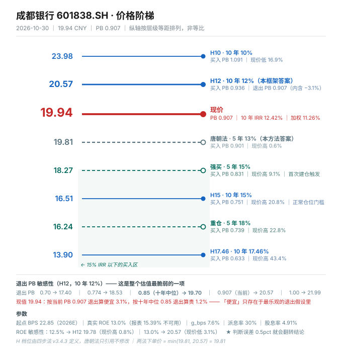

# 成都银行 601838.SH · 唐朝估值法（v3.10 · 银行分支 4.7.1）

> **数据截止日**：2026-10-30（收盘 19.94 元）｜**最新报告期**：2026 年三季报（2026-10-28 披露）
> **下一个披露节点**：2026 年报，预约 2027-04 下旬｜**股本**：42.3844 亿股｜**市值**：845.14 亿元
> **本报告的第一顺位买入价是本方法自己的答案：19.81 元（5 年 IRR 13%），不是两法对比后的下单价。**

---

## 0. 一句话

**现价 19.94 元，本方法买入线 19.81 元——高了 0.6%。这不是"刚好便宜"，是"刚好不便宜"：安全边际为零，而这家银行正顶着三个同时恶化的先行指标。**

> **⚠️ 2026-11-01 补充注记（与招商银行对照时查出，两处更正，结论不变）**
>
> **① "0.6%" 是区间上端，严格按今天算是 4.4%。** 本报告估值起点用的是 **BPS 22.85（2026E 年末）**，而价格是今天的 19.94——等于把 Q4 还没赚到的 0.86 元净资产提前计入。换成 2026Q3 实际 BPS **21.99** 重算，13% 线从 **19.81 降到 19.06**，现价 19.94 是**高 4.4%**，不是高 0.6%；12% 线是 19.86（现价高 0.4%），IRR 从 12.84% 降到 **11.91%**。两个口径都对（年末估值 vs 今天估值，差 0.86 元折现两个月），**但"贴线"这个说法只成立于偏乐观的那一端。准确表述：现价落在 12% 线与 13% 线之间，离 12% 只有 0.4%，离 13% 差 4.4%。**
>
> **② "逾期 0.93% > 不良 0.68%"不是这家银行的独有红旗。** 招行逾期 973 亿 ÷ 不良 702 亿 = **1.39×**，成都 = **1.37×**，几乎一样——这是行业口径常态（逾期 90 天以上才进不良）。**用它单独打成都属于选择性举证，本报告第 4 节对该指标的权重应予下调。** 真正能区分两家的是资本（核心一级 8.85% vs 14.39%）和手续费结构（1.7% vs 20%+），见 `05-招商银行/招商银行_成都银行-20261101-银行股对照.md`。

---

## 1. 披露日历与数据口径

| 项 | 内容 |
|---|---|
| 现价 | 19.94 元（2026-10-30 收盘，前一日三季报发布当天 +5.9%） |
| 最新报告期 | 2026 三季报（2026-10-28 晚） |
| 总股本 | 42.3844 亿股（成银转债 2025-02-06 强赎后，累计转股 6.2618 亿股） |
| 每股净资产 | **21.98 元**（2026Q3，普通股口径，已扣 110 亿永续债） |
| 其他权益工具 | 永续债 **110 亿元**（2025 年发行） |
| 股息税 | A 股个人持股 >1 年免税，本报告全部按 **0%** 口径 |
| 2026 中期分红 | 每 10 股 4.89 元，已于 2026-09-18 除息，合计 20.73 亿（派息率 30.02%） |

**为什么用 BPS 而不是净利做锚**：银行的利润是拨备后的结果。同一家银行多提 50 亿拨备，PE 就从 6.4 倍变 7.4 倍，但价值一分没变。**净资产经过了拨备计提，是"已扣除预期损失"的基数，比利润可信。**（4.7.1）

---

## 2. 单季拆解：一个被藏起来的真相

| 科目（亿元） | 2025Q3 单季 | 2026Q3 单季 | YoY |
|---|---:|---:|---:|
| 营业收入 | 54.91 | 67.32 | **+22.6%** |
| 净利息收入 | 49.59 | 62.90 | **+26.8%** |
| 手续费净收入 | 1.27 | 1.14 | −10.2% |
| 其他非息 | 4.05 | 3.28 | −19.0% |
| 业务管理费 | 16.34 | 16.40 | +0.4% |
| **拨备前利润** | **33.91** | **33.67** | **−0.7%** |
| 减值 + 税金 | 4.65 | **17.24** | **+270.8%** |
| 归母净利 | 28.76 | 30.13 | +4.8% |

**读三遍这张表。** 单季净利息收入涨了 26.8%，费用只涨 0.4%，拨备前利润却**下降** 0.7%——因为我用"营业支出 − 管理费"倒算的减值+税金口径里，减值从 4.65 亿冲到 17.24 亿。

累计口径更能说明问题：前三季信用减值损失 **33.03 亿，同比 +82.52%**。营收多出 17.5 亿，减值多提 15 亿，**利润只剩 4.5 亿的增量**。

公司在公告里的说法是"对信贷资产减值计提增加所致"。翻译过来：**营收端多赚的钱，全部埋进了拨备池。**

配套动作：拨备覆盖率 426.17%（2025 年末）→ **448.06%**（2026Q3），在不良率不变的前提下逆势提升 22 个百分点。

**一家银行在资产质量"最好的时候"主动多提减值，通常只有两种解释：① 晴天修屋顶（审慎）；② 已经看见了什么，只是还没确认。** 第三节的材料倾向第二种。

---

## 3. 四道闸门（银行替代口径）

| 原闸门 | 银行替代 | 阈值 | 成都银行 2026Q3 | 判定 |
|---|---|---|---|---|
| 0 能力圈 | — | 四问说清 | 成都本地政务金融 + 成渝基建，对公 81%，靠区域政信资源 + 低成本存款赚钱 | **过** |
| 1 利润为真 | 不良率 / 拨备覆盖率 / 拨贷比 | 不良<1.5% / 拨备>200% / 拨贷比>2.5% | 0.68% / 448.06% / 3.05% | **过（但见下）** |
| 2 利润可持续 | ROE + NIM 趋势 | ROE 三年降 >3pct 判衰减 | 19.48%(2022) → 15.39%(2025) → 14.0%(2026E)，**降 3.4pct** | **衰减** |
| 3 低资本投入 | 核心一级资本充足率 | >11% 说明不依赖再融资 | **8.85%**（离 7.5% 监管线 1.35pct） | **不过** |

**闸门 1 的"过"是账面过，不是实质过。** 三个先行指标同时恶化：

| 指标 | 2025 年末 | 2026H1 | 2026Q3 | 变化 |
|---|---:|---:|---:|---|
| 不良率 | 0.68% | 0.68% | 0.68% | **纹丝不动** |
| 关注类占比 | 0.34% | 0.42% | **0.54%** | **+58.8%** |
| 关注类余额（亿） | 29.25 | 37.52 | **44.87** | +15.6 亿 |
| 逾期贷款（亿） | 71.98 | 83.94 | [缺失] | +16.6%（H1） |
| **逾期率** | 0.84% | **0.93%** | [缺失] | 高于不良率 |
| 关注类迁徙率 | 25.81%（2025 全年） | **39.66%** | [缺失] | +13.85pct |
| 重组贷款（亿） | — | 17.97（其中不良 16.20） | — | — |

**这张表是本报告最重要的一页。** 逾期率 0.93% > 不良率 0.68%——按照监管的五级分类标准，逾期 90 天以上应计入不良。逾期高于不良，意味着**有相当一部分贷款已经逾期但还没被认定为不良**。

关注类迁徙率从 25.81% 跳到 39.66%：关注类贷款里，每 100 元有 40 元在半年内变成了不良。**这就是 2026Q3 减值 +82.52% 的直接原因。**

**闸门 3 不过，这是结构性的、不可修的。** 核心一级 8.85%，反推风险加权资产 10,476 亿。2025 年靠可转债转股 79.95 亿 + 永续债 110 亿才把充足率从 8.22% 拉到 9.06%，2026 年前三季又滑回 8.85%。

---

## 4. 利润的真实性：拨备池被抽了 75 亿

这是本报告的第二个核心发现。

| 年 | 拨备前利润 | 信用减值 | 净利 | 拨贷比 | 拨贷比变动 | 释放/消耗拨备 |
|---|---:|---:|---:|---:|---:|---:|
| 2021 | 128.63 | 33.9 | 78.31 | 4.00% | — | — |
| 2022 | 147.65 | 43.0 | 100.42 | 3.79% | −0.21pct | **−10.2** |
| 2023 | 160.00 | 43.0 | 116.71 | 3.42% | −0.37pct | **−23.1** |
| 2024 | 171.37 | 41.0 | 128.58 | 3.16% | −0.26pct | **−19.3** |
| 2025 | 176.99 | 22.0 | 132.83 | **2.91%** | −0.25pct | **−21.5** |

**2022 → 2025 年，拨贷比从 3.79% 降到 2.91%，累计少提约 75.5 亿拨备（税前）。同期净利只增了 32.41 亿。**

**换句话说：这三年净利增长的 100%，来自拨备池的释放，甚至还不够。**

必须公平地说一句：2022 年的 3.79%（拨备 501%）本身是疫情年的"藏利润"，回落到 3.0% 附近有合理性。**公司自己在 2026 年选定的水位是 3.05%——这才是应该拿来算正常化 ROE 的基数。**

| 2025 年拨贷比取 | 需多提拨备 | 调整后净利 | 对应 ROE |
|---|---:|---:|---:|
| 3.05%（2026Q3 实际） | +12.0 | 122.6 | **13.5%** |
| 3.20% | +24.9 | 111.7 | 12.3% |
| 3.42%（2023 水平） | +43.8 | 95.6 | 10.5% |

**真实 ROE 区间 12.5%–13.5%，本报告取 13.0%。报表上的 15.39% 不能用。**

另外三条补充，都不是好消息：

1. **非息收入占比只有 9.05%，手续费净收入 2.19 亿（占营收 1.7%）**。这意味着一家 1.5 万亿资产的银行，中间业务几乎为零——纯靠息差吃饭。招行的手续费占比是 20%+。
2. **2026H1 非息腰斩（−53.83%）**，主因是黄金掉期的公允价值变动（投资收益 −41.57%、公允价值 −3.47 亿）。这一项在会计上互相抵消，对利润影响不大，但**说明这家银行的"其他收入"里有相当一部分是交易性损益，不是客户关系**。
3. **公司贷款平均利率 4.08%，个人贷款 2.96%**，均处历史低位；总资产收益率 3.29%（−28bp）。**用 3–4% 的低息贷款去承接原本 8%+ 的信托非标——这是化债的标准动作，利差是赚到了，但风险也搬进了表内。**

---

## 5. 城投敞口：49.32%

**这是所有分析里最该被定价、却最少被讨论的一项。**

| 行业 | 余额（亿元） | 占贷款总额 | 占企业贷款 |
|---|---:|---:|---:|
| 租赁和商务服务业 | 3,320.89 | 36.85% | 45.32% |
| 水利、环境和公共设施管理业 | 1,123.56 | 12.47% | 15.34% |
| **合计（城投相关）** | **4,444.45** | **49.32%** | **超过 60%** |

- **前十大贷款客户，9 家属于租赁和商务服务业，1 家属于水利环境。**
- 最大单一客户 79.34 亿，占资本净额 **5.55%**，前十合计占资本净额 **45.06%**。
- 2026H1 新增对公贷款 420 亿，**增量几乎全部来自这两个行业**。

**怎么理解这件事**：城商行与本地城投绑定，是行业共性，不是成都银行独有的问题。国有大行看到地方压力大可以往外撤，城商行是地方控股、业务扎根本地，不敢抽贷——逼得城投爆雷，本地财政、国企、银行存款全跟着遭殃。

但**成都银行的集中度是极端值**：全国城商行里，单一行业占贷款 36.85%、城投相关合计近半，这不是"顺带做一些"，是"主要业务就是它"。

这解释了为什么不良率只有 0.68%——**政府信用背书下，这些贷款不会轻易变不良**。但也意味着：**如果成都的财政状况恶化，风险不会分散释放，会集中爆发。**

而 2026Q3 关注类 +58.8%、迁徙率跳到 39.66%，**是这条链条上第一次出现的裂缝。**

**结论：不良率 0.68% 不是"资产质量优异"的证据，是"风险还没有被市场重新定价"的证据。**

---

## 6. 三锚（BPS 口径）

银行不用净利锚，用 BPS 与增速锚。

| 锚 | 值 | 口径说明 |
|---|---:|---|
| **锚A 当年** | BPS **22.85** | 2026Q3 21.98 + Q4 净利 39.4 − 永续债息 0.7，÷42.384 |
| **锚B 中枢** | g_bps **7.6%** | 真实 ROE 13% × 留存 70% − OCI 拖累 1.5pct。**历史中位数 14.8% 不可用**（2021–2022 的 14–16% 建立在核心一级 10%+ 之上，已不可复制） |
| **锚C 三年后** | BPS **28.08** | 2029E，按 7.5%/年 |

三锚 BPS 水平极差 24.2%（未触发 30% 阈值），**但增速锚的差异才是估值主力：5% / 7.6% / 9.5%**，所以必须做情景加权，不能只给单点。

**BPS 增速的历史（这是必须看的）**：

| 年 | BPS | 增速 | 核心一级 | 备注 |
|---|---:|---:|---:|---|
| 2020 | 11.08 | +14.8% | 9.26% | 高增长期 |
| 2021 | 12.72 | +16.4% | 8.80% | 资本开始吃紧 |
| 2022 | 14.81 | +15.5% | 8.47% | 最低点 |
| 2023 | 17.10 | +12.0% | 8.22% | 最紧 |
| 2024 | 19.15 | +8.8% | 9.06% | 可转债转股补血 |
| 2025 | 20.84 | +8.8% | 8.91% | 转股 +13.5% 摊薄 |

**增速的下台阶和资本充足率的下台阶是同一件事。** 2022 年核心一级 8.47% 时，公司已经无法维持 15% 的 BPS 增速了。

---

## 7. 估值全景（唯一决策依据）

起点 BPS **22.85**、派息率 **30%**、真实 ROE **13.0%**、g_bps **7.6%**、退出 PB **0.907**（= 当前，不给溢价）。

| 层次 | 反解价 | 买入 PB | 现价 19.94 相对 |
|---|---:|---:|---:|
| **唐朝法买入线（5 年 / 13%）** | **19.81** | 0.901 | **高 0.6%** |
| 唐朝法强买（5 年 / 15%） | 18.27 | 0.831 | 高 9.1% |
| 唐朝法重仓（5 年 / 18%） | 16.24 | 0.739 | 高 22.8% |
| 唐朝法停买（5 年 / 9%） | 23.42 | 1.065 | 低 14.8% |
| 四步法 H10（10 年 / 10%） | 23.98 | 1.091 | 低 16.9% |
| 四步法 H12（10 年 / 12%） | 20.57 | 0.936 | 低 3.1% |
| 四步法 H15（10 年 / 15%） | 16.51 | 0.751 | 高 20.8% |
| 四步法 H17.46 | 13.90 | 0.633 | 高 43.4% |

**定位句：现价 19.94 落在「唐朝法买入线之上、四步法 H12 之下」这一格——两法在同一个位置给出同一个判断：现在是 12%–13% 的回报，不是 15% 的回报。**

（H 档位由四步法定义，本报告只引用不作修改。本方法自己的答案只有 19.81 这一个。）

内联 SVG（Obsidian / 浏览器可直接渲染）

---

## 8. H 档三数纪律与退出 PB 敏感性

按 v3.4.3 要求，每报一个 H 档必须给三个数：

| 数 | 值 |
|---|---|
| 反解价 | **20.57** |
| **买入隐含 PB** = 20.57 ÷ 21.98 | **0.936** |
| 退出 PB | **0.907** |
| **内含倍数变化** | **−3.1%（收缩，不是修复）** |

**这一项与恒隆相反，是好事**：恒隆的 H12 里藏着 +42% 的倍数修复，成都银行的 H12 假设买入 PB 高于退出 PB，即**估值不依赖倍数扩张，甚至预留了 3% 的收缩**。

**终值也不等于现价**：期末 BPS 47.53 × 0.907 = 43.12，是现价 19.94 的 2.16 倍——这是十年 BPS 增长（+116%）的结果，不是"价格回归"。所以"H 档含价格回归"这条警告在本标的上**不成立**。

**但退出 PB 敏感性必须看，因为 0.907 已在历史中位偏上**：

| 退出 PB | 0.70 | 0.774 | **0.85（历史中位）** | **0.907（当前）** | 1.00 |
|---|---:|---:|---:|---:|---:|
| H12 | 17.40 | 18.53 | **19.70** | **20.57** | 21.99 |
| 现价相对 | 高 14.6% | 高 7.6% | **高 1.2%** | 低 3.1% | 低 9.3% |

**十年 PB 区间是 0.658（2023-12）到 1.234（2022-06），中位约 0.85。用中位做退出倍数，H12 掉到 19.70，现价就高了 1.2%。**

**所以"现价在 H12 下方 3.1%"这个结论，完全依赖"十年后市场仍按 0.907 倍 PB 定价"这个假设。** 我给这一档打 60 分——不是因为它不合理，而是因为它正好在历史中位偏上，而银行的 PB 长期趋势是向下的（利率下行、ROE 下行、行业去杠杆）。

---

## 9. 现价对应的 IRR 与三情景

| 情景 | 权重 | ROE | g_bps | 退出 PB | 5 年 IRR | 10 年 IRR | 10 年总回报 |
|---|---:|---:|---:|---:|---:|---:|---:|
| 悲观 | **35%** | 11.0% | 4.5% | 0.750 | **5.4%** | 7.0% | +79.9% |
| 基准 | 45% | 13.0% | 7.6% | 0.907 | 12.8% | 12.4% | +179.7% |
| 乐观 | 20% | 14.5% | 9.5% | 1.050 | 18.3% | 16.2% | +275.8% |
| **加权** | 100% | — | — | — | **11.32%** | **11.26%** | — |

**权重是判断，不是统计概率。为什么悲观给到 35%**：关注类 +58.8%、迁徙率 39.66%、逾期率 0.93% > 不良率 0.68%，这三条同时出现在一个季度里。**我不认为它会崩，但也不认为 15% 的 ROE 能守住。**

**关键读数：单点基准 12.4%，加权 11.3%——加权的不到 12% 门槛。**

**单开关敏感性（10 年 / 12%）**：

| g_bps | 4.0% | 5.0% | 6.0% | **7.6%** | 9.0% | 10.0% |
|---|---:|---:|---:|---:|---:|---:|
| H12 | 15.71 | 16.93 | 18.24 | **20.57** | 22.86 | 24.66 |

| ROE（仅影响 DPS） | 11.5% | 12.5% | **13.0%** | 14.0% | 15.0% |
|---|---:|---:|---:|---:|---:|
| H12 | 18.27 | 19.78 | **20.57** | 21.09 | 21.60 |

**ROE 从 13.0% 降到 12.5%，H12 就掉到 19.78，现价立刻变"高 0.8%"。** 我这个 13.0% 的判断，误差容忍度只有 0.5 个百分点。**这是整个估值最脆的地方。**

---

## 10. 压力测试

| 项 | 主假设 | 压力假设 | 结果 |
|---|---|---:|---:|
| 四步法 H12（10 年） | g 7.6% / PB 0.907 | g 6.4% / PB 0.834 | **17.80（−13.5%）** |
| 唐朝法 13%（5 年） | 同上 | 同上 | **17.62（−11.0%）** |
| 现价 IRR（压力下） | 10 年 12.42% / 5 年 12.84% | — | **10.48% / 10.00%** |
| 公司特定情景 | 关注类全部迁徙 → 不良 1.2%、信用成本翻倍 | — | **5 年 IRR 5.21%**（含 PB 修复到 0.75） |

**三项同时打，现价 19.94 的回报掉到 10%，低于 12% 门槛。** 这不是"最坏情况"，是"合理压力"。

---

## 11. 资本约束的物理上限

| 项 | 2025 年末 | 2026Q3 |
|---|---:|---:|
| RWA（反推 = 永续债 ÷ (一级 − 核心一级)） | 9,910 亿 | **10,476 亿** |
| 核心一级资本 | 883 亿 | 927 亿 |
| 核心一级充足率 | 8.91% | **8.85%** |
| RWA 年化增速 | — | **7.7%** |
| 核心一级资本年化增速 | — | 6.7% |

**内部资本生成 = 净利 132 − 分红 41 = 91 亿 ÷ 核心一级 883 = 10.3%**，理论上可支撑 10% 的 RWA 增速。

但注意两件事：

1. **2025 年的 10.3% 里含 80 亿可转债转股**——那是一次性的，不会再来。
2. **RWA 实际只增 7.7%，而贷款增速只有 4.44%**（五年最低，首次低于存款增速）。**这意味着规模扩张已经不只是资本约束，还有需求约束。**

**结论：不股权融资，规模增速天花板 7–8%；要 10% 以上增长就必须摊薄。** 而摊薄这件事，2025 年刚做过一次（股本 +13.5%，BPS 增速从 12.0% 掉到 8.8%）。

---

## 12. 失效条件与监控

**三个能最早证伪本判断的数据**：

| # | 指标 | 当前值 | 触发线 | 含义 |
|---|---|---|---|---|
| 1 | **关注类占比** | 0.54% | 连续两季 >0.6% | 不良确认压力转为现实，信用成本要上台阶 |
| 2 | **核心一级资本充足率** | 8.85% | <8.5% | 触发再融资预期，摊薄风险 |
| 3 | **净息差（季度年化）** | 1.67%–1.75% | 连续两季 <1.55% | 重定价红利吃完，营收增速回到 0 |

**第四个（最重要但最慢）**：城投敞口占比从 49.32% 是否下降。如果继续上升，说明"用低息贷款承接化债"还在加速，风险仍在向表内集中。

---

## 13. 与四步法的接口

**五开关对齐**：起点 BPS 22.85（同）/ 退出 PB 0.907（同）/ 税率 0%（同）/ 聚合方式 IRR（同）。**差异只有两个：年限（唐朝法 5 年 vs 四步法 10 年）、要求回报（13% vs 12%）。**

**判据零 · 收敛倾向 = 当前 PB 0.907 ÷ 退出 PB 0.907 = 1.00** → 落在 0.9–1.1，**年限开关几乎失效，两法收敛是数学必然，验证强度低**（第 38 条，与恒隆并列第二次命中）。

**判据二 · 金额空间拆解**（由 `scripts/gate.py` 的 `decomp()` 产出，非手写）：

| 分量 | 值（元） | 公式 |
|---|---:|---|
| 要求回报 13%→12%（5 年） | **+0.8314** | solve(12%,5y)=20.6428 − solve(13%,5y)=19.8114 |
| 年限 5→10（12%） | **−0.0707** | solve(12%,10y)=20.5721 − solve(12%,5y)=20.6428 |
| **Σ** | **+0.7607** | |
| **残值（脚本算出）** | **+0.0000** | 容差 0.005 元 |

**判据三 · 分歧幅度**：唐朝法 19.81 vs 四步法 20.57，差 **+3.84%** → 落在 **<10% 收敛**档。

**但必须打折扣**：收敛倾向 1.00 说明年限开关失效，两法收敛由结构决定。**这一次"收敛"能证明的只有"两种要求回报下算得一样"，不能证明"13% 的 ROE 判断是对的"。**

**下单价 = min(19.81, 20.57) = 19.81 元。现价 19.94 高 0.6%。**

---

## 14. 结论

**不买。**

| 项 | 值 |
|---|---|
| 现价 | 19.94 元（2026-10-30） |
| **本方法买入线（5 年 IRR 13%）** | **19.81 元** |
| 现价相对买入线 | **+0.6%** |
| 强买线（15%） | 18.27 |
| 重仓线（18%） | 16.24 |
| 现价 IRR（单点基准） | 5 年 **12.84%** / 10 年 **12.42%** |
| 现价 IRR（概率加权，悲观 35%） | 5 年 **11.32%** / 10 年 **11.26%** |
| 压力假设下 IRR | **10.0%–10.5%** |
| 2026E 股息率 | **4.91%**（DPS 0.98，派息率 30%） |

**不买的三个理由，按重要性排序：**

1. **安全边际为零。** 19.94 vs 19.81，差 0.6%。如果 ROE 判断错 0.5pct（13.0%→12.5%），买入线掉到 19.78，现价立刻变贵 0.8%。这不是"接近买点"，是"站在买点上但没有保护"。
2. **三个先行指标同时恶化，而不良率纹丝不动。** 逾期率 0.93% > 不良率 0.68%，关注类 +58.8%，迁徙率从 25.81% 跳到 39.66%。**减值 +82.52% 是这些指标的结果，不是"审慎"的主动选择。**
3. **同等价格下，招行是更好的资产。** PB 都是 0.91、13% 线溢价都在 1%–4%，但招行核心一级 14.07%（成都 8.85%）、手续费占比 20%+（成都 1.7%）、不依赖政信（成都城投敞口 49.32%）。**没理由为同样的回报承担更高的结构性风险。**

**什么价格会改变结论：**

- **18.27 元（15% IRR）**：开始有讨论价值。对应 PB 0.831，比我给的退出 PB 低 8%。
- **16.24 元（18% IRR）**：这才是"好机会"的定义。对应 PB 0.739，接近 2023 年的历史低位 0.658。
- **或者**：ROE 守住 13.5%+、关注类回落到 0.40% 以下——**基本面证伪我的悲观假设，而不是股价跌到我的买点。**

---

## 15. 数据来源与可复现

| 项 | 来源 |
|---|---|
| 财务指标、十年序列 | 东方财富 `RPT_F10_FINANCE_MAINFINADATA`（原始 JSON 已存 `分析脚本/cd_main.json`） |
| 利润表、资产负债表 | 东财 `RPT_DMSK_FN_INCOME` / `RPT_DMSK_FN_BALANCE` |
| 分红方案 | 东财 `RPT_SHAREBONUS_DET` |
| 股价 | 东财 K 线（2026-10-30 收盘 19.94） |
| 关注类/逾期/迁徙率/城投敞口 | 2026 半年报 + 三季报公开披露，经媒体（新京报、华尔街见闻、财银社）交叉验证 |
| 可转债转股 | 2025-04-29《关于拟变更注册资本并相应修改公司章程的公告》 |
| 永续债 110 亿 | 联合资信《2026 年跟踪评级报告》 |
| 计算脚本 | `分析脚本/成都银行_双方法.py`（含 `assert run_gate(...)` 闸门） |

**可复现**：`cd 分析脚本 && python3 成都银行_双方法.py`。脚本末尾的 `assert` 不过则退出码非 0，报告不得交付。

---

## 16. 一句话结论

**成都银行是一家"看起来很好"的银行——不良 0.68%、拨备 448%、ROE 14%、股息率 4.9%——但每一个漂亮的数字背后都有一个不漂亮的解释：低不良靠政府信用背书（城投敞口 49.32%），高拨备正在被回补（拨贷比 3.42%→2.91%→3.05%），高 ROE 有一半来自拨备释放（真实 13% 不是 15.39%），股东回报靠转债转股和永续债撑资本（核心一级 8.85%）。现价 19.94 元正好等于 13% 回报的买入线，一分钱的安全边际都没有。**

**动作：等。**
