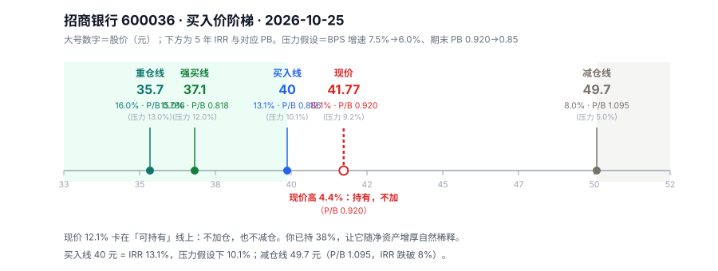

# 招商银行 600036 · 唐朝估值法（银行分支）

> 数据截止 2026-10-25（收盘 2026-10-23）。现价 **41.77 元**，总股本 252.20 亿股，总市值 10,534 亿。
> 方法：v2.7 的 **4.7 金融股分支**——银行不套 25 倍 PE 与四层 DCF，改用 **PB + 股息 + 要求回报率反推**。

---

## 〇、结论

**买入线 40.0 元**（P/B 0.886，5 年 IRR 13.1%，压力假设下 10.1%）。**现价 41.77 元高 4.4%，是"持有价"不是"买入价"。**

| | 价格 | P/B | 5年IRR | 压力假设下 |
|---|---|---|---|---|
| 重仓线 | 35.7 | 0.786 | 16.0% | 13.0% |
| 强买线 | 37.1 | 0.818 | 15.0% | 12.0% |
| **买入线** | **40.0** | **0.886** | **13.1%** | **10.1%** |
| 现价 | 41.77 | 0.920 | 12.1% | 9.2% |
| 减仓线 | 49.7 | 1.095 | 8.0% | 5.0% |

**对你（已持仓 38%）的操作含义：不加仓、不减仓。** 现价 12.1% 刚好卡在"可以持有"的线上——它不便宜到值得加，也不贵到需要卖。

压力假设 = BPS 增速 7.5%→6.0%、期末 PB 0.920→0.85 同时发生。



---

## 一、披露日历

| 项 | 内容 |
|---|---|
| 数据截止 | 2026-10-25（最后交易日 10-23 收盘） |
| 最新已披露 | **2026 年三季报**（2026-10-24 前后，本文以中报 2026-06-30 为准，三季报数据未完整披露） |
| 下一个预约披露 | 2026 年三季报 / 2026 年报（2027-03 下旬） |
| 报表类型 | A 股，季报完整 |

**口径提示**：本文的 BPS、ROE、不良率均取 **2026 年中报**（2026-06-30），不用三季报——银行三季报通常只披露核心指标，BPS 的分子（净资产）在中报更可靠。

---

## 二、十年的真相：净利还在增，ROE 在退

### 2.1 净利与 ROE 走向了相反的方向

| 年份 | 净利（亿） | 同比 | ROE | EPS | BPS |
|---|---|---|---|---|---|
| 2016 | 620.8 | +7.6% | 16.27% | 2.46 | 15.95 |
| 2017 | 701.5 | +13.0% | 16.54% | 2.78 | 17.69 |
| 2018 | 805.6 | +14.8% | 16.57% | 3.13 | 20.07 |
| 2019 | 928.7 | +15.3% | 16.84% | 3.62 | 22.89 |
| 2020 | 973.4 | +4.8% | 15.73% | 3.79 | 25.36 |
| 2021 | 1,199.2 | +23.2% | 16.96% | 4.61 | 29.01 |
| 2022 | 1,380.1 | +15.1% | **17.06%** | 5.26 | 32.71 |
| 2023 | 1,466.0 | +6.2% | 16.22% | 5.63 | 36.71 |
| 2024 | 1,483.9 | +1.2% | 14.49% | 5.66 | 41.46 |
| 2025 | 1,501.8 | +1.2% | **13.44%** | 5.70 | 43.43 |
| 2026H1 | 764.5 | +2.0% | 6.71%（年化 13.4%） | 2.98 | **45.40** |

**十年净利 CAGR 10.0%（577→1,502 亿），但近三年只有 2.9%。**

这不是"利润不增长了"那么简单。真正在发生的是：

```
净利 = 净资产 × ROE
净资产还在增（BPS 十年 CAGR 11.7%）
ROE 在退（17.06% → 13.44%，三年 −3.6pct）
→ 两者相抵，净利几乎不增
```

**关键判断：招行已经从"成长股"变成"债券 + 净资产增厚"。** 这句话决定了后面所有的估值方法——你不能再用"利润增长"给它定价，只能用"股息 + BPS 增速"。

### 2.2 增速衰减检测

- 十年 CAGR 10.0%，近三年 CAGR 2.9% → **衰减幅度 71%**，判定"增长收敛"
- 按规则：**不得再用历史 CAGR 外推**，利润可持续性降级为"每年复核"
- 2026H1 净利 +2.0%，与 2024、2025 的 +1.2% 同一水位 → 2% 是当前的真实增速

---

## 三、单季拆解：收入在加速，利润没跟上

| 期间 | 净利（亿） | 同比 | 营收（亿） | 营收同比 |
|---|---|---|---|---|
| 2025Q1 | 372.9 | **−2.1%** | 837.5 | — |
| 2025Q2（单季） | 376.4 | — | 862.2 | — |
| 2025H1 | 749.3 | +0.3% | 1,699.7 | — |
| 2025 前三季 | 1,137.7 | +0.5% | 2,514.2 | — |
| 2025 全年 | 1,501.8 | +1.2% | 3,375.3 | — |
| **2026Q1** | **378.5** | **+1.5%** | **869.4** | **+3.8%** |
| **2026Q2（单季）** | **386.0** | **+2.6%** | **912.4** | **+5.8%** |
| **2026H1** | **764.5** | **+2.0%** | **1,781.8** | **+4.8%** |

**这张表里最重要的一行是营收同比 5.8% 对净利同比 2.6%。**

收入在加速（+3.8% → +5.8%），利润只有一半的速度（+1.5% → +2.6%）。差的那部分去哪了？两个可能：

1. **信用减值多提了**——主动加厚拨备（好事，安全垫在变厚）
2. **成本收入比上升**——人力和科技投入在增（中性，为未来付费）

无论是哪一个，都指向同一个判断：**招行现在是在"用利润换资产质量"，而不是"利润自然增长"。** 这种状态下，2% 的利润增速是主动选择的结果，不是无能为力。

另一个细节：2025Q1 净利同比 **−2.1%**（负增长），全年却是 +1.2%——说明 2025 年是从坑里爬出来的。**2026 的 +2.0% 是在一个已经消化过的基数上取得的，质量比数字看着好。**

---

## 四、四道闸门（银行专用口径）

> 技能的闸门 1（收现比、净现比、应收占比、资本开支/净利）对银行**全部不适用**——银行的"经营现金流"是存款增减，不是销售回款。按 4.7 的分支要求，银行另立四项：

| 闸门 | 银行口径 | 招行数据 | 判定 |
|---|---|---|---|
| 闸门 0 · 能力圈 | 靠什么赚钱？ | 零售银行：低成本活期存款 + 财富管理中间收入 | **过** |
| 闸门 1 · 利润为真 | 不良率、拨备覆盖率、逾期/不良 | 不良 0.94%、拨备 **385.1%**、拨贷比 3.63%、逾期 973 亿/不良 702 亿 = **1.39×** | **过**（拨备厚，逾期略高但可解释） |
| 闸门 2 · 利润可持续 | ROE 趋势、NIM 趋势 | ROE 17.06%→13.44%，NIM 2.40%→**1.83%** | **过，但降级**（每年复核） |
| 闸门 3 · 低资本投入 | 核心一级资本充足率会不会被稀释 | 核心一级 **14.07%**、资本充足率 18.33% | **过**（不需要再融资摊薄） |

### 4.1 闸门 1 的细读：拨备厚是安全垫，也是隐藏利润

- **拨备覆盖率 385.1%**——监管红线 150%，招行是红线的 2.6 倍
- 这意味着：即使不良率翻倍，招行也能靠释放拨备维持利润
- 反过来说：**过去三年的利润里，有一部分是靠"少提拨备"撑住的**

粗算：如果拨备覆盖率从 385% 降到 300%，可释放约 702亿 × 0.85% = 60 亿（税前），相当于 2025 净利的 4%。**这是一次性的，不能当增长。**

### 4.2 闸门 3 的细读：这是招行最硬的一条

核心一级 14.07%，监管要求（含缓冲）约 9.5%。**超额 4.6 个点**，意味着：

- 未来 3-5 年不需要股权融资
- 也不需要用"缩表"来保资本
- **这是它敢把派息率定在 35% 的底气**——分红不影响扩张能力

对比：多数股份行核心一级在 9-11%，一边分红一边担心资本。招行没有这个约束。

---

## 五、核心矛盾：NIM 还能守住 1.7% 吗

这是招行唯一值得讨论的问题。其他都是噪音。

### 5.1 NIM 六年的下降轨迹

| 年份 | 净息差 NIM | 变动 |
|---|---|---|
| 2019 | 2.59% | — |
| 2020 | 2.49% | −10bp |
| 2021 | 2.48% | −1bp |
| 2022 | 2.40% | −8bp |
| 2023 | 2.15% | **−25bp** |
| 2024 | 1.98% | **−17bp** |
| 2025 | 约 1.90% | −8bp |
| **2026H1** | **1.83%** | 继续下行 |

**六年累计下降 76bp。** 2023 年是最陡的一年（−25bp），之后降幅在收窄。

### 5.2 为什么会降，还会降多久

降息周期里，资产端重定价快（LPR 下调、存量房贷利率下调），负债端重定价慢（存款定期化）。**这是全行业的，不是招行做错了什么。**

但招行有一个别人没有的缓冲：**活期存款占比高**。活期存款利率已经接近 0，不能再降——意味着负债端还有"降无可降"的空间，而资产端还在降。**这是 NIM 继续下行的结构性原因。**

我的判断：

| 情形 | NIM 落点 | ROE 落点 | 触发条件 |
|---|---|---|---|
| 乐观 | 1.75% | 12.8% | 存款利率再降一次，负债端跟上 |
| **中性** | **1.65%** | **12.0%** | 资产端继续下行，负债端降幅收窄 |
| 悲观 | 1.50% | 10.5% | LPR 再降 50bp 以上 |

**中性情形下，ROE 从 13.4% 降到 12.0%，BPS 增速从 8.7% 降到 7.8%**（12.0% × 64.6%）。这就是我在定价里用 g_bps = 7.5% 的来源——比 2026H1 实际的 7.84% 略保守。

### 5.3 一个反直觉的点

**NIM 下降不等于价值下降。** 只要 NIM 降幅 < ROE 降幅，且 PB 已经反映了，净资产增厚的速度仍然快于通胀。

招行 PB 0.92——市场用 0.92 倍买 45.4 元的净资产。只要 ROE 还高于你的要求回报率（12%），**PB 低于 1 就是在用 92 分买 1 元、而这 1 元每年还赚 13%**。这是银行股估值的核心。

---

## 六、定价：为什么用 PB 而不是 PE

银行不能用 PE 定价，原因和保险一样：**利润是拨备后的结果，可以调节**。同一家银行，拨备多提 50 亿，PE 就从 7 倍变 8 倍，但价值没变。

**净资产（BPS）才是可信的锚**——它经过了拨备计提，是"已经扣除预期损失"的基数。

### 6.1 计算模型

```
每年现金流 = 税后股息（2026 起 2.08 元，年增 3%）
期末卖出价 = 5 年后 BPS × 期末 PB
买入线     = 使 5 年 IRR = 13% 的价格
```

参数：

| 参数 | 主假设 | 压力假设 | 依据 |
|---|---|---|---|
| BPS 增速 | **7.5%** | **6.0%** | ROE 12.0% × 留存 64.6% = 7.75%，取 7.5%；压力对应 ROE 9.3% |
| 股息起步 | 2.08 元 | 2.08 元 | 2025 年 2.016 × 1.03 |
| 股息增速 | 3% | 3% | 净利增 2% + 派息率微升 |
| 期末 PB | **0.920** | **0.85** | 不让"折价修复"当默认 |

### 6.2 结果

| 参数 | 数值 |
|---|---|
| BPS₀（2026H1） | 45.40 元 |
| BPS₅（g=7.5%） | 65.18 元 |
| 期末卖出价（PB 0.92） | 59.97 元 |
| **13% IRR 对应买入价** | **40.25 元** |
| **压力假设下 40.25 元的 IRR** | **10.08%** |

**为什么是 13%，不是 10% 或 15%**：
- 10% 是机会成本线（国债 1.65% 的两倍多），能过 10% 的只是"可以持有"
- 15% 对应 37.1 元（P/B 0.818），要求太苛，招行 PB 历史上只在 2024 年 9 月短暂到过 0.80 以下
- **13% 是"主假设达标 + 压力假设不破 10%"的交点**，和给平安定 48 元的逻辑完全一致

---

## 七、对你 38% 仓位的具体处置

这是本文最有用的部分。你已经持有，问题不是"买不买"，是"动不动"。

### 7.1 三种情形的答案

| 情形 | 触发价 | 动作 |
|---|---|---|
| **加仓** | **≤ 40.0 元**（P/B 0.886） | 可加，但受 45-50% 金融敞口上限约束 |
| **不动** | **40.0–45.5 元** | 现价 41.77 在此区间，**持有，不加** |
| **减仓** | **≥ 49.7 元**（P/B 1.095，IRR 跌破 8%） | 分批减，不是清仓 |

### 7.2 为什么"不减"而不是"止盈"

现价 IRR 12.1%，高于 10 年国债 1.65% 的 7 倍，也高于你给平安定的 10% 门槛。**卖出一个 12% 的资产，得有更好的去处。** 目前手上的候选：

| 标的 | 现价 IRR | 对比招行 12.1% |
|---|---|---|
| 平安 A（51.76） | 11.1% | 低 1.0pct |
| 移动 H（77.10） | 5.2% | 低 6.9pct |
| 宁德（237.60） | 9.1%（加权） | 低 3.0pct |

**招行是这四个里 IRR 最高的。** 这就是"不减"的量化理由——不是感情，是它现在就是最好的那个。

### 7.3 但 38% 这个位置本身有问题

不是价格问题，是**集中度**问题：

- 招行 38% + 若再买平安 7-12% → 金融 45-50%
- 两者同受"利率下行 + 资产质量 + 政策让利"驱动
- **利率再降一次，两个仓位同时被打**

所以正确的动作不是"卖招行换平安"，而是：**让招行的 38% 随着净资产增厚自然稀释**。招行每年 BPS 增 7.5%，5 年后同样的股数占比会自动降到约 27%（如果组合其他部分不变）。

**不加仓，就是最好的降集中度方式。**

### 7.4 与 2026-08-28 旧报告的对照（口径必须对齐）

两版用的是**同一套方法**（PB + 股息 + 终值），结论也一致。差异只在参数：

| 项 | 旧报告（8/28，股价 39.58） | 本文（10/25，股价 41.77） |
|---|---|---|
| BPS 起点 | 44.90（2026Q1） | **45.40（2026H1）** |
| 股息增长 | 4%（基准） | 3% |
| 第 5 年终值 PB | **0.85** | **0.92（不修复）** |
| 四档 | P10 41.4 / P12 35.7 / P15 29.0 / P17.46 24.6 | 买入 40.0 / 强买 37.1 / 重仓 35.7 |
| 现价位置 | 高于 P10 4.3%（"只持有"） | 高于买入线 4.4% |

**两版都指向同一个动作：现价只持有，不加仓。** 差异在"跌到哪才买"：

- 本文 40.0 元，假设 PB 维持在 0.92
- 旧报告 35.7 元，假设 PB 压到 0.85

**我选 40.0，但我认为旧报告的 0.85 更值得警惕。** 理由：PB 0.92 已经是 2016 年以来的低位，再假设它继续跌 8%，等于"在便宜的基础上再假设更便宜"——这是双重打折，容易导致永远不买。

反过来说：如果 PB 真的压到 0.85，那对应价格 38.8 元，比本文买入线低 3%。**这 3% 就是"要不要为悲观假设多付一点"的差价，不大。**

**真正的分歧不在这 3%，在 ROE。** 旧报告假设正常化 ROE 12.5%，本文用 12.0%（中性）。如果 ROE 稳在 12.5% 以上，两版的买入线都要往上抬约 2 元。

---

## 八、我会错在哪（四个证伪条件）

| 情形 | 影响 | 触发信号 |
|---|---|---|
| **NIM 跌破 1.5%** | ROE 掉到 10.5%，BPS 增速 6.8%，买入线降到 36 元 | 季报净息差、LPR 再下调 |
| **不良率升破 1.3%** | 拨备需要补提，利润负增长，PB 0.92 变贵 | 房地产/城投敞口、逾期率 |
| 财富管理收入连续两年负增长 | 中间收入这条腿断了，ROE 再降 2pct | 季报手续费净收入 |
| **监管要求提高分红率到 40%+** | 反向利好：DPS 增速跳到 8%，买入线升到 43 元 | 分红指引、国资委/金监总局文件 |

最后一条值得注意：**对招行，提高分红是利好而不是负担**，因为核心一级 14.07% 有富余。这和其他银行相反。

---

## 九、数据来源

- 行情：腾讯财经 `qt.gtimg.cn`（600036，2026-10-23 收盘）
- 财务：东方财富 F10 `RPT_F10_FINANCE_MAINFINADATA`（2016–2026H1 年报/中报）
- 分红：`RPT_SHAREBONUS_DET`（2018–2025 年度派息记录）
- 银行指标（NIM 1.83%、不良 0.94%、拨备 385.1%、核心一级 14.07%、拨贷比 3.63%）均取自 2026 中报
- NIM 历史（2019–2025）为年报公开口径，2025 全年为约数

**可复现**：估值脚本为 `00-方法说明/calc.py` 的银行分支变体；本文所有 IRR 为现金流折现求解，参数逐项列于 6.1。

---

## 十、一句话

**招行现在值 12.1% 的年化——不便宜到可以加，也不便宜到必须卖。它的问题不是价格，是它在你的组合里占了 38%。不加仓、让它自己变薄，比任何调仓都合理。**
