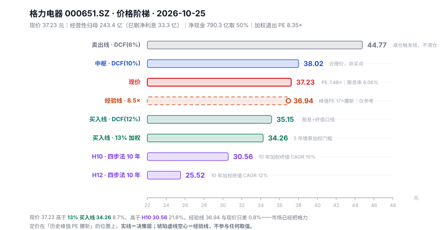

# 格力电器 000651.SZ · 唐朝估值法（v3.6）

> **数据截止 2026-10-25**（收盘价 2026-10-23）｜现价 **37.23 元**，总股本 56.01 亿股（加权 55.77），总市值 **2,085.25 亿**
> **最新已披露报告期：2026 中报**（2026-08-26 发布）
> **下一披露节点：2026 三季度报告**，法定截止 2026-10-31（2025 年三季报于 10-30 披露，2026 年预计同期）——本报告不含三季报
> 信息丰富度 **A**（十年完整财报 + 行业出货/零售/排产数据充分）
> 数据源：新浪财报三表（2016–2026H1）、腾讯实时行情（2026-10-23 收盘）、东财分红送转、券商中报点评与产业在线/奥维/暖通家行业数据

---

## 0. 一句话生意本质

向中国家庭卖空调，靠三十年品牌和几万家渠道网点，把一台三千元的机器做成 **30% 毛利率、15% 净利率**的现金生意。增量需求已经消失，剩下的是八到十年一轮的更新替换，所以利润几乎全部变成现金和股息——**它是一个付息资产，不是一台复利机器。**

---

## 1. 单季拆解（校验 1）与季节性校正（校验 5）

### 1.1 单季同比

| 季度 | 营收(亿) | 归母(亿) | 营收同比 | 归母同比 | 单季毛利率 | 单季净利率 |
|---|---:|---:|---:|---:|---:|---:|
| 2025Q1 | 415.1 | 59.0 | — | — | 27.36% | 14.2% |
| 2025Q2 | 558.2 | 85.1 | — | — | 29.33% | 15.2% |
| 2025Q3 | 398.6 | 70.5 | — | — | 28.31% | 17.7% |
| 2025Q4 | 332.7 | 75.4 | — | — | **35.45%** | **22.7%** |
| 2026Q1 | 429.7 | 60.8 | **+3.5%** | **+3.1%** | 27.42% | 14.2% |
| 2026Q2 | 464.3 | 72.0 | **−16.8%** | **−15.4%** | 30.11% | 15.5% |

**累计口径 −8.15% 掩盖了全部信息**：Q1 还在正增长（+3.5%），Q2 直接掉到 −16.8%。只看半年报会以为"温和下滑"，拆开才知道**拐点就在二季度**。

### 1.2 季节性校正（校验 5，强制）

空调是强季节性行业，但格力的季节性不在收入，**在利润率**——四季度是结算季：

| 年度 | Q1–Q3 净利率区间 | Q4 净利率 | Q4 毛利率 |
|---|---|---:|---:|
| 2023 | 11.6%–13.4% | **18.2%** | 30.0% |
| 2024 | 12.9%–16.7% | **24.1%** | 30.5% |
| 2025 | 14.2%–17.7% | **22.7%** | **35.5%** |

**Q4 净利率系统性高于前三季 5–8 个百分点，三年无一例外。** 结论：**禁止用 Q4 去比 Q3、禁止用 2026H2 去比 2026H1**，全年只能用同比。

这条同时解释了一个容易看反的现象：2025 全年净利 290 亿、净利率 17.0%，而 2026H1 只有 14.8%——**不是 2026 崩了，是 2026 还没走到结算季。** 按 2025 的季度结构，2026 全年净利率大概率回到 15.5–16.5%。

### 1.3 2025Q4 那 35.5% 的毛利率需要单独解释

2025Q4 营收 332.7 亿（全年最低），毛利率 35.5%（三年最高），净利 75.4 亿（净利率 22.7%）。**收入最少的季度赚了全年 26% 的利润。**

原因不是财务操纵，是**业务结构**：Q4 高毛利的空调主业占比最大，低毛利的"其他业务"（原材料贸易类）被砍到极低。2026H1 其他业务收入 41.42 亿、同比 **−57.87%**，进一步印证了这条收缩主线。**所以这是真实的利润改善，但它是"一次性结构红利"，不是可持续的提价能力**——主营毛利率 2026H1 已回落 1.35pct，红利基本用完了。

---

## 2. 十年序列与增速衰减检测（校验 3）

| 年 | 营业收入 | 归母净利 | 净利 YoY | 毛利率 | 经营现金流 | 净现比 |
|---|---:|---:|---:|---:|---:|---:|
| 2016 | 1,083.0 | 154.6 | — | 32.70% | 148.6 | 0.96 |
| 2017 | 1,482.9 | 224.0 | +44.9% | 32.86% | 163.4 | 0.73 |
| 2018 | 1,981.2 | 262.0 | +17.0% | 30.23% | 269.4 | 1.03 |
| 2019 | 1,981.5 | 247.0 | −5.7% | 27.58% | 278.9 | 1.13 |
| 2020 | 1,682.0 | 221.8 | −10.2% | 26.14% | 192.4 | 0.87 |
| 2021 | 1,878.7 | 230.6 | +4.0% | 24.28% | **18.9** | **0.08** |
| 2022 | 1,889.9 | 245.1 | +6.3% | 26.04% | 286.7 | 1.17 |
| 2023 | 2,039.8 | 290.2 | +18.4% | 29.43% | 564.0 | 1.94 |
| 2024 | 1,891.6 | 321.8 | +10.9% | 29.43% | 293.7 | 0.91 |
| 2025 | 1,704.5 | 290.0 | **−9.9%** | 29.81% | 463.8 | 1.60 |

**判定：已穿零（YoY 出现负值）。**

- 十年净利 CAGR **7.24%**，三年 CAGR **5.77%**，差 1.47pct（<10pct，不判"增速换挡"）
- **营收已连续两年下滑**：2023 峰值 2,039.8 → 2024 −7.3% → 2025 −9.9% → 2026H1 −8.1%
- 净利在 2024 见顶 321.8 亿，2025 回落 290.0，2026E 再降

按校验 3 规则：**锚 C 必须同时给"不再增长"和"继续下滑"两个子情景**，禁止用历史 CAGR 外推。

### 2.1 一个必须先回答的问题：为什么营收在跌，利润却没怎么跌？

2023→2025：营收 −16.4%，净利 −0.1%。这三个百分点的缺口由三样东西填：

1. **结构**：砍低毛利贸易业务（其他业务收入 −57.9%）
2. **费用**：2026H1 销售费用 51.30 亿（−17.29%）、研发费用 31.67 亿（**−19.01%**）
3. **利息**：2025 利息收入 58.85 亿 = 净利的 **20.3%**

**第二条是最危险的。** 收入降 8%，研发降 19%——这是把未来的护城河折成当期利润。研发费用率从 2025H1 的 4.03% 降到 2026H1 的 3.54%，一年少投 7.5 亿。**这笔钱不是省下来的，是借来的。**

---

## 3. 四道闸门

### 闸门 0 · 能力圈四问

1. 靠空调的**品牌溢价 + 规模成本 + 渠道覆盖**赚钱，客户付的是"买空调时第一个想到格力"和"坏了有人上门"；
2. 十年后空调一定还在——它是耐用品、无技术断代风险，只被建筑形态和气候影响；
3. 利润从空调内销（2026H1 内销主营 725.12 亿、毛利率 31.9%）来，流向分红（十年累计派现 1,588 亿，派现/募资 3,014%）；
4. 跌 30% 我会先去查"主营毛利率是否还在 30%"，而不是先怀疑自己。

**通过。**

### 闸门 1 · 利润为真

| 指标 | 阈值 | 格力实际 | 判定 |
|---|---|---:|---|
| 收现比（十年中位） | ≥0.90 | **0.906** | 通过（勉强） |
| 收现比（近三年） | ≥0.90 | 1.09 / 0.91 / 1.06 | 通过 |
| 净现比（十年中位） | ≥0.80 | **0.96** | 通过 |
| 应收 ÷ 营收（TTM） | ≤10% | 171.77 / 1,625.2 = **10.6%** | 略超，需解释 |
| 资本开支 ÷ 净利（2025） | ≤30% | 17.2 / 290.0 = **6%** | 通过 |

**两处必须解释，不许一句"通过"带过：**

- **收现比 2016–2018 只有 0.65 / 0.73 / 0.68**，远低于 0.8 红线。原因不是坏账，是当年大量用**银行承兑票据**结算（计入应收票据/应收款项融资，不进"销售商品收到的现金"）。2021 年后票据结构改变、收现比回到 0.90 以上。**十年中位 0.906 恰好压线，这是它真实的经营特征，不是美化后的数字。**
- **2021 年净现比 0.08（经营现金流 18.9 亿）**：渠道改革 + 票据结算 + 经销商打款节奏变化的三重叠加。次年即恢复（1.17），**是单年扰动，不是利润失真**。

**通过，但带一条警告：应收/营收 10.6% 已经站在红线上。** 格力的应收主要来自外销、工业制品和 B 端，空调内销是现款或票据——外销占比越高，这条线越难看。2026H1 外销 −22% 反而在改善这个指标。

### 闸门 2 · 利润可持续

十年序列 + 衰减检测已判**已穿零**。增速不可外推，利润可持续性降级为**每年复核**。

### 闸门 3 · 低资本投入

十年 capex 合计 **408 亿**，合计净利 **2,487 亿**，比值 **16%**。2025 年只有 6%（17.2 / 290.0）。固定资产净额 337 亿，在建工程 10.8 亿——**这是一门几乎不需要再投钱的生意。**

**通过。** 但要注意这意味着什么：**不需要投钱 = 没有地方投钱 = 留存利润只能变成现金或股息。** 这是后面所有估值问题的源头。

### 闸门表决

| 闸门 | 结论 |
|---|---|
| 0 能力圈 | 通过 |
| 1 利润为真 | 通过（收现比压线、应收踩线，均已解释） |
| 2 利润可持续 | 通过，但判定"已穿零"，逐年复核 |
| 3 低资本投入 | 通过（16%，极优） |

**四门全过，进入计算。**

---

## 4. 三锚定利润中枢（校验 2）

### 4.1 先修一件事：利息收入占净利 20.3%，必须剔除

| 项 | 数值 |
|---|---:|
| 2025 利息收入 | 58.85 亿 |
| 2025 利息费用 | 19.65 亿 |
| 净利息收入（税后，15%） | **(58.85 − 19.65) × 0.85 = 33.32 亿** |
| 2025 报表归母 | 290.03 亿 |
| **2025 经营性归母** | **256.71 亿** |
| 利息收入 ÷ 归母净利 | **20.3%**（>10%，触发强制剔除） |

按 4.4.1：**NP0 剔除利息收入，净现金单列**。2026E 报表归母 275 亿 → **经营性归母 243.4 亿**。

为什么要做这一步：格力 PE 只有 7.48 倍，看着像破产价，但**其中五分之一的利润是存款利息**。剔除后经营性 PE = (2,085.25 − 395.15) ÷ 243.4 = **6.94 倍**——更便宜，但含义完全不同：你买的是"6.94 倍的空调生意 + 一笔 790 亿现金"，不是"7.48 倍的空调公司"。

### 4.2 三锚取值

| 锚 | 口径 | 数值 | 说明 |
|---|---|---:|---|
| **A 当年** | 2026E 报表归母 | **275 亿** | H1 132.78 + H2 约 142（2025H2 为 145.9，按 −3% 估） |
| **B 中枢** | 2021–2025 五年中位 | **290 亿** | 序列 230.6 / 245.1 / 290.2 / 321.8 / 290.0；均值 275.5 |
| **C 未来** | 2029 三年后 | 236 / 275 / 309 亿 | 继续下滑(−5%/年) / 不再增长 / 温和恢复(+4%/年) |

**落后度 = 290.0 ÷ 278.7 = 1.04 ≥ 0.8** → 锚 B 可用五年中位（无需换成 TTM 经调整）。

但要标注一个陷阱：**2021–2025 恰好是格力史上最好的五年**（净利从 230.6 到 290.0，中间摸到 321.8）。用这五年的中位数 290 做"正常化"，隐含"最好的五年可以延续"的假设。**如果真实的正常化水平是 2026E 的 275 亿，锚 B 高估 5.5%。** 我在情景加权里用的是 275（锚 A），锚 B 只作旧口径对照。

### 4.3 三锚极差检查

增长率 5.77% < 12% → **"当年 ×0.7" 禁用**，买点区间只由锚 B、锚 C 构成。区间 76.0–85.4 元（详见第 6 节），极差 12.5% < 30%，不触发"估值不确定性过高"。

---

## 5. 估值全景：利润锚 → 价格轴（唯一决策依据）

### 5.1 先说清楚用哪个 DCF 口径——这是我这次做错再改对的地方

**口径①（错）：净利 DCF。** 把 100% 经营性净利当作可以按 r=12% 复利再投的现金，得到 r=12% → **47.87 元**（现价低 22.2%）。

**这个口径在格力身上是错的。** 因为它隐含"留存利润能按 12% 再投"。格力的真实情况是：

- 派息率 65%（对经营性净利），留存 35% = 85 亿/年
- 但这 85 亿**没有地方去**——capex 只有 17 亿，也不需要建产能
- 于是它躺在账上赚 2% 的利息，或者去还短期借款
- 实证：净现金 2019 年 1,104 亿 → 2026H1 790 亿，**六年间不增反降**（因为分红和回购比留存更多）

**用"高 ROIC + 零增长"这个组合去检验就能看出来**：理论增长 = ROE 19.9% × 留存 35% = **7.0%**，实际 2024–2026 是 **−6%**。差 13 个百分点，说明增量资本的回报是 0，不是 12%。

**口径②（对）：股息 + 终值 DCF。** 股息按经营性归母 × 65%，终值按退出 PE × 期末净利 + 净现金。这才是股东真正拿到的现金流。

| r | 口径① 净利 DCF（错） | **口径② 股息+终值（对）** | 口径② 相对现价 |
|---:|---:|---:|---:|
| 12%（买入线） | 47.87 | **35.15** | **−5.6%** |
| 10%（中枢） | 57.93 | **38.02** | **+2.1%** |
| 6%（卖出线） | 108.17 | **44.77** | **+20.3%** |

**两个口径差 36%，全在"留存那 35% 算不算钱"这一件事上。** 这就是格力估值的真正难点——不是折现率，是"它的利润能不能变成你口袋里的钱"。

> **口径① 保留在报告里，不删。** 读者需要知道：如果相信"格力能把留存利润按 12% 投出去"，它值 47.87 元；如果相信"它只能把利润分给你"，它值 35.15 元。**格力的分红记录站在后者这边。**

### 5.2 净现金三档（硬规则 17）

净现金 = 货币资金 1,282.48 + 交易性金融资产 344.19 − 有息负债 836.37 = **790.30 亿**（占市值 **37.9%**，每股 14.11 元）
有息负债明细：短期借款 797.19 + 一年内到期 11.35 + 长期借款 21.29 + 租赁负债 6.54

| 净现金权重 | 金额 | 占市值 | 5 年 13% 门槛价 | 现价对应 5 年加权 IRR |
|---|---:|---:|---:|---:|
| 0% | 0 | 0% | **30.32** | 7.73% |
| **50%（基准）** | **395.15** | **18.9%** | **34.26** | **10.87%** |
| 100% | 790.30 | 37.9% | **38.17** | **13.64%** |
| 扣销售返利（本报告加的一档） | 305.63 | 14.7% | **33.37** | 10.19% |

**这一张表比后面所有敏感性表都重要。** 现价 37.23 恰好落在"100% 净现金"和"50% 净现金"之间：如果那 790 亿真的属于股东，格力现在就够 13%；如果一分都不算，现价高 22.8%。

**为什么默认取 50%，而不是 100% 或 0%：**

- **不能取 100%**：其他流动负债 598.25 亿里有 **销售返利 484.67 亿**。这是已经计提、必须兑付给经销商的准债务——按格力自己的口径，它是"经销商未来拿货时的抵扣额度"。你可以说它不是现金流出，但它确实会减少未来的现金流入。把这 484.67 亿视为准债务，净现金降到 **305.63 亿**。
- **不能取 0%**：2026H1 合同负债只剩 84.74 亿（同比 −31.7%，较年初 −44.3%），短期借款反而从 679.57 涨到 797.19 亿。这个组合说明**账上的钱是真的、能动的**，不是冻结的保证金。
- **50% 落在 305.63（扣返利）和 790.30（全额）之间**，恰好是两种极端解释的中间值——这不是折中偷懒，是**返利池这件事本身没法用会计口径判定，只能给权重**。

**另一个必须点明的判断：有息负债 836 亿／净资产 1,485 亿 = 56.3%，机械套用"高杠杆打七折"会误判。** 格力是拿着 1,282 亿现金去借 797 亿短期借款（现金/有息负债 = **1.95 倍**），本质是低息负债替换和票据流转，不是杠杆经营。**不适用七折。**

### 5.3 全景表

| 层次 | 口径 | 每股 | 隐含 PE（对经营性归母） | 相对现价 | 性质 |
|---|---|---:|---:|---:|---|
| **卖出线** | DCF r=6%（股息口径） | **44.77** | 10.3× | +20.3% | 决策层·减仓触发 |
| **中枢** | DCF r=10%（股息口径） | **38.02** | 8.7× | +2.1% | 决策层·合理价 |
| **现价** | 2026-10-23 收盘 | **37.23** | 8.6× | — | — |
| *经验线* | *当年净利 × min(峰值PE×50%, 25)* | *36.94* | *8.5×* | *−0.8%* | *辅助参考，不参与任何取值* |
| **买入线** | DCF r=12%（股息口径） | **35.15** | 8.1× | −5.6% | 决策层·保守档 |
| **买入线** | 情景加权 5 年 IRR = 13% | **34.26** | 7.9× | **−8.7%** | 决策层·要求回报 |

**定位句（只对决策层排序）：现价 37.23 元位于买入线 35.15 与中枢 38.02 之间，距买入线还有 5.6%、距 13% 门槛线还有 8.7%。**

*经验线 36.94 元在现价下方 0.8%，仅参考：格力近十年 PE(TTM) 峰值约 17 倍（2020 年末–2021 年初），腰斩得 8.5 倍，已是 25 倍硬顶之下——现价刚好站在"历史峰值腰斩"的位置上。这条线在格力身上参考价值有限（它低于中枢、高于买入线），不作任何判断依据。*



<details><summary>内联 SVG（Obsidian / 浏览器可直接渲染）</summary>

（见同目录 `格力电器-阶梯.svg`）

</details>

---

## 6. 三锚 × 三方案矩阵（唐朝原式 · 旧口径对照）

**这一节在本标的上整体失效，但它必须被展示出来——读者需要知道"如果错误地用了原式，会得到什么数字"。**

| 方案 | 合理 PE | 当年×0.7<del>⚠️禁用</del> | 中枢×0.6 | 三年后×0.5 | 买点区间 | 相对现价 |
|---|---:|---:|---:|---:|---:|---:|
| A 正常化 3% | 27.5 | ~~94.5~~ | 85.4 | 76.0 | **76.0–85.4** | **+104%~+129%** |
| B 当期国债 1.65% | 50（封顶） | ~~171.8~~ | 155.3 | 138.1 | 138.1–155.3 | +271%~+317% |
| C 美债 5.1% | 20 | ~~68.7~~ | 62.1 | 55.2 | 55.2–62.1 | +48%~+67% |

**失效的原因只有一句**：原式的 `合理 PE = 1 ÷ 无风险收益率`，在 A 方案下给 27.5 倍；而市场三十年来给格力的 PE 中位就在 **8–10 倍**。用 27.5 倍去"合理估值"一家零增长、份额在缩、多元化全部失败的空调公司，得出的买点 76–85 元是现价的**两倍多**——这个数字不是说"格力很便宜"，是**原式在这里的前提假设（利润全部可分配 + 三年后零增长 + 风险等于国债）三条全不成立**。

**它在江南布衣（1.63% 国债 → 50 倍封顶）和老铺黄金（PE 6.4 倍）之后，是第三个"原式失效"的标本，而且是最极端的一个：失效方向相反——前两家是原式给的买点太低（贵），格力是原式给的买点太高（便宜）。**

结论：**格力只能用 4.5 的四层 DCF（股息口径）与 4.8 的情景加权，原式仅作对照。**

---

## 7. 情景加权（主口径，终值占比 >60% 时唯一可用）

口径① 的终值占比 62%、口径② 的终值占比 **71%**——**两个都超过 60%，按硬规则 15 都不能单点下结论**。所以决策层以情景加权为准。

### 7.1 四档情景（起点 = 经营性归母 243.4 亿，派息 65%，净现金 50%）

| 情景 | 净利年增 | 2031 净利 | 退出 PE | 2031 市值 | 权重 | 5 年 IRR | 5 年总回报 |
|---|---:|---:|---:|---:|---:|---:|---:|
| 悲观 | −5% | 188.3 | 7.0 | 1,714 | 25% | **3.2%** | +14.8% |
| 偏悲观 | 0% | 243.4 | 8.0 | 2,342 | 30% | **9.6%** | +50.3% |
| 中性 | +3% | 282.2 | 9.0 | 2,935 | 30% | **14.4%** | +82.2% |
| 乐观 | +6% | 325.7 | 10.0 | 3,652 | 15% | **19.2%** | +120.5% |

**加权 IRR = 10.87%**（聚合方式：加权各档 IRR，非加权终值 CAGR）
下行侧权重 25% + 30% = **55%**，符合"下行不低于 50%"的纪律。

**权重是怎么来的，不是对称分配的：**
- 悲观 25%：行业 6 月底库存 6,995 万台（+7%）、渠道库存 5,623 万台（+11%），9–11 月排产隔年比仍 −11.7%~−15.8%。**去库存不是一两个季度的事。**
- 偏悲观 30%：利润零增长但股息照付，这是最可能的状态。
- 中性 30%：内销主营 2026H1 还 +1.9%（行业 −5.6%），份额在修复；更新需求托底。
- 乐观 15%：需要地产企稳 + 海外恢复 + 治理改善三件事同时发生。

### 7.2 门槛价

| 要求回报（5 年加权 IRR） | 对应价格 | 相对现价 |
|---|---:|---:|
| 10% | 38.53 | 现价已过线（−3.4%） |
| 12% | 35.61 | −4.5% |
| **13%** | **34.26** | **−8.7%** |
| 15% | 31.76 | −17.2% |

**中性单点 13%（观察线）= 39.23 元**——比加权 13% 线高 14.5%。**这 14.5% 就是对"行业看不清"的报价**：如果你相信中性情景（+3% 增长、9 倍退出），现价 37.23 已经够；如果你承认悲观有 55% 的概率，就不够。**我选择承认。**

### 7.3 三项敏感性

**起点利润（5 年 13% 线，净现金 50%）**

| 经营性归母 | 13% 门槛价 |
|---|---:|
| 220 亿（行业再降两年） | 31.34 |
| **243 亿（本报告基准）** | **34.26** |
| 260 亿（H2 与去年持平） | 36.33 |
| 275 亿（不剔利息） | 38.20 |

**注意最后一行**：如果忘了剔那 33 亿利息，13% 线会变成 38.20 元——**现价直接"够线"**。整个结论的方向，被"利息算不算经营利润"这一个动作决定。这就是为什么 4.4.1 是硬规则。

**退出 PE（5 年 13% 线）**

| 全档退出 PE | 13% 门槛价 | 现价对应加权 IRR |
|---|---:|---:|
| −1 | 31.83 | 8.98% |
| **基准 7/8/9/10** | **34.26** | **10.87%** |
| +1 | 36.69 | 12.62% |

**退出 PE 每动 1 倍，门槛价动 7%——几乎是线性。** 说明格力对"市场愿意给几倍"极度敏感，而这件事**完全不由公司决定**。

**最差情景的绝对回报（第 22 条，必须给两端）**

| 净现金权重 | 悲观档 5 年总回报 |
|---|---:|
| 0% | −0.2% |
| 50% | +18.7% |
| 100% | +37.7% |

**这是格力最好的地方**：即使净利连跌五年（累计 −22.6%）、退出 PE 只有 7 倍，5 年总回报仍是正的（净现金 50% 口径 +18.7%）。**7.6% 的股息率把下行托住了。** 对比陕西煤业最差 −20.2%、宁德时代 −17.2%，格力在赔率结构上明显更好。

---

## 8. 净现金调整（估值对象锁定）

| 项 | 金额（亿） | 说明 |
|---|---:|---|
| 货币资金 | 1,282.48 | 2026H1 |
| 交易性金融资产 | 344.19 | 含理财/基金 |
| 减：短期借款 | (797.19) | 从年初 679.57 上升 |
| 减：一年内到期非流动负债 | (11.35) | 从年初 136.68 大幅下降 |
| 减：长期借款 | (21.29) | — |
| 减：租赁负债 | (6.54) | — |
| **净现金** | **790.30** | 占市值 37.9%，每股 14.11 元 |
| 减：销售返利（准债务） | (484.67) | 其他流动负债 598.25 的主要构成 |
| **保守净现金** | **305.63** | 占市值 14.7% |

**经营性市值与经营性 PE**

| 口径 | 经营性市值 | 经营性归母 | 经营性 PE | 表观 PE |
|---|---:|---:|---:|---:|
| 净现金 0% | 2,085.25 | 243.4 | 8.57× | 7.48× |
| **净现金 50%** | **1,690.1** | **243.4** | **6.94×** | **7.48×** |
| 净现金 100% | 1,294.95 | 243.4 | 5.32× | 7.48× |

**换个说法：你花 37.23 元，其中 14.11 元是现金（若全算），7.06 元是现金（若打对折），剩下 23–30 元买的是每年赚 4.35 元（每股经营性净利 243.4÷55.77）的空调生意。**

---

## 9. 价格区间（图形）

见同目录 `格力电器-阶梯.svg`（已嵌入第 5 节）。图内决策层为实线（DCF 12%/10%/6% + 情景加权 13%），经验线为琥珀虚线空心点，底部标注"不参与计算"。

---

## 10. 失效条件与监控（三个能最早证伪的数据）

| 指标 | 当前值 | 触发阈值 | 含义 |
|---|---:|---|---|
| **2026 三季报主营毛利率** | 30.13%（H1） | 跌破 **28%** | 价格战已经吃掉结构性红利，275 亿起点必须下调 |
| **2027 冷年排产（隔年比）** | −11.7%~−15.8%（9–11 月） | 连续两季好于 **−5%** | 行业去库存结束，悲观档权重要下调 |
| **销售返利池余额** | 484.67 亿 | 单季减少 >**40 亿** | 利润靠释放返利池做出来的，利润质量恶化 |
| （辅助）合同负债 | 84.74 亿 | 继续跌破 **70 亿** | 经销商打款意愿继续恶化，收入前瞻走弱 |
| （辅助）研发费用同比 | −19.01% | 连续两年负增长 | 护城河在被折现 |

---

## 11. 与四步法的接口（v3.5 §5.1 三条判据，强制）

> 四步法独立报告：`格力电器-20261025-四步法.md`

### 判据零 · 先算收敛倾向

```
当前 PE = 2,085.25 ÷ 278.68 = 7.48×
加权退出 PE = 0.25×7 + 0.30×8 + 0.30×9 + 0.15×10 = 8.35×
收敛倾向 = 7.48 ÷ 8.35 = 0.896
```

**0.896 落在 0.7–0.9 的边界上——年限开关有中等作用，但方向已经确定：**

```
当前 PE 7.48 < 退出 PE 8.35  →  买得比退出便宜  →  估值修复是正贡献
                              →  年限越长，这次修复摊得越薄  →  10 年收益率更低
```

这与第 33 条的第二种情形一致，并且和实测完全吻合（见判据二）。

### 判据一 · 五开关对齐

| 开关 | 唐朝法 | 四步法 | 对齐 |
|---|---|---|---|
| ① 起点利润 | 经营性归母 243.4 亿（2026E） | 同 | ✅ |
| ② 年限 | **5 年** | **10 年** | ❌ 唯一的实质差异 |
| ③ 退出倍数 | 7 / 8 / 9 / 10（加权 8.35×） | 同 | ✅ |
| ④ 税率 | A 股个人持股 >1 年免税，股息 0% | 同 | ✅ |
| ⑤ 聚合方式 | **加权各档 IRR** | **概率加权期末财富 → 等效 CAGR** | ❌ 第二个差异 |

情景与权重也统一（四档 25/30/30/15），四步法的"三情景"模板在此把悲观档拆成两档，下行侧合计仍为 55%。

### 判据二 · 拆到开关级（残值 0.00pct）

| 口径 | 5 年 | 10 年 |
|---|---:|---:|
| 加权 IRR | **10.87%**（唐朝法） | 9.32% |
| 加权终值 CAGR | 10.06% | **7.85%**（四步法） |

**顺序拆解（唐 → 四步法）：**

| 步骤 | 数值 | 变化 |
|---|---:|---:|
| 起点：5 年加权 IRR | 10.87% | — |
| 换聚合（IRR → 终值 CAGR），年限不动 | 10.06% | **−0.80pct** |
| 换年限（5 年 → 10 年），聚合不动 | 7.85% | **−2.21pct** |
| **合计** | **7.85%** | **−3.02pct，残值 0.00pct ✅** |

**反向顺序的检验（说明两个开关不是独立相加）：** 先换年限（10 年 IRR）9.32%（−1.55pct），再换聚合 7.85%（−1.47pct）。两种顺序的差是 **0.67pct**——**这是交互项，不是残值**，因为"年限"和"聚合"本质上是同一个机制的两种表现：**持有越久，凸性越强，加权 IRR 与加权终值 CAGR 的缺口越大。**

**为什么 10 年一定更差，有具体的机制解释，不是参数调出来的：**

| 情景 | 5 年 IRR | 10 年 IRR | 差 |
|---|---:|---:|---:|
| 悲观 | 3.2% | 3.1% | −0.1 |
| 偏悲观 | 9.6% | 8.4% | −1.2 |
| 中性 | 14.4% | 12.1% | −2.3 |
| 乐观 | 19.2% | 15.9% | −3.3 |

**每个情景的 10 年 IRR 都低于 5 年，而且越乐观的情景降得越多。** 原因：现价 8.6 倍买入、8.35 倍退出，**"买得便宜"这个一次性收益只在头五年兑现**；十年里它被摊成每年 0.2 个百分点。**格力的回报来源越往后越只剩下"股息 + 零到三个点的增长"。**

### 判据三 · 分歧幅度对应动作

**同口径（同为 13% 要求回报）的两个买点：**

| 方法 | 口径 | 13% 买点 | 差额 |
|---|---|---:|---:|
| 唐朝法 | 5 年 加权 IRR | **34.26** | — |
| 四步法 | 10 年 加权终值 CAGR | **23.35** | **−31.8%** |

**−31.8%，超过 30% 阈值 → 触发"警示：估值对假设极度敏感"。**

按 5.1 判据三第三行：**该标的估值不可靠，仓位必须打五折，报告须写明。**

按 `investment-advisor` §分歧处理的实际下单价：

```
下单价 = min(唐朝法 13% 线 34.26, 四步法 H12 25.52) = 25.52 元
```

**25.52 元对应 2026E 表观 PE 5.2 倍、股息率 11.8%（TTM 口径）——低于格力近十年的最低估值区间（约 6.3–8 倍）。**

这句话要正面说清楚：**这不是"再等一等就到"，是"本框架认为格力的质量配不上它的价格，而不是价格配不上价值"。** 一只零增长、份额在缩、多元化全败、研发在砍的公司，要求 12% 的十年回报，就只能在历史从未出现过的估值上买。

### 判据小结

| 判据 | 结果 |
|---|---|
| 零 · 收敛倾向 | 0.896，年限有中等作用（边界） |
| 一 · 五开关同口径 | ✅ 起点/退出倍数/税率/权重全对齐，只差年限与聚合 |
| 二 · 拆到开关级 | ✅ 聚合 −0.80 + 年限 −2.21 = −3.02，残值 **0.00pct** |
| 三 · 分歧幅度 | ⚠️ **−31.8%（>30%）→ 估值不可靠、仓位打五折** |

**两法方向一致（都说不买），所以不触发"方向相反 → 不买"的最高级警示；但分歧幅度过大，触发"仓位打五折"的中级警示——这两条同时成立，结果就是：即使价格跌到 34.26，也只能用半仓。**

---

## 12. 数据来源与可复现

| 项 | 内容 |
|---|---|
| 行情 | 腾讯财经 `qt.gtimg.cn`，2026-10-23 收盘 37.23 元，PE(TTM) 7.48、PB 1.40 |
| 财报 | 新浪财经 `CompanyFinanceService.getFinanceReport2022`，利润表/资产负债表/现金流量表 2016-09-30 至 2026-06-30 共 40 期 |
| 分红 | 东财 `RPT_SHAREBONUS_DET`，2011 年至今 |
| 行业 | 产业在线（内销出货/排产）、奥维云网（零售量额/线上均价结构）、暖通家（中央空调）、AVC（零售份额） |
| 券商 | 2026 中报点评（国信/中财口径 2026–2028 归母 283/297/316 亿） |
| 计算脚本 | `分析脚本/格力_tangchao.py` + `input.json`（同目录） |
| 复核 | 分部加总 740.74+86.52+3.74+21.56+41.42 = 893.98 ≈ 营收 894.0 ✅；股价×稀释股本 2,076.3 vs 市值 2,085.3，差 0.43%（回购库存股 0.24 亿股）✅ |

**口径声明**：全文"归母净利"指归属于母公司股东的净利润；2026E 为 275 亿（H1 132.78 实际 + H2 约 142 估算）；经营性归母 = 报表归母 − 净利息收入（税后 33.32 亿）。**EPS 一律用加权股本 55.77 亿股，市值一律用总股本 56.01 亿股。**

---

## 13. 一句话结论

**等。** 现价 37.23 元给 5 年加权 IRR 10.87%、10 年加权终值 CAGR 7.85%——**过了 10% 的及格线，够不上 13% 的买入线和 12% 的新增资金门槛；买入线 34.26（5 年 13%），下单价 25.52（四步法 H12）。**

---

### 修订记录

- **v1（2026-10-25 首版）**。本报告相对于前十个算例，新踩并修正了两个错误，均已写回 `tangchao-valuation` v3.6：
  1. **"高 ROIC + 零增长" 会让净利 DCF 系统性高估**：格力 ROIC 29.8%、理论增长 7.0%、实际 −6%，差额说明增量资本回报为 0。净利 DCF 给 47.87 元（比股息口径高 36%）。**新增 4.4.4 与硬规则 18。**
  2. **"有息负债/净资产 >50%" 不能机械判高杠杆**：格力 56.3% 超标，但现金/有息负债 1.95 倍、净现金为正。**先看净现金覆盖率再判杠杆。**
