# 片仔癀（600436.SH）· 唐朝估值法

> **报告日期**：2026-11-08｜**数据截止**：2026-09-30 三季报、2026-11-06 收盘
> **脚本**：`分析脚本/片仔癀唐朝法20261108.py`（唯一权威，可独立复算，不引用任何历史版本）
> **配对报告**：`片仔癀-20261108-四步法.md`（双方法强制配对，判据零/一/二/三见 §9）

---

## 一句话结论

**现价 136.00 元的 10 年 IRR = 0.31%。要 12% 只需付 59.38 元，现价贵 129%。**

这不是"贵一点"。这家公司过去三年净利复合 **−4.41%**，2026 年 **−25.9%**，而现价要求未来十年复合 **+18.8%**。三个情景里最乐观的那个（2027 修复到 26 亿 + 6% 增长 + 退出 25 倍 PE）也只给 6.83%。

---

## §1 前置闸与输入

### 1.1 三道前置闸（原样输出，禁则要求）

```
【precheck · inputs】决策输入清单：缺失必须显式 UNKNOWN，禁止默认值静默生效
  ✓ 可投资总资金基数               = 1000.0
  ✓ 本标的持仓市值                = 0.0
  ✓ 持仓成本价                  = 0.0
  ✓ 现价                     = 136.0
  ✓ 可动用现金                  = 600.0
  ✓ 报表币->交易币汇率             = 1.0
  仓位 = 0.0 / 1000.0 = 0.00%
  结果：PASS

【precheck · fx】跨币种扰动自检（终值必须与股息同币种）
     FXR      A 法价     B 法价      IRR
   1.000      51.60      56.80  0.0000%
  IRR 极差 0.000000%
  ✓ IRR 对 FXR 恒定（汇率只换展示，不改回报）
  结果：PASS

【precheck · class】分类必须数出来，不得判出来
  核心六维：维度2 存疑 | 维度3 存疑 | 维度5 过 | 维度6 存疑 | 维度7 存疑 | 维度8 存疑
  → 核心存疑 5 个，核心不通过 0 个，否决项 无
  → 护城河 存疑，财务 存疑
  **机械分类 = C 类**（核心存疑 >=3）
  ✓ 报告所述分类 C 类与机械分类一致
  结果：PASS
```

> 闸二的两个价格 51.60 / 56.80 是闸门自检用的示例值，不是本报告的估值结论（本报告结论为 12% 线 59.38）。A 股同币种，FXR=1.0，本标的无汇率敞口。

### 1.2 输入表（逐项标明性质）

| 项 | 值 | 性质 | 来源 |
|---|---:|---|---|
| 现价 | 136.00 | 事实 | 2026-11-06 收盘 |
| 总股本 | 6.03 亿股 | 事实 | 年报 |
| 市值 | 820.08 亿 | 计算 | — |
| 2025 营收 / 归母 / OCF | 90.01 / 21.59 / **0.77** 亿 | 事实 | 2025 年报 |
| 2026 前三季营收 / 归母 / OCF | 63.49 / 12.88 / 23.17 亿 | 事实 | 2026 三季报 |
| 2026E 归母 | **16.0 亿** | 假设 | 前三季 12.88 + Q4 约 3.1 |
| 2027 正常化归母 | **22.0 亿** | 假设 | 牛黄成本红利释放后 |
| 派息率 | 83.01% | 事实 | 2025 年报 |
| 每股净资产 | 23.46 元 | 事实 | 2026-09-30 |
| 净非经营性资产 | 58.08 亿 = **9.63 元/股** | 计算 | 见 §4 |

---

## §2 先验倾向与反向扰动（禁则要求，先写再做）

**我的先验：不喜欢这个价格。** 三个理由：PE(TTM) 62 倍、需求在萎缩、治理在动荡。

**这个先验有偏，必须扰动。** 反向问题：**如果我错了，最可能错在哪一步？**

**答案：错在"2026 年是底部"这个判断上。**

如果 2026 年是业绩底，2027 年成本红利充分释放（牛黄 170 万→55 万/kg，降 68%），利润可能不是修到 22 亿，而是修到 28-30 亿——接近 2024 年的峰值。若如此，2027 年 PE = 820/28 = 29 倍，一个正在修复的品牌中药给 29 倍，不算离谱。

**所以本报告刻意做了一件事：把"乐观情景"设到很宽（2027 修到 26 亿、之后 6% 增长、退出 25 倍）。** 结果仍是 6.83%——低于 10% 的机会成本线。

**这个反向测试是关键**：不是我压低了假设才得出"贵"，而是把假设放宽到"几乎不可能更好"之后，它仍然不便宜。

---

## §3 历史序列：先把"下滑"的形状看清

| 年 | 营收 | 归母净利 | OCF | 毛利率 | ROE | OCF/净利 |
|---|---:|---:|---:|---:|---:|---:|
| 2022 | 86.94 | 24.72 | 25.20 | 47.0% | 22.0% | 1.02 |
| 2023 | 100.58 | 27.97 | 22.07 | 46.8% | 22.6% | 0.79 |
| 2024 | 107.88 | 29.77 | 13.14 | 42.7% | 21.4% | 0.44 |
| 2025 | 90.01 | 21.59 | **0.77** | 36.4% | 14.8% | **0.04** |
| 2026 前三季 | 63.49 | 12.88 | 23.17 | 37.9% | 8.7% | 1.80 |

### 3.1 现金流那两年，是同一笔钱在往返

2025 年 OCF 崩到 0.77 亿（−94.14%），2026 前三季回到 23.17 亿（+376%）。**方向完全相反，且都不正常。**

原因在存货：

- 2024 末 49.67 亿 → 2025 末 **66.79 亿**（+34.5%，高价囤牛黄，其中原材料占 72%）
- 2026-09 **56.96 亿**（−14.7%，去化）

**2025 年"流出"的 17.12 亿，与 2026 年"流入"的 9.83 亿，是同一笔钱。** 两年合计 OCF 23.94 亿、合计净利 34.47 亿，比值 **0.69**。

> **所以 2026 年"现金流大幅改善"这条新闻标题是假的。** 它不是经营改善，是资产负债表上的一次往返。正常化 OCF 应该回到净利附近，不能拿 23.17 亿去外推。

### 3.2 2025 年真正发生了什么：量增价崩

这是本报告最重要的一个数据，多数讨论都漏了：

| 肝病用药（2025 年） | 变化 |
|---|---:|
| 生产量 | **+41.39%** |
| 销售量 | **+25.81%** |
| 库存量 | **+265.53%** |
| 收入 | **−19.63%** |
| 毛利率 | 61.29%（−6.62pct） |

**销量涨 26%、收入跌 20%，只有一个解释：均价崩了。**

2023 年 5 月提价到 760 元/粒之后，礼品需求崩盘、囤货泡沫破裂。2025 年实际成交价普遍 600 元左右，电商更低，出现**出厂价 > 零售价**的倒挂。

> **这组数说明：片仔癀不是卖不动，是"愿意按 760 元买的人"没有了。** 需求池没有消失，价格体系塌了。这两件事的估值含义完全不同——前者是周期，后者是永久性下台阶。

---

## §4 正常化盈利与非经营性资产

### 4.1 2026E：16.0 亿

前三季 12.88 亿，Q3 单季只 1.95 亿（含投资收益 −0.54 亿）。2025 年 Q4 净利仅 0.29 亿——极端低基数。2026 Q4 按 3.1 亿估，全年 **16.0 亿**，同比 −25.9%。

### 4.2 正常化：22.0 亿（这是假设，不是预测）

牛黄从 170 万/kg 跌到 55 万/kg（−67.6%），进口通道打通（阿根廷、乌拉圭），成本拐点已现。**但成本下降不会立刻变成利润**：

- 存货中原材料 **40.92 亿**（2026H1），按加权平均法逐季消化
- 华兴、长城证券均判断：真正弹性在 2027 年，前提是终端价格不继续松动

中性正常化取 **22.0 亿**（净利率 25.9%，低于 2024 年的 27.8%），对应每股 3.65 元。

> **为什么不用 28-30 亿？** 因为毛利率修复的上限不是"回到 80%"，而是"回到 80% 减去价格折让"。2025 年终端已从 760 打到 599，这个折让是永久的。22 亿是"成本正常化 + 价格不再跌"的稳态。

### 4.3 非经营性资产 58.08 亿 = 9.63 元/股

| 项 | 亿 | 说明 |
|---|---:|---|
| 货币资金 | 12.56 | |
| 其他流动资产（一年内定存） | 15.99 | |
| 其他非流动资产（定期存单） | 31.67 | |
| 减：有息负债 | −10.62 | 短借 8.38 + 长借 0.56 + 其他 |
| 加：长期股权投资 | 8.48 | 片仔癀投资管理公司，按账面 |
| **合计** | **58.08** | 占市值 7.1% |

按"今天价值直加"（NPV=0），禁只折现不给 g_inv。

> 长期股权投资 8.48 亿给账面值不打折已属宽容——该子公司 2026Q3 投资收益 **−0.54 亿**，2025 年按权益法增 4.36 亿，波动极大。

---

## §5 三情景（每情景一套独立假设）

关键假设是"**2027 年利润修复到哪**"，不是 CAGR——成本红利在 2027 年集中释放，之后回到稳态。

| 情景 | 2027 净利 | 稳态 g | 退出 PE | 12% 线 | **现价 IRR** | 现价 vs 线 |
|---|---:|---:|---:|---:|---:|---:|
| 悲观 | 18.00 | 0.0% | 15.0 | 38.05 | **−6.68%** | 高 257.4% |
| **中性** | **22.00** | **3.0%** | **20.0** | **59.38** | **0.31%** | **高 129.0%** |
| 乐观 | 26.00 | 6.0% | 25.0 | 93.53 | **6.83%** | 高 45.4% |

- **悲观**：需求继续萎缩，成本红利只够补掉原料涨价，零增长；退出按周期底部 15×
- **中性**：修到 22 亿（净利率 25.9%），之后 3% 稳态；退出按成熟品牌中药 20×
- **乐观**：修到 26 亿并重回 6% 增长，新品类起量；退出按成长股 25×

**「现价 vs 线」这一列是同一把尺子的三种刻度，不是三个价格判断。** 三个都是"付这个价，十年能拿回多少"。

---

## §6 四层价格（中性情景）

| 要求回报 | 可付价格 | 对应 2026E PE | 现价距此 |
|---:|---:|---:|---:|
| 17.46% | 43.99 | 16.6× | +209.2% |
| 15.00% | 50.02 | 18.9× | +171.9% |
| **12.00%** | **59.38** | 22.4× | **+129.0%** |
| 10.00% | 67.19 | 25.3× | +102.4% |
| 6.00% | 87.99 | 33.2× | +54.6% |

**即便只要求 6%（等于放弃股权风险溢价），可付价格也只有 87.99 元——比现价低 35%。**



> 曲线是「中性情景下、要求不同年化回报时今天该付多少钱」。现价 136.00 落在曲线之外——**要求 0.31% 才配得上这个价**。

---

## §7 退出倍数必须当自变量（禁则 36）

同一个 12% 要求，不同退出倍数给出的价格：

| 退出 PE | 12% 线 | 现价 IRR | 含义 |
|---:|---:|---:|---|
| 15.0 | 51.71 | −1.99% | 周期底部 |
| 18.0 | 56.31 | −0.55% | |
| **20.0** | **59.38** | **0.31%** | 成熟品牌中药（主口径） |
| 25.0 | 67.04 | 2.21% | |
| 30.0 | 74.70 | 3.82% | |
| 35.0 | 82.37 | 5.22% | |

**15 倍与 35 倍相差 30.65 元——退出倍数不是"保守/激进"的旋钮，它占估值的将近一半。**

片仔癀的历史给了这个倍数一个校准：2021 年给过 100 倍，2025 年给过 30 倍，**今天 62 倍（TTM）**。取 20 倍意味着"它最终会被当成一家成熟中药企业来定价"——这本身是判断，不是事实。

---

## §8 现价在要求什么（反解）

固定 2026E 16 亿、退出 20 倍、资产 9.63 元：

**要让现价 136.00 达到 12% 回报，需要未来十年净利复合增长 18.78%。**

对照：
- 过去三年复合 **−4.41%**
- 2026 年 **−25.9%**
- 乐观情景（2027 修到 26 亿 + 6% 增长 + 退出 25×）只给 **6.83%**

**换一个更直观的说法**：现价 136.00 隐含的 2036 年净利是多少？

| 算法 | 2036 年净利 |
|---|---:|
| 忽略股息 | 118 亿 |
| 扣除十年股息现值约 18 元 | **101 亿** |

**对照：历史最高年净利 29.77 亿（2024）。现价要求 2036 年净利达到历史峰值的 3.4 倍。**

---

## §9 同一终值验伪（禁则 38）

2036 年净利 28.71 亿 × 退出 20× = 终值 **574.1 亿**（每股 95.21 元）

| 要求 | 价格 | 股息现值 | 终值现值 | 反推终值 | 残差 |
|---:|---:|---:|---:|---:|---:|
| 17.46% | 43.99 | 15.31 | 19.04 | 95.21 | 0.0000 |
| 15.00% | 50.02 | 16.85 | 23.53 | 95.21 | −0.0000 |
| 12.00% | 59.38 | 19.09 | 30.65 | 95.21 | −0.0000 |
| 10.00% | 67.19 | 20.85 | 36.71 | 95.21 | 0.0000 |
| 6.00% | 87.99 | 25.19 | 53.16 | 95.21 | 0.0000 |

**五档残差全部 < 0.5 元，PASS。**

**构成拆分**：现价 136.00 里，股息现值占 **23.9%**、第十年一次成交占 **69.0%**、非经营性资产占 **7.1%**。

> **七成回报来自"2036 年有人按 20 倍接盘"，不是每年挣到的。** 这一点必须说清，否则读者会把"12%"理解成"每年涨 12%"。

---

## §10 与四步法对账（技能 5.1 三判据）

| 口径 | 价格 | 现价 IRR |
|---|---:|---:|
| 唐朝法 12% 线（中性，10 年截断 + PE 20×） | **59.38** | 0.31% |
| 四步法 H12（10 年截断 + EV/EBIT 15×） | 55.93 | −0.66% |
| 四步法两段式（**永续** FCF，g=3%） | 45.48 | 5.71% |

**判据零 · 收敛倾向**：PE(TTM) 62.27 ÷ 加权退出 PE（20.6）≈ **3.02**，远在 0.8–1.25 之外 → 年限与退出倍数会制造分歧，收敛非必然 ✓

**判据一 · 六开关**：起点（16 亿 vs 22 亿，不同）、**年限（10 年截断 vs 永续，不同）**、退出方式（PE 20× vs 永续隐含 11.1×，不同）、税率（已对齐）、聚合方式（同）、资产口径（同）

**判据二 · 金额空间**：59.38 − 45.48 = **+13.90 元**

**不做 0.01 级拆解。** 两个模型结构不同（10 年截断 vs 无限期永续），强行拆只会得到"年金系数差"，不是"假设差"。三个分量方向相反（年限让唐朝法低、退出倍数让唐朝法高、起点让四步法高），净额 +13.90 元，说明 **20× vs 11.1× 这一项主导**。

**判据三 · 分歧幅度**：`|59.38/45.48 − 1| = 30.6%` → 落「>30% → 仓位五折」档。但 **C 类仓位本就是 0，五折不适用**。

> **⚠️ 这一处是本报告最重要的方法警告：**
>
> **两法共用"净利 ≈ FCF"这一前提**（片仔癀 capex 仅 3.40 亿、占净利 15.7%）。所以这里的收敛或分歧，都不构成独立验证。
>
> 更严重的是：**两段式的永续 3% 增长假设，对需求萎缩的行业是系统性高估**。它给 45.48 元、IRR 5.71%，而 10 年截断的唐朝法只给 0.31%。差的 5.4pct 全部来自"第 11 年起还假设 3% 增长"。
>
> **对片仔癀这类标的，主口径应取 10 年截断模型，不取永续。** 这是与腾讯相反的方向：腾讯是 capex 太大导致两法公式退化，片仔癀是永续假设不适用导致两段式虚高。

---

## §11 结论

### 11.1 主句

**现价 136.00 元的 10 年 IRR = 0.31%（唐朝法中性）。三情景跨度 −6.68% 至 6.83%，没有一种假设达到 10% 的机会成本线。**

### 11.2 三条独立证据，同一方向

1. **三情景 IRR**：−6.68% / 0.31% / 6.83%，乐观情景也不够
2. **隐含增长率**：现价要求 10 年复合 **+18.8%**，过去三年 **−4.41%**、当年 **−25.9%**
3. **隐含终值净利**：现价要求 2036 年净利 **101 亿** = 历史峰值的 **3.4 倍**

### 11.3 买点（仅作参考，C 类不构成建仓建议）

| 档 | 要求回报 | 价格 |
|---|---:|---:|
| 第一档 | 15% | **50.02** |
| 第二档 | 17.46% | **43.99** |
| 极严 | 20% | 约 38 |

**距现价 −63% / −68%。** 这个距离说明：不是"等回调"，是"等重新定价"。

### 11.4 唐朝法自身的局限（必须写明）

1. **非经营性资产 58.1 亿直接加总**，意味着市场给主业的定价是 **126.37 元/股**（136 − 9.63）。这既是下行保护，也说明"便宜"的错觉可能来自把现金当成了安全垫。
2. **退出 PE 取 20 是判断**：2021 年给过 100 倍、2025 年给过 30 倍、今天 62 倍。历史区间宽到无法约束。
3. **g 只能表达"每年涨多少"，表达不了"需求池在缩小"**。这是方法盲区——它对片仔癀这种"量在但价崩"的公司，只能通过压低 g 和退出倍数来间接表达，而压多少全靠判断。

### 11.5 我可能错在哪（反向扰动，已做）

如果片仔癀能重回 15% 增长（新品类成药落地 + 提价重启 + 渠道库存出清完成），我的 g=3% 就错了，现价可能是合理的。

**但 2025 年那组数（生产 +41%、销量 +26%、收入 −19.6%）指向相反的方向：它不是卖不动，是价格体系塌了。** 要把人找回来只能降价，降价意味着毛利率永久下一台阶。

**这是全报告唯一需要你自己判断的地方：你认为片仔癀还能不能重新提价？**

- 能 → 我错了，它是被低估的
- 不能 → 20 倍 PE 是它的上限，现价 62 倍，贵

---

## §12 置信度

| 项 | 等级 | 理由 |
|---|---|---|
| 数据置信度 | **中高** | 年报、三季报、分部数据齐全；牛黄价格为行业公开报价 |
| 生意质量置信度 | **中低** | 护城河真实存在，但"变窄多少"无法量化 |
| 估值置信度 | **低** | 正常化盈利 22 亿是判断；退出 PE 20 是判断。两个判断相乘，误差会放大 |

**关键缺失数据**：片仔癀锭剂的分渠道销量、真实终端成交均价、渠道库存绝对值。这三项决定"价格体系能否修复"，但公司不披露。

---

*本报告所有数字可由 `分析脚本/片仔癀唐朝法20261108.py` 独立复算。*
