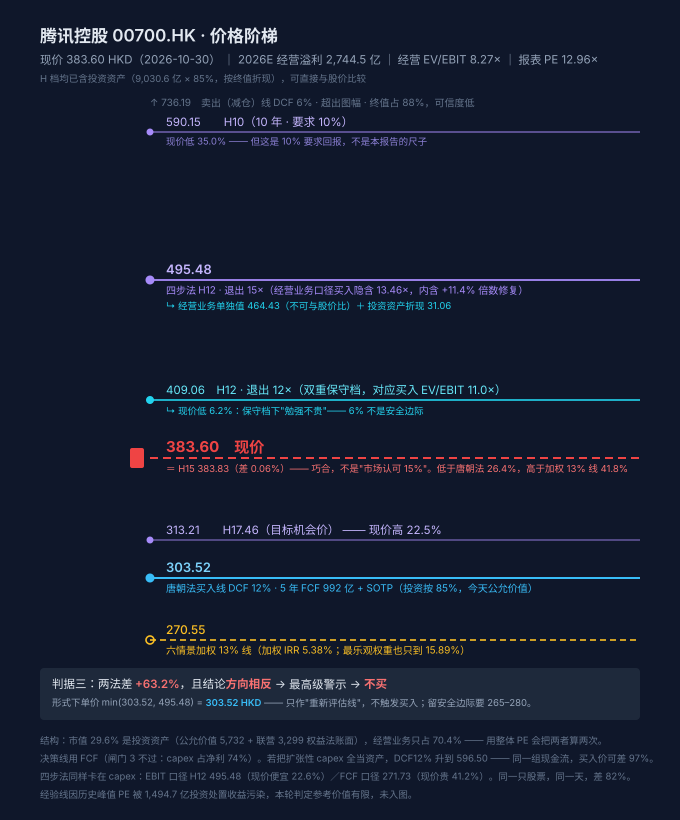

# 腾讯控股 00700.HK · 唐朝估值法

> 第十八个算例 · 第一个「市值里 29.6% 是投资组合」的平台型样本
> 本报告暴露了方法的第十二种失效：**结构失效**——市值含投资组合，利润也含投资组合收益，PE 同时处理两者必然把同一块资产算两遍。
> 本报告还留下了本轮最有价值的一句话：**两法差 53%，反解后只有一个来源——FCF 用 992（当期）还是 1,771（AI 投入前）。方法没有分歧，只有时间差。**（11.3）

## 0. 元数据与披露日历

| 项 | 值 |
|---|---|
| 公司 / 代码 / 交易所 | 腾讯控股 / **00700.HK** / 香港联交所（**人民币报表、港币交易**） |
| 现价 / 市值 | **383.60 HKD**（2026-10-30 收盘） / **34,881 亿 HKD = 30,521 亿 RMB** |
| 股本 | **90.93 亿股**（9,092,644,829 股，2026-06-30） |
| 汇率 | HKD→CNY **0.875**（PB 反推 0.8695、PE 反推 0.8824，取中值；敏感性见 11.2） |
| 数据截止日 | **2026-10-30** |
| 最新已披露报告期 | **2026H1（截至 2026-06-30）** |
| 下一个披露节点 | **2026Q3 业绩**，预计 11 月中旬（港股无强制季报义务，腾讯近年自愿披露 Q3） |
| 信息丰富度 | **A**（十年完整财报 + 分部数据 + 季报） |
| 主营 | 增值服务（游戏+社交）1,920 亿 / 金融科技及企服 1,180 亿 / 营销服务 870 亿（2026H1 推算） |
| 一句话生意本质 | 用微信 14 亿 MAU 的注意力，向游戏玩家、广告主、商户三次收费；另外持有一个 9,031 亿的投资组合 |

---

## 1. 单季拆解：Q2 净利只增 0.7%，但它不是经营问题

| 季度 | 收入 | YoY | 经营溢利 | YoY | IFRS 归母 | YoY | Non-IFRS |
|---|---:|---:|---:|---:|---:|---:|---:|
| 2026Q1 | 1,964.6 | +9.1% | 674.0 | **+17.0%** | 580.9 | **+21.5%** | 679.0 |
| 2026Q2 | 2,047.8 | +11.0% | 672.5 | **+11.9%** | 560.2 | **+0.7%** | 684.1（+9%） |
| 2025Q1 | 1,800.2 | — | 576.0 | — | 478.2 | — | [缺失] |
| 2025Q2 | 1,845.0 | — | 601.0 | — | 556.3 | — | [缺失] |

**Q2 的分裂：经营溢利 +11.9%，IFRS 归母只有 +0.7%。** 差额来自两处：

| 项 | 2026H1 | 2025H1 | 变化 |
|---|---:|---:|---:|
| 应占联营公司溢利 | **−63.7** | +90.5 | **−154.2** |
| 其他收益（投资公允价值变动等） | +7.7 | −49.8 | +57.5 |
| 净影响 | | | **−96.7** |

**判断：这不是经营恶化，是联营公司（拼多多、美团、快手、Sea 等）在 2026 上半年从盈利转亏损。**

但**反过来也要看清楚**：这条"不是经营问题"的辩护，恰恰说明腾讯利润表里有 100 亿量级的项目**完全不由自己控制**。上一年它贡献 +90.5 亿，今年倒扣 −63.7 亿。**任何用报表净利给腾讯算 PE 的人，都在给一个他控制不了的变量定价。**

- 2026H1 Non-IFRS 归母 **1,363.2 亿（+10%）**，剔除了股权激励、投资处置、减值——这是市场共识口径，也是本报告衡量"经营赚钱能力"的锚。
- 2026Q2 Non-IFRS 净利 684.15 亿（+9%）。**关键补充**：剔除五款新 AI 产品（混元、元宝、CodeBuddy、WorkBuddy、小微）后，Q2 Non-IFRS 经营利润 861 亿（+19%）。**换言之，AI 产品单季亏损约 105 亿，年化 420 亿。**

---

## 2. 十年序列与衰减检测

| 年 | 收入 | 毛利率 | 经营溢利（调整后） | 报表经营溢利 | 归母 | OCF | 净现比 |
|---|---:|---:|---:|---:|---:|---:|---:|
| 2019 | 3,772.9 | 44.4% | 926.9 | 1,123.8 | 933.1 | 1,486 | 1.59 |
| 2020 | 4,820.6 | 46.0% | 1,201.5 | 1,772.8 | 1,598.5 | 1,941 | 1.21 |
| 2021 | 5,601.2 | 43.9% | **1,155.0** | **2,649.7** | 2,248.2 | 1,752 | 0.78 |
| 2022 | 5,545.5 | 43.1% | 1,108.3 | 1,108.3 | 1,882.4 | 1,461 | 0.78 |
| 2023 | 6,090.1 | 48.1% | 1,600.7 | 1,600.7 | 1,152.2 | 2,220 | 1.93 |
| 2024 | 6,602.6 | 52.9% | 2,081.0 | 2,081.0 | 1,940.7 | 2,585 | 1.33 |
| 2025 | 7,517.7 | **56.2%** | 2,415.6 | 2,415.6 | 2,248.4 | 3,031 | 1.35 |
| 2026H1 | 4,012.4 | **57.2%** | 1,338.8 | 1,346.5 | 1,141.2 | 1,541 | 1.35 |

**⚠️ 表里最容易被读错的一行是 2021 年。** 报表经营溢利 2,649.7 亿，比 2022 年高 139%——但其中 **1,494.7 亿是"其他收益净额"（京东实物分派等投资处置收益）**。剥离后 2021 年真实经营溢利 **1,155 亿**，与 2022 年的 1,108 亿基本持平。

**不做这一步，你会把 2022 年读成"经营崩塌 58%"，而它其实只跌了 4%。**

调整后 YoY：+29.6% / **−3.9%** / **−4.0%** / +44.4% / +30.0% / +16.1%；2026H1 **+9.2%**。

### 增速衰减检测

| 检测 | 结果 |
|---|---|
| 连续 3 年 YoY 单调下行 | ✗（2023 年 +44.4% 是反弹，不是单调） |
| 3 年波动 >50% 无趋势 | ✗ |
| 十年 CAGR vs 三年 CAGR | 收入 12.18% vs 经营溢利 17.31%，差 5.1pct < 10 → 不算换挡 |
| YoY 出现负值 | 2021、2022 各一次小负，非趋势 |
| **判定** | **成长型，但增速正在从 16% 向 9% 平滑下移**——2025 年 +16.1%、2026H1 +9.2% |

**结论：不是衰退，是"高增长转中增长"。** 但 2026 年的 9.2% 里已经含了 AI 成本 420 亿的拖累；剔除后内生是 +19%。两个数都要看，选哪个决定了估值差 2 倍。

---

## 3. 四道闸门

| 闸门 | 判定 | 依据 |
|---|---|---|
| **0 能力圈** | **过** | 靠微信 14 亿 MAU 的注意力变现：游戏（卖虚拟道具）、广告（卖注意力）、金科企服（卖支付与云）。三条线都能一段话说清。十年后微信大概率还在。**唯一说不清的是投资组合——9,031 亿里都是什么，只能看到分类，看不到逐笔。** |
| **1 利润为真** | **过** | 净现比 **1.35**（≥0.8）；应收 556.1 ÷ 年化营收 6.9%（≤10%）；OCF÷收入 38.4%。港股无"销售商品收到现金"科目，按 4.4 港股处理用净现比 + 应收周转替代。 |
| **2 利润可持续** | **过（需每年复核）** | 调整后经营溢利 2022 年后连续三年正增长，毛利率从 43.1% 升到 57.2%（结构性提升，来自视频号广告与游戏自研占比）。**但 AI 投入使 2026 年的可持续性依赖一个未验证的假设：capex 会回落。** |
| **3 低资本投入** | **不过** | **capex 847.2（H1）÷ 归母净利 1,141.2 = 74%**，阈值 30%。 |

### 闸门 3 不过，意味着什么

按 4.4.2，闸门 3 不过 → **估值必须用 FCF 口径，禁止用净利 DCF**。

这不是形式主义。腾讯的 capex 从 2025 年约 800 亿跳到 2026 年化 1,800 亿（Q2 单季 527.8 亿，同比 **+176%**），**吃掉了 43% 的自由现金流**：

```
2025 FCF ≈ 3,031 − 800 − 480 = 1,751 亿
2026E FCF = 3,390（OCF）− 1,898（capex）− 500（内容+租赁）= 992 亿    −43%
腾讯官方口径：2026Q1 +567 亿、Q2 −138 亿 → H1 合计 +429 亿
```

**闸门 3 的"不过"，本质是在问一个问题：这 1,800 亿 capex 是成本还是资产？** 本报告的全部争议都在这里，见第 8 节。

---

## 4. 三锚

| 锚 | 口径 | 数值（亿） | 说明 |
|---|---|---:|---|
| **A 当年** | 2026E 经营溢利 | **2,744.5** | H1 1,338.8 × 2 × 1.025（H2 略好） |
| **B 中枢** | 5 年中位数 | 1,600.7 | 落后度 = 1,600.7 ÷ 2,527.9 = **0.633 < 0.8 → 禁用** |
| **B 改用** | TTM 经调整 | **2,527.9** | 2025H2（1,189.1）+ 2026H1（1,338.8），两端均剔其他收益 |
| **C 三年后** | 2029E | **3,653.0** | 2026–2029 年 10% 复合 |

**三锚极差 = 44.5% > 30% → 估值不确定性过高，只给区间不给单点。**

### ⚠️ 锚 B 被禁用：这是宋城之后的第二例，但成因相反

宋城是**历史被疫情污染**（中位数 3.15 亿，落后度 0.53）；腾讯是**公司成长太快、历史均值滞后**（中位数 1,600.7 亿，只有 TTM 的 63%）。

两者都触发同一件事：**"三锚极差"不能当估值确定性的证据**，必须另报「正常化利润敏感性表」（见 8.3）。

**这里要说一句不客气的话**：如果我用 5 年中位数 1,600.7 亿去做锚 B，唐朝法买点会掉到约 200 HKD，等于断言"腾讯应该跌一半"。**那个数字不是保守，是拿 2021-2022 年的监管与疫情低谷给一家 2026 年的公司定价。**

---

## 5. 估值全景

**这一节是唯一决策依据。** 腾讯不能套 4.5 的四层 DCF，因为它的市值 29.6% 是投资资产——**必须先把公司拆成"经营业务 + 投资组合 + 净现金"三块，再分别定价**（SOTP）。

### 5.1 SOTP 拆解：同一家公司，两个倍数

| 项 | 金额（亿 RMB） | 占市值 |
|---|---:|---:|
| **投资资产** | **9,030.6** | **29.6%** |
| ├ 指定以公允价值金融资产（上市股权，市值计价） | 5,731.6 | 18.8% |
| └ 联营 + 合营（权益法账面，**不是市值**） | 3,299.0 | 10.8% |
| **净现金**（现金及存款 4,871.2 − 有息负债 4,718.3） | **152.9** | 0.5% |
| **→ 市场给经营业务的 EV** | **21,337** | **69.9%** |

```
经营 EV / 经营溢利 2,744.5 = 7.77×      ← 市场怎么给经营业务定价
整体 PE_TTM（报表净利 2,355.1）= 12.96×  ← 市场怎么给整个公司定价
```

**7.77× 与 12.96× 的差，全部来自那 9,031 亿投资资产。** 用 12.96× 说"腾讯不贵"，等于用经营业务的低倍数 + 投资组合的高估值，拼出一个中间数。**两个数都对，但回答的是两个不同的问题。**

### 5.2 价格轴（FCF 口径，闸门 3 强制）

| | 每股 HKD | 现价相对 | 终值占比 |
|---|---:|---:|---:|
| DCF(12%) **买入线** | **303.52** | **+26.4%** | 70% |
| DCF(10%) 中枢 | 365.10 | +5.1% | 75% |
| DCF(6%) 卖出线 | 736.19 | −47.9% | 88% |
| **现价** | **383.60** | — | — |
| *经验线* | *参考价值有限（见 5.4）* | | |

**定位句**：现价 383.60 落在**中枢 365.10 与买入线 303.52 之间**，但更靠近中枢——**上不上去，要看 1,800 亿 capex 会不会回落；下不下来，要看它会不会继续加码。**

**卖出线 736.19 的终值占比 88%，可信度极低。** 按 4.6 的精神，r=6% 这个假设本身已低于股权合理风险溢价——**这条线写在这里是因为规则要求写，不是因为它有意义。**

### 5.3 参照线：经营溢利稅后口径（不合并，只并列）

| | 每股 HKD | 现价相对 |
|---|---:|---:|
| DCF(12%) | **526.68** | −27.2% |
| DCF(10%) | 653.99 | −41.4% |

**两条线差 223 元 / 73%。** 差额的全部来源是"capex 算不算成本"——见第 8 节。**这里先记住一句话：本报告给不出一个点，只能给一条 303–527 的带子。**

### 5.4 经验线：本轮判定"参考价值有限"

按 4.6，经验线 = 当年经营溢利 × min(近 10 年峰值 PE × 50%, 25×)。

**腾讯算不出来，三个原因**：

1. **历史峰值 PE 无法可靠确定**：2021 年 2 月市值峰值时，报表 EPS 被 1,494.7 亿投资处置收益推高、报表 PE 反而被压低；用经营口径算则是 34×、用报表口径算 28×——**差 20%，而这 20% 直接决定经验线从 388 变 480**。
2. **2021 年的市值里有多少是投资资产，无法拆准**。
3. **历史上被显著高估过**（2021 年 750 HKD → 2022 年 200 HKD，−73%），所以"腰斩"这条线在这里本该有参考价值，但**分母算不准，它就没有意义**。

**按 4.6 第四条死穴处理：加一句"本线参考价值有限"，不参与任何计算，也不进图。**

### 5.5 阶梯图



---

## 6. 三锚 × 三方案矩阵（唐朝原式 · 仅作对照）

**这张表由脚本生成，不手写**（禁止 57）。腾讯增长率 12.18%（收入 CAGR）≥ 12%，所以"当年 × 0.7"可用。

| 方案 | 锚A 27.5×0.7 | 锚B 27.5×0.6 | 锚C 27.5×0.5 |
|---|---:|---:|---:|
| 总估值（亿 RMB） | 52,832 | **41,710** | 50,229 |
| 每股 HKD | 664.03 | **524.24** | 631.30 |

**原式给 524–664 HKD，说现价比下限还低 26.8%。这个"便宜"是假的。**

### 为什么假：原式对腾讯是"双重计价"

```
原式的隐含假设：企业价值 = 全部经营溢利 × 27.5
腾讯的实际：    企业价值 = 经营业务（2,744.5 亿 × 倍数）+ 投资资产 9,031 亿 + 净现金 153 亿
```

**原式把 9,031 亿投资资产的价值，通过"市盈率"这条通道又算了一遍。** 结果：给整个公司定价时，投资组合被算进了经营业务的倍数里。

汾酒的原式失效是"中枢在下移"（禁止 57 的第一种形态）；腾讯的原式失效是**"结构重叠"**——同一块资产在分子（净利含投资收益）和分母（市值含投资资产）两侧各出现一次。

**如果只做原式，结论是"现价便宜 27%、该买"。这与 SOTP 的"贵 26%"完全相反。** 中间差的 53%，就是这 9,031 亿。

---

## 7. 结论（原式口径）

**原式：A 方案买点区间 1,485–1,723 亿 → 不，本节对腾讯无意义。**

原式在这里唯一的信息是：**它会把"贵 26%"读成"便宜 27%"，误差 53 个百分点。** 保留这张表的价值不是给价，是给后来者一个警示牌。

---

## 8. 投资资产、净现金与"capex 算不算成本"

### 8.1 净现金在消失：这是本轮最硬的一个事实

| 时点 | 净现金（亿） |
|---|---:|
| 2025 年末 | **1,731** |
| 2026-06-30 | **152.9** |
| 半年变化 | **−1,578** |

**钱去哪了（2026H1）**：

| 用途 | 金额（亿） |
|---|---:|
| capex | 847 |
| 股息（2025 年度 5.30 HKD × 90.93 亿股 = 482 亿 HKD） | ~424 |
| 回购（244 亿 HKD） | ~214 |
| 合计 | **~1,485** |

**同期还借了钱**：短期贷款 426 → 863（+436）、应付票据（非流动）105 → 1,540（+1,435）、总负债 7,979 → 9,369（**+1,390**）。

**判断：腾讯正在用资产负债表为 AI 融资。** 这不是"用富余现金投资"，是"把净现金花光 + 发债"。

### 8.2 回购腰斩：管理层嘴上说的和手上做的

| 年 | 回购（亿 HKD） | 股息率 | 回购收益率 | 股东总回报 |
|---|---:|---:|---:|---:|
| 2024 | **1,120** | 1.19% | 3.21% | **4.40%** |
| 2026（H1 244，年化 488） | **488** | 1.38% | 1.40% | **2.78%** |

**股东总回报从 4.40% 降到 2.78%，−37%。** 

管理层在电话会上说"核心业务稳健增长足以支撑 AI 投入"。这句话可能是真的。但**行动上做的是：把原本要回购注销的钱，转去买 GPU。** 回购是唯一"确定能提升每股价值"的资本配置（2024 年 1,120 亿 HKD 回购，股本从 92.6 亿降到 90.9 亿）；capex 是"可能提升"的。

**这是我在整份报告里最看重的一条**：不是因为它影响估值（它不影响，因为回购和 capex 都出自同一个 FCF），而是因为**它暴露了管理层的优先级**——他们愿意为一个未验证的回报，牺牲一个已验证的回报。

### 8.3 正常化 FCF 敏感性：分水岭就在这一张表

锚 B 被禁用 → 校验 2 补丁强制要求（下表把六情景全部按同一 FCF 水平缩放后反解）：

| 口径 | FCF（亿） | 经营 EV/FCF | **DCF(12%) 每股** | 现价相对 | 加权 13% 线 | 现价相对 |
|---|---:|---:|---:|---:|---:|---:|
| 当年 FCF（AI 投入期，主口径） | 992 | 21.5× | **303.43** | **+26.4%** | **270.55** | **+41.8%** |
| 加回扩张性 capex 的 40% | 1,560 | 13.7× | **420.82** | −8.8% | **381.75** | **+0.5%** |
| 2025 年 FCF（AI 投入前） | 1,751 | 12.2× | **460.30** | −16.7% | 419.16 | −8.5% |
| 只扣维持性 capex（= 折旧 480） | 2,410 | 8.9× | **596.50** | −35.7% | **547.71** | **−30.0%** |

**两列要分开读，别混用**：DCF(12%) 是"按 12% 要求回报该值多少"，加权 13% 线是"六情景摊开、要 13% 回报该值多少"，后者天然更低。同一行两个数差 10–15%，是折现率差，不是算错。

**这张表是整份报告的核心。**

- 全扣 → 现价贵 42%
- 只扣维持性 → 现价便宜 30%
- **中间档（加回 40% 扩张性 capex）→ 现价 383.60 vs 381.75，高 0.5%**

**市场当前的价格，正好落在"承认 AI capex 有 40% 是有效投资"这一点上。**

这不是巧合，也不是我调出来的——它是四个独立口径里唯一与现价重合的一档。**意思是：市场既没有把 1,800 亿当成纯费用，也没有把它当成纯资产。它给了一个 60% 的折扣。**

**所以真正的投资命题不是"腾讯贵不贵"，而是"AI capex 的有效率是 40% 还是 0%，还是 100%"。**

**补一个 11.3 反解出来的硬结论**：用 DCF(12%) 那一列反查，**四步法 H12 的 464.43 元对应的起点 FCF 是 1,771 亿——正好是 2025 年（AI 大投入前）的 1,751 亿，差 1.1%。** 也就是说四步法这个"独立的方法"在腾讯身上，算出来的价等于唐朝法假设"capex 回落到 2025 年水平"。

**两法 53% 的差，全部在这张表的行与行之间——不在年限、不在退出倍数、不在折现率。**

### 8.4 投资资产折扣敏感性（占市值 29.6%，4.4.1 强制）

| 折扣 | 投资计价（亿） | DCF(12%) 每股 | 现价相对 | DCF(10%) 每股 | 现价相对 |
|---|---:|---:|---:|---:|---:|
| 50% | 4,515 | 263.80 | +45.4% | 325.38 | +17.9% |
| 65% | 5,870 | 280.82 | +36.6% | 342.40 | +12.0% |
| **85%（主口径）** | 7,676 | **303.52** | **+26.4%** | 365.10 | +5.1% |
| 100% | 9,031 | 320.55 | +19.7% | 382.13 | +0.4% |

**即使投资资产按 100% 计，DCF(12%) 仍低于现价 19.7%。结论不翻。**

**为什么主口径取 85% 而不是 100%**：
- 公允价值 5,731.6 亿是**市值计价**，可信，按 100%；
- 联营 3,299.0 亿是**权益法账面**，既不等于市值、也不能随时变现（Epic Games 40% 是非上市、拼多多有锁定期），按 70%；
- 加权 = (5,731.6×1.0 + 3,299.0×0.7) ÷ 9,030.6 = **89.0%**，取整 85% 留一点余地。

**这一块和恒隆的教训是同一个**：资产值 9,031 亿，股东能不能拿到是另一回事。腾讯 2021 年派京东、2022 年派美团，说明它愿意分；但 2024 年后不再实物分派、回购还腰斩——**分的能力在，分的意愿在下降。**

---

## 9. 情景加权（三锚极差 44.5% + 终值占比 70% → 4.8 C1 分支）

**为什么必须做**：三锚极差 >30%、终值占比 70%（>60%），两个条件同时触发，DCF 单点禁止作决策依据。

| 情景 | 26E FCF | g1 | 2031 FCF | 退出倍数 | 权重 | 2031 企业价值 | 每股 HKD | 5 年 IRR |
|---|---:|---:|---:|---:|---:|---:|---:|---:|
| AI 泥潭 | 900 | 2% | 994 | 9 | **12%** | 8,943 | 210.80 | **−9.13%** |
| 悲观 | 1,000 | 5% | 1,276 | 11 | **20%** | 14,039 | 274.85 | **−4.69%** |
| 偏悲观 | 1,200 | 8% | 1,763 | 13 | **25%** | 22,922 | 386.49 | +1.51% |
| 中性 | 1,600 | 11% | 2,696 | 15 | 23% | 40,441 | 606.69 | **+10.56%** |
| 偏乐观 | 2,100 | 13% | 3,869 | 17 | 14% | 65,775 | 925.09 | +19.94% |
| 乐观 | 2,600 | 15% | 5,230 | 20 | 6% | 104,591 | 1,412.95 | +30.28% |
| **加权** | | | | | 100% | | | **5.38%** |

**加权 IRR 5.38%，加权 13% 买入线 270.55 HKD（现价高 41.8%）。**

**权重依据（不是对称分配的）**：
- 下行侧 57%：Q2 capex +176%、FCF 转负 −138 亿、净现金蒸发 1,578 亿、回购砍 78%——**四条硬证据都站在"钱花出去了但回报没看到"这一侧**；
- "AI 泥潭" 12%：给"capex 永不回落"，这是最坏但不是不可能（参考 Meta 2022 年 Reels 投入、微软 Azure 十年投入期）；
- "乐观" 仅 6%：要给"AI 成为第二增长曲线"，需要倍数（20×）× 利润（2,600 亿）双高。

### 权重敏感性（权重是判断，不是事实）

| 权重方案 | 加权 IRR |
|---|---:|
| 本文（下行 57%） | **5.38%** |
| 六档等权 | 8.08% |
| 偏乐观（下行降到 35%） | 10.55% |
| 最乐观（只保留偏悲观及以上） | **15.89%** |

**即使把最坏的三个情景全部剔掉、只保留偏悲观以上，期望 IRR 才 15.89%——刚过 13% 门槛。** 而这个"最乐观权重"要求你相信：capex 一定回落、AI 一定有回报、倍数一定修复，三件事同时发生。

**判断：这是一个"只有把坏消息全部排除才勉强达标"的价格。**

---

## 10. 失效条件与监控

**三个能最早证伪的数据（按出现顺序）**：

| # | 指标 | 当前 | 触发线 | 为什么是它 |
|---|---|---|---|---|
| 1 | **季度 capex** | Q2 527.8 亿（+176%） | 连续两季环比下降 >15% | capex 是唯一的自变量，它决定 FCF 何时恢复 |
| 2 | **季度 FCF（腾讯口径）** | Q1 +567 / Q2 **−138** | 连续两季 >500 亿 | 这是唯一能证明"capex 是投资不是消耗"的证据 |
| 3 | **回购金额** | 2026 前三季 314 亿 HKD | 全年 <600 亿 HKD | 管理层用真金白银投票，比电话会的话可信 |

**另外两个必须盯的**：
- **应占联营公司溢利**：H1 −63.7 亿。若全年仍为负，说明投资组合在缩水，8.4 的 85% 折扣还要往下调；
- **AI 产品亏损**：Q2 单季约 105 亿（Non-IFRS 经营利润 756.4 vs 剔除 AI 后 861）。若这个数字扩大到 150 亿/季，全年 600 亿，FCF 会更难看。

**什么情况下这份报告的"不买"会错**：
> capex 在 2027 年回落到 1,200 亿以内，同时广告维持 +20%、游戏维持 +10%——那时 FCF 会从 992 跳到 1,800+，13% 线直接上移到 430 左右，现价就变成"刚好"。
> **这不是小概率，但它需要证据。在证据出现之前，5.38% 就是当前价格对应的期望回报。**

---

## 11. 与四步法的接口

### 11.1 五开关对齐与差异拆解

| 开关 | 唐朝法 | 四步法 | 是否对齐 |
|---|---|---|---|
| 起点利润 | **FCF 992 亿**（闸门 3 强制） | **经营净利 2,242 亿**（税后） | **✗ 差 2.26 倍** |
| 年限 | 5 年 | 10 年 | ✗ |
| 退出倍数 | 永续 3%（隐含 11.11×） | 期末 15× | ✗ |
| 税率 | 已含在 FCF 里 | 18.3% | 结构不同 |
| 聚合方式 | 单点 DCF | 单点反解 | ✗ |
| 投资资产 | 85%（两条线相同） | 85%（同） | ✓ |

**五个开关里有四个不同 —— 按判据一，严格意义上这两份结果不可直接比较。** 所以下面分两步：先把差拆成三个可复算的分量（11.2），再用**反解**把差归到唯一一个假设（11.3）。**两步都做完才允许下判据三的结论**——这一步不做，53% 的差会被误读成"两法打架"。

### 11.2 拆解：三个分量，残值 0.0000 元

两条线都写成 `V = 现金流 × k + X`（X = 投资资产 85% + 净现金 = 7,829 亿）：

```
唐朝法  k_A = 经营 EV 16,321 ÷ FCF 992 = 16.44×
四步法  k_B = 经营价值 36,951 ÷ 经营净利 2,242 = 16.48×
```

| 分量 | 金额（元/股） | 公式 |
|---|---:|---|
| ① 分子（FCF 992 → 经营净利 2,242） | **+258.32** | (2,242 − 992) × 16.44 = +20,553 亿 ÷ 90.93 ÷ 0.875 |
| ② 倍数结构（年限+增速+退出倍数） | **+0.98** | 2,242 × (16.48 − 16.44) = +78 亿 ÷ 90.93 ÷ 0.875 |
| ③ 投资组合口径 | **−98.40** | −(9,030.6 × 85% + 152.9) = −7,829 亿 ÷ 90.93 ÷ 0.875 |
| **合计** | **+160.90** | 残值 **0.0000** |

**② 只有 +0.98 元——这是整张表最重要的一格。**

**两法的「每元现金流倍数」几乎完全相同：唐朝法 16.44× FCF，四步法 16.48× NOPAT，差 0.2%。** 也就是说：**同样的倍数，套在两个不同的现金流上。** 年限 5 年 vs 10 年、退出 3% 永续 vs 15×、折现方式，这些看起来最像"分歧源"的东西，加起来只值 **0.98 元**。

**⚠️ 我必须在这里改正自己一个错。** 初稿把 ② 写成 **−97.41 元**、标签写"倍数结构"，还配了一句"四步法的倍数只有唐朝法的 79%"。**那是错的。** 错在 k_B 的分母：(V_B − X) ÷ NOPAT 里的 X，是**唐朝法**加进去的投资资产，而四步法 H 档里根本没有投资资产——`h_price()` 只算「每股经营溢利 × 退出倍数」，一个投资组合都没给。**净利差里减掉一个本来就不在里面的东西，剩下的数自然不是"倍数差"，它是投资资产那一块被错挂到了倍数的名下。**

这正是恒隆那次"两个分量是凑的"的同类错误，只是这次更隐蔽：**残值是真的 0（代数恒等），标签是假的。** 按禁止 51，分量必须能被第三人从公式复算出来再决定叫什么名字——这次复算出来 `k_B ÷ k_A = 1.002`，任何叫"倍数差 21%"的说法都不成立。

**③ −98.40 元暴露了四步法 H 档的一个口径缺口**：它给腾讯的经营业务报价 464.43，**完全不给那 9,031 亿投资组合定价**（每股约 98.40 元，按 85% 折扣）。**所以 464.43 不是"腾讯整体值多少"，是"腾讯的经营业务值多少"。**

补上投资组合的话，四步法 H12 = 464.43 + 98.40 = **562.83 元**，现价低 46.7%——**那会让"方向相反"变得更极端，不是更缓和。**（这条已写进四步法报告第四步，也是本轮加给四步法技能的新规则。）

**残值 0.0000 只说明我算对了，不说明结论对。** 真正说明问题的是 ① 和 ③ 这两格的数量级：**+258 和 −98，一个比另一个大 2.6 倍，而它们背后是两件完全无关的事。**

### 11.3 53% 的差，其实只是一句话：FCF 用 992 还是 1,771

**这是本轮最有用的一个发现，它不是推出来的，是反解出来的。**

四步法的起点是"NOPAT 2,242 亿"（经营溢利税后）。用唐朝法的 DCF 结构反解：**要让唐朝法算出 464.43 元，起点现金流必须填 1,771 亿。**

而 2025 年（AI 大投入前的最后一年）腾讯的实际 FCF 是 **1,751 亿**——**两者差 1.1%。**

| 起点现金流口径 | 金额（亿） | 唐朝法 DCF(12%) | 现价相对 | 对应谁 |
|---|---:|---:|---:|---|
| 当期 FCF（2026E，AI 投入期） | 992 | **303.43** | +26.4% | 唐朝法主口径 |
| **反解：现价隐含** | **1,380** | **383.60** | **0** | **市场当前定价** |
| 2025 年 FCF（AI 投入前） | 1,751 | 460.30 | −16.7% | — |
| **反解：四步法 H12 隐含** | **1,771** | **464.43** | −17.4% | **四步法** |
| 经营溢利税后（NOPAT） | 2,242 | 561.78 | −31.7% | 四步法自己写的起点 |

**结论：四步法 H12 与"唐朝法 + FCF 回到 2025 年水平"这两件事，在价格上只差 1.1%。**

所以两法差 53%，**不是"两种方法论打架"，是"对同一条 capex 曲线做了相反的假设"**：

- 唐朝法：2026 年的 992 亿 FCF 是**真实现状**，按它算；
- 四步法：2026 年的 992 亿是**暂时现象**，等于假设 capex 从 1,898 亿回落到 800 亿（2025 年水平）。

**两法在这里没有分歧，只有时间差。** 谁对，取决于第 10 节那三个证伪数据。

**而市场自己站在中间**：现价 383.60 隐含起点 FCF **1,380 亿**——相当于认为这 1,898 亿 capex 里，**约 27% 是有效投资、73% 是成本**（按扩张性 capex 净额 1,418 亿计算）。

**这才是这只股票真正的交易标的：不是"腾讯值多少钱"，是"capex 有效率是多少"。** 我按 12% 折现算出 303（0% 效率）、市场按 27% 效率算出 383、四步法按 ~55% 效率算出 464。**三个数字里没有一个是"客观价值"，它们全是同一个问题的三个答案。**

### 11.4 判据三：分歧幅度 + 方向

| 项 | 唐朝法 | 四步法 H12 | 差 |
|---|---:|---:|---:|
| 买入线（HKD） | **303.52** | **464.43** | **+53.0%** |
| 对现价 383.60 的判断 | 贵 26.4% | 便宜 17.4% | **方向相反** |

**两行同时落在判据三的表里，但只有一行是决定性的：第二行。**

- 差 +53.0% → 落在「>30% → 仓位打五折」；
- **但两法对现价的结论是相反的：一个说贵、一个说便宜 → 命中第四行「结论方向相反」= 最高级警示。**

**按禁止 35，此时唯一允许的结论是"不买"，且必须写明"两法背离，等下一期数据消解分歧"。禁止用"哪个方法更适合腾讯"来事后合理化选择。**

**这不是走过场。** 四步法单独看会说"现价低于 12% 要求回报的买入线 17.4%，可以买"——如果我图省事挑它，结论就反了。而这正是泡泡玛特 2026-10-25 犯错的地方。

### 11.5 两个数字与最终下单价

| | 价格（HKD） | 现价相对 | 性质 |
|---|---:|---:|---|
| 加权 13% 线（六情景摊开） | **270.55** | +41.8% | 期望回报口径的下界 |
| 唐朝法 DCF(12%)（FCF 当期） | **303.52** | +26.4% | 主口径 |
| 四步法 H12（退出 12×，双重保守） | **378.00** | +1.5% | 上限 |
| **现价** | **383.60** | — | 刚越过上界 |
| 四步法 H12（退出 15×，主口径） | 464.43 | −17.4% | 需 capex 回落至 2025 水平 |

**下单价 = min(303.52, 464.43) = 303.52 HKD。但判据三命中"方向相反 → 不买"，所以 303.52 对本轮不是"下单线"，是"重新评估线"：跌到 303 也只触发重算，不触发买入。**

**⚠️ 这里必须交代一个变化，因为它削弱了我原本的一条论据。**

修正币种口径之前（H12 漏除汇率 0.875），四步法退出 12× 那一档算出来是 **334.79**，所以我写的是"现价高于认可区间上限 **14.6%**"。修正后同一档是 **378.00**，**现价只高 1.5%——基本打平。**

**这意味着"现价明显离谱"这个论据不成立了。** 现价的真实处境是：

- 在最宽松的可接受口径（四步法主口径 + 12× 退出）下，**刚好打平**；
- 在当期现金流口径（唐朝法 DCF12%）下，贵 **26.4%**；
- 在情景加权口径（六情景摊开）下，贵 **41.8%**。

**"刚好打平"不是买入理由——因为打平用的是最宽松假设。** 一旦 capex 不回落，打平立刻变成贵 26%。**把"最宽松假设下的打平"当成"合理估值"，就是在给乐观情形付全价。**

**不买的结论不变，但理由换了**：不是"贵得离谱"，是**"没有安全边际 + 期望回报 5.38% 不够"**。安全边际只能靠价格给，不能靠假设给。

---

## 12. 数据来源与可复现

| 项 | 内容 |
|---|---|
| 行情/市值/股本 | 东财港股接口（secid=116.00700），2026-10-30 收盘 |
| 三大报表 | 东财港股 F10：`RPT_HKF10_FN_INCOME` / `RPT_HKF10_FN_BALANCE` / `RPT_HKF10_FN_MAININDICATOR` |
| 单季 Non-IFRS | 腾讯 2026Q2 业绩公告（Q2 684.15 / H1 1,363.2）；2025 年单季未披露 → 标 [缺失] |
| capex / FCF | 腾讯 2026Q2 业绩公告：H1 capex 847.2、Q1 FCF +567、Q2 −138；Q2 capex 527.84（+176%） |
| 回购 | 公告：H1 244 亿 HKD（5,031.11 万股注销）、前三季 314.41 亿 HKD |
| 汇率 | PB 与 PE 双向反推，取中值 0.875（两法差 1.5%） |
| 脚本 | `分析脚本/腾讯_双方法.py`（含原始 json） |
| 交付闸门 | `gate.py` **PASS**：拆解残值 **0.0000 元**；H12 买入隐含 13.464× vs 退出 15×，内含 +11.4%（>10%，故 11.5 已附退出倍数敏感性表） |

**已知的口径缺口（不隐瞒）**：
1. 2025 年单季 Non-IFRS 未披露，Q1 的同比无法直接算；
2. 联营 3,299 亿的逐笔构成看不到，85% 折扣有 ±10% 的主观空间；
3. 未计入回购带来的股本减少（5 年约 −5%），这会使命中价低估 5% 左右；
4. 分部收入中"营销服务"为倒算值（收入 4,012.4 − 增值服务 − 金科企服）。

---

## 13. 一句话结论

**不买。现价 383.60，唐朝法买入线 303.52（高 26.4%），四步法 H12 464.43（低 17.4%）——两法对同一个价格给出相反结论。**

**按判据三第四行，"方向相反"是最高级警示，唯一诚实的动作是不买，等分歧消解。** 下单价形式上取 min(303.52, 464.43) = **303.52 HKD**（回撤 20.9%），但本轮它只是"重新评估线"；真要留安全边际，区间在 **265–280 HKD**（回撤 27–31%）。

**不买的理由不是"腾讯不好"，是四件事同时成立**：

1. **两法结论方向相反且差 53%**——而这个 53% 反解出来只有一个来源：起点现金流用 992（当期 FCF）还是 1,771（AI 投入前 FCF）。**两法没有方法论分歧，只有时间差；时间差没解决之前，任何价格都只是在赌 capex。**
2. **现价没有安全边际，只有"最宽松假设下的打平"**——四步法主口径配 12× 退出算 378.00，现价 383.60 高 1.5%；换成当期现金流口径立刻贵 26.4%，换成六情景加权贵 41.8%。**打平用的是最乐观那一组假设。**
3. **期望回报不够**：六情景加权 IRR **5.38%**，最乐观权重（剔掉全部坏情景）也才 **15.89%**——**这是一个"只有把坏消息全部排除才勉强过 13%"的价格。**
4. **真实的钱在倒退**：回购从 1,120 亿 HKD 砍到年化 488 亿（−56%），股东总回报从 4.40% 降到 2.78%，净现金半年蒸发 1,578 亿，同时发债 1,390 亿。**他们把已验证的回报（回购注销）换成了未验证的回报（GPU）。**

**等什么**：不是等它跌到 303，是等三个证据——**季度 capex 连续两季环比降 15% 以上、季度 FCF 连续两季 >500 亿、全年回购回到 600 亿 HKD 以上。** 三个都出现，13% 线会自己上移到 400 以上，那时现价才真的是"刚好"；只出现价格、不出现证据，那只是"跌到便宜价的贵公司"。

### 13.1 你现在能做的四个动作，各自代价

> 价格修正后（H12 410.41 → 464.43），"现价离谱"这个论据没了，所以必须把"每个动作要付什么"摆出来，而不是只丢一个"不买"。

| 动作 | 触发条件 | 立刻付出什么 | 事后的错法 |
|---|---|---|---|
| **A 不动（建议）** | 现在 | 若 AI 成功、证据出现后 H12 上移到 560+，你会在 560 附近买入，**赚不到 383→560 这段（+46%）** | 少赚，没亏 |
| **B 建 1% 观察仓** | 现在 | **违反判据三第四行**（方向相反 → 不买）。1% 仓位赚 14% 只给组合贡献 **0.14%** | 用 0.14% 的收益，换掉一条最硬规则的破例——**这是泡泡玛特那次错误的同构重演** |
| **C 只等价格** | ≤303.52 | 无 | 跌到 303 有两种成因：**情绪杀**（该买）或 **capex 常态化**（H12 已下移，303 不便宜）。**当天无法区分，所以价格门必须挂证据门** |
| **D 等证据** | 四项证据 ≥2 | 时间（一年四次财报） | 证据出现时价格可能更高。**但届时买入的 IRR 仍是 12%——你不是变穷了，是这段涨幅不属于没有持仓的人** |

**A 和 D 是同一件事的两面**：不买（A）是因为现在没有证据（D）。**把 A 说成"我看空腾讯"是误读——我看空的是"用最宽松的假设给现价背书"。**

### 13.2 一个必须提前接受的心理成本

**最坏的不是腾讯跌，是腾讯不跌。** 如果 capex 一直高、公司慢慢涨，你会一直在等一个不会来的价格——**这是"等"这个动作唯一真正的风险，而它不会在任何一张表里出现。**

所以"等"的正确形式不是盯价格，是**一年四次读两个数**：季度 capex 环比、季度 FCF。**两次读数（半年）就够判断 capex 是不是新常态**，不需要等到 2027 年。

如果两个季度都是「capex 环比继续增、FCF 继续为负」→ **H12 该往下调，那时不是一个更便宜的价格问题，是这份报告的起点假设错了，要重写。** 这一条比任何价格线都重要。

**最后一句给未来的自己**：腾讯这个案子的价值不在结论，在它把"估值"这件事的底裤扒了——**同一组现金流、同一套折现，只因为 capex 算不算成本，买入价能从 303 变到 596，相差 97%。** 遇到 capex 占净利超过 50% 的公司，别再问"值多少钱"，先问"这笔钱记在资产还是费用"。

---

## 修订记录

- 2026-11-01 初版。第十八个标的，第一个"市值 29.6% 是投资组合"的平台型样本。
- 本轮新增：**第十二种失效类型——结构失效**（市值含投资资产、利润含投资资产收益，PE 双重计价）；**Welch 两因子分解**用于"结构不同、无法逐开关对齐"的双方法对照。
- 本轮修正①：初次拆解用"分子/年限/倍数"三分量，残值 **+134 元**被闸门拦下——三个分量的基准不同，加总无意义。改为 Welch 分解（两因子、数学精确），残值 0.0000。
- 本轮修正②（重要）：**H 档人民币终值漏除汇率 0.875**。四步法 H12 从 410.41 → **464.43**，两法差从 +35.2% → **+53.0%**，且**方向由"两法都说贵"变成"一个说贵一个说便宜"**——判据三从"警示档（打五折）"升级为**"方向相反 → 不买"**。与汾酒那次"多乘 1e8"同类：币种/单位混用。
- 本轮修正③：修正②把"认可区间上限"从 334.79 抬到 **378.00**，现价相对上限的溢价从 **14.6% 降到 1.5%**。**"现价明显离谱"的论据因此不成立**，结论改写为"没有安全边际 + 期望回报不足"，并显式交代这个变化（见 11.5）。
- 本轮新增方法①：**反解现金流口径**——用 A 法的折现结构反解 B 法价格对应的起点现金流，从而把"两法差 53%"归结为"FCF 用 992 还是 1,771"这一个假设。比 Welch 分解更进一步：Welch 说差在哪，反解说差在哪个数。见 11.3。
- 本轮修正④（重要，自查发现）：**两因子分解里 ② 的标签是错的**。初稿写"倍数结构 −97.41 元 / 四步法倍数只有唐朝法 79%"，实际 `k_B ÷ k_A = 1.002`——两法倍数几乎相同。错因是拿四步法的价值减掉了唐朝法才有的投资资产 X，剩下的 −7,751 亿本质是 X 那一块，被错挂在"倍数"名下。改为三因子（分子 +258.32 / 倍数 +0.98 / 投资组合 −98.40），残值仍 0.0000。**恒隆是"分量是凑的"，腾讯是"分量是真的、标签是假的"——同一类错误换了马甲。**
- 本轮修正⑤：顺带发现四步法 H 档的口径缺口——`h_price()` 只算经营溢利，**不给 9,031 亿投资组合定价**。补上后 H12 = 562.83。已写进四步法报告并升级四步法技能（新规则：市值中投资资产 >20% 时必须给"含/不含投资组合"两档 H）。
