# 安踏体育（2020.HK）· 唐朝估值法

## 0. 披露日历

- 数据截止日：**2026-10-25**
- 最新已披露报告期：**2026年中期报告（2026-06-30）**
- 下一个披露节点：**2026年第三季度运营数据 / 2026年全年业绩，季度运营数据约 10 月下旬；全年业绩约 2027-03 中下旬**
- 现价 75.30 HKD｜总股本 27.9665 亿股｜市值 1,791 亿人民币｜PE(TTM) 11.16

## 1. 单季拆解（累计口径不算数）

| 报告期 | 归母净利(亿) | 净利同比 | 收入同比 | 口径 |
|---|---|---|---|---|
| 2025H1 | 70.31 | — | — | 披露 |
| 2026H1 | 79.40 | +12.9% | +12.9% | 披露 |

> 累计同比会掩盖拐点。看单季，不看累计。

## 2. 十年序列与增速衰减检测

| 年度 | 归母净利(亿) | YoY | 3年CAGR |
|---|---|---|---|
| 2016 | 23.86 | — | — |
| 2017 | 30.88 | +29.4% | — |
| 2018 | 41.03 | +32.9% | — |
| 2019 | 53.44 | +30.2% | +30.8% |
| 2020 | 51.62 | -3.4% | +18.7% |
| 2021 | 77.20 | +49.6% | +23.5% |
| 2022 | 75.90 | -1.7% | +12.4% |
| 2023 | 102.36 | +34.9% | +25.6% |
| 2024 | 119.30 | +16.5% | +15.6% |
| 2025 | 135.88 | +13.9% | +21.4% |

**CAGR 三档**：近3年 +21.4%｜近5年 +21.4%｜全序列 +21.3%

**判定类型**：`decaying`
- 已出现负增长（穿零）
- 连续3年增速单调下行 → 增长收敛，禁用历史CAGR外推
- 近5年增速波动 51pct（>50%）且无稳定趋势 → 趋近周期型

## 3. 四道闸门

| 闸门 | 指标 | 实测 | 阈值 | 判定 |
|---|---|---|---|---|
| 利润为真 | 收现比 | — | ≥0.9 | 缺失 |
| 利润为真 | 净现比 | 1.54 | ≥0.8 | ✅ 过 |
| 利润为真 | 应收/营收 | 8.7% | ≤10% | ✅ 过 |
| 低资本投入 | 资本开支/净利 | 36.0% | ≤30% | ❌ 不过 |

> 港股报表不单列「销售商品、提供劳务收到的现金」，收现比缺失。以净现比 1.55（2025）/ 1.38（2026H1）与应收账款周转 10.4 天替代验证：利润收到了现金。

> 应收账款 46.16 亿（2025 年末）/ 802.19 亿收入 = 5.8%；2026H1 为 37.88 亿 / 435.07 亿，年化 8.7%。DTC 直营为主，渠道压货风险体现在存货而非应收。

> 2025 年资本开支 48.94 亿（经营现金流 210.0 − 自由现金流 161.06），占净利 36%，略超 30% 阈值。但资本开支与折旧摊销大致相当（维持性），自由现金流/净利 = 1.19 > 1，判定「过，但需每年复核」。DTC 直营模式决定了门店与物流投入是刚性的。

- 能力圈四问：靠“买品牌 + 做零售”赚钱：把 FILA、迪桑特、可隆、狼爪这些品牌的大中华区经营权买下来，用 DTC 直营把店效做上去，客户为品牌溢价与专业属性付费。十年后运动鞋服这门生意大概率还在，但这些品牌十年后还在不在，取决于安踏的经营，不取决于行业。利润来源：分品牌收入 × 分部经营利润率，加上亚玛芬（权益法）与彪马（29.06%）的投资收益。跌 30% 时先问的是“主品牌失速是不是结构性的”，这道题不容易答清——这是四问里唯一没有把握的一问。
- 利润可持续：降级为「每年复核」。经调整增速已连续四年下行：2023 +34.9% → 2024 +16.6% → 2025 +13.9% → 2026E +12.6%。主品牌（占收入 43%）2025 年只增 3.7%、经营利润率降至 20.7%、毛利率降 0.9pct；FILA（35%）增 6.9%；增长几乎全部来自“其他品牌”（21%）的 59% 高增。增长引擎从“双核”变成“单引擎 + 并购”。

## 4. 三锚定利润中枢

| 锚 | 口径 | 低 | 高 | 中枢 | 说明 |
|---|---|---|---|---|---|
| 锚A 当年 | — | 150 | 155 | 153 | H1实际79 + H2按趋势+8%~+15% |
| 锚B 中枢 | — | 145 | 145 | 145 | TTM 经调整 = 2025 全年 135.88 − 2025H1 70.31 + 2026H1 经调整 79.40。5 年中位数 102 亿被禁用（成长股滞后 33%，见报告说明） |
| 锚C 三年后 | — | 170 | 230 | 200 | 2029E 分品牌：安踏 400 / FILA 355 / 其他 350 亿收入（合计 1,105 亿），集团经营利润率 25%，加亚玛芬+彪马投资收益 28 亿 |

## 5. 估值全景：利润锚 → 价格轴

输入：np0=152 亿，前 5 年增速 +8.0%，永续 +3.0%，净现金 320 亿。**四层价格是唯一决策依据；经验线并列展示，不参与任何取值。**

| 层次 | 性质 | 口径 | 估值（亿） | 每股（HKD） | 隐含 EV/净利 | 相对现价 |
|---|---|---|---|---|---|---|
| **买入线** | 决策层 | DCF r=12% | 2,460 | 103.4 | 16.1× | -27.2% |
| **中枢** | 决策层 | DCF r=10% | 3,089 | 129.9 | 20.3× | -42.0% |
| *经验线* | 辅助参考 | 峰值 58.1× ×50% → 封顶 25× | 3,812 | 160.3 | 25.0× | -53.0% |
| **乐观** | 决策层 | DCF r=8% | 4,224 | 177.6 | 27.7× | -57.6% |
| **卖出线** | 决策层 | DCF r=6% | 6,876 | 289.1 | 45.1× | -74.0% |
| 现价 | — | 市价 | 1,791 | 75.3 | 11.7× | — |

> 口径提示：决策层的「隐含 EV/净利」= 企业价值（含净现金）÷ np0；现价行的「市值/净利」已扣除净现金。二者之差即净现金贡献——本例净现金 320 亿，占市值 17.9%。

> **定位**：现价 75.3 HKD 低于决策层最低档「买入线 103.4」——处于买入区。
> 经验线 160.3 HKD 在现价上方，仅作参考，不参与上面的档位判定。

> **读法**：买入线 103.4 HKD → 现价 75.3 HKD，现价低于买入线 27.2%。

> **卖出（减仓）线 = 289.1 HKD**，即 DCF(r=6%)。四层价格的取值只由 DCF 决定，不受任何外部参考线影响。

内联 SVG（Obsidian 可直接渲染）

<svg viewBox="0 0 680 279" role="img" xmlns="http://www.w3.org/2000/svg" style="font-family: var(--font-sans); width:100%;">
<title>安踏体育 四层价格与经验线</title>
<desc>安踏体育：买入线至卖出线，经验线以琥珀色标出，现价 75.3 HKD。</desc>
<line x1="70" y1="112" x2="610" y2="112" stroke="var(--color-border-secondary)" stroke-width="1" />
<line x1="167.0" y1="112" x2="167.0" y2="118" stroke="var(--color-border-secondary)" stroke-width="1" />
<line x1="272.2" y1="112" x2="272.2" y2="118" stroke="var(--color-border-secondary)" stroke-width="1" />
<line x1="377.5" y1="112" x2="377.5" y2="118" stroke="var(--color-border-secondary)" stroke-width="1" />
<line x1="482.7" y1="112" x2="482.7" y2="118" stroke="var(--color-border-secondary)" stroke-width="1" />
<line x1="588.0" y1="112" x2="588.0" y2="118" stroke="var(--color-border-secondary)" stroke-width="1" />
<g font-size="11" fill="var(--color-text-tertiary)" text-anchor="middle">
<text x="167.0" y="130">100</text>
<text x="272.2" y="130">150</text>
<text x="377.5" y="130">200</text>
<text x="482.7" y="130">250</text>
<text x="588.0" y="130">300</text>
</g>
<line x1="115.0" y1="44" x2="115.0" y2="112" stroke="#E24B4A" stroke-width="1.5" stroke-dasharray="5 4" />
<text x="115.0" y="34" text-anchor="middle" font-size="13" font-weight="600" fill="#E24B4A">现价 75.3 HKD</text>
<line x1="174.2" y1="96" x2="174.2" y2="118" stroke="#378ADD" stroke-width="2" stroke-opacity="0.85" />
<circle cx="174.2" cy="96" r="4" fill="#378ADD" />
<text x="174.2" y="158" text-anchor="middle" font-size="12" fill="var(--color-text-secondary)">买入线 16.1×</text>
<text x="174.2" y="177" text-anchor="middle" font-size="14" font-weight="600" fill="var(--color-text-primary)">103.4</text>
<line x1="229.9" y1="96" x2="229.9" y2="118" stroke="#378ADD" stroke-width="2" stroke-opacity="0.85" />
<circle cx="229.9" cy="96" r="4" fill="#378ADD" />
<text x="229.9" y="202" text-anchor="middle" font-size="12" fill="var(--color-text-secondary)">中枢 20.3×</text>
<text x="229.9" y="221" text-anchor="middle" font-size="14" font-weight="600" fill="var(--color-text-primary)">129.9</text>
<line x1="293.9" y1="96" x2="293.9" y2="118" stroke="#C2410C" stroke-width="1.5" stroke-dasharray="4 3" stroke-opacity="0.9" />
<circle cx="293.9" cy="96" r="4" fill="none" stroke="#C2410C" stroke-width="1.5" />
<text x="293.9" y="158" text-anchor="middle" font-size="12" fill="#C2410C">经验线（参考） 25.0×</text>
<text x="293.9" y="177" text-anchor="middle" font-size="14" font-weight="600" fill="#C2410C">160.3</text>
<line x1="330.3" y1="96" x2="330.3" y2="118" stroke="#378ADD" stroke-width="2" stroke-opacity="0.85" />
<circle cx="330.3" cy="96" r="4" fill="#378ADD" />
<text x="330.3" y="202" text-anchor="middle" font-size="12" fill="var(--color-text-secondary)">乐观 27.7×</text>
<text x="330.3" y="221" text-anchor="middle" font-size="14" font-weight="600" fill="var(--color-text-primary)">177.6</text>
<line x1="565.0" y1="96" x2="565.0" y2="118" stroke="#378ADD" stroke-width="2" stroke-opacity="0.85" />
<circle cx="565.0" cy="96" r="4" fill="#378ADD" />
<text x="565.0" y="158" text-anchor="middle" font-size="12" fill="var(--color-text-secondary)">卖出线 45.1×</text>
<text x="565.0" y="177" text-anchor="middle" font-size="14" font-weight="600" fill="var(--color-text-primary)">289.1</text>
<text x="340.0" y="263" text-anchor="middle" font-size="12" fill="#C2410C">经验线（参考，不参与计算）= 峰值 58.1× ×50% → 29.1× 触顶，按 25× 计</text>
</svg>

### 5.1 辅助经验线（只展示，不进公式）

> 它回答「历史上市场最多愿意给它多少倍」，**不回答「它值多少」**。不参与买入线/中枢/卖出线，也不构成减仓触发条件——改它，估值结果一个数字都不变。

| 项 | 值 |
|---|---|
| 峰值 PE | 58.1×（2021-09） |
| × 50% | 29.1× |
| 25× 硬顶 | 触顶 → 按 25× 计 |
| 经验线估值 | 3,812 亿 |
| 经验线股价 | **160.3 HKD**（25.0×） |
| 与 DCF(6%) 之差 | -44.5%（仅陈述差异，不据此调整卖出线） |

> **触顶**：峰值 58.1× 打五折为 29.1×，高于 25× 硬顶，故按 25× 计——该股历史峰值本身已属极端。

---

## 6. 三锚 × 三方案买点矩阵（旧口径·对照）

> **口径说明**：本节是唐朝原式（合理 PE = 1÷无风险收益率，买点再打 5–6 折）。v2.0 起只作**历史对照**，不作决策依据——决策请看第 5 节估值全景。原因：原式的 1÷rf 漏掉股权风险溢价，靠「五折」倒补回来，两处误差互相抵消，买点碰巧接近合理，但「合理估值」与「卖点」双双偏离。

| 方案 | 合理PE | 锚A 当年×0.7 | 锚B 中枢×0.6 | 锚C 三年后×0.5 | 区间宽度 |
|---|---|---|---|---|---|
| A 正常化 3%（默认） | 27.5 | ~~123~~ ⚠️ | 101 | 116 | 15% |
| B 书中原教旨 | 50.0 | ~~224~~ ⚠️ | 183 | 210 | 15% |
| C 全球对照 5.1% | 20.0 | ~~90~~ ⚠️ | 73 | 84 | 15% |

> ⚠️ **锚A「当年×0.7」已被禁用**（记为 ~~删除线~~）：书上「当年七折」与「三年后五折」数学等价的前提是隐含 12% 以上增长；本标的已被判定为 `decaying`（增速单调下行/已穿零），未来三年增速必然低于历史 CAGR，此时「当年七折」隐含的 12% 增长假设不成立，会系统性买贵。买点区间只由锚B、锚C 构成。

## 7. 结论（原式口径·对照）

> 本节按唐朝原式给出，属于第 6 节的延续。**最终结论以第 5 节估值全景（DCF 四层）为准。**

**A 方案买点区间：101 – 116 HKD**（宽 15%）

现价 75.30 HKD → **低于区间下限 25.1%**，已在买点区内。

## 8. 净现金调整

- 净现金 320 亿 → 经营性市值 1,471 亿
- 名义 PE 11.7× → 调整后 **9.6×**

## 9. 价格区间图（旧口径：三锚买点区间）

内联 SVG（Obsidian 可直接渲染）

<svg viewBox="0 0 680 282" role="img" xmlns="http://www.w3.org/2000/svg" style="font-family: var(--font-sans); width:100%;">
<title>安踏体育 唐朝法买点区间与现价</title>
<desc>安踏体育 在「A 正常化 3%（默认）」下买点区间 100.6 至 115.6 HKD，现价 75.3 HKD。</desc>
<text x="115.8" y="44" text-anchor="middle" font-size="13" font-weight="500" fill="#E24B4A">现价 75.3 HKD</text>
<line x1="115.8" y1="60" x2="115.8" y2="206" stroke="#E24B4A" stroke-width="1.5" stroke-dasharray="5 4" />
<rect x="397.0" y="104" width="167.1" height="38" rx="6" fill="#B5D4F4" fill-opacity="0.45" stroke="#378ADD" stroke-opacity="0.7" stroke-width="1" />
<text x="480.6" y="92" text-anchor="middle" font-size="13" font-weight="500" fill="var(--color-text-primary)">买点区间 100.6 – 115.6 HKD</text>
<circle cx="397.0" cy="104" r="3.5" fill="#378ADD" />
<text x="397.0" y="172" text-anchor="middle" font-size="12" fill="var(--color-text-secondary)">中枢×0.6</text>
<text x="397.0" y="189" text-anchor="middle" font-size="13" font-weight="500" fill="var(--color-text-primary)">100.6</text>
<circle cx="564.2" cy="104" r="3.5" fill="#378ADD" />
<text x="564.2" y="172" text-anchor="middle" font-size="12" fill="var(--color-text-secondary)">三年后×0.5</text>
<text x="564.2" y="189" text-anchor="middle" font-size="13" font-weight="500" fill="var(--color-text-primary)">115.6</text>
<line x1="62" y1="206" x2="618" y2="206" stroke="var(--color-border-secondary)" stroke-width="1" />
<g stroke="var(--color-border-secondary)" stroke-width="1">
<line x1="168.0" y1="206" x2="168.0" y2="212" />
<line x1="279.2" y1="206" x2="279.2" y2="212" />
<line x1="390.4" y1="206" x2="390.4" y2="212" />
<line x1="501.6" y1="206" x2="501.6" y2="212" />
<line x1="612.8" y1="206" x2="612.8" y2="212" />
</g>
<g font-size="11" fill="var(--color-text-tertiary)" text-anchor="middle">
<text x="168.0" y="226">80</text>
<text x="279.2" y="226">90</text>
<text x="390.4" y="226">100</text>
<text x="501.6" y="226">110</text>
<text x="612.8" y="226">120</text>
</g>
<text x="340.0" y="262" text-anchor="middle" font-size="12" fill="var(--color-text-tertiary)">利润锚：当年（已禁用） 152.5 亿　｜　中枢 145 亿　｜　三年后 200 亿</text>
</svg>

