# 安踏体育（2020.HK）· 唐朝估值法

> 用《价值投资实战手册》两辑提炼的「四道闸门 + 三锚定 + 三方案」对安踏做一次完整试算。
> 数据截止 **2026-10-25**；最新硬数据 = **2026 年中期报告（2026-06-30）**。
> 全部计算由 `scripts/calc.py` 产出，输入见同目录 `input.json`，图由 `scripts/priceband.py` 生成。

---

> ⚠️ **口径说明（2026-10-25 定稿）**
> 本报告第 1–4 章为数据与闸门校验；**第 5 章「估值全景」是唯一决策依据**（DCF 四层 + 辅助经验线）；第 6–7 章保留唐朝原式矩阵作为对照。
> **最终决策口径以第 5 章「估值全景」为准**：买入线 = DCF(12%)，减仓线 = DCF(6%)。经验线仅作辅助参考，不参与任何取值。
> 两者若结论方向冲突，一律以第 5 章为准。

## 0. 披露日历（先看这里）

| 项目 | 内容 |
|---|---|
| 数据截止日 | 2026-10-25 |
| 最新已披露报告期 | **2026 年中期报告（截至 2026-06-30）** |
| 下一披露节点 | 2026 年三季度运营数据（约 10 月下旬）；2026 年全年业绩（约 2027 年 3 月中下旬） |
| 现价 | **75.30 HKD**（2026-10-23 收盘） |
| 汇率 | HKD/CNY = 0.85041 → 折人民币 **64.04 元/股** |
| 市值 | 2,105.88 亿 HKD = **1,790.9 亿人民币** |
| 股本 | 27.9665 亿股 |
| PE(TTM，报告口径) | **11.2×**（TTM 归母 160.44 亿） |
| PE(TTM，经调整) | **12.4×**（TTM 归母 145.0 亿） |
| 股息率(TTM) | **3.44%**（DPS 2.59 HKD，派息率约 50%） |

**港股只有半年报和年报，没有一季报/三季报。** 所以本报告第 1 节做的是「半年拆解」，不是「单季拆解」——这是本 skill 在港股上的口径调整，不是偷懒。

---

## 1. 半年拆解：15.47 亿是假的，79.40 亿是真的

| 报告期 | 归母净利（亿） | 同比 | 收入（亿） | 收入同比 |
|---|---|---|---|---|
| 2025H1 | 70.31 | — | 385.44 | — |
| 2026H1（报告） | **94.87** | **+34.9%** | 435.07 | +12.9% |
| 2026H1（剔除一次性） | **79.40** | **+12.9%** | 435.07 | +12.9% |

**这是本报告最重要的一个数字修正。** 2026 年上半年报告归母净利 94.87 亿、同比 +34.9%，看着像爆发式增长。但公司自己在业绩公告里写明：**剔除与「联营公司投资」相关的一次性利得后，股东应占溢利为 79.40 亿，同比 +12.9%。**

差额 **15.47 亿**（占报告利润的 16.3%）来自联营公司投资的会计处理，不是卖鞋赚的。如果直接拿 94.87 亿去做估值，2026E 会被系统性高估 15 亿、约 10%。

> 这条经验值得固化：**港股/海外公司的"股东应占溢利"里，权益法投资的一次性重估收益经常藏在"其他收益"里。看到净利增速远超收入增速，先去找这一行。**

单看经营层面，2026H1 是扎实的：

- 收入 +12.9%，经营溢利 117.60 亿 **+16.1%**（快于收入，经营杠杆在起作用）
- 毛利率 63.9%，**+0.5pct**；经营利润率 27.0%，**+0.7pct**
- 自由现金流 116.3 亿，**+54.2%**

---

## 2. 十年序列：一个 21% 的复利机器，正在减速

**用了经调整口径**（2024 年剔除 36.66 亿亚玛芬上市/配股一次性利得），否则 2024→2025 的 -12.9% 会让人误判成衰退。

| 年度 | 归母净利（亿，经调整） | YoY | 3年CAGR |
|---|---|---|---|
| 2016 | 23.86 | — | — |
| 2017 | 30.88 | +29.4% | — |
| 2018 | 41.03 | +32.9% | — |
| 2019 | 53.44 | +30.2% | +30.8% |
| 2020 | 51.62 | **-3.4%** | +18.7% |
| 2021 | 77.20 | +49.6% | +23.5% |
| 2022 | 75.90 | **-1.7%** | +12.4% |
| 2023 | 102.36 | +34.9% | +25.6% |
| 2024 | 119.30 | +16.5% | +15.6% |
| 2025 | 135.88 | +13.9% | **+21.4%** |

**CAGR 三档**：近 3 年 **+21.4%** ｜ 近 5 年 **+21.4%** ｜ 全序列 **+21.3%**

这个一致性非常漂亮，十年 21%，三年 21%，五年 21%。但**恰恰是这个漂亮的一致性，掩盖了真正的问题**：三年和五年的 CAGR 相同，是因为分母（2020–2022 疫情低谷）和分子（2023–2025 恢复 + 并购）互相抵消，而不是因为增长稳定。

**增速衰减检测结论：`decaying`（增长收敛）**

| 检测项 | 结果 | 动作 |
|---|---|---|
| 连续 3 年 YoY 单调下行 | ✅ 34.9% → 16.5% → 13.9%（2026E 再降至 +12.6%，已第四年） | 禁用历史 CAGR 外推 |
| 出现负增长 | ✅ 2020 -3.4%、2022 -1.7%（疫情年，非主业衰退） | 锚C 需给双情景 |
| 近 5 年波动 >50pct | ✅ 51pct（-3.4% ~ +49.6%） | 警惕"看似成长股、实则受外部冲击驱动" |

**判定为 `decaying` → 「当年×0.7」禁用 → 买点区间只由锚B、锚C 构成。** 理由见第 5 节。

### 增长引擎已经换过一次了

| 分部 | 2025 收入 | 占比 | 2025 增速 | 2026H1 增速 | 2025 经营利润率 |
|---|---|---|---|---|---|
| 安踏主品牌 | 347.54 亿 | 43.3% | **+3.7%** | +4.8% | 20.7%（-0.3pct） |
| FILA | 284.69 亿 | 35.5% | +6.9% | +6.1% | 26.1%（+0.8pct） |
| 其他品牌（迪桑特/可隆/狼爪等） | 169.96 亿 | 21.2% | **+59.2%** | **+44.2%** | 约 26% |

三年年，安踏的增长故事是"安踏 + FILA 双引擎"。现在 FILA 已经成熟（6.9%），主品牌在失速（3.7%，且毛利率降 0.9pct、经营利润率降 0.3pct），**集团 13.3% 的增长里，有 63 亿来自"其他品牌"，占了整个收入增量的 64%。**

这不是坏事——迪桑特流水破百亿、可隆增速最快、狼爪刚并进来，说明"买品牌 + 做零售"这套能力是真的。但要看清：**增长的性质变了，从"经营改善"变成"并购扩张"。** 后者的估值倍数天生应该更低，因为它不可持续、且需要不断投入现金。

---

## 3. 四道闸门

| 闸门 | 指标 | 实测 | 阈值 | 判定 |
|---|---|---|---|---|
| 利润为真 | 收现比 | — | ≥0.9 | 缺失（港股不披露） |
| 利润为真 | 净现比 | **1.54** | ≥0.8 | ✅ 过 |
| 利润为真 | 应收/营收 | **8.7%** | ≤10% | ✅ 过 |
| 低资本投入 | 资本开支/净利 | **36.0%** | ≤30% | ⚠️ 未过（但方向相反） |

**闸门0 · 能力圈四问**

1. **靠什么赚钱**：把 FILA、迪桑特、可隆、狼爪这些品牌的大中华区（或全球）经营权买下来，用 DTC 直营把店效做上去，赚品牌溢价与渠道效率的差。
2. **十年后还在吗**：运动鞋服这门生意大概率还在；但**这些品牌十年后还在不在，取决于安踏的经营，不取决于行业**——这正是它和茅台的根本区别。
3. **利润从哪来到哪去**：分品牌收入 × 分部经营利润率，加亚玛芬（权益法 37.63%）与彪马（29.06%）的投资收益。能说清，但比茅台难。
4. **跌 30% 会怎样**：第一反应是"主品牌失速是不是结构性的"。**这一问没有把握。** 按 skill 的规则，四问里有一问答不清，就该把结论的置信度降一级。

**闸门1 · 利润为真 ✅**

港股报表不单列"销售商品、提供劳务收到的现金"，收现比拿不到。用两个替代指标交叉验证：
- 净现比 1.54（2025）/ 1.38（2026H1）——赚的是现金
- 应收账款周转 **10.4 天**，应收/营收 8.7%——DTC 直营为主，没有向经销商压货的应收风险（压货风险体现在存货，2025 年末存货 121.52 亿，2026H1 降到 103.54 亿，在改善）

**闸门3 · 低资本投入 ⚠️ 需要解释，但结论是"过"**

资本开支 48.94 亿（= 经营现金流 210.0 − 自由现金流 161.06），占净利 **36.0%**，超了 30% 阈值。

按 skill 的规则，超阈值意味着"重资产生意，要改用 FCF"。但这里出现了**方向相反**的情况：

```
自由现金流 161.06 亿 > 归母净利 135.88 亿
FCF / NP = 1.19
```

资本开支虽然占净利 36%，但与折旧摊销大致相当（维持性而非扩张性），现金流转化依然超过 100%。**所以仍然用净利润做基数，不用 FCF——用 FCF 反而会把估值抬高 19%，那不是保守，是自欺。**

需要承认的是：DTC 直营模式决定了门店装修与物流中心的投入是刚性的。这是安踏这门生意的结构性成本，不是暂时现象。

---

## 4. 三锚定：这里有一个必须处理的方法论问题

| 锚 | 口径 | 取值（亿元） | 说明 |
|---|---|---|---|
| **锚A 当年** | 2026E 经调整 | **152.5**（150–155） | H1 实际 79.40 + H2 按 2025 年 H2 的 65.57 亿增长 8%~15% |
| **锚B 中枢** | **TTM 经调整** | **145.0** | 135.88 − 70.31 + 79.40 |
| **锚C 三年后** | 2029E | **200**（170–230） | 分品牌推演，见下 |

### 为什么锚B 不能用"5 年中位数"

按 skill 原规则，锚B 应该取近 5 年中位数。安踏算出来是 **102.36 亿**。

**这个数字是错的，而且错得很危险。**

5 年（2021–2025）里，安踏的利润从 77.20 亿涨到 135.88 亿，增长了 76%。用这五年的中位数 102 亿去代表"当前盈利能力"，等于假设公司规模退回 2023 年。

如果机械套用 5 年中位数，会得到什么结果？

| 锚B 口径 | 买点（A 方案） | 对应股价 | 现价 75.30 的位置 |
|---|---|---|---|
| 5 年中位数 102.36 亿 | 1,689 亿 | **71.0 HKD** | 贵 6.0% |
| **TTM 经调整 145.0 亿** | 2,392 亿 | **100.6 HKD** | **便宜 25.1%** |

**同一个方法论，一个锚的选择，把结论从"贵 6%"翻转成"便宜 25%"，摆动 31 个百分点。**

这暴露了 skill 原有规则的一个漏洞：**「禁止用 10 年均值估值成长型公司」这条规则，对 5 年中位数同样适用。** 只要公司在 5 年里利润翻了近一倍，5 年中位数就必然严重滞后。

**修正规则（已写回 skill）**：

> 锚B 的正确口径 = **取"不滞后的平滑值"**：
> - 周期型 / 增速已归零 / 利润在区间内波动 → 5 年或 10 年**中位数**
> - **高速成长型（5 年利润增幅 > 50%）→ 只能用「TTM 经调整」，禁用任何历史均值**
>
> 判断标准：若 5 年中位数 / TTM < 0.8，说明历史均值已滞后，禁用。

安踏：102.36 / 145.0 = **0.71 < 0.8 → 5 年中位数禁用。** ✅

### 锚C · 2029E 分品牌推演

**收入端**

| 分部 | 2025 实际 | 2026E | 2029E | 2026→2029 年化 |
|---|---|---|---|---|
| 安踏主品牌 | 347.54 | 365 | 400 | +3.1% |
| FILA | 284.69 | 302 | 355 | +5.5% |
| 其他品牌 | 169.96 | 231 | 350 | +14.8% |
| **合计** | **802.19** | **898** | **1,105** | **+7.2%** |

- 主品牌给 3%：大众市场被李宁、特步、361 度三面挤压，800 元以上价格带安踏占比不到 8%，向上突破困难。能守住 3% 已经是好结果。
- FILA 给 5.5%：ONE FILA 战略聚焦网球/高尔夫，经营利润率已回升到 26.1%，但品牌已进入成熟期。
- 其他品牌给 14.8%：迪桑特流水 100 亿 → 约 145 亿，可隆 60 亿 → 约 105 亿，狼爪 35 亿 → 约 75 亿。这是全报告最乐观的假设，也是最大的风险点。

**利润端**

```
经营溢利 = 1,105 亿 × 25.0%           = 276 亿
        （主品牌 20% / FILA 26% / 其他 31%，mix 上移拉高整体）
+ 利息收入                              = 15 亿
+ 分占联营（亚玛芬 24 + 彪马 4）         = 28 亿
= 除税前                                = 319 亿
− 税 27%                               = 233 亿
− 少数股东 14.5%                        = 199 亿  →  取 200 亿
```

情景：**悲观 170 亿**（其他品牌只做到 280 亿、集团利润率 23%、彪马继续亏）／**乐观 230 亿**（其他品牌做到 420 亿、利润率 26%、亚玛芬超预期）。

2026E 152.5 亿 → 2029E 200 亿 = **年化 +9.5%**。低于 12%，与"增长收敛"的判断一致。

---

## 5. 估值全景：利润锚 → 价格轴（含辅助经验线）

> 本章为 2026-10-25 定稿口径，**优先于第 6–7 节的唐朝原式**。
> DCF 输入：np0 = 152.5 亿（2026E 经调整），前 5 年增 8%，永续 3%，净现金 320 亿，27.9665 亿股，HKD/CNY = 0.85041。

| 层次 | 性质 | 口径 | 估值（亿 RMB） | 每股（HKD） | 隐含 EV/净利 | 相对现价 |
|---|---|---|---|---|---|---|
| **买入线** | 决策层 | DCF r=12% | 2,460 | **103.4** | 16.1× | −27.2% |
| **中枢** | 决策层 | DCF r=10% | 3,089 | 129.9 | 20.3× | −42.0% |
| *经验线* | 辅助参考 | 峰值 58.1× ×50% → 封顶 25× | 3,812 | 160.3 | 25.0× | −53.0% |
| **乐观** | 决策层 | DCF r=8% | 4,224 | 177.6 | 27.7× | −57.6% |
| **卖出（减仓）线** | 决策层 | DCF r=6% | 6,876 | **289.1** | 45.1× | −74.0% |
| 现价 | — | 市价 | 1,791 | 75.3 | 11.7× | — |

> 「相对现价」= 现价 ÷ 该层价格 − 1，币种统一后计算（**v2.5 修正**：旧版误用人民币现价 64.04 除以港币层价，得出 −38.1%，真值 −27.2%）。「隐含 EV/净利」= 企业价值（含净现金）÷ np0，与现价行的「市值/净利」不同口径。

> 四层 DCF 是决策层；斜体那一行是**辅助参考**，只并列展示、不参与任何取值。注意经验线（25×）排序后落在「乐观」（27.7×）**之下**——这是有信息的，见 5.1。

**减仓线 = DCF(6%) = 289.1 HKD。不取 min，不受经验线影响。**

> **定位**：现价 75.3 HKD 低于决策层最低档「买入线 103.4」——处于买入区。经验线 160.3 HKD 在现价上方，仅作参考，不参与上面的档位判定。



### 5.1 经验线（辅助参考，不参与计算）：160.3 HKD，落在「乐观」之下

注意它与 DCF(8%) 乐观档（27.7×）的相对位置：经验线（25×）**低于**乐观档。

这不是排序错误，是有信息的：**市场愿意为安踏支付的乐观定价（27.7×），已经高过「它自己历史上最疯的估值腰斩后」的 25 倍。** 换句话说，如果安踏真的回到 27.7 倍，那是超出它历史经验上限的。

原因有两层：

1. 58.1 倍是 2021 年 9 月「奥运 + 国潮」叠加出来的极端值，一次性的；
2. 安踏的业务结构在 2026 年已变——增长靠并购（其他品牌贡献 64% 增量）、刚花 123 亿买亏损的 PUMA。**并购驱动的增长，市场给的倍数本就该低于品牌驱动。**

```
经验 PE = min( 58.1 × 0.5 , 25 ) = min(29.1, 25) = 25×
经验线  = 152.5 亿 × 25 = 3,812 亿 RMB → 160.3 HKD
```

若不封顶，经验线是 186.0 HKD，比现在高 16%。25 倍封顶把「2021 年那波国潮溢价」的残留影响削掉了。

### 5.2 两个不能忽略的边界

1. **DCF(6%) 给 45.1×，是四层里唯一超过 30 倍的。** 这说明 r=6% 对安踏已经偏宽松（低于其应有的股权风险溢价）——按 v2.2 口径，处理方式是**注明「289.1 这条卖出线可信度下降」**，而不是拿经验线 160.3 去截断它。两条线相撞时，质疑假设，不改数字。
2. **经验线 160.3 距现价 75.3 有 113% 空间，看着很远。** 它只是参考，不是目标价、也不是减仓触发线。
## 6. 三锚 × 三方案买点矩阵（港元/股）

| 方案 | 合理PE | 锚A 当年×0.7 | 锚B 中枢×0.6 | 锚C 三年后×0.5 | 区间宽度 |
|---|---|---|---|---|---|
| **A 正常化 3%（默认）** | 27.5 | ~~123~~ ⚠️ | **101** | **116** | 15% |
| B 书中原教旨（1.64% 封顶 50） | 50.0 | ~~224~~ ⚠️ | 183 | 210 | 15% |
| C 全球对照（美债 5.21%） | 19.2 | ~~90~~ ⚠️ | 73 | 84 | 15% |

> ⚠️ **锚A「当年×0.7」已禁用**（删除线仅为让人看见它有多危险）：书上"当年七折 = 三年后五折"的等价关系，前提是隐含 12% 以上增长。安踏被判定为 `decaying`，2026→2029 只有 9.5%，此时"当年七折"隐含的增长假设不成立，会系统性买贵。
>
> 注意方向：**禁用它让结论变保守了**（买点下限从 123 降到 101）。如果不禁用，现价会被说成"便宜 39%"。

---

## 7. 结论：便宜，但不是"五折送钱"

**A 方案买点区间：100.6 – 115.6 HKD（宽 15%）**

**现价 75.30 HKD → 低于区间下限 25.1%。**

| | 现价 | 买点下沿 | 买点上沿 | 2029 合理估值 | 卖点 |
|---|---|---|---|---|---|
| 港元/股 | **75.30** | 100.6 | 115.6 | 231 | **321** |
| 对应市值（亿 HKD） | 2,106 | 2,814 | 3,233 | 6,467 | 8,964 |

**卖点 = min(2029 合理估值 ×150%, 当年净利 ×50) = min(8,250, 7,625) = 7,625 亿 RMB = 321 HKD。**
触发后**只减仓至观察仓，不清仓**；资金去向走 v3.4 第四步。这是动态线，每年随 2029 滚动基准年更新，不是永久卖出价。

### 但"便宜 25%"这个数字，我不打算让你当真

三个理由：

**① 买点里藏着一个"三年后市场愿意给 27.5 倍"的假设。**

安踏过去三年（2024–2026）实际交易的市盈率大致在 **10×–18×** 之间，2021 年高点曾到 40× 以上。**27.5 倍是它 2021 年以后再没到过的水平。**

从买点 2,392 亿涨到 2029 合理估值 5,500 亿，需要 **PE 从 16.5×（买点对应）一路回到 27.5×**。如果三年后市场只愿意给 15×，那么 2,392 亿买进去，三年后只值 2,970 亿，年化 7.5%——不是一个好买卖。

**换句话说：唐朝法的买点，本质上是"低估值买入 + 估值回归"的双击假设。它没有告诉你，如果估值不回归会怎样。**

**② 把锚C 的 170–230 亿区间展开，区间就过宽了。**

| 锚C 取值 | 买点下沿 | 现价位置 |
|---|---|---|
| 170 亿（悲观） | 98 HKD | 便宜 23% |
| 200 亿（中值） | 116 HKD | 便宜 35% |
| 230 亿（乐观） | 133 HKD | 便宜 43% |

若按 170–230 全区间展开，买点区间变成 **98–133 HKD，宽 36% > 30%**，按 skill 规则应判定为"估值不确定性过高"：只给方向，不给精确折价率。

**所以诚实的表述是：现价低于买点区间下沿，方向明确是"偏便宜"；但"便宜 25%"和"便宜 43%"都在合理误差内，不是一个可以据以加仓的精确信号。**

**③ 这个价格里有一笔 123 亿的新赌注。**

2026 年 10 月 7 日，安踏以 15.055 亿欧元（约 123 亿人民币）完成收购 PUMA 29.06% 股权，成为第一大股东。PUMA 2025 年净亏损 6.46 亿欧元，2026 年仍在转型阵痛中。

- 123 亿 ≈ 当前市值的 **6.9%**，≈ 净现金的 **39%**
- 买入价 €35/股 vs PUMA 每股净资产约 €14，**溢价约 2.5 倍**
- 权益法核算：PUMA 若继续年亏 3–5 亿欧元，安踏每年承担 6–10 亿人民币亏损
- 更大的风险是**减值**：2.5 倍 PB 买一家亏损公司，一旦 PUMA 转型失败，商誉/投资减值可能一次性抹掉 20–40 亿

这笔钱在 2026 年半年报的资产负债表上还看不到（10 月才交割），所以本报告的净现金 320 亿已经扣掉了它，但**利润表上的拖累要 2027 年才完整体现**。

---

## 8. 净现金：391 亿 → 320 亿的桥

| 项目 | 金额（亿元） | 时点 |
|---|---|---|
| 公司口径净现金 | **391.1** | 2026-06-30 |
| − PUMA 股权对价 | −123.0 | 2026-10-07 已付 |
| − 2026 中期股息（估） | −40.0 | 约 2026-10 |
| + 2026H2 自由现金流（估） | +90.0 | 2026H2 |
| **= 年末备考净现金** | **约 318 → 取 320** | 2026-12-31 |

净现金 320 亿 = 当前市值的 **17.9%**。

- 名义 PE（TTM 经调整）12.4× → **经营性市值 1,471 亿，调整后 PE 10.1×**
- 若用 2026E 152.5 亿：名义 11.7× → 调整后 **9.6×**

对一家还在两位数增长、ROE 21%、股息率 3.4% 的公司，**10 倍经营性 PE 是便宜的价格。**

---

## 9. 价格区间图



<details><summary>内联 SVG（Obsidian / 浏览器可直接渲染）</summary>

<svg viewBox="0 0 680 282" role="img" xmlns="http://www.w3.org/2000/svg" style="font-family: var(--font-sans); width:100%;">
<title>安踏体育 唐朝法买点区间与现价</title>
<desc>安踏体育 在「A 正常化 3%（默认）」下买点区间 100.6 至 115.6 HKD，现价 75.3 HKD。</desc>
<text x="115.8" y="44" text-anchor="middle" font-size="13" font-weight="500" fill="#E24B4A">现价 75.3 HKD</text>
<line x1="115.8" y1="60" x2="115.8" y2="206" stroke="#E24B4A" stroke-width="1.5" stroke-dasharray="5 4" />
<rect x="397.0" y="104" width="167.1" height="38" rx="6" fill="#B5D4F4" fill-opacity="0.45" stroke="#378ADD" stroke-opacity="0.7" stroke-width="1" />
<text x="480.6" y="92" text-anchor="middle" font-size="13" font-weight="500" fill="var(--color-text-primary)">买点区间 100.6 – 115.6 HKD</text>
<circle cx="397.0" cy="104" r="3.5" fill="#378ADD" />
<text x="397.0" y="172" text-anchor="middle" font-size="12" fill="var(--color-text-secondary)">中枢×0.6</text>
<text x="397.0" y="189" text-anchor="middle" font-size="13" font-weight="500" fill="var(--color-text-primary)">100.6</text>
<circle cx="564.2" cy="104" r="3.5" fill="#378ADD" />
<text x="564.2" y="172" text-anchor="middle" font-size="12" fill="var(--color-text-secondary)">三年后×0.5</text>
<text x="564.2" y="189" text-anchor="middle" font-size="13" font-weight="500" fill="var(--color-text-primary)">115.6</text>
<line x1="62" y1="206" x2="618" y2="206" stroke="var(--color-border-secondary)" stroke-width="1" />
<g stroke="var(--color-border-secondary)" stroke-width="1">
<line x1="168.0" y1="206" x2="168.0" y2="212" />
<line x1="279.2" y1="206" x2="279.2" y2="212" />
<line x1="390.4" y1="206" x2="390.4" y2="212" />
<line x1="501.6" y1="206" x2="501.6" y2="212" />
<line x1="612.8" y1="206" x2="612.8" y2="212" />
</g>
<g font-size="11" fill="var(--color-text-tertiary)" text-anchor="middle">
<text x="168.0" y="226">80</text>
<text x="279.2" y="226">90</text>
<text x="390.4" y="226">100</text>
<text x="501.6" y="226">110</text>
<text x="612.8" y="226">120</text>
</g>
<text x="340.0" y="262" text-anchor="middle" font-size="12" fill="var(--color-text-tertiary)">利润锚：当年（已禁用） 152.5 亿　｜　中枢 145 亿　｜　三年后 200 亿</text>
</svg>

</details>

图表说明：横轴为股价（港元）。蓝色带为 A 方案买点区间 100.6–115.6 HKD，带下两个刻度点分别是"锚B 中枢×0.6"和"锚C 三年后×0.5"。红色虚线为现价 75.30 HKD。底部标注里"当年（已禁用）152.5 亿"是那个被禁用的锚——**保留它，是为了让你看见它存在但不可用。**

---

## 10. 与 v3.4 框架的交叉验证

安踏目前没有完整的 v3.4 三步法报告，这里做口径对照。

**分子端：两套方法高度一致。** 都指向 2029 年归母约 **200 亿**（v3.4 用 10%/12% 资本成本折现，唐朝法用 27.5 倍合理 PE）。**分歧 100% 在分母端。**

**分母端：两套方法的隐含回报差了一倍。**

当前市值 **1,791 亿人民币**（2,106 亿 HKD × 0.85041），这是所有回报计算的分母。

| 退出 PE | 2029 目标市值 | 3 年价格回报 | 年化（价格） | 年化 + 股息 3.44% |
|---|---|---|---|---|
| 12× | 2,400 亿 | +34.0% | +10.3% | **+13.7%** |
| 15× | 3,000 亿 | +67.5% | +18.8% | **+22.2%** |
| 18× | 3,600 亿 | +101.0% | +26.2% | **+29.6%** |
| 唐朝法 27.5× | 5,500 亿 | +207.1% | +45.4% | **+48.8%** |

> **修订说明（v1.1 重算）**：本表上一版误把「按 12% 折现后的现值」当成「三年后市值」来计算回报，得出 9.4% 的错误结论。折现现值是"我愿意付的价格"，不是"三年后能卖的价格"，两者不能混。已按 `3 年回报 = 退出市值 ÷ 当前市值 − 1` 重算。唐朝法那一行原本算法正确（5,500/1,791），可作对照。

**关键结论：**

1. **临界点是退出 PE 13.3×。** 要达到 v3.4 的目标 IRR 17.46%（含股息），三年价格年化需 14.02%，对应 2029 年市值 2,655 亿、即 **13.27 倍退出 PE**。安踏 2024–2026 实际交易在 10–18×，中值约 14×——**刚好压在这条线上方一点**。
2. **唐朝法说"便宜 25%"，本质是"低估值买入 + 估值回归"的双击。** 45.4% 的年化里，约 30 个百分点来自 PE 从 12.4× 回到 27.5×，只有约 15 个点来自利润增长（145→200 亿）。v3.4 不给估值回归，只给利润增长，所以两套方法的差异不在分子端（都是 200 亿），而在"该给多少倍"。
3. **对安踏，两套方法背离，方向与茅台相反。** 茅台是唐朝法买点 1,099 元与 v3.4 的 H12≈947 元收敛；安踏是唐朝法买点 101 HKD **高于** v3.4 隐含合理价（12% 折现、15× 退出约 90 HKD）——唐朝法更乐观。原因：唐朝法用无风险收益率定倍数（27.5×，债券替代思维），v3.4 用资本成本折现（隐含 8–12×，我要的回报思维）。**对一家增长依赖并购、刚花 123 亿买亏损公司的企业，27.5 倍明显偏高。**

**按 v3.4 的投资标签**（分档取决于你接受哪个退出倍数，不是单一结论）：

| 你接受的退出 PE | 含股息年化 | v3.4 标签 |
|---|---|---|
| 12× | 13.7% | 组合辅助型（10% ≤ IRR < 15%） |
| **13.3×（临界）** | **17.5%** | **达标 / 不达标分界** |
| 15× | 22.2% | 目标达成型（≥17.46%） |
| 18× | 29.6% | 目标达成型 |

**所以准确的说法是：安踏现价是否达标，取决于你认为三年后市场给它 13 倍还是 15 倍。** 这个判断比"该不该买"更值得想清楚——因为它是唯一的分水岭。已持 6%，在 13.3× 附近的位置上，**继续持有有依据，但加仓仍需你对退出倍数有超出历史的信心**。

---

## 11. 数据来源与可复现

| 项目 | 来源 |
|---|---|
| 实时行情 / 市值 / 股本 / PE | 腾讯财经行情接口（2026-10-23 收盘） |
| 汇率 HKD/CNY 0.85041 | frankfurter.app（2026-10-23），用股息率交叉验证一致 |
| 2016–2025 年报数据 | 东方财富港股 F10（`RPT_HKF10_FN_MAININDICATOR` / `_INCOME` / `_BALANCE`） |
| 2026 中期业绩、分部数据、经调整净利 79.40 亿、净现金 391.1 亿 | 安踏投资者关系 `ir.anta.com` 2026 中期业绩公告（2026-08-26） |
| 2025 年报、2024 一次性利得 36.66 亿 | 2025 年度业绩公告（2026-03-25）+ 新华网/澎湃报道交叉核对 |
| PUMA 交割 15.055 亿欧元 / 29.06% | 安踏公告（2026-10-07）、新华网 |
| 亚玛芬持股 37.63%、2026Q2 收入 16.33 亿美元 +32% | 亚玛芬 SEC 文件、澎湃新闻（2026-10-20） |
| 中国 10Y 国债 1.64% | 中债收益率曲线（2026-10-22） |
| 美国 10Y 国债 5.21% | 中债日评引美债（2026-10-13） |

**复现方式**

```bash
cd ~/.workbuddy/skills/tangchao-valuation
python3 scripts/calc.py cases/anta/input.json
# 产出 report_data.md / result.json / priceband.svg
```

**本案例对 skill 的三处补丁（已写回 SKILL.md）**

1. **锚B 的成长股修正**：5 年利润增幅 >50%（或 5 年中位数/TTM < 0.8）时，禁用历史均值，改用 TTM 经调整。安踏是第一个触发这条的公司。
2. **港股/外币标的支持**：`market.display_fx` + `display_cur`，计算用本币、展示用交易币种；半年拆解替代单季拆解（港股无季报）。
3. **权益法一次性收益的强制排查**：看到"净利增速远超收入增速"，必须先找"分占联营/合营公司损益"里的一次性项目。安踏 15.47 亿、茅台没有——两个案例共同证明这一条必要。

---

## 12. 一句话结论

**好公司（ROE 21%、净现比 1.54、净现金占市值 18%）、换引擎的公司（主品牌失速，增长交给"其他品牌 + 并购"）、便宜但不够便宜的价格（12.4× TTM，唐朝法说低于买点 25%，但那 25% 里大部分是"估值该回归"的假设，不是安全边际）。**

**操作含义**：已持有 6%，继续持有；不因"唐朝法说便宜 25%"加仓，因为那个数字对锚的选择极其敏感（换 5 年中位数就从"便宜 25%"变成"贵 6%"）。要加仓，等两件事之一：**PUMA 减值风险落地（2027 年报表见分晓）**，或**主品牌重新回到 5% 以上增长**。

---

