# 中国移动（0941.HK）· 唐朝估值法

## 0. 披露日历

- 数据截止日：**2026-10-25**
- 最新已披露报告期：**2026年三季报（2026-09-30，2026-10-20 披露）**
- 下一个披露节点：**2026年全年业绩，约 2027-03 下旬（2025 年报为 2026-03-26）**
- 现价 77.10 HKD｜总股本 216.9589 亿股｜市值 14,226 亿人民币｜PE(TTM) 11.12

## 1. 单季拆解（累计口径不算数）

| 报告期 | 归母净利(亿) | 净利同比 | 收入同比 | 口径 |
|---|---|---|---|---|
| 2026Q1 | 293.40 | -4.2% | +1.1% | 披露 |
| 2026Q2 | 495.90 | -7.5% | -3.0% | 披露 |
| 2026Q3 | 273.00 | -12.4% | -3.4% | 披露 |

> 累计同比会掩盖拐点。看单季，不看累计。

## 2. 十年序列与增速衰减检测

| 年度 | 归母净利(亿) | YoY | 3年CAGR |
|---|---|---|---|
| 2016 | 1,087.40 | — | — |
| 2017 | 1,142.80 | +5.1% | — |
| 2018 | 1,177.80 | +3.1% | — |
| 2019 | 1,066.40 | -9.5% | -0.6% |
| 2020 | 1,078.40 | +1.1% | -1.9% |
| 2021 | 1,161.50 | +7.7% | -0.5% |
| 2022 | 1,254.60 | +8.0% | +5.6% |
| 2023 | 1,317.70 | +5.0% | +6.9% |
| 2024 | 1,383.70 | +5.0% | +6.0% |
| 2025 | 1,371.00 | -0.9% | +3.0% |

**CAGR 三档**：近3年 +3.0%｜近5年 +4.9%｜全序列 +2.6%

**判定类型**：`decaying`
- 已出现负增长（穿零）
- 连续3年增速单调下行 → 增长收敛，禁用历史CAGR外推

## 3. 四道闸门

| 闸门 | 指标 | 实测 | 阈值 | 判定 |
|---|---|---|---|---|
| 利润为真 | 收现比 | — | ≥0.9 | 缺失 |
| 利润为真 | 净现比 | 1.74 | ≥0.8 | ✅ 过 |
| 利润为真 | 应收/营收 | 11.7% | ≤10% | ❌ 不过 |
| 低资本投入 | 资本开支/净利 | 108.0% | ≤30% | ❌ 不过 |

> 港股报表不单列「销售商品收到的现金」，收现比缺失。以净现比替代：2026 前三季经营现金流 1,853 亿 ÷ 净利 1,062 亿 = 1.74；2025 年经营现金流约 2,329 亿 ÷ 1,371 亿 = 1.70。折旧 1,890 亿远大于资本开支，现金回收好于账面利润。

> 应收账款 1,220.4 亿（2026-09-30）÷ 年化收入 10,404 亿 = 11.7%，略超 10% 阈值。原因是政企/算力业务（占总收入 15.7%）账期 90–180 天，而 To C 业务基本预收。应收账款同比 +22.4%（1,220.4 vs 997.6），增速高于收入，需每年跟踪。

> 2026 年资本开支计划 1,366 亿（-9.5%），2025 年实际 1,509 亿，折旧摊销约 1,890 亿。资本开支/净利 = 108%，远超 30% 阈值 → **闸门 3 不过，属重资产**。但资本开支已低于折旧 380 亿，处于收缩期，自由现金流在改善（2025 年公司口径 FCF 820 亿，2026 前三季经营现金流 1,853 亿、+15.1%）。估值用净利可以，但必须做 FCF 交叉校验。

- 能力圈四问：靠「卖连接」赚钱：10.14 亿移动用户、3.42 亿宽带用户按月付费，客户不付给它就得付给电信或联通，而中国移动的信号覆盖最好、是默认选项。十年后连接生意一定还在，但单价长期向下（语音退场、流量单价年降 5–8%），新增量在算力与智能服务（已占主营 22.6%）。利润来源：通信服务 7,149 亿 × 高毛利 + 算力 898 亿 / 智能 908 亿 × 低毛利，减去折旧 1,900 亿与人工 1,500 亿。跌 30% 时更想买——因为股息率会升到 10%，而用户和频谱不会消失。四问里唯一没把握的是第 2 问的变体：十年后「连接」还在，但「运营商」是否还是利润的主要获取者。
- 利润可持续：降级为「每年复核」。账面 YoY 连续三年单调下行：2024 +5.0% → 2025 −0.9% → 2026E −7.4%；但 2026 的降幅中有约 115 亿来自增值税税目调整（流量与宽带接入 6%→9%）的一次性水平位移，剔除后 2026 同口径约持平（+0.6%）。通信服务收入 2025 已 −1.0%，是真实的趋势性收缩；算力+智能服务 1,806 亿、2030 年目标翻番，年增 14.8%，但毛利率远低于通信服务，接棒的是收入不是利润。

## 4. 三锚定利润中枢

| 锚 | 口径 | 低 | 高 | 中枢 | 说明 |
|---|---|---|---|---|---|
| 锚A 当年 | — | 1,280 | 1,280 | 1,280 | TTM = 2025 全年 1,371.0 − 2025 前三季 1,153.5 + 2026 前三季 1,062.0；与东财 EPS_TTM 5.897 × 216.96 亿股吻合。含利息收入，不含一次性项目（增值税调整属永久性水平位移，不剔除） |
| 锚B 中枢 | — | 1,318 | 1,318 | 1,318 | 5 年中位数（2021–2025：1161.5 / 1254.6 / 1317.7 / 1383.7 / 1371.0）。落后度 = 1,317.7 ÷ TTM 1,279.5 = 1.03 ≥ 0.8，可用；但这是通信服务见顶前的最好 5 年，属乐观锚。 |
| 锚C 三年后 | — | 1,150 | 1,400 | 1,275 | 2029E。中性：通信服务收入零增长、算力+智能服务年增 15% 但毛利率仅 18%（通信服务 55%），集团净利年均 +1%。低情景：算力价格战、通信服务年降 3% → 1,150。高情景：算力毛利率改善至 25% + 折旧到顶 → 1,400。 |

## 5. 估值全景：利润锚 → 价格轴

输入：np0=1,093 亿，前 5 年增速 +1.0%，永续 +1.0%，净现金 5,681 亿。**四层价格是唯一决策依据；经验线并列展示，不参与任何取值。**

| 层次 | 性质 | 口径 | 估值（亿） | 每股（HKD） | 隐含 EV/净利 | 相对现价 |
|---|---|---|---|---|---|---|
| *经验线* | 辅助参考 | 峰值 15.4× ×50%（未触顶） | 8,411 | 45.6 | 7.7× | +69.1% |
| **买入线** | 决策层 | DCF r=12% | 15,717 | 85.2 | 14.4× | -9.5% |
| **中枢** | 决策层 | DCF r=10% | 17,947 | 97.3 | 16.4× | -20.7% |
| **乐观** | 决策层 | DCF r=8% | 21,452 | 116.3 | 19.6× | -33.7% |
| **卖出线** | 决策层 | DCF r=6% | 27,760 | 150.5 | 25.4× | -48.8% |
| 现价 | — | 市价 | 14,226 | 77.1 | 13.0× | — |

> 口径提示：决策层的「隐含 EV/净利」= 企业价值（含净现金）÷ np0；现价行的「市值/净利」已扣除净现金。二者之差即净现金贡献——本例净现金 5,681 亿，占市值 39.9%。

> **定位**：现价 77.1 HKD 低于决策层最低档「买入线 85.2」——处于买入区。
> 经验线 45.6 HKD 在现价下方，仅作参考，不参与上面的档位判定。

> **读法**：买入线 85.2 HKD → 现价 77.1 HKD，现价低于买入线 9.5%。

> **卖出（减仓）线 = 150.5 HKD**，即 DCF(r=6%)。四层价格的取值只由 DCF 决定，不受任何外部参考线影响。

内联 SVG（Obsidian 可直接渲染）

<svg viewBox="0 0 680 279" role="img" xmlns="http://www.w3.org/2000/svg" style="font-family: var(--font-sans); width:100%;">
<title>中国移动 四层价格与经验线</title>
<desc>中国移动：买入线至卖出线，经验线以琥珀色标出，现价 77.1 HKD。</desc>
<line x1="70" y1="112" x2="610" y2="112" stroke="var(--color-border-secondary)" stroke-width="1" />
<line x1="133.9" y1="112" x2="133.9" y2="118" stroke="var(--color-border-secondary)" stroke-width="1" />
<line x1="241.2" y1="112" x2="241.2" y2="118" stroke="var(--color-border-secondary)" stroke-width="1" />
<line x1="348.5" y1="112" x2="348.5" y2="118" stroke="var(--color-border-secondary)" stroke-width="1" />
<line x1="455.8" y1="112" x2="455.8" y2="118" stroke="var(--color-border-secondary)" stroke-width="1" />
<line x1="563.0" y1="112" x2="563.0" y2="118" stroke="var(--color-border-secondary)" stroke-width="1" />
<g font-size="11" fill="var(--color-text-tertiary)" text-anchor="middle">
<text x="133.9" y="130">50</text>
<text x="241.2" y="130">75</text>
<text x="348.5" y="130">100</text>
<text x="455.8" y="130">125</text>
<text x="563.0" y="130">150</text>
</g>
<line x1="250.2" y1="44" x2="250.2" y2="112" stroke="#E24B4A" stroke-width="1.5" stroke-dasharray="5 4" />
<text x="250.2" y="34" text-anchor="middle" font-size="13" font-weight="600" fill="#E24B4A">现价 77.1 HKD</text>
<line x1="115.0" y1="96" x2="115.0" y2="118" stroke="#C2410C" stroke-width="1.5" stroke-dasharray="4 3" stroke-opacity="0.9" />
<circle cx="115.0" cy="96" r="4" fill="none" stroke="#C2410C" stroke-width="1.5" />
<text x="115.0" y="158" text-anchor="middle" font-size="12" fill="#C2410C">经验线（参考） 7.7×</text>
<text x="115.0" y="177" text-anchor="middle" font-size="14" font-weight="600" fill="#C2410C">45.6</text>
<line x1="284.9" y1="96" x2="284.9" y2="118" stroke="#378ADD" stroke-width="2" stroke-opacity="0.85" />
<circle cx="284.9" cy="96" r="4" fill="#378ADD" />
<text x="284.9" y="158" text-anchor="middle" font-size="12" fill="var(--color-text-secondary)">买入线 14.4×</text>
<text x="284.9" y="177" text-anchor="middle" font-size="14" font-weight="600" fill="var(--color-text-primary)">85.2</text>
<line x1="336.8" y1="96" x2="336.8" y2="118" stroke="#378ADD" stroke-width="2" stroke-opacity="0.85" />
<circle cx="336.8" cy="96" r="4" fill="#378ADD" />
<text x="336.8" y="202" text-anchor="middle" font-size="12" fill="var(--color-text-secondary)">中枢 16.4×</text>
<text x="336.8" y="221" text-anchor="middle" font-size="14" font-weight="600" fill="var(--color-text-primary)">97.3</text>
<line x1="418.3" y1="96" x2="418.3" y2="118" stroke="#378ADD" stroke-width="2" stroke-opacity="0.85" />
<circle cx="418.3" cy="96" r="4" fill="#378ADD" />
<text x="418.3" y="158" text-anchor="middle" font-size="12" fill="var(--color-text-secondary)">乐观 19.6×</text>
<text x="418.3" y="177" text-anchor="middle" font-size="14" font-weight="600" fill="var(--color-text-primary)">116.3</text>
<line x1="565.0" y1="96" x2="565.0" y2="118" stroke="#378ADD" stroke-width="2" stroke-opacity="0.85" />
<circle cx="565.0" cy="96" r="4" fill="#378ADD" />
<text x="565.0" y="158" text-anchor="middle" font-size="12" fill="var(--color-text-secondary)">卖出线 25.4×</text>
<text x="565.0" y="177" text-anchor="middle" font-size="14" font-weight="600" fill="var(--color-text-primary)">150.5</text>
<text x="340.0" y="263" text-anchor="middle" font-size="12" fill="#C2410C">经验线（参考，不参与计算）= 峰值 15.4× ×50% = 7.7×（未触顶）</text>
</svg>

### 5.1 辅助经验线（只展示，不进公式）

> 它回答「历史上市场最多愿意给它多少倍」，**不回答「它值多少」**。不参与买入线/中枢/卖出线，也不构成减仓触发条件——改它，估值结果一个数字都不变。

| 项 | 值 |
|---|---|
| 峰值 PE | 15.4×（2016-07） |
| × 50% | 7.7× |
| 25× 硬顶 | 未触顶 → 按实际值 |
| 经验线估值 | 8,411 亿 |
| 经验线股价 | **45.6 HKD**（7.7×） |
| 与 DCF(6%) 之差 | -69.7%（仅陈述差异，不据此调整卖出线） |

> ⚠️ **参考价值有限**：经验线 45.6 HKD 低于买入线 85.2 HKD，说明该股历史从未被显著高估，「峰值腰斩」对它几乎没意义——忽略即可，它本来也不参与计算。

---

## 6. 三锚 × 三方案买点矩阵（旧口径·对照）

> **口径说明**：本节是唐朝原式（合理 PE = 1÷无风险收益率，买点再打 5–6 折）。v2.0 起只作**历史对照**，不作决策依据——决策请看第 5 节估值全景。原因：原式的 1÷rf 漏掉股权风险溢价，靠「五折」倒补回来，两处误差互相抵消，买点碰巧接近合理，但「合理估值」与「卖点」双双偏离。

| 方案 | 合理PE | 锚A 当年×0.7 | 锚B 中枢×0.6 | 锚C 三年后×0.5 | 区间宽度 |
|---|---|---|---|---|---|
| A 正常化 3%（默认） | 27.5 | ~~133~~ ⚠️ | 118 | 95 | 24% |
| B 书中原教旨 | 50.0 | ~~243~~ ⚠️ | 214 | 173 | 24% |
| C 全球对照 5.1% | 20.0 | ~~97~~ ⚠️ | 86 | 69 | 24% |

> ⚠️ **锚A「当年×0.7」已被禁用**（记为 ~~删除线~~）：书上「当年七折」与「三年后五折」数学等价的前提是隐含 12% 以上增长；本标的已被判定为 `decaying`（增速单调下行/已穿零），未来三年增速必然低于历史 CAGR，此时「当年七折」隐含的 12% 增长假设不成立，会系统性买贵。买点区间只由锚B、锚C 构成。

## 7. 结论（原式口径·对照）

> 本节按唐朝原式给出，属于第 6 节的延续。**最终结论以第 5 节估值全景（DCF 四层）为准。**

**A 方案买点区间：95 – 118 HKD**（宽 24%）

现价 77.10 HKD → **低于区间下限 18.9%**，已在买点区内。

## 8. 净现金调整

- 净现金 5,681 亿 → 经营性市值 8,545 亿
- 名义 PE 11.1× → 调整后 **6.7×**

## 9. 价格区间图（旧口径：三锚买点区间）

内联 SVG（Obsidian 可直接渲染）

<svg viewBox="0 0 680 282" role="img" xmlns="http://www.w3.org/2000/svg" style="font-family: var(--font-sans); width:100%;">
<title>中国移动 唐朝法买点区间与现价</title>
<desc>中国移动 在「A 正常化 3%（默认）」下买点区间 95 至 117.8 HKD，现价 77.1 HKD。</desc>
<text x="115.8" y="44" text-anchor="middle" font-size="13" font-weight="500" fill="#E24B4A">现价 77.1 HKD</text>
<line x1="115.8" y1="60" x2="115.8" y2="206" stroke="#E24B4A" stroke-width="1.5" stroke-dasharray="5 4" />
<rect x="313.0" y="104" width="251.2" height="38" rx="6" fill="#B5D4F4" fill-opacity="0.45" stroke="#378ADD" stroke-opacity="0.7" stroke-width="1" />
<text x="438.6" y="92" text-anchor="middle" font-size="13" font-weight="500" fill="var(--color-text-primary)">买点区间 95 – 117.8 HKD</text>
<circle cx="313.0" cy="104" r="3.5" fill="#378ADD" />
<text x="313.0" y="172" text-anchor="middle" font-size="12" fill="var(--color-text-secondary)">三年后×0.5</text>
<text x="313.0" y="189" text-anchor="middle" font-size="13" font-weight="500" fill="var(--color-text-primary)">95</text>
<circle cx="564.2" cy="104" r="3.5" fill="#378ADD" />
<text x="564.2" y="172" text-anchor="middle" font-size="12" fill="var(--color-text-secondary)">中枢×0.6</text>
<text x="564.2" y="189" text-anchor="middle" font-size="13" font-weight="500" fill="var(--color-text-primary)">117.8</text>
<line x1="62" y1="206" x2="618" y2="206" stroke="var(--color-border-secondary)" stroke-width="1" />
<g stroke="var(--color-border-secondary)" stroke-width="1">
<line x1="147.7" y1="206" x2="147.7" y2="212" />
<line x1="257.8" y1="206" x2="257.8" y2="212" />
<line x1="367.8" y1="206" x2="367.8" y2="212" />
<line x1="477.9" y1="206" x2="477.9" y2="212" />
<line x1="588.0" y1="206" x2="588.0" y2="212" />
</g>
<g font-size="11" fill="var(--color-text-tertiary)" text-anchor="middle">
<text x="147.7" y="226">80</text>
<text x="257.8" y="226">90</text>
<text x="367.8" y="226">100</text>
<text x="477.9" y="226">110</text>
<text x="588.0" y="226">120</text>
</g>
<text x="340.0" y="262" text-anchor="middle" font-size="12" fill="var(--color-text-tertiary)">利润锚：当年（已禁用） 1,280 亿　｜　中枢 1,318 亿　｜　三年后 1,275 亿</text>
</svg>

