# 贵州茅台（600519.SH）· 唐朝估值法

## 0. 披露日历

- 数据截止日：**2026-10-25**
- 最新已披露报告期：**2026年半年报（2026-06-30）**
- 下一个披露节点：**2026年三季报，2026-10-31（交易所预约披露日）**
- 现价 1,335.00 元｜总股本 12.5008 亿股｜市值 16,689 亿人民币｜PE(TTM) 20.49

## 1. 单季拆解（累计口径不算数）

| 报告期 | 归母净利(亿) | 净利同比 | 收入同比 | 口径 |
|---|---|---|---|---|
| 2024Q1 | 240.65 | — | — | 披露 |
| 2024H1 | 416.96 | — | — | 披露 |
| 2025Q1 | 268.47 | +11.6% | +10.7% | 披露 |
| 2025Q2 | 185.56 | +5.2% | +7.3% | 单季反推 |
| 2025H1 | 454.03 | — | — | 披露 |
| 2026Q1 | 272.43 | +1.5% | +6.3% | 披露 |
| 2026Q2 | 172.74 | -6.9% | -5.2% | 单季反推 |
| 2026H1 | 445.17 | — | — | 披露 |

> 累计同比会掩盖拐点。看单季，不看累计。

## 2. 十年序列与增速衰减检测

| 年度 | 归母净利(亿) | YoY | 3年CAGR |
|---|---|---|---|
| 2016 | 167.18 | — | — |
| 2017 | 270.79 | +62.0% | — |
| 2018 | 352.04 | +30.0% | — |
| 2019 | 412.06 | +17.0% | +35.1% |
| 2020 | 466.97 | +13.3% | +19.9% |
| 2021 | 524.60 | +12.3% | +14.2% |
| 2022 | 627.17 | +19.6% | +15.0% |
| 2023 | 747.34 | +19.2% | +17.0% |
| 2024 | 862.28 | +15.4% | +18.0% |
| 2025 | 823.20 | -4.5% | +9.5% |

**CAGR 三档**：近3年 +9.5%｜近5年 +12.0%｜全序列 +19.4%

**判定类型**：`decaying`
- 已出现负增长（穿零）
- 连续3年增速单调下行 → 增长收敛，禁用历史CAGR外推

## 3. 四道闸门

| 闸门 | 指标 | 实测 | 阈值 | 判定 |
|---|---|---|---|---|
| 利润为真 | 收现比 | 1.09 | ≥0.9 | ✅ 过 |
| 利润为真 | 净现比 | 0.75 | ≥0.8 | ❌ 不过 |
| 利润为真 | 应收/营收 | 0.0% | ≤10% | ✅ 过 |
| 低资本投入 | 资本开支/净利 | 3.8% | ≤30% | ✅ 过 |

> 2025年经营现金流615.22亿（-33.46%），净现比0.747低于0.8阈值。年报解释为财务公司吸收集团存款减少+同业存款增加，非主业恶化；收现比1.09佐证。判定为「过，但需每年复核」

> 资本开支/净利为估算值，取近年3%~4%区间中值，需以年报「购建固定资产支付现金」核对

- 能力圈四问：靠品牌溢价卖酱香酒，客户为社交/礼赠/收藏付费而非为酒精付费；十年内这门生意大概率还在；利润来自出厂价与基酒产能的乘积，去向往经销商与直销渠道；跌30%时的问题是行业周期而非公司质地——四问可答。
- 利润可持续：降级为「每年复核」。2025年营收净利双降为上市25年首次；2026Q2单季净利-6.91%；毛利率89.56%同比-1.74pct。量的引擎（基酒产能）已到顶，提价空间被渠道价差压缩。

## 4. 三锚定利润中枢

| 锚 | 口径 | 低 | 高 | 中枢 | 说明 |
|---|---|---|---|---|---|
| 锚A 当年 | — | 796 | 814 | 805 | H1实际445 + H2按趋势-5%~+0% |
| 锚B 中枢 | — | 717 | 747 | 732 | 5年中位数 747 / 均值 717 |
| 锚C 三年后 | — | 947 | 1,051 | 999 | 2029E分板块：茅台酒量+3.5%、不再提价 / 系列酒230~300亿 / 财务公司18亿 |

## 5. 估值全景：利润锚 → 价格轴

输入：np0=805 亿，前 5 年增速 +4.0%，永续 +2.0%，净现金 517 亿。**四层价格是唯一决策依据；经验线并列展示，不参与任何取值。**

| 层次 | 性质 | 口径 | 估值（亿） | 每股（元） | 隐含 EV/净利 | 相对现价 |
|---|---|---|---|---|---|---|
| **买入线** | 决策层 | DCF r=12% | 9,426 | 754.0 | 11.7× | +77.1% |
| **中枢** | 决策层 | DCF r=10% | 11,683 | 934.6 | 14.5× | +42.8% |
| **乐观** | 决策层 | DCF r=8% | 15,448 | 1,235.7 | 19.2× | +8.0% |
| *经验线* | 辅助参考 | 峰值 62.9× ×50% → 封顶 25× | 20,125 | 1,609.9 | 25.0× | -17.1% |
| **卖出线** | 决策层 | DCF r=6% | 22,982 | 1,838.5 | 28.5× | -27.4% |
| 现价 | — | 市价 | 16,689 | 1,335.0 | 20.7× | — |

> 口径提示：决策层的「隐含 EV/净利」= 企业价值（含净现金）÷ np0；现价行的「市值/净利」已扣除净现金。二者之差即净现金贡献——本例净现金 517 亿，占市值 3.1%。

> **定位**：现价 1,335.0 元 落在「乐观 1,235.7」与「卖出线 1,838.5」之间——第 3/4 档（按决策层价格从低到高）。
> 经验线 1,609.9 元 在现价上方，仅作参考，不参与上面的档位判定。

> **读法**：买入线 754.0 元 → 现价 1,335.0 元，现价高于买入线 77.1%。

> **卖出（减仓）线 = 1,838.5 元**，即 DCF(r=6%)。四层价格的取值只由 DCF 决定，不受任何外部参考线影响。

内联 SVG（Obsidian 可直接渲染）

<svg viewBox="0 0 680 279" role="img" xmlns="http://www.w3.org/2000/svg" style="font-family: var(--font-sans); width:100%;">
<title>贵州茅台 四层价格与经验线</title>
<desc>贵州茅台：买入线至卖出线，经验线以琥珀色标出，现价 1,335 元。</desc>
<line x1="70" y1="112" x2="610" y2="112" stroke="var(--color-border-secondary)" stroke-width="1" />
<line x1="113.3" y1="112" x2="113.3" y2="118" stroke="var(--color-border-secondary)" stroke-width="1" />
<line x1="217.1" y1="112" x2="217.1" y2="118" stroke="var(--color-border-secondary)" stroke-width="1" />
<line x1="320.8" y1="112" x2="320.8" y2="118" stroke="var(--color-border-secondary)" stroke-width="1" />
<line x1="424.5" y1="112" x2="424.5" y2="118" stroke="var(--color-border-secondary)" stroke-width="1" />
<line x1="528.3" y1="112" x2="528.3" y2="118" stroke="var(--color-border-secondary)" stroke-width="1" />
<g font-size="11" fill="var(--color-text-tertiary)" text-anchor="middle">
<text x="113.3" y="130">750</text>
<text x="217.1" y="130">1,000</text>
<text x="320.8" y="130">1,250</text>
<text x="424.5" y="130">1,500</text>
<text x="528.3" y="130">1,750</text>
</g>
<line x1="356.1" y1="44" x2="356.1" y2="112" stroke="#E24B4A" stroke-width="1.5" stroke-dasharray="5 4" />
<text x="356.1" y="34" text-anchor="middle" font-size="13" font-weight="600" fill="#E24B4A">现价 1,335 元</text>
<line x1="115.0" y1="96" x2="115.0" y2="118" stroke="#378ADD" stroke-width="2" stroke-opacity="0.85" />
<circle cx="115.0" cy="96" r="4" fill="#378ADD" />
<text x="115.0" y="158" text-anchor="middle" font-size="12" fill="var(--color-text-secondary)">买入线 11.7×</text>
<text x="115.0" y="177" text-anchor="middle" font-size="14" font-weight="600" fill="var(--color-text-primary)">754</text>
<line x1="189.9" y1="96" x2="189.9" y2="118" stroke="#378ADD" stroke-width="2" stroke-opacity="0.85" />
<circle cx="189.9" cy="96" r="4" fill="#378ADD" />
<text x="189.9" y="202" text-anchor="middle" font-size="12" fill="var(--color-text-secondary)">中枢 14.5×</text>
<text x="189.9" y="221" text-anchor="middle" font-size="14" font-weight="600" fill="var(--color-text-primary)">934.6</text>
<line x1="314.9" y1="96" x2="314.9" y2="118" stroke="#378ADD" stroke-width="2" stroke-opacity="0.85" />
<circle cx="314.9" cy="96" r="4" fill="#378ADD" />
<text x="314.9" y="158" text-anchor="middle" font-size="12" fill="var(--color-text-secondary)">乐观 19.2×</text>
<text x="314.9" y="177" text-anchor="middle" font-size="14" font-weight="600" fill="var(--color-text-primary)">1,236</text>
<line x1="470.2" y1="96" x2="470.2" y2="118" stroke="#C2410C" stroke-width="1.5" stroke-dasharray="4 3" stroke-opacity="0.9" />
<circle cx="470.2" cy="96" r="4" fill="none" stroke="#C2410C" stroke-width="1.5" />
<text x="470.2" y="158" text-anchor="middle" font-size="12" fill="#C2410C">经验线（参考） 25.0×</text>
<text x="470.2" y="177" text-anchor="middle" font-size="14" font-weight="600" fill="#C2410C">1,610</text>
<line x1="565.0" y1="96" x2="565.0" y2="118" stroke="#378ADD" stroke-width="2" stroke-opacity="0.85" />
<circle cx="565.0" cy="96" r="4" fill="#378ADD" />
<text x="565.0" y="202" text-anchor="middle" font-size="12" fill="var(--color-text-secondary)">卖出线 28.5×</text>
<text x="565.0" y="221" text-anchor="middle" font-size="14" font-weight="600" fill="var(--color-text-primary)">1,838</text>
<text x="340.0" y="263" text-anchor="middle" font-size="12" fill="#C2410C">经验线（参考，不参与计算）= 峰值 62.9× ×50% → 31.4× 触顶，按 25× 计</text>
</svg>

### 5.1 辅助经验线（只展示，不进公式）

> 它回答「历史上市场最多愿意给它多少倍」，**不回答「它值多少」**。不参与买入线/中枢/卖出线，也不构成减仓触发条件——改它，估值结果一个数字都不变。

| 项 | 值 |
|---|---|
| 峰值 PE | 62.9×（2021-02） |
| × 50% | 31.4× |
| 25× 硬顶 | 触顶 → 按 25× 计 |
| 经验线估值 | 20,125 亿 |
| 经验线股价 | **1,609.9 元**（25.0×） |
| 与 DCF(6%) 之差 | -12.4%（仅陈述差异，不据此调整卖出线） |

> **触顶**：峰值 62.9× 打五折为 31.4×，高于 25× 硬顶，故按 25× 计——该股历史峰值本身已属极端。

---

## 6. 三锚 × 三方案买点矩阵（旧口径·对照）

> **口径说明**：本节是唐朝原式（合理 PE = 1÷无风险收益率，买点再打 5–6 折）。v2.0 起只作**历史对照**，不作决策依据——决策请看第 5 节估值全景。原因：原式的 1÷rf 漏掉股权风险溢价，靠「五折」倒补回来，两处误差互相抵消，买点碰巧接近合理，但「合理估值」与「卖点」双双偏离。

| 方案 | 合理PE | 锚A 当年×0.7 | 锚B 中枢×0.6 | 锚C 三年后×0.5 | 区间宽度 |
|---|---|---|---|---|---|
| A 正常化 3%（默认） | 27.5 | ~~1,240~~ ⚠️ | 966 | 1,099 | 14% |
| B 书中原教旨 | 50.0 | ~~2,254~~ ⚠️ | 1,757 | 1,998 | 14% |
| C 全球对照 5.1% | 20.0 | ~~902~~ ⚠️ | 703 | 799 | 14% |

> ⚠️ **锚A「当年×0.7」已被禁用**（记为 ~~删除线~~）：书上「当年七折」与「三年后五折」数学等价的前提是隐含 12% 以上增长；本标的已被判定为 `decaying`（增速单调下行/已穿零），未来三年增速必然低于历史 CAGR，此时「当年七折」隐含的 12% 增长假设不成立，会系统性买贵。买点区间只由锚B、锚C 构成。

## 7. 结论（原式口径·对照）

> 本节按唐朝原式给出，属于第 6 节的延续。**最终结论以第 5 节估值全景（DCF 四层）为准。**

**A 方案买点区间：966 – 1,099 元**（宽 14%）

现价 1,335.00 元 → 高于区间上限 **+21.5%**，高于下限 **+38.1%**。

## 8. 净现金调整

- 净现金 517 亿 → 经营性市值 16,172 亿
- 名义 PE 20.7× → 调整后 **20.1×**

## 9. 价格区间图（旧口径：三锚买点区间）

内联 SVG（Obsidian 可直接渲染）

<svg viewBox="0 0 680 282" role="img" xmlns="http://www.w3.org/2000/svg" style="font-family: var(--font-sans); width:100%;">
<title>贵州茅台 唐朝法买点区间与现价</title>
<desc>贵州茅台 在「A 正常化 3%（默认）」下买点区间 966.3 至 1,099 元，现价 1,335 元。</desc>
<text x="564.2" y="44" text-anchor="middle" font-size="13" font-weight="500" fill="#E24B4A">现价 1,335 元</text>
<line x1="564.2" y1="60" x2="564.2" y2="206" stroke="#E24B4A" stroke-width="1.5" stroke-dasharray="5 4" />
<rect x="115.8" y="104" width="161.1" height="38" rx="6" fill="#B5D4F4" fill-opacity="0.45" stroke="#378ADD" stroke-opacity="0.7" stroke-width="1" />
<text x="196.4" y="92" text-anchor="middle" font-size="13" font-weight="500" fill="var(--color-text-primary)">买点区间 966.3 – 1,099 元</text>
<circle cx="115.8" cy="104" r="3.5" fill="#378ADD" />
<text x="115.8" y="172" text-anchor="middle" font-size="12" fill="var(--color-text-secondary)">中枢×0.6</text>
<text x="115.8" y="189" text-anchor="middle" font-size="13" font-weight="500" fill="var(--color-text-primary)">966.3</text>
<circle cx="276.9" cy="104" r="3.5" fill="#378ADD" />
<text x="276.9" y="172" text-anchor="middle" font-size="12" fill="var(--color-text-secondary)">三年后×0.5</text>
<text x="276.9" y="189" text-anchor="middle" font-size="13" font-weight="500" fill="var(--color-text-primary)">1,099</text>
<line x1="62" y1="206" x2="618" y2="206" stroke="var(--color-border-secondary)" stroke-width="1" />
<g stroke="var(--color-border-secondary)" stroke-width="1">
<line x1="156.7" y1="206" x2="156.7" y2="212" />
<line x1="278.4" y1="206" x2="278.4" y2="212" />
<line x1="400.0" y1="206" x2="400.0" y2="212" />
<line x1="521.6" y1="206" x2="521.6" y2="212" />
</g>
<g font-size="11" fill="var(--color-text-tertiary)" text-anchor="middle">
<text x="156.7" y="226">1,000</text>
<text x="278.4" y="226">1,100</text>
<text x="400.0" y="226">1,200</text>
<text x="521.6" y="226">1,300</text>
</g>
<text x="340.0" y="262" text-anchor="middle" font-size="12" fill="var(--color-text-tertiary)">利润锚：当年（已禁用） 805.1 亿　｜　中枢 732.1 亿　｜　三年后 999 亿</text>
</svg>

