# 贵州茅台（600519.SH）· 唐朝估值法

> 数据截止 2026-10-25｜现价 1,335.00 元｜市值 16,688.59 亿｜PE(TTM) 20.49
> 本报告为**算例**，用于演示 tangchao-valuation skill 的完整输出格式。
> 计算脚本：`calc.py`（输入 `input.json`，输出 `result.json` / `priceband.svg`）

---

> ⚠️ **口径说明（2026-10-25 定稿）**
> 本报告第 1–4 章为数据与闸门校验；**第 5 章「估值全景」是唯一决策依据**（DCF 四层 + 辅助经验线）；第 6–7 章保留唐朝原式矩阵作为对照。
> **最终决策口径以第 5 章「估值全景」为准**：买入线 = DCF(12%)，减仓线 = DCF(6%)。经验线仅作辅助参考，不参与任何取值。
> 两者若结论方向冲突，一律以第 5 章为准。

## 0. 披露日历

| 项 | 值 |
|---|---|
| 数据截止日 | 2026-10-25 |
| 最新已披露报告期 | **2026 年半年报（2026-06-30）** |
| 下一个披露节点 | **2026 年三季报，2026-10-31（交易所预约披露日）** |
| 数据时效说明 | 三季报尚未披露，故最新硬数据为半年报。**未采用任何未披露数据。** |

---

## 1. 单季拆解（累计口径不算数）

| 报告期 | 归母净利(亿) | 净利同比 | 收入同比 | 口径 |
|---|---|---|---|---|
| 2025Q1 | 268.47 | +11.6% | +10.7% | 披露 |
| 2025Q2 | 185.56 | +5.2% | +7.3% | 单季反推 |
| 2025H1 | 454.03 | — | — | 披露 |
| 2026Q1 | 272.43 | **+1.5%** | +6.3% | 披露 |
| 2026Q2 | 172.74 | **-6.9%** | -5.2% | 单季反推 |
| 2026H1 | 445.17 | — | — | 披露 |

**【判断】** 累计口径是 -1.95%，看起来只是"微降"。拆开后是：**Q1 还有 +1.5%，Q2 直接 -6.9%**。差距 8.4 个百分点，拐点精确落在二季度。

只看半年报会得出"基本持平"的结论，这是会致命的误判。同一天拉到的旁证同向：H1 毛利率 89.56%（同比 -1.74pct）、加权 ROE 16.75%（-1.14pct）、扣非 -2.04%（去年同期 +8.93%）、营收滚动环比 -1.18%（去年同期 +1.50%）。

---

## 2. 十年序列与增速衰减检测

| 年度 | 归母净利(亿) | YoY | 3年CAGR |
|---|---|---|---|
| 2016 | 167.18 | — | — |
| 2017 | 270.79 | +62.0% | — |
| 2018 | 352.04 | +30.0% | — |
| 2019 | 412.06 | +17.0% | +35.1% |
| 2020 | 466.97 | +13.3% | +19.9% |
| 2021 | 524.60 | +12.3% | +14.2% |
| 2022 | 627.17 | +19.6% | +15.0% |
| 2023 | 747.34 | +19.2% | +17.0% |
| 2024 | 862.28 | +15.4% | +18.0% |
| 2025 | 823.20 | **-4.5%** | +9.5% |

**CAGR 三档**：近 3 年 9.5%｜近 5 年 12.0%｜全序列 19.4%

**判定类型：`decaying`（增长收敛并已穿零）**

- 已出现负增长（2025 年 -4.5%，上市 25 年来首次营收净利双降）
- 连续 3 年增速单调下行（19.6% → 19.2% → 15.4% → -4.5%），**禁用历史 CAGR 外推**

**【判断】** 只看 2024 年会得出"15% 稳健增长"；只看 2025 年会得出"开始衰退"；只看 2026Q2 会得出"断崖"。三个都不对。真实形态是**增速收敛曲线，且已经穿过零轴**。

---

## 3. 四道闸门

| 闸门 | 结论 | 依据 |
|---|---|---|
| 闸门0 能力圈四问 | ✅ 过 | 靠品牌溢价卖酱香酒，客户为社交/礼赠/收藏付费而非为酒精付费；十年内生意大概率还在；利润 = 出厂价 × 基酒产能；跌 30% 时的问题会是行业周期，不是公司质地 |
| 闸门1 利润为真 | ⚠️ **过，但需每年复核** | 收现比 1.09 ✅｜**净现比 0.75 ❌**｜应收/营收 0.002% ✅｜资本开支/净利 3.8% ✅ |
| 闸门2 利润可持续 | ⚠️ 降级为"每年复核" | 见第 2 节检测；量的引擎已到顶 |
| 闸门3 低资本投入 | ✅ 过 | 资本开支/净利 3.8% |

**净现比不达标的解释（必须写清，不许含糊）**：2025 年经营现金流 615.22 亿，同比 -33.46%。年报原因为财务公司吸收集团存款减少 + 同业存款增加，属金融子公司口径，非主业恶化。**收现比 1.09 佐证主业收款正常**（销售收现 1,839.90 亿 / 营收 1,688.38 亿）。

→ 判定为"过，但连续两年低于 0.6 则出局"。不因为一个数字否定主业，也不因为收现比好看就无视它。

**资本开支数据为估算值**（3%~4% 区间中值），需以年报"购建固定资产、无形资产和其他长期资产支付的现金"核对。

---

## 4. 三锚定利润中枢

| 锚 | 低 | 高 | 中枢 | 说明 |
|---|---|---|---|---|
| 锚A 当年 | 796 | 814 | **805** | H1 实际 445.17 + H2 按 Q2 趋势 -5%~0% |
| 锚B 中枢 | 717 | 747 | **732** | 5 年中位数 747 / 均值 717 |
| 锚C 三年后 | 947 | 1,051 | **999** | 2029E 分板块推演 |

### 锚C 的分板块拆解（不许只给一个总数）

| 板块 | 2029E 收入 | 净利率 | 净利 |
|---|---|---|---|
| 茅台酒 | 1,560 × 1.035（量）× 1.00~1.10（价）= 1,615~1,777 | 54% | 872~960 |
| 系列酒 | 230~300 | 25% | 58~75 |
| 财务公司 | — | — | 18 |
| **合计** | | | **947~1,051** |

**量的引擎已熄火**：2025 年基酒 5.85 万吨，按 82.7% 转化率（用 2025 年实测销量 4.675 万吨反推），2029 年可售约 4.84 万吨，比 2025 年多 **3.5%**，四年年化 0.87%。设计产能仅 4.64 万吨、实际已超产，没有第二个 3 万吨级来源。

**提价空间被自己吃掉**：2020 年出厂 969 / 批价 2,000+，渠道价差 106%；2026 年合同价 1,369（年内两次提价 +17.1%）/ 批价 1,560~1,650，价差只剩 **14~21%**。再大幅提价，经销商就没钱赚。

### 【判断】哪个锚最可能失真

- **锚B 偏乐观**：2021–2025 恰好是茅台史上最好的五年，这段增长由四重引擎叠加（出厂价上调 + 直销占比提升 + 系列酒放量 + 渠道改革）。现在四重全部熄火。用这五年做中枢，等于假设引擎还能再跑五年。
- **锚C 偏乐观**：假设了"不再提价"也有 3.5% 量增，且系列酒止跌。若行业继续下行，系列酒可能跌破 230 亿。
- **10 年均值 525 亿完全不可用**：2016 年才 167 亿，体量涨了 5 倍，简单平均会把当期盈利能力砍掉三分之一。

---

## 5. 估值全景：利润锚 → 价格轴（含辅助经验线）

> 本章为 2026-10-25 定稿口径，**优先于第 6–7 节的唐朝原式**。
> DCF 输入：np0 = 805 亿（2026E 经调整），前 5 年增 4%，永续 2%，净现金 517 亿，12.5008 亿股。

| 层次 | 性质 | 口径 | 估值（亿） | 每股（元） | 隐含 EV/净利 | 相对现价 |
|---|---|---|---|---|---|---|
| **买入线** | 决策层 | DCF r=12% | 9,426 | **754** | 11.7× | +77.1% |
| **中枢** | 决策层 | DCF r=10% | 11,683 | 935 | 14.5× | +42.8% |
| **乐观** | 决策层 | DCF r=8% | 15,448 | 1,236 | 19.2× | +8.0% |
| *经验线* | 辅助参考 | 峰值 62.9× ×50% → 封顶 25× | 20,125 | 1,610 | 25.0× | −17.1% |
| **卖出（减仓）线** | 决策层 | DCF r=6% | 22,982 | **1,838** | 28.5× | −27.4% |
| 现价 | — | 市价 | 16,689 | 1,335 | 20.7× | — |

> 四层 DCF 是决策层；斜体那一行是**辅助参考**，只并列展示、不参与任何取值。
> 「隐含 EV/净利」= 企业价值（含净现金）÷ np0；现价行的「市值/净利」= 市值 ÷ np0，两者差一个净现金（本例 517 亿，占市值 3.1%）。

**减仓线 = DCF(6%) = 1,838 元。不取 min，不受经验线影响。**

> **定位**：现价 1,335 元 落在「乐观 1,236」与「卖出线 1,838」之间——第 3/4 档（按决策层价格从低到高）。经验线 1,610 元在现价上方，仅作参考，不参与上面的档位判定。



### 5.1 经验线是怎么算的（辅助参考，不参与计算）

```
经验 PE = min( 近 10 年峰值 PE × 50% , 25× )
        = min( 62.9 × 0.5 , 25 ) = min(31.4, 25) = 25×
经验线  = 805 亿 × 25 = 20,125 亿 → 1,610 元/股
```

**打五折**：62.9 倍出现在 2021 年 2 月，是股价 2,628 元时市场给的定价。那个价格之后跌了 49%，所以峰值是情绪极值，不是价值。腰斩是对那次疯狂的对折承认。

**25 倍封顶**：打五折后是 31.4 倍，仍然偏高。25 倍 = 4% 的盈利收益率，比 10 年国债（1.65%）高 2.35 个点。含义是——**不管历史上被炒到多疯，市场愿意给的最高定价也就到「4% 的盈利收益率」这一档。**

若不封顶，经验线会是 2,023 元，比现在高 26%。25 倍这个顶把「茅台曾经被炒到 62 倍」这件事的残留影响压掉了。

### 5.2 它为什么只是一条参考线

| 假设按经验线买 | 当时股价 | 经验线（旧算法 70%） | 结论 | 之后 |
|---|---|---|---|---|
| 2021 年 2 月 | 2,628 元 | 2,835 元 | 「还便宜 8%」 | **跌 49%** |

即使换成 0.5 + 25 倍封顶（1,610 元），2021 年 2 月也不会触发买入——因为 2,628 远高于 1,610。**这正是新算法修好的地方**：旧算法在泡沫顶说「便宜」，新算法在泡沫顶说「贵了 63%」。

**v2.2 定位**：经验线衡量「市场情绪允许的上限」，不回答「公司值多少」。它**并列展示**，不参与买入线/中枢/卖出线的任何取值，也不构成减仓触发条件。本例经验线 1,610 低于卖出线 1,838（-12.4%），这个差额只陈述、不据此调整——**改它、删它，1,838 这个卖出线都不动**。
## 6. 三锚 × 三方案买点矩阵（元/股）

| 方案 | 合理PE | 锚A 当年×0.7 | 锚B 中枢×0.6 | 锚C 三年后×0.5 | 区间宽度 |
|---|---|---|---|---|---|
| **A 正常化 3%（默认）** | 27.5 | ~~1,240~~ ⚠️ | **966** | **1,099** | **14%** |
| B 书中原教旨 | 50.0 | ~~2,254~~ ⚠️ | 1,757 | 1,998 | 14% |
| C 全球对照 5.1% | 20.0 | ~~902~~ ⚠️ | 703 | 799 | 14% |

> ⚠️ **锚A「当年×0.7」已被禁用**：书上「当年七折」与「三年后五折」等价的前提是隐含 12% 增长，茅台近 3 年 CAGR 仅 9.5%，沿用当年七折会系统性买贵 16%。

**这是本报告最重要的一张表。** 如果错误地用了当年七折，买点区间变成 966–1,240（宽 28%），现价只"贵 7.7%"——会让人误以为快到位了。禁用后区间是 966–1,099（宽 14%），现价"贵 21.5%"。

**B 方案的意义**：如果严格按书中原教旨（1÷1.65% = 60.6，封顶 50 倍），买点会高达 1,757–1,998 元，等于告诉你在 1,900 元买入茅台是"五折"。这不是理论进步，是利率幻觉——书写成时无风险收益率 3%–4%，合理 PE 只有 25–30。

---

## 7. 结论（只给方向与区间）

**A 方案买点区间：966 – 1,099 元**（宽 14%）

现价 **1,335.00 元** → 高于区间上限 **+21.5%**，高于下限 **+38.1%**。

**方向判定：高于区间上限 → 不买，等回落至 1,100 元以下。**

区间宽度 14% < 30%，估值不确定性可控，可以给方向性折价率。

**一句话**：好公司、坏周期、合理偏贵的价格。现价 20 倍 PE、3.9% 股息率，拿着不难受，但没有老唐要的"五折送钱"。

---

## 8. 价格区间图



<details><summary>内联 SVG（Obsidian / 浏览器可直接渲染）</summary>

<svg viewBox="0 0 680 282" role="img" xmlns="http://www.w3.org/2000/svg" style="font-family: var(--font-sans); width:100%;">
<title>贵州茅台 唐朝法买点区间与现价</title>
<desc>贵州茅台 在「A 正常化 3%（默认）」下买点区间 966 至 1,099 元，现价 1,335 元。</desc>
<text x="564.2" y="44" text-anchor="middle" font-size="13" font-weight="500" fill="#E24B4A">现价 1,335 元</text>
<line x1="564.2" y1="60" x2="564.2" y2="206" stroke="#E24B4A" stroke-width="1.5" stroke-dasharray="5 4" />
<rect x="115.8" y="104" width="161.1" height="38" rx="6" fill="#B5D4F4" fill-opacity="0.45" stroke="#378ADD" stroke-opacity="0.7" stroke-width="1" />
<text x="196.4" y="92" text-anchor="middle" font-size="13" font-weight="500" fill="var(--color-text-primary)">买点区间 966 – 1,099 元</text>
<circle cx="115.8" cy="104" r="3.5" fill="#378ADD" />
<text x="115.8" y="172" text-anchor="middle" font-size="12" fill="var(--color-text-secondary)">中枢×0.6</text>
<text x="115.8" y="189" text-anchor="middle" font-size="13" font-weight="500" fill="var(--color-text-primary)">966</text>
<circle cx="276.9" cy="104" r="3.5" fill="#378ADD" />
<text x="276.9" y="172" text-anchor="middle" font-size="12" fill="var(--color-text-secondary)">三年后×0.5</text>
<text x="276.9" y="189" text-anchor="middle" font-size="13" font-weight="500" fill="var(--color-text-primary)">1,099</text>
<line x1="62" y1="206" x2="618" y2="206" stroke="var(--color-border-secondary)" stroke-width="1" />
<g stroke="var(--color-border-secondary)" stroke-width="1">
<line x1="156.7" y1="206" x2="156.7" y2="212" />
<line x1="278.4" y1="206" x2="278.4" y2="212" />
<line x1="400.0" y1="206" x2="400.0" y2="212" />
<line x1="521.6" y1="206" x2="521.6" y2="212" />
</g>
<g font-size="11" fill="var(--color-text-tertiary)" text-anchor="middle">
<text x="156.7" y="226">1,000</text>
<text x="278.4" y="226">1,100</text>
<text x="400.0" y="226">1,200</text>
<text x="521.6" y="226">1,300</text>
</g>
<text x="340.0" y="262" text-anchor="middle" font-size="12" fill="var(--color-text-tertiary)">利润锚：当年（已禁用） 805 亿　｜　中枢 732 亿　｜　三年后 999 亿</text>
</svg>

</details>

图中两个锚点：中枢 732 亿 → 966 元；三年后 999 亿 → 1,099 元。当年锚（805 亿）因增长率 <12% 被禁用，未画入区间但保留在底部标注中——读者需要知道"如果错用它，会得到 1,240 元"。

---

## 9. 失效条件与监控

| 监控指标 | 当前值 | 触发阈值 | 触发后动作 |
|---|---|---|---|
| 单季净利同比 | 2026Q2 -6.9% | 连续 2 季 < -10% | 锚C 下修至"不再增长"子情景（净利 ≈ 830 亿），买点降至 900 元以下 |
| 毛利率 | 89.56% | < 88% | 说明结构恶化加速，锚C 上沿失效 |
| 合同价/批价价差 | 14~21% | < 10% | 提价能力归零，锚C 只能按"不再提价"算 |
| 收现比 | 1.09 | < 0.9 | 闸门1 重审，暂停估值 |
| 2026 三季报（10-31） | 未披露 | 单季同比 < -10% | 立即重跑本报告 |

**三个能最早证明这套估值错了的数据**：①2026Q3 单季净利同比转正且 >+5%（说明锚C 太保守）；②基酒产量出现新的扩产批复（说明量的引擎重启）；③系列酒收入连续两季环比回升（说明第二曲线成立）。

---

## 10. 与 v3.4 交叉验证

| 项 | v3.4 | 唐朝法 | 差异 |
|---|---|---|---|
| 买点 / 门槛价 | H12 ≈ 947 元 | 区间 966–1,099 元 | 19 元（2%） |
| 锚 | 10%/12% 资本成本 IRR 倒算 | 1÷无风险收益率 × 安全边际 | — |
| 隐含 PE | 8–12 倍 | 27.5 倍 | 3 倍 |

**分歧归因**：**分母端**。v3.4 用"我要的回报"（10%–12%）折现，唐朝法用"市场给的替代收益"（1÷3% ≈ 27.5 倍）。

**但最终买点几乎重合（947 vs 966）**，因为：v3.4 的低折现率 × 低增长 = 唐朝法的高 PE × 低增长，两股力量互相抵消。**在低增长稳定股上，两套框架收敛。**

**裁决**：下单价取较低者 = **947 元**（v3.4 的 H12）。唐朝法不覆盖 H 档位。

**这也说明：方法分歧不是对错问题，是适用对象问题。** 在高增长高估值标的上（如泡泡玛特），两套框架会严重背离；在低增长稳定标的上，会收敛。

---

## 11. 数据来源与可复现

| 项 | 内容 |
|---|---|
| 行情 | 腾讯行情 API，2026-10-25 |
| 财报 | 新浪财经三表接口（利润表/现金流/资产负债），2025 年报 + 2026 半年报 |
| 披露日历 | 东方财富 F10「大事提醒」+ 交易所预约披露日 |
| F10 旁证 | 东财 F10 操盘必读（毛利率/ROE/扣非/滚动环比） |
| 计算 | `input.json` → `calc.py` → `result.json` |
| 图 | `priceband.py` → `priceband.svg` |

> 复现命令：
> ```bash
> python3 ~/.workbuddy/skills/tangchao-valuation/scripts/calc.py \
>   ~/.workbuddy/skills/tangchao-valuation/cases/moutai/input.json
> ```

---

## 12. 一句话结论

茅台是「好公司 + 现价偏贵 + 卖出线还很远」的组合：四道闸门全过，买入线 DCF(12%)=754 元，现价 1,335 元高出 **77.1%**；即使按最宽松的 DCF(6%)，卖出线 1,838 元仍在现价上方 **27.4%**。

所以本期动作只有三个字：**不买、不减、呆坐**——不买因为价格远高于买入线，不减因为离卖出线还有距离。经验线 1,610 元只是并排的一条参考线，既不加速买入也不提前减仓。

---

